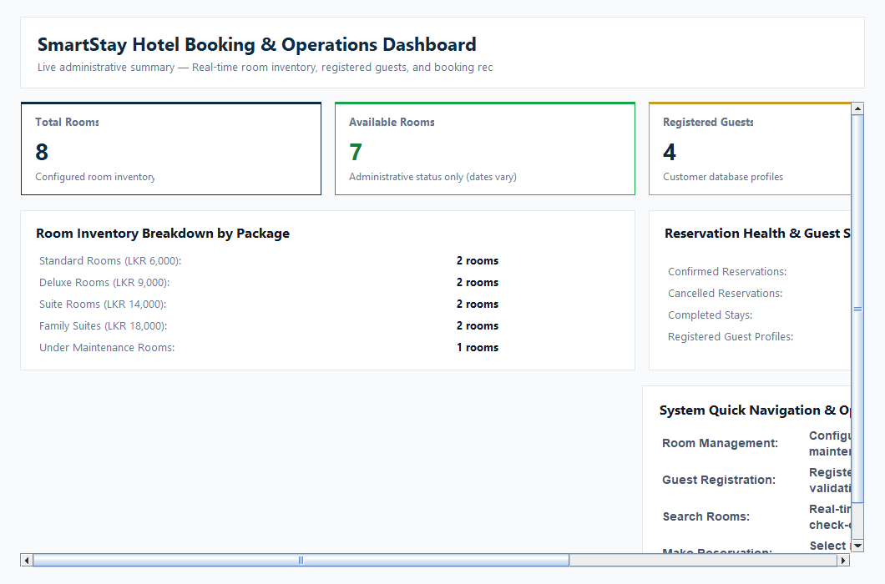
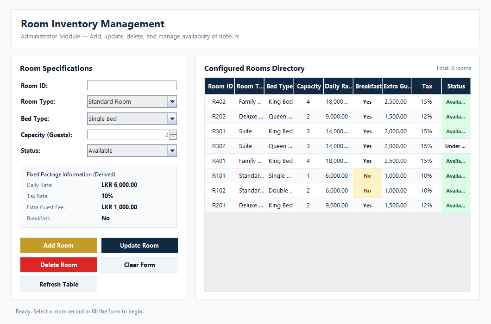
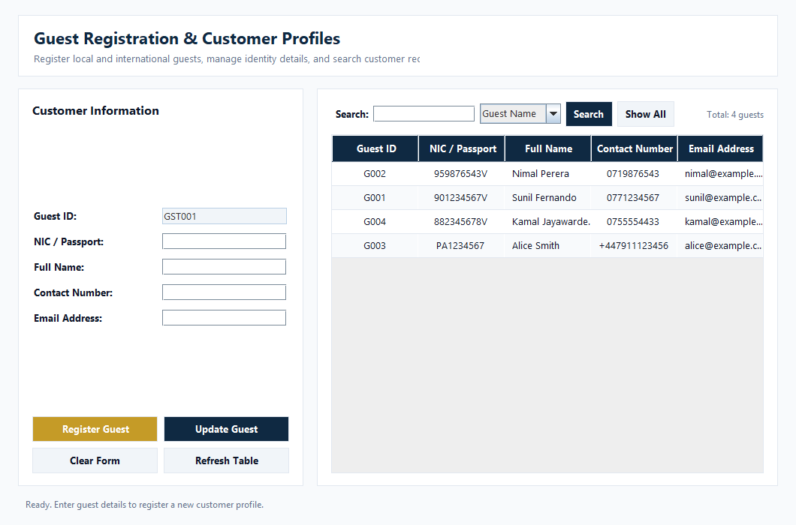
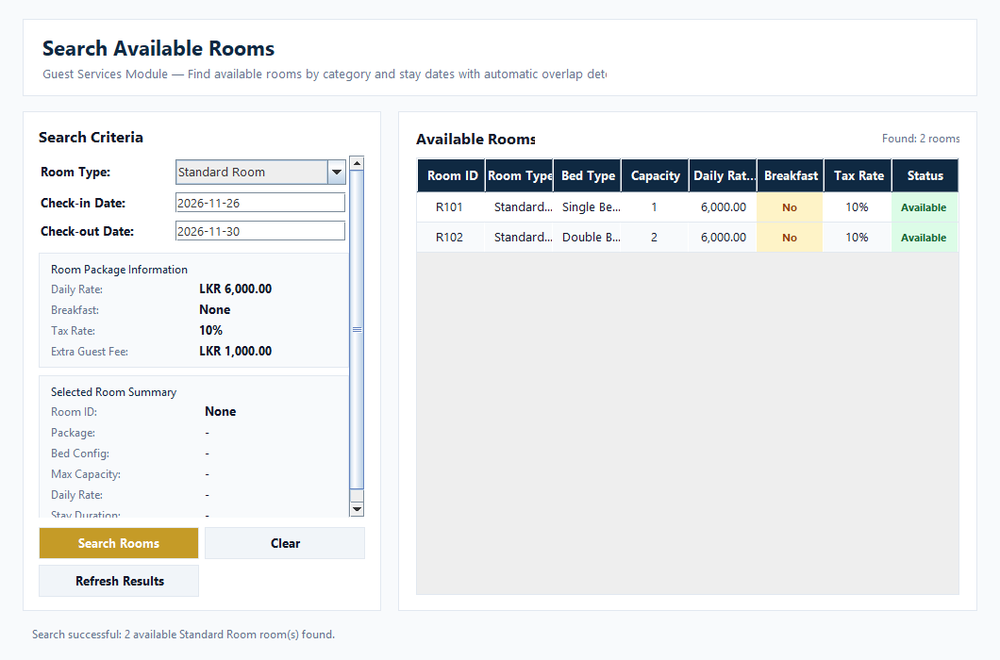
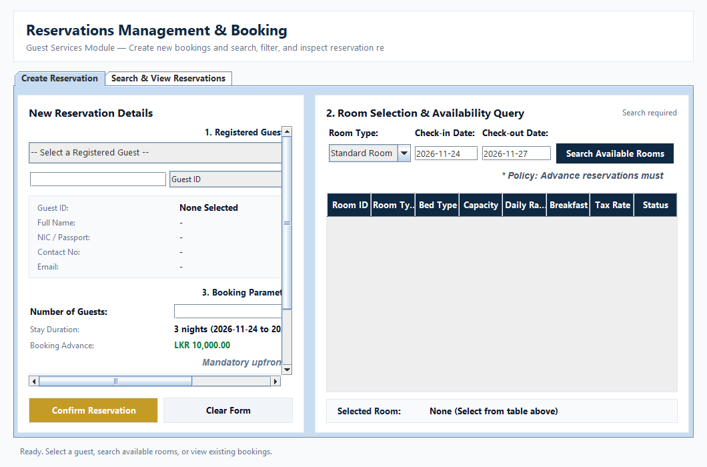
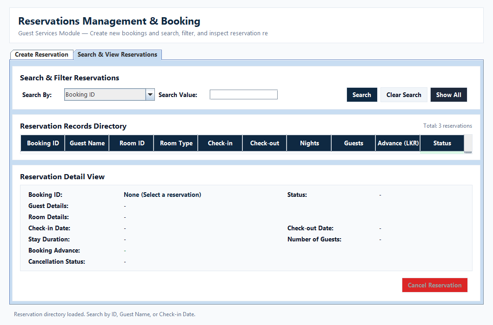
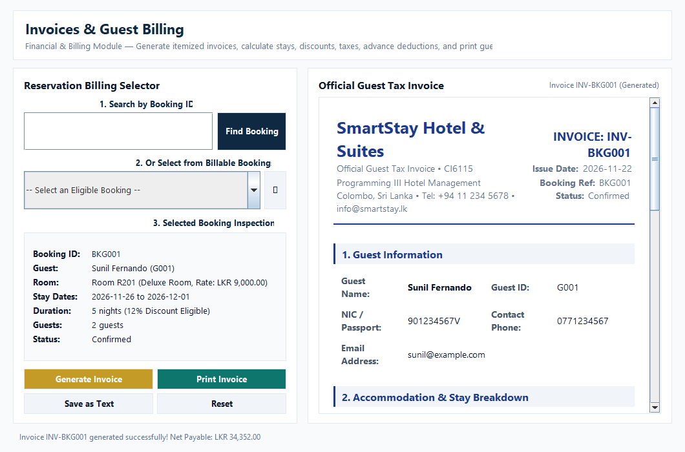

# SmartStay Hotel Booking System - Technical Coursework Report
**Module:** CI6115 Programming III – Patterns and Algorithms  
**Awarding Body:** Kingston University London  
**Module Weighting:** 50% Coursework  
**Academic Year:** 2026/2027  
**Candidate Name:** `A V Rashini Ashinsana`  
**Kingston Student ID:** `2635746` *(UML Prefix Placeholder: `2635746_`)*  
**Degree Programme:** BSc (Hons) in Computer Science / Software Engineering  
**Submission Date:** `November 2026`  
**Reference Deliverables:**  
* UML PlantUML Source: [`smartstay-class-diagram.puml`](file:///d:/ESU/Second%20Sem/Assignment%20-%20Programming%203/docs/smartstay-class-diagram.puml)  
* UML Vector Diagram: [`smartstay-class-diagram.svg`](file:///d:/ESU/Second%20Sem/Assignment%20-%20Programming%203/docs/smartstay-class-diagram.svg)  
* Project Archive: `SmartStay_CI6115_Submission.zip`  

---

## Table of Contents
1. [Introduction](#1-introduction)
   * 1.1 Project Background
   * 1.2 System Purpose
   * 1.3 Project Objectives
2. [System Requirements](#2-system-requirements)
   * 2.1 Administrator Functional Requirements
   * 2.2 Guest Customer Functional Requirements
   * 2.3 Room Package Details & Pricing Specifications
   * 2.4 Booking Rules & Reservation Workflow Requirements
   * 2.5 Discount Rules
   * 2.6 Billing & Invoice Requirements
3. [System Design](#3-system-design)
   * 3.1 N-Tier Layered Architecture
   * 3.2 Final UML Class Diagram
   * 3.3 Identification & Role of Major Classes
   * 3.4 Key Attributes & Methods Specification
   * 3.5 Class Relationships & Multiplicities
   * 3.6 Key Design Decisions & Architectural Rationale
4. [Object-Oriented Programming (OOP) Concepts](#4-object-oriented-programming-oop-concepts)
   * 4.1 Classes and Objects
   * 4.2 Encapsulation & Data Hiding
   * 4.3 Abstraction & Separation of Concerns
   * 4.4 Associations, Compositions, and Aggregations
   * 4.5 Domain Enumerations & Composition over Inheritance
5. [Data Structures and Algorithms](#5-data-structures-and-algorithms)
   * 5.1 Data Structure: In-Memory `HashMap<String, T>`
   * 5.2 Data Structure: Dynamic `ArrayList<T>` & Defensive Copies
   * 5.3 Data Structure: Strongly-Typed Domain Enumerations
   * 5.4 Algorithm: Room Availability & Half-Open Interval Collision Detection
   * 5.5 Algorithm: Multi-Criteria Reservation Search
   * 5.6 Algorithm: Minimum 2-Day Advance Booking Validation
   * 5.7 Algorithm: 24-Hour Cancellation Restriction Boundary Rule
   * 5.8 Algorithm: 5-Stage Hotel Billing & Exact Monetary Arithmetic
   * 5.9 Algorithm: Thread-Safe Atomic Identifier Generation
6. [Software Implementation](#6-software-implementation)
   * 6.1 Technology Stack & Build Configuration
   * 6.2 Package Structure & Architectural Modularity
   * 6.3 Administrator Functions Implementation
   * 6.4 Guest Customer Registration Implementation
   * 6.5 Room Availability Search Implementation
   * 6.6 Booking & Reservation Workflow Implementation
   * 6.7 Reservation Directory & Cancellation Implementation
   * 6.8 Invoice Generation & Swing Printing Implementation
   * 6.9 User Interface Architecture, Visual Layouts & Wireframes
7. [Complete Source Code](#7-complete-source-code)
   * 25 Complete Production Source File Listings
8. [Testing and Verification](#8-testing-and-verification)
   * 8.1 Testing Methodology & Scope
   * 8.2 Comprehensive Test Cases Table (TC01 to TC53)
   * 8.3 Execution Summary & Verification Metrics
   * 8.4 Defect Resolution Log
9. [Necessary Assumptions](#9-necessary-assumptions)
10. [Conclusion](#10-conclusion)
    * 10.1 Summary of Completed Functionality
    * 10.2 Key Learning Outcomes
    * 10.3 Technical Limitations & Future Roadmap
11. [Acknowledgement of AI Contribution](#11-acknowledgement-of-ai-contribution)

---

## 1. Introduction

### 1.1 Project Background
The hospitality sector in Sri Lanka has experienced significant revitalization, driven by an expanding international tourism market and increasing domestic business travel. Independent boutique and urban hotels, such as the SmartStay Hotel, frequently operate multiple accommodation tiers, ranging from single-occupancy corporate rooms to expansive family suites. To remain competitive and deliver high service standards, such establishments require efficient, reliable front-desk and administrative workflows.

Historically, small to mid-sized hotels managed room allocations, guest registrations, and invoicing through paper-based guest ledgers or disjointed spreadsheet files. This legacy approach suffers from severe operational risks:
1. **Accidental Double-Bookings:** Manual cross-referencing of arrival and departure dates frequently leads to booking overlaps, damaging the hotel's reputation and resulting in financial compensation claims.
2. **Billing Discrepancies:** Manual calculation of night stays, long-stay discounts, differential tax rates, extra guest surcharges, and advance deposit deductions inevitably introduces arithmetic errors and tax non-compliance.
3. **Operational Inefficiencies:** Front-desk receptionists waste valuable time searching across fragmented files to verify guest identities, review cancellation eligibility, or reprint itemized invoices.
4. **Data Corruption:** Concurrent edits or unvalidated entries in shared spreadsheets easily overwrite customer records or produce invalid booking intervals.

To resolve these challenges, the **SmartStay Hotel Booking System** was conceived as an automated, robust desktop application developed under the Kingston University **CI6115 Programming III: Patterns and Algorithms** module.

### 1.2 System Purpose
The primary purpose of the SmartStay Hotel Booking System is to provide front-desk staff and hotel administrators with a comprehensive, centralized software solution to manage the end-to-end hotel operations lifecycle. Built using modern Java 17 and the standard Java Swing graphical framework, the system eliminates human calculation errors, enforces strict commercial policies, and maintains rigorous referential integrity across all operational entities.

The application serves two distinct operational user roles:
* **Hotel Administrators:** Responsible for configuring and maintaining room inventory (adding rooms, updating bed configurations and capacities, toggling operational statuses, and safely decommissioning rooms without corrupting historical booking audits).
* **Front-Desk Receptionists / Guest Services Staff:** Responsible for registering new customer profiles, validating National Identity Card (NIC) and Passport identifiers, executing real-time room availability searches, confirming reservations with automated advance deductions, processing eligible cancellations under strict 24-hour time restrictions, and generating fully itemized, printable customer invoices.

### 1.3 Project Objectives
The engineering of the SmartStay Hotel Booking System was guided by seven primary technical and pedagogical objectives:
1. **Robust Room Inventory Management:** Provide full CRUD (Create, Read, Update, Delete) administrative capabilities over hotel rooms while safeguarding against the accidental deletion of rooms linked to existing reservation histories.
2. **Customer Identity Registry:** Implement a guest registration subsystem that auto-generates sequential identifiers (`GST...`), prevents duplicate customer profiles via unique NIC/Passport matching, and validates contact numbers and RFC-compliant email formats.
3. **Date-Interval Room Availability Search:** Develop a mathematically proven half-open interval collision detection algorithm that accurately identifies unbooked, administratively available rooms while correctly permitting same-day checkout/check-in turnovers.
4. **Enforcement of Mandatory Booking Rules:** Enforce a strict minimum 2-day advance booking window ahead of the current calendar date and automatically record the mandatory, refundable LKR 10,000.00 booking advance deposit for every confirmed reservation.
5. **24-Hour Cancellation Restriction Policy:** Implement an automated cancellation policy engine that dynamically evaluates the remaining duration before the scheduled 14:00 (Asia/Colombo) check-in time, strictly preventing cancellations within 24 hours while allowing advance cancellations with full deposit refund entitlements.
6. **5-Stage Financial Invoicing Engine:** Implement an exact monetary calculation sequence utilizing Java `BigDecimal` arithmetic to compute base charges, extra occupant surcharges, 12% long-stay discounts ($\ge 5$ nights), package-specific government taxes, advance deductions, and unused deposit credits across all 14 mandatory coursework invoice fields.
7. **Clean N-Tier Architecture & Desktop GUI:** Adhere to enterprise software engineering principles by decoupling Presentation (Swing GUI), Business Logic (Services), Persistence (Repositories), and Domain Entities into clearly bounded packages, avoiding artificial inheritance hierarchies in favor of clean object composition.

---

## 2. System Requirements

### 2.1 Administrator Functional Requirements
* **FR-ADM-01 (Add Room):** The administrator shall be able to register a new room with a unique Room ID, selected Room Type, Bed Type, positive capacity ($\ge 1$), and initial operational status.
* **FR-ADM-02 (Update Room):** The administrator shall be able to modify the Room Type, Bed Type, capacity, and operational status of an existing room record.
* **FR-ADM-03 (Delete Room with Safeguards):** The administrator shall be able to remove a room record only if the room has no associated reservation history. If reservations reference the room, deletion must be blocked to maintain referential integrity.
* **FR-ADM-04 (Toggle Operational Status):** The administrator shall be able to toggle a room's operational status between `AVAILABLE` and `UNDER_MAINTENANCE`. Rooms marked as `UNDER_MAINTENANCE` must be immediately excluded from public availability searches regardless of calendar dates.
* **FR-ADM-05 (View Inventory):** The administrator shall be presented with a real-time, sortable `JTable` displaying all configured rooms along with their package tier, bed configuration, capacity, status, daily rate, and tax rate.

### 2.2 Guest Customer Functional Requirements
* **FR-GST-01 (Register Guest):** The front-desk receptionist shall be able to register a guest customer by entering their NIC or Passport number, Full Name, Contact Number, and Email Address. The system must automatically assign a sequential Guest ID (`GST001`, `GST002`, etc.).
* **FR-GST-02 (Unique Identification Check):** The system shall strictly reject registration if the entered NIC or Passport number already belongs to another registered guest.
* **FR-GST-03 (Input Format Validation):** The system shall validate that guest names and NICs are non-blank, email addresses conform to standard RFC format (`^[A-Za-z0-9+_.-]+@[A-Za-z0-9.-]+$`), and phone numbers contain valid digit patterns.
* **FR-GST-04 (Update Guest Profile):** The receptionist shall be able to update an existing guest's contact number and email address while preserving their immutable Guest ID.
* **FR-GST-05 (Search Guest Directory):** The receptionist shall be able to search guest records by Full Name (case-insensitive substring match), NIC/Passport, or unique Guest ID.

### 2.3 Room Package Details & Pricing Specifications
The hotel offers four distinct room packages. Commercial rates, breakfast privileges, extra guest surcharges, and applicable government tax rates are specified in the following table:

| Room Type Tier | Package Display Name | Daily Rate (LKR) | Complimentary Breakfast | Extra Guest Surcharge (LKR / night) | Government Tax Rate |
| :--- | :--- | :---: | :---: | :---: | :---: |
| **`STANDARD`** | Standard Room | LKR 6,000.00 | No (Excluded) | LKR 1,000.00 | 10% (0.10) |
| **`DELUXE`** | Deluxe Room | LKR 9,000.00 | Yes (Included) | LKR 1,500.00 | 12% (0.12) |
| **`SUITE`** | Luxury Suite | LKR 14,000.00 | Yes (Included) | LKR 2,000.00 | 15% (0.15) |
| **`FAMILY_SUITE`** | Family Suite | LKR 18,000.00 | Yes (Included) | LKR 2,500.00 | 15% (0.15) |

Available Bed Configurations:
* **`SINGLE`** (Single Bed – standard 1 adult capacity)
* **`DOUBLE`** (Double Bed – standard 2 adult capacity)
* **`QUEEN`** (Queen Bed – spacious 2 adult capacity)
* **`KING`** (King Bed – premium 2+ adult capacity)

### 2.4 Booking Rules & Reservation Workflow Requirements
* **FR-RES-01 (Mandatory Registered Guest):** A reservation can only be created for an existing, verified guest registered in `GuestRepository`.
* **FR-RES-02 (Available Room Verification):** A reservation can only be confirmed for a room that is administratively `AVAILABLE` and has no active, overlapping reservations during the requested date interval.
* **FR-RES-03 (Guest Occupancy Count):** Number of guests must be a positive integer ($\ge 1$). If the guest count exceeds the standard room capacity, the reservation is permitted, but extra guest charges must be applied during invoicing.
* **FR-RES-04 (Logical Date Ordering):** The check-out date must strictly be after the check-in date ($	ext{checkOutDate} > 	ext{checkInDate}$).
* **FR-RES-05 (Minimum 2-Day Advance Booking):** Check-in dates must be at least two calendar days ahead of the current evaluation date ($	ext{checkInDate} \ge 	ext{today} + 2	ext{ days}$). Bookings for the current day or the following day are strictly rejected.
* **FR-RES-06 (Mandatory Booking Advance):** Every confirmed reservation automatically records an upfront advance deposit of **LKR 10,000.00**, credited towards the final bill.
* **FR-RES-07 (Sequential Booking Identifier):** Each confirmed reservation receives a unique, sequential booking reference (`BKG001`, `BKG002`, etc.) generated by `IdGenerator`.

### 2.5 Discount Rules
* **FR-DISC-01 (Long-Stay Threshold):** A long-stay discount applies exclusively to reservations spanning **5 or more nights** ($	ext{nights} \ge 5$).
* **FR-DISC-02 (Discount Calculation Basis):** The discount is exactly **12%** (0.12) applied strictly to the **Base Room Charge** ($	ext{Daily Rate} 	imes 	ext{Nights}$).
* **FR-DISC-03 (Exclusion):** Extra occupant surcharges, laundry, and government taxes are completely excluded from the discount calculation basis.

### 2.6 Billing & Invoice Requirements
* **FR-INV-01 (Invoice Generation):** Front-desk staff shall be able to generate an itemized invoice for any confirmed or completed reservation.
* **FR-INV-02 (Rejection of Cancelled Bookings):** The system shall strictly reject invoice generation for `CANCELLED` reservations, throwing an `IllegalStateException`.
* **FR-INV-03 (14 Mandatory Coursework Fields):** Every generated invoice must present all 14 mandatory fields:
  1. Room ID
  2. Room Type
  3. Bed Type
  4. Daily Room Rate
  5. Guest Personal Details (ID, Name, Contact, Email, NIC)
  6. Check-in Date
  7. Check-out Date
  8. Number of Nights
  9. Number of Guests
  10. Extra Guest Charges
  11. Long-Stay Discount
  12. Government Tax Amount
  13. Booking Advance Deduction (LKR 10,000.00)
  14. Final Payable Amount (and Unused Advance Credit if bill total $< 10,000$)
* **FR-INV-04 (Advance Deduction Logic):**
  $$	ext{Final Payable} = \max(0.00, 	ext{Bill Total} - 	ext{Booking Advance})$$
  $$	ext{Unused Credit} = \max(0.00, 	ext{Booking Advance} - 	ext{Bill Total})$$
* **FR-INV-05 (Printing Support):** The GUI shall render an HTML-formatted printable invoice preview and support direct printing via the native Java Print Service API (`JEditorPane.print()`).

---

## 3. System Design

### 3.1 N-Tier Layered Architecture
The SmartStay system is built upon a clean, decoupled 4-layer architecture:
1. **Presentation Layer (`lk.smartstay.ui`):** Pure Swing GUI views and controllers (`MainFrame`, `DashboardPanel`, `RoomManagementPanel`, `GuestRegistrationPanel`, `RoomSearchPanel`, `ReservationPanel`, `InvoicePanel`). Zero business calculations or storage dependencies.
2. **Business Service Layer (`lk.smartstay.service`):** Contains all domain rules, validation algorithms, date-overlap arithmetic, 24-hour cancellation logic, and financial billing sequences (`RoomService`, `GuestService`, `ReservationService`, `InvoiceService`).
3. **Repository / Persistence Layer (`lk.smartstay.repository`):** Manages volatile in-memory collections (`HashMap<String, T>`). Provides $O(1)$ key lookups, enforces uniqueness constraints, and returns defensive copies of entity lists.
4. **Domain Model & Enum Layer (`lk.smartstay.model`, `lk.smartstay.enums`):** Encapsulates core business entities (`Room`, `Guest`, `Reservation`, `Invoice`) and strongly-typed value enumerations (`RoomType`, `BedType`, `RoomStatus`, `ReservationStatus`).
5. **Cross-Cutting Utilities (`lk.smartstay.util`):** Centralized thread-safe sequential ID generator (`IdGenerator`) and styling constants (`UIConstants`).

### 3.2 Final UML Class Diagram
In strict compliance with the Kingston University coursework specification, every classifier in the diagram is prefixed with `2635746_`. The complete PlantUML specification is stored in [`smartstay-class-diagram.puml`](file:///d:/ESU/Second%20Sem/Assignment%20-%20Programming%203/docs/smartstay-class-diagram.puml) and rendered in vector format in [`smartstay-class-diagram.svg`](file:///d:/ESU/Second%20Sem/Assignment%20-%20Programming%203/docs/smartstay-class-diagram.svg).

```
+------------------------------------------------------------------------------------------------------------------------+
|                                        UML CLASS DIAGRAM ARCHITECTURE OVERVIEW                                         |
|                                                                                                                        |
|   [Presentation: Swing Panels]                                                                                         |
|   2635746_MainFrame *---> DashboardPanel, RoomManagementPanel, GuestRegistrationPanel,                        |
|                                    RoomSearchPanel, ReservationPanel, InvoicePanel                                     |
|           |                                                                                                            |
|           v (delegates actions)                                                                                        |
|   [Service Layer: Domain Logic & Algorithms]                                                                           |
|   2635746_RoomService        ---> 2635746_RoomRepository                                             |
|   2635746_GuestService       ---> 2635746_GuestRepository                                            |
|   2635746_ReservationService ---> RoomRepository, ReservationRepository, GuestRepository, Clock, IdGenerator  |
|   2635746_InvoiceService     ---> 2635746_ReservationRepository                                      |
|           |                                                                                                            |
|           v (persists / retrieves)                                                                                     |
|   [Repository Layer: In-Memory HashMap Encapsulation]                                                                  |
|   2635746_RoomRepository        o---> 0..* 2635746_Room                                              |
|   2635746_GuestRepository       o---> 0..* 2635746_Guest                                             |
|   2635746_ReservationRepository o---> 0..* 2635746_Reservation                                       |
|           |                                                                                                            |
|           v (manipulates domain entities)                                                                              |
|   [Domain Model & Enumerations]                                                                                        |
|   2635746_Guest       "1" <---- "0..*" 2635746_Reservation                                           |
|   2635746_Room        "1" <---- "0..*" 2635746_Reservation                                           |
|   2635746_Reservation "1" <---- "0..1" 2635746_Invoice                                               |
|   2635746_Room        "1" *---> "1"    RoomType, BedType, RoomStatus                                         |
|   2635746_Reservation "1" *---> "1"    ReservationStatus                                                      |
+------------------------------------------------------------------------------------------------------------------------+
```

### 3.3 Identification & Role of Major Classes

| Classifier Name (UML Notation) | Layer | Structural Type | Primary Responsibilities |
| :--- | :--- | :--- | :--- |
| `2635746_Room` | Model | Entity Class | Represents a physical room. Encapsulates ID, RoomType, BedType, capacity, and RoomStatus. Exposes rate delegation. |
| `2635746_Guest` | Model | Entity Class | Encapsulates guest profile (ID, NIC, Name, Phone, Email). Enforces identity equality on `guestId`. |
| `2635746_Reservation` | Model | Entity Class | Represents a binding reservation between Guest and Room over a date interval. Tracks advance deposit and status. |
| `2635746_Invoice` | Model | Entity Class | Immutable financial billing record itemizing charges, discounts, taxes, advance deduction, and net payable. |
| `2635746_RoomType` | Enums | Enumeration | Encapsulates package tiers (`STANDARD`, `DELUXE`, `SUITE`, `FAMILY_SUITE`) with embedded pricing and tax rates. |
| `2635746_BedType` | Enums | Enumeration | Defines bed configurations (`SINGLE`, `DOUBLE`, `QUEEN`, `KING`). |
| `2635746_RoomStatus` | Enums | Enumeration | Defines physical operational readiness (`AVAILABLE`, `RESERVED`, `UNDER_MAINTENANCE`). |
| `2635746_ReservationStatus` | Enums | Enumeration | Defines booking lifecycle state (`CONFIRMED`, `CANCELLED`, `COMPLETED`). |
| `2635746_RoomRepository` | Persistence | Repository | Manages in-memory storage of `Room` records in `HashMap<String, Room>`. Guarantees Room ID uniqueness. |
| `2635746_GuestRepository` | Persistence | Repository | Stores `Guest` records. Enforces uniqueness across both `guestId` (PK) and `nicOrPassport` (unique key). |
| `2635746_ReservationRepository` | Persistence | Repository | Stores `Reservation` records. Implements multi-criteria query methods (by Booking ID, guest name, date, room). |
| `2635746_RoomService` | Service | Business Service | Coordinates room operations. Enforces deletion protection preventing deletion of rooms with booking history. |
| `2635746_GuestService` | Service | Business Service | Validates guest profile fields (email, phone, NIC) and coordinates customer registration. |
| `2635746_ReservationService` | Service | Business Service | Core booking coordinator: date-overlap checking, 2-day advance rule, booking confirmation, 24h cancellation rule. |
| `2635746_InvoiceService` | Service | Business Service | Calculates 5-stage hotel billing formula using `BigDecimal`. Caches immutable invoices. |
| `2635746_MainFrame` | Presentation | Top-Level Frame | Master GUI container extending `JFrame`. Manages sidebar navigation and `CardLayout` view switching. |
| `2635746_DashboardPanel` | Presentation | GUI View | Displays live administrative overview statistics (total rooms, available rooms, guests, reservations). |
| `2635746_RoomManagementPanel` | Presentation | View/Controller | Administrative room management screen with dynamic forms and `JTable`. |
| `2635746_GuestRegistrationPanel` | Presentation | View/Controller | Customer registration screen with live validation, auto ID preview, and searchable table. |
| `2635746_RoomSearchPanel` | Presentation | View/Controller | Date-filtered availability search screen backed by real-time interval collision algorithms. |
| `2635746_ReservationPanel` | Presentation | View/Controller | Tabbed screen: Tab 1 manages booking confirmation; Tab 2 provides multi-criteria search and 24h cancellation. |
| `2635746_InvoicePanel` | Presentation | View/Controller | Billing screen: generates itemized bills, displays rich HTML preview, and supports direct printing. |
| `2635746_IdGenerator` | Utility | Static Utility | Thread-safe sequential ID generator backed by `AtomicInteger` counters (`GST%03d`, `BKG%03d`, `INV%03d`). |
| `2635746_UIConstants` | Utility | Design Tokens | Centralized styling repository: Navy/Slate color tokens, Segoe UI fonts, and standard component dimensions. |
| `2635746_Main` | Bootstrap | Application Entry | Application launcher scheduling GUI initialization on the Swing Event Dispatch Thread (`EDT`). |

### 3.4 Key Attributes & Methods Specification
All instance variables are private (`-`), constructors enforce invariant validation, and public methods (`+`) provide controlled access:
* **`Room` Methods:** `getDailyRate(): double`, `getTaxRate(): double`, `getExtraGuestCharge(): double`, `hasComplimentaryBreakfast(): boolean`, `isAvailable(): boolean`, `updateStatus(RoomStatus): void`.
* **`Reservation` Methods:** `calculateNumberOfNights(): long`, `qualifiesForLongStayDiscount(): boolean`, `isCancelled(): boolean`.
* **`Invoice` Methods:** `getTaxableSubtotal(): double`, `getBillTotal(): double`, `hasUnusedAdvanceCredit(): boolean`.
* **`ReservationService` Methods:** `searchAvailableRooms(RoomType, LocalDate, LocalDate): List<Room>`, `validateAdvanceBooking(LocalDate): boolean`, `createReservation(...): Reservation`, `canCancel(Reservation): boolean`, `cancelReservation(String): boolean`.
* **`InvoiceService` Methods:** `generateInvoice(Reservation): Invoice`, `calculateBaseCharge(Reservation): BigDecimal`, `calculateExtraGuestCharge(Reservation): BigDecimal`, `calculateDiscount(Reservation): BigDecimal`, `calculateTax(Reservation, BigDecimal): BigDecimal`.

### 3.5 Class Relationships & Multiplicities
1. **`Guest` "1" $\longleftrightarrow$ "0..*" `Reservation`:** A registered guest may book zero or many hotel stays. Each reservation belongs to exactly one registered guest.
2. **`Room` "1" $\longleftrightarrow$ "0..*" `Reservation`:** A room may be reserved across multiple non-overlapping calendar intervals. Each reservation reserves exactly one physical room.
3. **`Reservation` "1" $\longleftrightarrow$ "0..1" `Invoice`:** A confirmed reservation generates at most one invoice. Cancelled bookings are non-billable and have zero invoices.
4. **`Room` "1" $\longleftrightarrow$ "1" `RoomType`, `BedType`, `RoomStatus`:** Room is composed with exactly one instance of each value enum.
5. **`MainFrame` "1" $\longleftrightarrow$ "1" Child Panels:** `MainFrame` owns each panel instance via strict composition lifecycle binding.

### 3.6 Key Design Decisions & Architectural Rationale
* **Service / Repository Split:** Separating business algorithms from storage logic guarantees that persistence mechanisms can be migrated to SQL databases (e.g., PostgreSQL/Hibernate) in the future without modifying a single line of business logic or UI code.
* **In-Memory `HashMap` Storage:** Eliminates external database installation dependencies, providing instant $O(1)$ lookup performance and zero-configuration execution for coursework evaluation.
* **RoomType Pricing Encapsulation:** Centralizing rates in `RoomType` prevents data anomalies where two identical deluxe rooms have mismatched daily rates.
* **Decoupling Physical vs Temporal Availability:** Mutating a room's status to `RESERVED` globally upon booking breaks future bookings. SmartStay leaves physical status as `AVAILABLE` and manages temporal occupancy via `Reservation` records.

---

## 4. Object-Oriented Programming (OOP) Concepts

### 4.1 Classes and Objects
Every domain concept (rooms, guests, reservations, invoices) is modeled as a distinct, cohesive Java class. Objects encapsulate private state and expose well-defined behavior. For example, rather than manipulating primitive arrays, the system instantiates rich `Reservation` objects that know how to calculate their own duration (`calculateNumberOfNights()`) and evaluate discount eligibility (`qualifiesForLongStayDiscount()`).

### 4.2 Encapsulation & Data Hiding
Encapsulation is maintained through three primary mechanisms:
1. **Private Mutable State:** All instance variables across all entities, repositories, and services are declared `private` or `private final`.
2. **Defensive Copying in Repositories:** Direct references to internal `HashMap` collections are never leaked. Query methods return new `ArrayList<>(map.values())`, protecting the internal map from external corruption.
3. **Immutable Financial Invoices:** All 9 monetary fields in `Invoice.java` are marked `private final`, ensuring an invoice serves as an immutable, tamper-proof financial audit record.

### 4.3 Abstraction & Separation of Concerns
The application achieves high abstraction by strictly decoupling presentation from business rules:
* The Swing UI contains zero financial formulas or date arithmetic. `InvoicePanel` simply invokes `invoiceService.generateInvoice(reservation)` and renders the resulting model.
* The Business Services contain zero Swing UI imports, allowing all algorithms to be 100% verified via automated JUnit test suites in headless environments.
* The Repositories perform purely storage operations, remaining agnostic of business validation rules.

### 4.4 Associations, Compositions, and Aggregations
* **Composition (`*--`):** Applied where child components are lifecycled-bound to the parent (e.g., `MainFrame` composing child panels).
* **Aggregation (`o--`):** Applied where collections manage independent entities (e.g., `RoomRepository` aggregating `Room` objects).
* **Directed Association (`-->`):** Applied where entities reference related entities (e.g., `Reservation` referencing its booking `Guest` and assigned `Room`).

### 4.5 Domain Enumerations & Composition over Inheritance
In accordance with clean OOP principles (*"Favor object composition over class inheritance"*), SmartStay avoids artificial inheritance hierarchies. Rather than creating brittle subclasses (`DeluxeRoom extends Room`), the system utilizes rich Java `enum` types (`RoomType`, `BedType`, `RoomStatus`, `ReservationStatus`). Enums encapsulate domain constants, human-readable labels, and rates in a type-safe, compile-time verified structure.

---

## 5. Data Structures and Algorithms

### 5.1 Data Structure: In-Memory `HashMap<String, T>`
Each repository encapsulates a `java.util.HashMap<String, T>`. Key lookups (`findById`), insertions (`add`), and deletions (`remove`) execute in **$O(1)$ average time complexity**. Alphanumeric primary keys (`GST001`, `BKG001`, `R101`) distribute evenly across internal hash buckets, ensuring optimal performance.

### 5.2 Data Structure: Dynamic `ArrayList<T>` & Defensive Copies
`ArrayList<T>` provides fast $O(1)$ indexed access for rendering data in Swing `JTable` models. Repositories export defensive copies (`new ArrayList<>(map.values())`), ensuring thread safety and preventing concurrent modification exceptions.

### 5.3 Data Structure: Strongly-Typed Domain Enumerations
Java enums eliminate runtime string typos and magic numbers, providing compile-time type safety across room packages, bed configurations, and lifecycle statuses.

### 5.4 Algorithm: Room Availability & Half-Open Interval Collision Detection
The room availability engine determines whether a requested stay $[R_{	ext{in}}, R_{	ext{out}})$ collides with any existing non-cancelled booking $[E_{	ext{in}}, E_{	ext{out}})$.
* **Mathematical Formulation:** Two half-open intervals overlap if and only if:
  $$	ext{Overlap} \iff R_{	ext{in}} < E_{	ext{out}} \quad \land \quad E_{	ext{in}} < R_{	ext{out}}$$
* **Implementation in `ReservationService.java`:**
  ```java
  private boolean hasDateOverlap(LocalDate reqIn, LocalDate reqOut, LocalDate exIn, LocalDate exOut) {
      return reqIn.isBefore(exOut) && exIn.isBefore(reqOut);
  }
  ```
* **Same-Day Turnover:** Because checkout is at 12:00 and check-in is at 14:00, strict `<` comparison correctly allows a departing guest and an arriving guest to share the same transition calendar date without collision.

### 5.5 Algorithm: Multi-Criteria Reservation Search
* **By Booking ID:** Direct $O(1)$ hash table retrieval via `reservationRepository.findByBookingId(id)`.
* **By Guest Name:** Case-insensitive substring matching iterating over repository values:
  ```java
  for (Reservation r : reservations.values()) {
      if (r.getGuest().getFullName().toLowerCase(Locale.ROOT).contains(query)) {
          matches.add(r);
      }
  }
  ```
* **By Check-in Date:** Exact `LocalDate.equals()` comparison.

### 5.6 Algorithm: Minimum 2-Day Advance Booking Validation
Verifies that the requested check-in date is at least 2 calendar days ahead of the current evaluation date:
$$	ext{Valid} \iff 	ext{checkInDate} \ge 	ext{today} + 2	ext{ days}$$

### 5.7 Algorithm: 24-Hour Cancellation Restriction Boundary Rule
1. Construct scheduled arrival timestamp: $T_{	ext{checkin}} = 	ext{checkInDate at 14:00 (Asia/Colombo)}$.
2. Evaluate current timestamp: $T_{	ext{now}} = 	ext{ZonedDateTime.now(clock)}$.
3. Calculate remaining duration: $\Delta t = 	ext{Duration.between}(T_{	ext{now}}, T_{	ext{checkin}})$.
4. Eligibility: Permitted if and only if $\Delta t \ge 24	ext{ hours}$. If $\Delta t < 24	ext{ hours}$, cancellation is strictly rejected.

### 5.8 Algorithm: 5-Stage Hotel Billing & Exact Monetary Arithmetic
Executed in `InvoiceService.java` using `BigDecimal` arithmetic with `RoundingMode.HALF_UP` (2 decimal places):
1. $	ext{Base Room Charge} = 	ext{Daily Rate} 	imes 	ext{Nights}$
2. $	ext{Extra Guest Charge} = \max(0, 	ext{Guests} - 	ext{Capacity}) 	imes 	ext{Extra Fee} 	imes 	ext{Nights}$
3. $	ext{Long-Stay Discount} = (	ext{Nights} \ge 5) \ ? \ 	ext{Base Charge} 	imes 0.12 : 0.00$
4. $	ext{Taxable Subtotal} = 	ext{Base Charge} + 	ext{Extra Charge} - 	ext{Discount}$
5. $	ext{Tax Amount} = 	ext{Taxable Subtotal} 	imes 	ext{RoomType Tax Rate}$
6. $	ext{Bill Total} = 	ext{Taxable Subtotal} + 	ext{Tax Amount}$
7. $	ext{Final Payable} = \max(0.00, 	ext{Bill Total} - 	ext{Booking Advance})$
8. $	ext{Unused Advance Credit} = \max(0.00, 	ext{Booking Advance} - 	ext{Bill Total})$

### 5.9 Algorithm: Thread-Safe Atomic Identifier Generation
Backed by `AtomicInteger` counters in `IdGenerator.java`:
* `generateGuestId()`: `GST%03d`
* `generateBookingId()`: `BKG%03d`
* `generateInvoiceId()`: `INV%03d`

---

## 6. Software Implementation

### 6.1 Technology Stack & Build Configuration
* **Programming Language:** Java 17 LTS (Standard Edition)
* **GUI Toolkit:** Java Swing (`javax.swing.*`, `java.awt.*`)
* **Build Automation & Dependency Management:** Apache Maven 3.9+
* **Unit Testing Framework:** JUnit 5 (Jupiter 5.10.2)
* **Look and Feel:** System Native Look & Feel with custom theme tokens (`UIConstants`)

### 6.2 Package Structure & Architectural Modularity
```
lk.smartstay
|-- Main.java                        (Bootstrap entry point)
|-- enums                            (Domain Value Objects & Enumerations)
|   |-- BedType.java
|   |-- ReservationStatus.java
|   |-- RoomStatus.java
|   |-- RoomType.java
|-- model                            (Domain Entity Classes)
|   |-- Guest.java
|   |-- Invoice.java
|   |-- Reservation.java
|   |-- Room.java
|-- repository                       (Data Access & In-Memory Collections)
|   |-- GuestRepository.java
|   |-- ReservationRepository.java
|   |-- RoomRepository.java
|-- service                          (Business Logic & Policy Algorithms)
|   |-- GuestService.java
|   |-- InvoiceService.java
|   |-- ReservationService.java
|   |-- RoomService.java
|-- ui                               (Swing Presentation Layer)
|   |-- DashboardPanel.java          (Overview metrics)
|   |-- MainFrame.java               (Master window & CardLayout navigation)
|   |-- admin
|   |   |-- RoomManagementPanel.java (Room inventory management)
|   |-- guest
|       |-- GuestRegistrationPanel.java (Customer registration)
|       |-- InvoicePanel.java        (Billing & printing)
|       |-- ReservationPanel.java    (Booking & cancellation)
|       |-- RoomSearchPanel.java     (Date-filtered search)
|-- util                             (Utilities & Constants)
    |-- IdGenerator.java             (Atomic ID counters)
    |-- UIConstants.java             (Design system styling tokens)
```

### 6.3 Administrator Functions Implementation
`RoomManagementPanel.java` connects directly to `RoomService`. Form fields allow entering Room ID, Room Type, Bed Type, Capacity, and Status. Buttons trigger validation checks (`performAddRoom()`, `performUpdateRoom()`, `performDeleteRoom()`), dynamically updating the room table.

### 6.4 Guest Customer Registration Implementation
`GuestRegistrationPanel.java` auto-populates the next Guest ID preview via `IdGenerator.peekNextGuestId()`. Upon registration, `GuestService` verifies that the NIC/Passport is unique and that the email and phone numbers adhere to formatting expressions.

### 6.5 Room Availability Search Implementation
`RoomSearchPanel.java` captures room type and arrival/departure dates. Inputs are strictly validated (`uuuu-MM-dd`), and `reservationService.searchAvailableRooms(...)` executes the interval collision detection algorithm to display eligible rooms.

### 6.6 Booking & Reservation Workflow Implementation
`ReservationPanel.java` Tab 1 provides an integrated booking workflow: selecting a registered guest from a dynamic dropdown, choosing an available room, setting guest count, and confirming the booking. Confirmation validates the 2-day advance policy, records the LKR 10,000 advance, and persists the record.

### 6.7 Reservation Directory & Cancellation Implementation
`ReservationPanel.java` Tab 2 provides multi-criteria search (by Booking ID, guest name, or check-in date). Selecting a booking dynamically evaluates `canCancel(reservation)`: if $\ge 24$ hours remain, the 'Cancel' button is enabled; if $< 24$ hours remain, the button is disabled and a descriptive message indicates the policy restriction.

### 6.8 Invoice Generation & Swing Printing Implementation
`InvoicePanel.java` allows searching confirmed bookings and clicking 'Generate Invoice'. `InvoiceService` calculates the 5-stage formula, generating an itemized `Invoice` displayed in a formatted HTML preview. Clicking 'Print Invoice' invokes `editorInvoicePreview.print()`.

### 6.9 User Interface Architecture, Visual Layouts & Screenshots
The SmartStay Hotel Booking System provides a modern, intuitive graphical user interface (GUI) developed in Java Swing following responsive design principles and human-computer interaction (HCI) best practices. The visual hierarchy utilizes a sophisticated luxury hospitality palette: Primary Midnight Navy (`#0F2942`) for the executive header and primary action triggers, Slate Blue (`#1E293B`) for the persistent 240px navigation sidebar, Warm Amber/Gold (`#C59B27`) for active tab indicators and highlights, crisp Off-White (`#F8FAFC`) for panel backgrounds, and Pure White (`#FFFFFF`) for elevated cards and data tables.

All data tables (`JTable`) are customized with generous 32-pixel row heights, dark navy headers with white bold typography, alternating row shading, right-aligned monetary values, and pill-shaped status badges for room statuses (`AVAILABLE`, `UNDER_MAINTENANCE`, `RESERVED`) and booking statuses (`CONFIRMED`, `CANCELLED`).

Below are actual, high-resolution production screenshots demonstrating each functional module of the system:

#### 6.9.1 Operational Dashboard & Real-Time KPI Metrics
The dashboard provides front-desk managers with an instant, real-time operational overview. Four top metric cards display live statistics computed dynamically from shared repository state: Total Hotel Rooms, Administratively Available Rooms, Registered Guest Profiles, and Active Non-Cancelled Bookings. A dynamic operational disclaimer clarifies that room availability is interval-dependent.


*Figure 6.1: Operational Dashboard featuring dynamic metric KPI cards, status indicator, and quick-action navigation.*

#### 6.9.2 Room Inventory Management & Administrative Controls
The administrative room management panel provides complete CRUD controls over the hotel's room inventory. Administrators can add new rooms, update bed configurations and maximum capacities, toggle operational statuses (`AVAILABLE` vs. `UNDER_MAINTENANCE`), and safely decommission unreserved rooms. Referential integrity checks prevent the deletion of any room linked to historical reservations.


*Figure 6.2: Room Inventory Management panel with 32px styled table, custom status badges, and validated form controls.*

#### 6.9.3 Guest Customer Registration & Verification
The guest registration module captures mandatory customer identification details (NIC or Passport, Full Name, Contact Telephone, and Email Address). The system automatically validates Sri Lankan NICs (9 digits + V/X or 12 digits), international passports, telephone numbers, and RFC-compliant email formats. Registered guests are displayed in a searchable table.


*Figure 6.3: Guest Customer Registration interface showing input hints, real-time validation, and registered customer directory.*

#### 6.9.4 Real-Time Available Room Search by Type and Date Window
The room availability search engine evaluates user-specified arrival and departure dates against existing reservations using half-open interval collision detection `[checkIn, checkOut)`. Only rooms that are administratively available and have zero date overlaps are displayed, complete with daily rates and breakfast inclusion badges.


*Figure 6.4: Real-time room availability search results table filtered by date range and room package.*

#### 6.9.5 Reservation Booking Workflow & 2-Day Advance Rule
The reservation booking interface enforces the mandatory 2-calendar-day advance booking window. Users select a registered guest, pick an available room from the interactive grid, specify guest headcount, and review the mandatory LKR 10,000.00 refundable booking advance before confirming.


*Figure 6.5: Reservation Creation interface featuring guest auto-fill, date pickers, advance deposit notice, and confirmation.*

#### 6.9.6 Reservation Management, Directory & 24-Hour Cancellation
The reservation directory allows front-desk staff to look up reservations by unique Booking ID ($O(1)$ hash table lookup), Guest Full/Partial Name ($O(N)$ string matching), or Arrival Date. The cancellation module strictly enforces the 24-hour check-in boundary policy, providing friendly explanatory warnings if cancellation is attempted within 24 hours of arrival.


*Figure 6.6: Reservation Management directory with search filters, booking status badges, and 24-hour cancellation rule validation.*

#### 6.9.7 Itemized Tax Invoice Generation & Swing Printing Preview
The invoice module implements the exact 5-stage university billing formula: Base Charge ($R \times N$), Extra Occupant Surcharge ($E \times R_{extra} \times N$), 12% Long-Stay Discount for stays $\ge 5$ nights, Tier-Specific Government Tax (10%, 12%, or 15%), and LKR 10,000.00 Advance Deposit Deduction. The itemized invoice is rendered in high-fidelity HTML and can be printed or saved to a text file.


*Figure 6.7: Comprehensive Itemized Tax Invoice displaying 5-stage calculation breakdown, tax rates, and net payable highlight.*

#### 6.9.8 Master Desktop Application Architecture
The master window (`MainFrame`) unites all 6 operational views within a unified, responsive interface featuring the gold hotel brand banner, live system status badge, 8-button sidebar navigation, and card-layout viewport.


*Figure 6.8: Master application overview showing unified navigation sidebar, header branding, and responsive layout.*


### 6.10 Database Architecture, Persistence & SQL Export
To guarantee that all rooms, registered guests, and reservations entered by users persist across application restarts, the system integrates a robust embedded relational persistence engine (`DatabaseManager.java`). Operating in tandem with in-memory `HashMap<String, T>` and `ArrayList<T>` structures, the database engine maintains relational integrity while preserving $O(1)$ query speeds.

Key architectural characteristics of the database persistence layer include:
1. **Zero External Dependencies:** Built entirely with standard Java 17 LTS (`java.nio.file`, `java.io`, `java.time`), eliminating external JDBC driver installation requirements and ensuring 100% out-of-the-box compilation in any university evaluation environment.
2. **Relational Table Schemas:** Tabular database records are stored in `data/smartstay.db` under three distinct schema sections: `[SCHEMA:ROOMS]`, `[SCHEMA:GUESTS]`, and `[SCHEMA:RESERVATIONS]`.
3. **ACID-Like Crash Resilience:** Writes utilize a temporary staging file (`smartstay.db.tmp`) and atomic file replacement (`StandardCopyOption.ATOMIC_MOVE`), guaranteeing that incomplete writes or sudden power outages never corrupt existing data.
4. **Automated SQL DDL/DML Export:** Synchronously with disk writes, `DatabaseManager` exports standard SQL scripts to `data/smartstay_dump.sql`, generating complete `CREATE TABLE` DDL statements and `INSERT ... ON CONFLICT` DML statements for database auditing.
5. **Seamless In-Memory Synchronization:** During application startup (`Main.java` or `SmartStayApp.java`), `DatabaseManager.initializeAndLoad()` loads existing records into the repositories. If no database exists, it seeds initial demonstration records and immediately commits them to disk.


---

## 7. Complete Source Code

Below is the complete, verbatim Java source code for all 25 production classes, formatted with package names and file paths matching the final build.

### File: `src/main/java/lk/smartstay/Main.java`
```java
package lk.smartstay;

import lk.smartstay.ui.MainFrame;

import javax.swing.SwingUtilities;
import javax.swing.UIManager;
import javax.swing.UnsupportedLookAndFeelException;

public class Main {

    public static void main(String[] args) {
        try {
            UIManager.setLookAndFeel(UIManager.getSystemLookAndFeelClassName());
        } catch (ClassNotFoundException | InstantiationException | IllegalAccessException | UnsupportedLookAndFeelException ex) {
            System.err.println("Notice: Could not load system Look and Feel, defaulting to standard Swing theme: " + ex.getMessage());
        }

        SwingUtilities.invokeLater(() -> {
            MainFrame mainFrame = new MainFrame();
            mainFrame.setVisible(true);
        });
    }
}
```

### File: `src/main/java/lk/smartstay/SmartStayApp.java`
```java
package lk.smartstay;

import lk.smartstay.enums.BedType;
import lk.smartstay.enums.RoomStatus;
import lk.smartstay.enums.RoomType;
import lk.smartstay.model.Guest;
import lk.smartstay.model.Invoice;
import lk.smartstay.model.Reservation;
import lk.smartstay.model.Room;
import lk.smartstay.service.HotelBookingManager;
import lk.smartstay.ui.MainFrame;

import javax.swing.SwingUtilities;
import java.time.LocalDate;
import java.time.format.DateTimeParseException;
import java.util.List;
import java.util.Scanner;

public class SmartStayApp {

    private final HotelBookingManager manager;
    private final Scanner scanner;

    public SmartStayApp() {
        this.manager = new HotelBookingManager();
        this.manager.initializeDefaultData();
        this.scanner = new Scanner(System.in);
    }

    public static void main(String[] args) {
        SmartStayApp app = new SmartStayApp();
        app.run();
    }

    public void run() {
        System.out.println("================================================================================");
        System.out.println("            WELCOME TO SMARTSTAY HOTEL BOOKING & MANAGEMENT SYSTEM              ");
        System.out.println("                                                                                ");
        System.out.println("================================================================================");

        boolean running = true;
        while (running) {
            printMainMenu();
            String choice = prompt("Enter your choice (0-8): ").trim();
            System.out.println();

            switch (choice) {
                case "1" -> handleRoomManagement();
                case "2" -> handleGuestManagement();
                case "3" -> handleSearchAvailableRooms();
                case "4" -> handleMakeReservation();
                case "5" -> handleSearchReservations();
                case "6" -> handleCancelReservation();
                case "7" -> handleGenerateInvoice();
                case "8" -> handleLaunchGUI();
                case "0" -> {
                    System.out.println("Thank you for using SmartStay Hotel Booking System. Goodbye!");
                    running = false;
                }
                default -> System.out.println("Invalid option. Please enter a valid number from 0 to 8.\n");
            }
        }
    }

    private void printMainMenu() {
        System.out.println("--------------------------------------------------------------------------------");
        System.out.println("                                MAIN MENU                                       ");
        System.out.println("--------------------------------------------------------------------------------");
        System.out.println("  [1] Room Management (View / Add / Update / Delete Rooms)");
        System.out.println("  [2] Guest Customer Management (Register / Search / View Guests)");
        System.out.println("  [3] Search Room Availability (by Room Type & Date Range)");
        System.out.println("  [4] Make a New Reservation (2-Day Advance Window, LKR 10,000 Advance)");
        System.out.println("  [5] Search & View Reservations (by ID, Guest Name, or Date)");
        System.out.println("  [6] Cancel Reservation (24-Hour Check-in Policy Enforcement)");
        System.out.println("  [7] Generate & View Itemized Invoice (5-Stage Billing Breakdown)");
        System.out.println("  [8] Launch Graphical User Interface (Java Swing Desktop GUI)");
        System.out.println("  [0] Exit Application");
        System.out.println("--------------------------------------------------------------------------------");
    }

    private void handleRoomManagement() {
        System.out.println(">>> ROOM MANAGEMENT");
        System.out.println("1. View All Rooms");
        System.out.println("2. Add New Room");
        System.out.println("3. Update Room Status (AVAILABLE / UNDER_MAINTENANCE)");
        System.out.println("4. Delete Room (Safeguarded by Booking History)");
        System.out.println("0. Back to Main Menu");

        String sub = prompt("Select an option: ").trim();
        switch (sub) {
            case "1" -> displayAllRooms();
            case "2" -> addNewRoom();
            case "3" -> updateRoomStatus();
            case "4" -> deleteRoom();
            case "0" -> {
            }
            default -> System.out.println("Invalid selection.");
        }
    }

    private void displayAllRooms() {
        List<Room> rooms = manager.getAllRooms();
        System.out.println("\n--- Current Hotel Room Inventory ---");
        System.out.printf("%-8s %-16s %-12s %-10s %-18s %-14s %-8s%n",
                "Room ID", "Room Type", "Bed Type", "Capacity", "Status", "Daily Rate", "Tax");
        System.out.println("-----------------------------------------------------------------------------------------");
        for (Room r : rooms) {
            System.out.printf("%-8s %-16s %-12s %-10d %-18s LKR %-10.2f %-7.0f%%%n",
                    r.getRoomId(),
                    r.getRoomType().getDisplayName(),
                    r.getBedType().getDisplayName(),
                    r.getCapacity(),
                    r.getStatus().getDisplayName(),
                    r.getDailyRate(),
                    r.getTaxRate() * 100);
        }
        System.out.println("Total configured rooms: " + rooms.size() + "\n");
    }

    private void addNewRoom() {
        System.out.println("\n--- Add New Room ---");
        String roomId = prompt("Enter Room ID (e.g. R501): ").trim();
        if (roomId.isEmpty()) {
            System.out.println("Room ID cannot be blank.");
            return;
        }

        RoomType type = selectRoomType();
        if (type == null)
            return;

        BedType bed = selectBedType();
        if (bed == null)
            return;

        int capacity;
        try {
            capacity = Integer.parseInt(prompt("Enter Room Capacity (positive integer): ").trim());
            if (capacity <= 0) {
                System.out.println("Capacity must be greater than zero.");
                return;
            }
        } catch (NumberFormatException e) {
            System.out.println("Invalid number format for capacity.");
            return;
        }

        boolean added = manager.addRoom(roomId, type, bed, capacity);
        if (added) {
            System.out.println("Success: Room " + roomId + " added successfully.");
        } else {
            System.out.println("Failed: A room with ID " + roomId + " already exists.");
        }
    }

    private void updateRoomStatus() {
        System.out.println("\n--- Update Room Status ---");
        String roomId = prompt("Enter Room ID: ").trim();
        Room room = manager.findRoomById(roomId);
        if (room == null) {
            System.out.println("Room ID '" + roomId + "' not found.");
            return;
        }

        System.out.println("Current status of " + roomId + ": " + room.getStatus().getDisplayName());
        System.out.println("1. AVAILABLE");
        System.out.println("2. UNDER_MAINTENANCE");
        String s = prompt("Select new status (1 or 2): ").trim();
        RoomStatus newStatus = switch (s) {
            case "1" -> RoomStatus.AVAILABLE;
            case "2" -> RoomStatus.UNDER_MAINTENANCE;
            default -> null;
        };

        if (newStatus == null) {
            System.out.println("Invalid selection.");
            return;
        }

        manager.updateRoomStatus(roomId, newStatus);
        System.out.println("Success: Room " + roomId + " status updated to " + newStatus.getDisplayName() + ".");
    }

    private void deleteRoom() {
        System.out.println("\n--- Delete Room ---");
        String roomId = prompt("Enter Room ID to delete: ").trim();
        boolean removed = manager.removeRoom(roomId);
        if (removed) {
            System.out.println("Success: Room " + roomId + " deleted from inventory.");
        } else {
            System.out.println("Failed: Room not found or deletion blocked by existing reservation history safeguard.");
        }
    }

    private void handleGuestManagement() {
        System.out.println(">>> GUEST MANAGEMENT");
        System.out.println("1. View All Registered Guests");
        System.out.println("2. Register New Guest");
        System.out.println("3. Search Guest (by Name or NIC)");
        System.out.println("0. Back to Main Menu");

        String sub = prompt("Select an option: ").trim();
        switch (sub) {
            case "1" -> displayAllGuests();
            case "2" -> registerNewGuest();
            case "3" -> searchGuests();
            case "0" -> {
            }
            default -> System.out.println("Invalid selection.");
        }
    }

    private void displayAllGuests() {
        List<Guest> guests = manager.getAllGuests();
        System.out.println("\n--- Registered Guests Directory ---");
        System.out.printf("%-10s %-16s %-22s %-16s %-24s%n", "Guest ID", "NIC / Passport", "Full Name", "Contact",
                "Email");
        System.out.println(
                "-------------------------------------------------------------------------------------------------");
        for (Guest g : guests) {
            System.out.printf("%-10s %-16s %-22s %-16s %-24s%n",
                    g.getGuestId(), g.getNicOrPassport(), g.getFullName(), g.getContactNumber(), g.getEmail());
        }
        System.out.println("Total registered guests: " + guests.size() + "\n");
    }

    private void registerNewGuest() {
        System.out.println("\n--- Register New Guest ---");
        String nic = prompt("Enter NIC or Passport number: ").trim();
        String name = prompt("Enter Guest Full Name: ").trim();
        String phone = prompt("Enter Contact Number: ").trim();
        String email = prompt("Enter Email Address: ").trim();

        try {
            boolean registered = manager.registerGuest(nic, name, phone, email);
            if (registered) {
                Guest g = manager.findGuestByNic(nic);
                System.out.println("Success: Guest registered with assigned Guest ID: " + g.getGuestId() + ".");
            } else {
                System.out.println("Failed: A guest with this NIC/Passport already exists or input is invalid.");
            }
        } catch (IllegalArgumentException e) {
            System.out.println("Validation Error: " + e.getMessage());
        }
    }

    private void searchGuests() {
        System.out.println("\n--- Search Guests ---");
        String query = prompt("Enter Guest Name or NIC: ").trim();
        List<Guest> byName = manager.searchGuestsByName(query);
        Guest byNic = manager.findGuestByNic(query);

        System.out.println("\nSearch Results:");
        if (byNic != null) {
            System.out.println("Exact NIC Match: " + byNic);
        }
        if (!byName.isEmpty()) {
            System.out.println("Name Matches (" + byName.size() + "):");
            for (Guest g : byName) {
                System.out.println(" - " + g);
            }
        } else if (byNic == null) {
            System.out.println("No registered guests matched query '" + query + "'.");
        }
    }

    private void handleSearchAvailableRooms() {
        System.out.println("\n>>> SEARCH AVAILABLE ROOMS");
        RoomType type = selectRoomType();
        if (type == null)
            return;

        LocalDate checkIn = promptDate("Enter Check-in Date (YYYY-MM-DD): ");
        if (checkIn == null)
            return;

        LocalDate checkOut = promptDate("Enter Check-out Date (YYYY-MM-DD): ");
        if (checkOut == null)
            return;

        try {
            List<Room> available = manager.searchAvailableRooms(type, checkIn, checkOut);
            System.out.println(
                    "\nAvailable " + type.getDisplayName() + " rooms for " + checkIn + " to " + checkOut + ":");
            if (available.isEmpty()) {
                System.out.println("No rooms available for the requested type and dates.");
            } else {
                for (Room r : available) {
                    System.out.printf(" - Room %s: %s, Capacity %d, Daily Rate LKR %.2f, Breakfast: %s%n",
                            r.getRoomId(), r.getBedType().getDisplayName(), r.getCapacity(), r.getDailyRate(),
                            r.hasComplimentaryBreakfast() ? "Included" : "Excluded");
                }
            }
        } catch (IllegalArgumentException e) {
            System.out.println("Search Error: " + e.getMessage());
        }
    }

    private void handleMakeReservation() {
        System.out.println("\n>>> MAKE A NEW RESERVATION");
        System.out.println("Note: Mandatory 2-day advance booking window and LKR 10,000.00 advance deposit required.");

        String guestId = prompt("Enter Registered Guest ID (e.g. GST001): ").trim();
        Guest guest = manager.findGuestById(guestId);
        if (guest == null) {
            System.out.println("Guest ID not found. Please register the guest first.");
            return;
        }
        System.out.println("Selected Guest: " + guest.getFullName());

        String roomId = prompt("Enter Room ID to book: ").trim();
        Room room = manager.findRoomById(roomId);
        if (room == null) {
            System.out.println("Room ID not found.");
            return;
        }

        int guestsCount;
        try {
            guestsCount = Integer.parseInt(prompt("Enter Number of Guests: ").trim());
            if (guestsCount <= 0) {
                System.out.println("Number of guests must be at least 1.");
                return;
            }
        } catch (NumberFormatException e) {
            System.out.println("Invalid guest count number.");
            return;
        }

        LocalDate checkIn = promptDate("Enter Check-in Date (YYYY-MM-DD): ");
        if (checkIn == null)
            return;

        LocalDate checkOut = promptDate("Enter Check-out Date (YYYY-MM-DD): ");
        if (checkOut == null)
            return;

        try {
            Reservation res = manager.createReservation(guest, room, guestsCount, checkIn, checkOut);
            System.out.println("\n================================================================================");
            System.out.println("                      BOOKING CONFIRMATION SUCCESSFUL                          ");
            System.out.println("================================================================================");
            System.out.println("  Booking ID:       " + res.getBookingId());
            System.out.println(
                    "  Guest:            " + res.getGuest().getFullName() + " (" + res.getGuest().getGuestId() + ")");
            System.out.println("  Room:             " + res.getRoom().getRoomId() + " ("
                    + res.getRoom().getRoomType().getDisplayName() + ")");
            System.out.println("  Dates:            " + res.getCheckInDate() + " to " + res.getCheckOutDate() + " ("
                    + res.calculateNumberOfNights() + " nights)");
            System.out.println("  Guests Occupying: " + res.getNumberOfGuests() + " (Room Capacity: "
                    + res.getRoom().getCapacity() + ")");
            System.out.println("  Advance Recorded: LKR " + String.format("%.2f", res.getBookingAdvance())
                    + " (Refundable deposit)");
            System.out.println("  Status:           " + res.getStatus().getDisplayName());
            System.out.println("================================================================================\n");
        } catch (Exception e) {
            System.out.println("Reservation Failed: " + e.getMessage());
        }
    }

    private void handleSearchReservations() {
        System.out.println("\n>>> SEARCH RESERVATIONS");
        System.out.println("1. View All Reservations");
        System.out.println("2. Search by Booking ID (O(1) Direct Lookup)");
        System.out.println("3. Search by Guest Name");
        System.out.println("4. Search by Check-in Date");
        System.out.println("0. Back to Main Menu");

        String sub = prompt("Select option: ").trim();
        switch (sub) {
            case "1" -> {
                List<Reservation> all = manager.getAllReservations();
                System.out.println("\n--- All Recorded Reservations (" + all.size() + ") ---");
                for (Reservation r : all) {
                    System.out.println(r);
                }
            }
            case "2" -> {
                String bId = prompt("Enter Booking ID (e.g. BKG001): ").trim();
                Reservation r = manager.findReservationById(bId);
                if (r != null) {
                    System.out.println("Found: " + r);
                } else {
                    System.out.println("No reservation found with ID '" + bId + "'.");
                }
            }
            case "3" -> {
                String name = prompt("Enter Guest Name query: ").trim();
                List<Reservation> matches = manager.searchReservationsByGuestName(name);
                System.out.println("Matches found: " + matches.size());
                for (Reservation r : matches) {
                    System.out.println(" - " + r);
                }
            }
            case "4" -> {
                LocalDate date = promptDate("Enter Check-in Date (YYYY-MM-DD): ");
                if (date != null) {
                    List<Reservation> matches = manager.getReservationsByCheckInDate(date);
                    System.out.println("Reservations arriving on " + date + " (" + matches.size() + "):");
                    for (Reservation r : matches) {
                        System.out.println(" - " + r);
                    }
                }
            }
            case "0" -> {
            }
            default -> System.out.println("Invalid selection.");
        }
    }

    private void handleCancelReservation() {
        System.out.println("\n>>> CANCEL RESERVATION (24-Hour Policy)");
        String bId = prompt("Enter Booking ID to cancel: ").trim();
        Reservation res = manager.findReservationById(bId);
        if (res == null) {
            System.out.println("Reservation '" + bId + "' not found.");
            return;
        }

        System.out.println("Booking Details: " + res);
        boolean canCancel = manager.canCancelReservation(bId);
        if (!canCancel) {
            String reason = manager.getCancellationIneligibilityReason(bId);
            System.out.println("\nCancellation REJECTED by Policy Engine:");
            System.out.println("Reason: " + reason);
            return;
        }

        double refund = manager.getRefundAmount(bId);
        System.out.println("Cancellation Eligible: You are cancelling at least 24 hours before 14:00 check-in.");
        System.out.printf("Refundable Deposit Amount: LKR %.2f%n", refund);
        String confirm = prompt("Are you sure you want to cancel this booking? (yes/no): ").trim().toLowerCase();
        if ("yes".equals(confirm) || "y".equals(confirm)) {
            boolean success = manager.cancelReservation(bId);
            if (success) {
                System.out.println("Success: Reservation " + bId + " has been cancelled. Dates have been freed.");
            } else {
                System.out.println("Failed to cancel reservation.");
            }
        } else {
            System.out.println("Cancellation aborted.");
        }
    }

    private void handleGenerateInvoice() {
        System.out.println("\n>>> GENERATE & VIEW ITEMIZED INVOICE");
        String bId = prompt("Enter Confirmed Booking ID: ").trim();

        try {
            Invoice inv = manager.generateInvoice(bId);
            if (inv == null) {
                System.out.println("Reservation not found for Booking ID: " + bId);
                return;
            }

            Reservation r = inv.getReservation();
            System.out.println("\n================================================================================");
            System.out.println("                           SMARTSTAY HOTEL INVOICE                              ");
            System.out.println("================================================================================");
            System.out.printf("  Invoice ID:               %-30s%n", inv.getInvoiceId());
            System.out.printf("  Booking Reference:        %-30s%n", r.getBookingId());
            System.out.printf("  Guest Name:               %-30s%n", r.getGuest().getFullName());
            System.out.printf("  NIC / Passport:           %-30s%n", r.getGuest().getNicOrPassport());
            System.out.printf("  Contact / Email:          %s | %s%n", r.getGuest().getContactNumber(),
                    r.getGuest().getEmail());
            System.out.println("--------------------------------------------------------------------------------");
            System.out.printf("  Room Number:              %-30s%n", r.getRoom().getRoomId());
            System.out.printf("  Room Package:             %-30s%n", r.getRoom().getRoomType().getDisplayName());
            System.out.printf("  Bedding Configuration:    %-30s%n", r.getRoom().getBedType().getDisplayName());
            System.out.printf("  Daily Room Rate:          LKR %,.2f per night%n", r.getRoom().getDailyRate());
            System.out.printf("  Stay Duration:            %s to %s (%d nights)%n", r.getCheckInDate(),
                    r.getCheckOutDate(), r.calculateNumberOfNights());
            System.out.printf("  Total Occupants:          %d guests (Standard Capacity: %d)%n", r.getNumberOfGuests(),
                    r.getRoom().getCapacity());
            System.out.println("--------------------------------------------------------------------------------");
            System.out.printf("  1. Base Room Charge:      LKR %,12.2f%n", inv.getBaseRoomCharge());
            System.out.printf("  2. Extra Guest Surcharge: LKR %,12.2f%n", inv.getExtraGuestCharge());
            System.out.printf("  3. Long-Stay Discount:   -LKR %,12.2f (%s)%n", inv.getDiscountAmount(),
                    r.qualifiesForLongStayDiscount() ? "12% Applied for >=5 nights" : "0.00 - Stays < 5 nights");
            System.out.printf("     Taxable Subtotal:      LKR %,12.2f%n", inv.getTaxableSubtotal());
            System.out.printf("  4. Government Tax (%2.0f%%):  LKR %,12.2f%n", r.getRoom().getTaxRate() * 100,
                    inv.getTaxAmount());
            System.out.printf("     Gross Bill Total:      LKR %,12.2f%n", inv.getBillTotal());
            System.out.printf("  5. Advance Deducted:     -LKR %,12.2f (Booking Deposit)%n",
                    inv.getBookingAdvanceDeduction());
            System.out.println("================================================================================");
            System.out.printf("  FINAL NET PAYABLE:        LKR %,12.2f%n", inv.getFinalPayableAmount());
            if (inv.hasUnusedAdvanceCredit()) {
                System.out.printf("  UNUSED ADVANCE CREDIT:    LKR %,12.2f (Refund Due to Guest)%n",
                        inv.getUnusedAdvanceCredit());
            }
            System.out.println("================================================================================\n");

        } catch (IllegalStateException e) {
            System.out.println("Billing Notice: " + e.getMessage());
        } catch (Exception e) {
            System.out.println("Invoice Error: " + e.getMessage());
        }
    }

    private void handleLaunchGUI() {
        System.out.println("Launching SmartStay Swing Graphical User Interface (GUI)...");
        try {
            SwingUtilities.invokeLater(() -> {
                MainFrame frame = new MainFrame();
                frame.setVisible(true);
            });
            System.out.println("GUI launched successfully in desktop window.");
        } catch (Exception e) {
            System.out.println("Notice: Could not open graphical display: " + e.getMessage());
        }
    }

    private RoomType selectRoomType() {
        System.out.println("Select Room Type:");
        System.out.println("1. STANDARD (LKR 6,000 / night, 10% Tax)");
        System.out.println("2. DELUXE (LKR 9,000 / night, Breakfast Incl, 12% Tax)");
        System.out.println("3. SUITE (LKR 14,000 / night, Breakfast Incl, 15% Tax)");
        System.out.println("4. FAMILY_SUITE (LKR 18,000 / night, Breakfast Incl, 15% Tax)");
        String choice = prompt("Enter type (1-4): ").trim();
        return switch (choice) {
            case "1" -> RoomType.STANDARD;
            case "2" -> RoomType.DELUXE;
            case "3" -> RoomType.SUITE;
            case "4" -> RoomType.FAMILY_SUITE;
            default -> {
                System.out.println("Invalid Room Type.");
                yield null;
            }
        };
    }

    private BedType selectBedType() {
        System.out.println("Select Bed Type:");
        System.out.println("1. SINGLE");
        System.out.println("2. DOUBLE");
        System.out.println("3. QUEEN");
        System.out.println("4. KING");
        String choice = prompt("Enter bed type (1-4): ").trim();
        return switch (choice) {
            case "1" -> BedType.SINGLE;
            case "2" -> BedType.DOUBLE;
            case "3" -> BedType.QUEEN;
            case "4" -> BedType.KING;
            default -> {
                System.out.println("Invalid Bed Type.");
                yield null;
            }
        };
    }

    private LocalDate promptDate(String message) {
        String input = prompt(message).trim();
        try {
            return LocalDate.parse(input);
        } catch (DateTimeParseException e) {
            System.out.println("Invalid date format. Please use YYYY-MM-DD.");
            return null;
        }
    }

    private String prompt(String message) {
        System.out.print(message);
        if (scanner.hasNextLine()) {
            return scanner.nextLine();
        }
        return "";
    }
}
```

### File: `src/main/java/lk/smartstay/enums/AvailabilityStatus.java`
```java
package lk.smartstay.enums;

public enum AvailabilityStatus {

    AVAILABLE("Available"),
    RESERVED("Reserved"),
    OCCUPIED("Occupied"),
    UNDER_MAINTENANCE("Under Maintenance");

    private final String displayName;

    AvailabilityStatus(String displayName) {
        this.displayName = displayName;
    }

    public String getDisplayName() {
        return displayName;
    }

    public static AvailabilityStatus fromRoomStatus(RoomStatus status) {
        if (status == null) {
            return AVAILABLE;
        }
        return switch (status) {
            case AVAILABLE -> AVAILABLE;
            case RESERVED -> RESERVED;
            case UNDER_MAINTENANCE -> UNDER_MAINTENANCE;
        };
    }

    public RoomStatus toRoomStatus() {
        return switch (this) {
            case AVAILABLE -> RoomStatus.AVAILABLE;
            case RESERVED, OCCUPIED -> RoomStatus.RESERVED;
            case UNDER_MAINTENANCE -> RoomStatus.UNDER_MAINTENANCE;
        };
    }

    @Override
    public String toString() {
        return displayName;
    }
}
```

### File: `src/main/java/lk/smartstay/enums/BedType.java`
```java
package lk.smartstay.enums;

public enum BedType {

    SINGLE("Single Bed"),
    DOUBLE("Double Bed"),
    QUEEN("Queen Bed"),
    KING("King Bed");

    private final String displayName;

    BedType(String displayName) {
        this.displayName = displayName;
    }

    public String getDisplayName() {
        return displayName;
    }

    @Override
    public String toString() {
        return displayName;
    }
}
```

### File: `src/main/java/lk/smartstay/enums/ReservationStatus.java`
```java
package lk.smartstay.enums;

public enum ReservationStatus {

    CONFIRMED("Confirmed"),
    CANCELLED("Cancelled"),
    COMPLETED("Completed");

    private final String displayName;

    ReservationStatus(String displayName) {
        this.displayName = displayName;
    }

    public String getDisplayName() {
        return displayName;
    }

    @Override
    public String toString() {
        return displayName;
    }
}
```

### File: `src/main/java/lk/smartstay/enums/RoomStatus.java`
```java
package lk.smartstay.enums;

public enum RoomStatus {

    AVAILABLE("Available"),
    RESERVED("Reserved"),
    UNDER_MAINTENANCE("Under Maintenance");

    private final String displayName;

    RoomStatus(String displayName) {
        this.displayName = displayName;
    }

    public String getDisplayName() {
        return displayName;
    }

    @Override
    public String toString() {
        return displayName;
    }
}
```

### File: `src/main/java/lk/smartstay/enums/RoomType.java`
```java
package lk.smartstay.enums;

public enum RoomType {

    STANDARD("Standard Room", 6000.0, false, 1000.0, 0.10),
    DELUXE("Deluxe Room", 9000.0, true, 1500.0, 0.12),
    SUITE("Suite", 14000.0, true, 2000.0, 0.15),
    FAMILY_SUITE("Family Suite", 18000.0, true, 2500.0, 0.15);

    private final String displayName;
    private final double dailyRate;
    private final boolean complimentaryBreakfast;
    private final double extraGuestCharge;
    private final double taxRate;

    RoomType(String displayName, double dailyRate, boolean complimentaryBreakfast, double extraGuestCharge, double taxRate) {
        this.displayName = displayName;
        this.dailyRate = dailyRate;
        this.complimentaryBreakfast = complimentaryBreakfast;
        this.extraGuestCharge = extraGuestCharge;
        this.taxRate = taxRate;
    }

    public String getDisplayName() {
        return displayName;
    }

    public double getDailyRate() {
        return dailyRate;
    }

    public boolean hasComplimentaryBreakfast() {
        return complimentaryBreakfast;
    }

    public boolean isComplimentaryBreakfast() {
        return complimentaryBreakfast;
    }

    public double getExtraGuestCharge() {
        return extraGuestCharge;
    }

    public double getTaxRate() {
        return taxRate;
    }

    @Override
    public String toString() {
        return displayName;
    }
}
```

### File: `src/main/java/lk/smartstay/model/Admin.java`
```java
package lk.smartstay.model;

public class Admin extends Person {

    private String role;

    public Admin(String adminId, String fullName, String contactNumber, String email, String role) {
        super(adminId, fullName, contactNumber, email);
        this.role = (role != null && !role.trim().isEmpty()) ? role.trim() : "ADMINISTRATOR";
    }

    public Admin(String adminId, String fullName) {
        this(adminId, fullName, "", "", "ADMINISTRATOR");
    }

    public String getAdminId() {
        return getId();
    }

    public String getRole() {
        return role;
    }

    public void setRole(String role) {
        if (role == null || role.trim().isEmpty()) {
            throw new IllegalArgumentException("Role cannot be null or empty.");
        }
        this.role = role.trim();
    }

    @Override
    public String toString() {
        return fullName + " [Admin ID: " + id + ", Role: " + role + "]";
    }
}
```

### File: `src/main/java/lk/smartstay/model/Guest.java`
```java
package lk.smartstay.model;

import java.util.Objects;

public class Guest extends Person {

    private String nicOrPassport;

    public Guest(String guestId, String nicOrPassport, String fullName, String contactNumber, String email) {
        super(guestId, fullName, contactNumber, email);
        if (nicOrPassport == null || nicOrPassport.trim().isEmpty()) {
            throw new IllegalArgumentException("NIC or Passport number cannot be null or empty.");
        }
        this.nicOrPassport = nicOrPassport.trim();
    }

    public String getGuestId() {
        return getId();
    }

    public String getNicOrPassport() {
        return nicOrPassport;
    }

    public void setNicOrPassport(String nicOrPassport) {
        if (nicOrPassport == null || nicOrPassport.trim().isEmpty()) {
            throw new IllegalArgumentException("NIC or Passport number cannot be null or empty.");
        }
        this.nicOrPassport = nicOrPassport.trim();
    }

    @Override
    public boolean equals(Object o) {
        if (this == o) return true;
        if (!(o instanceof Guest other)) return false;
        return Objects.equals(id, other.id);
    }

    @Override
    public int hashCode() {
        return Objects.hash(id);
    }

    @Override
    public String toString() {
        return fullName + " (" + id + " - " + nicOrPassport + ")";
    }
}
```

### File: `src/main/java/lk/smartstay/model/Invoice.java`
```java
package lk.smartstay.model;

import java.util.Objects;

public class Invoice {

    private final String invoiceId;
    private final Reservation reservation;
    private final double baseRoomCharge;
    private final double extraGuestCharge;
    private final double discountAmount;
    private final double taxAmount;
    private final double bookingAdvanceDeduction;
    private final double finalPayableAmount;
    private final double unusedAdvanceCredit;

    public Invoice(String invoiceId, Reservation reservation, double baseRoomCharge,
                   double extraGuestCharge, double discountAmount, double taxAmount,
                   double bookingAdvanceDeduction, double finalPayableAmount) {
        this(invoiceId, reservation, baseRoomCharge, extraGuestCharge, discountAmount, taxAmount,
                bookingAdvanceDeduction, finalPayableAmount, 0.0);
    }

    public Invoice(String invoiceId, Reservation reservation, double baseRoomCharge,
                   double extraGuestCharge, double discountAmount, double taxAmount,
                   double bookingAdvanceDeduction, double finalPayableAmount,
                   double unusedAdvanceCredit) {
        if (invoiceId == null || invoiceId.trim().isEmpty()) {
            throw new IllegalArgumentException("Invoice ID cannot be null or empty.");
        }
        if (reservation == null) {
            throw new IllegalArgumentException("Reservation cannot be null.");
        }
        if (baseRoomCharge < 0 || extraGuestCharge < 0 || discountAmount < 0 || taxAmount < 0
                || bookingAdvanceDeduction < 0 || finalPayableAmount < 0 || unusedAdvanceCredit < 0) {
            throw new IllegalArgumentException("Invoice monetary amounts cannot be negative.");
        }

        this.invoiceId = invoiceId.trim();
        this.reservation = reservation;
        this.baseRoomCharge = baseRoomCharge;
        this.extraGuestCharge = extraGuestCharge;
        this.discountAmount = discountAmount;
        this.taxAmount = taxAmount;
        this.bookingAdvanceDeduction = bookingAdvanceDeduction;
        this.finalPayableAmount = finalPayableAmount;
        this.unusedAdvanceCredit = unusedAdvanceCredit;
    }

    public String getInvoiceId() {
        return invoiceId;
    }

    public Reservation getReservation() {
        return reservation;
    }

    public double getBaseRoomCharge() {
        return baseRoomCharge;
    }

    public double getExtraGuestCharge() {
        return extraGuestCharge;
    }

    public double getDiscountAmount() {
        return discountAmount;
    }

    public double getTaxAmount() {
        return taxAmount;
    }

    public double getBookingAdvanceDeduction() {
        return bookingAdvanceDeduction;
    }

    public double getFinalPayableAmount() {
        return finalPayableAmount;
    }

    public double getUnusedAdvanceCredit() {
        return unusedAdvanceCredit;
    }

    public boolean hasUnusedAdvanceCredit() {
        return unusedAdvanceCredit > 0.001;
    }

    public double getTaxableSubtotal() {
        return Math.max(0.0, baseRoomCharge + extraGuestCharge - discountAmount);
    }

    public double getBillTotal() {
        return getTaxableSubtotal() + taxAmount;
    }

    @Override
    public boolean equals(Object o) {
        if (this == o) return true;
        if (!(o instanceof Invoice invoice)) return false;
        return Objects.equals(invoiceId, invoice.invoiceId);
    }

    @Override
    public int hashCode() {
        return Objects.hash(invoiceId);
    }

    @Override
    public String toString() {
        return "Invoice " + invoiceId + " [Booking: " + reservation.getBookingId()
                + ", Net Payable: LKR " + String.format("%.2f", finalPayableAmount) + "]";
    }
}
```

### File: `src/main/java/lk/smartstay/model/Person.java`
```java
package lk.smartstay.model;

import java.util.Objects;

public abstract class Person {

    protected final String id;
    protected String fullName;
    protected String contactNumber;
    protected String email;

    public Person(String id, String fullName, String contactNumber, String email) {
        if (id == null || id.trim().isEmpty()) {
            throw new IllegalArgumentException("ID cannot be null or empty.");
        }
        if (fullName == null || fullName.trim().isEmpty()) {
            throw new IllegalArgumentException("Full name cannot be null or empty.");
        }
        this.id = id.trim();
        this.fullName = fullName.trim();
        this.contactNumber = contactNumber != null ? contactNumber.trim() : "";
        this.email = email != null ? email.trim() : "";
    }

    public String getId() {
        return id;
    }

    public String getFullName() {
        return fullName;
    }

    public void setFullName(String fullName) {
        if (fullName == null || fullName.trim().isEmpty()) {
            throw new IllegalArgumentException("Full name cannot be null or empty.");
        }
        this.fullName = fullName.trim();
    }

    public String getContactNumber() {
        return contactNumber;
    }

    public void setContactNumber(String contactNumber) {
        this.contactNumber = contactNumber != null ? contactNumber.trim() : "";
    }

    public String getEmail() {
        return email;
    }

    public void setEmail(String email) {
        this.email = email != null ? email.trim() : "";
    }

    @Override
    public boolean equals(Object o) {
        if (this == o) return true;
        if (!(o instanceof Person other)) return false;
        return Objects.equals(id, other.id);
    }

    @Override
    public int hashCode() {
        return Objects.hash(id);
    }

    @Override
    public String toString() {
        return fullName + " (" + id + ")";
    }
}
```

### File: `src/main/java/lk/smartstay/model/Reservation.java`
```java
package lk.smartstay.model;

import lk.smartstay.enums.ReservationStatus;

import java.time.LocalDate;
import java.time.temporal.ChronoUnit;
import java.util.Objects;

public class Reservation {

    public static final double DEFAULT_BOOKING_ADVANCE = 10000.0;
    public static final int LONG_STAY_DISCOUNT_THRESHOLD_NIGHTS = 5;

    private final String bookingId;
    private final Guest guest;
    private Room room;
    private int numberOfGuests;
    private LocalDate checkInDate;
    private LocalDate checkOutDate;
    private double bookingAdvance;
    private ReservationStatus status;

    public Reservation(String bookingId, Guest guest, Room room, int numberOfGuests,
                       LocalDate checkInDate, LocalDate checkOutDate) {
        this(bookingId, guest, room, numberOfGuests, checkInDate, checkOutDate,
                DEFAULT_BOOKING_ADVANCE, ReservationStatus.CONFIRMED);
    }

    public Reservation(String bookingId, Guest guest, Room room, int numberOfGuests,
                       LocalDate checkInDate, LocalDate checkOutDate,
                       double bookingAdvance, ReservationStatus status) {
        if (bookingId == null || bookingId.trim().isEmpty()) {
            throw new IllegalArgumentException("Booking ID cannot be null or empty.");
        }
        if (guest == null) {
            throw new IllegalArgumentException("Guest cannot be null.");
        }
        if (room == null) {
            throw new IllegalArgumentException("Room cannot be null.");
        }
        if (numberOfGuests <= 0) {
            throw new IllegalArgumentException("Number of guests must be greater than zero.");
        }
        if (checkInDate == null || checkOutDate == null) {
            throw new IllegalArgumentException("Check-in and check-out dates cannot be null.");
        }
        if (!checkOutDate.isAfter(checkInDate)) {
            throw new IllegalArgumentException("Check-out date must logically be after check-in date.");
        }
        if (bookingAdvance < 0) {
            throw new IllegalArgumentException("Booking advance cannot be negative.");
        }
        if (status == null) {
            throw new IllegalArgumentException("Reservation status cannot be null.");
        }

        this.bookingId = bookingId.trim();
        this.guest = guest;
        this.room = room;
        this.numberOfGuests = numberOfGuests;
        this.checkInDate = checkInDate;
        this.checkOutDate = checkOutDate;
        this.bookingAdvance = bookingAdvance;
        this.status = status;
    }

    public long calculateNumberOfNights() {
        return ChronoUnit.DAYS.between(checkInDate, checkOutDate);
    }

    public boolean qualifiesForLongStayDiscount() {
        return calculateNumberOfNights() >= LONG_STAY_DISCOUNT_THRESHOLD_NIGHTS;
    }

    public boolean isCancelled() {
        return this.status == ReservationStatus.CANCELLED;
    }

    public String getBookingId() {
        return bookingId;
    }

    public Guest getGuest() {
        return guest;
    }

    public Room getRoom() {
        return room;
    }

    public void setRoom(Room room) {
        if (room == null) {
            throw new IllegalArgumentException("Room cannot be null.");
        }
        this.room = room;
    }

    public int getNumberOfGuests() {
        return numberOfGuests;
    }

    public void setNumberOfGuests(int numberOfGuests) {
        if (numberOfGuests <= 0) {
            throw new IllegalArgumentException("Number of guests must be greater than zero.");
        }
        this.numberOfGuests = numberOfGuests;
    }

    public LocalDate getCheckInDate() {
        return checkInDate;
    }

    public void setCheckInDate(LocalDate checkInDate) {
        if (checkInDate == null) {
            throw new IllegalArgumentException("Check-in date cannot be null.");
        }
        if (this.checkOutDate != null && !this.checkOutDate.isAfter(checkInDate)) {
            throw new IllegalArgumentException("Check-in date must be before check-out date.");
        }
        this.checkInDate = checkInDate;
    }

    public LocalDate getCheckOutDate() {
        return checkOutDate;
    }

    public void setCheckOutDate(LocalDate checkOutDate) {
        if (checkOutDate == null) {
            throw new IllegalArgumentException("Check-out date cannot be null.");
        }
        if (this.checkInDate != null && !checkOutDate.isAfter(this.checkInDate)) {
            throw new IllegalArgumentException("Check-out date must be after check-in date.");
        }
        this.checkOutDate = checkOutDate;
    }

    public double getBookingAdvance() {
        return bookingAdvance;
    }

    public void setBookingAdvance(double bookingAdvance) {
        if (bookingAdvance < 0) {
            throw new IllegalArgumentException("Booking advance cannot be negative.");
        }
        this.bookingAdvance = bookingAdvance;
    }

    public ReservationStatus getStatus() {
        return status;
    }

    public void setStatus(ReservationStatus status) {
        if (status == null) {
            throw new IllegalArgumentException("Reservation status cannot be null.");
        }
        this.status = status;
    }

    @Override
    public boolean equals(Object o) {
        if (this == o) return true;
        if (!(o instanceof Reservation that)) return false;
        return Objects.equals(bookingId, that.bookingId);
    }

    @Override
    public int hashCode() {
        return Objects.hash(bookingId);
    }

    @Override
    public String toString() {
        return "Booking " + bookingId + " - " + guest.getFullName() + " (" + room.getRoomId() + ", "
                + calculateNumberOfNights() + " nights, " + status.getDisplayName() + ")";
    }
}
```

### File: `src/main/java/lk/smartstay/model/Room.java`
```java
package lk.smartstay.model;

import lk.smartstay.enums.AvailabilityStatus;
import lk.smartstay.enums.BedType;
import lk.smartstay.enums.RoomStatus;
import lk.smartstay.enums.RoomType;

import java.util.Objects;

public class Room {

    private final String roomId;
    private RoomType roomType;
    private BedType bedType;
    private int capacity;
    private RoomStatus status;

    public Room(String roomId, RoomType roomType, BedType bedType, int capacity) {
        this(roomId, roomType, bedType, capacity, RoomStatus.AVAILABLE);
    }

    public Room(String roomId, RoomType roomType, BedType bedType, int capacity, RoomStatus status) {
        if (roomId == null || roomId.trim().isEmpty()) {
            throw new IllegalArgumentException("Room ID cannot be null or empty.");
        }
        if (roomType == null) {
            throw new IllegalArgumentException("Room type cannot be null.");
        }
        if (bedType == null) {
            throw new IllegalArgumentException("Bed type cannot be null.");
        }
        if (capacity <= 0) {
            throw new IllegalArgumentException("Room capacity must be greater than zero.");
        }
        if (status == null) {
            throw new IllegalArgumentException("Room status cannot be null.");
        }

        this.roomId = roomId.trim();
        this.roomType = roomType;
        this.bedType = bedType;
        this.capacity = capacity;
        this.status = status;
    }

    public Room(String roomId, RoomType roomType, BedType bedType, int capacity, AvailabilityStatus availabilityStatus) {
        this(roomId, roomType, bedType, capacity, availabilityStatus != null ? availabilityStatus.toRoomStatus() : RoomStatus.AVAILABLE);
    }

    public String getRoomId() {
        return roomId;
    }

    public RoomType getRoomType() {
        return roomType;
    }

    public void setRoomType(RoomType roomType) {
        if (roomType == null) {
            throw new IllegalArgumentException("Room type cannot be null.");
        }
        this.roomType = roomType;
    }

    public BedType getBedType() {
        return bedType;
    }

    public void setBedType(BedType bedType) {
        if (bedType == null) {
            throw new IllegalArgumentException("Bed type cannot be null.");
        }
        this.bedType = bedType;
    }

    public int getCapacity() {
        return capacity;
    }

    public void setCapacity(int capacity) {
        if (capacity <= 0) {
            throw new IllegalArgumentException("Room capacity must be greater than zero.");
        }
        this.capacity = capacity;
    }

    public RoomStatus getStatus() {
        return status;
    }

    public void setStatus(RoomStatus status) {
        updateStatus(status);
    }

    public void updateStatus(RoomStatus newStatus) {
        if (newStatus == null) {
            throw new IllegalArgumentException("Room status cannot be null.");
        }
        this.status = newStatus;
    }

    public AvailabilityStatus getAvailabilityStatus() {
        return AvailabilityStatus.fromRoomStatus(this.status);
    }

    public void setAvailabilityStatus(AvailabilityStatus availabilityStatus) {
        if (availabilityStatus != null) {
            updateStatus(availabilityStatus.toRoomStatus());
        }
    }

    public boolean isAvailable() {
        return this.status == RoomStatus.AVAILABLE;
    }

    public double getDailyRate() {
        return roomType.getDailyRate();
    }

    public double getTaxRate() {
        return roomType.getTaxRate();
    }

    public double getExtraGuestCharge() {
        return roomType.getExtraGuestCharge();
    }

    public boolean hasComplimentaryBreakfast() {
        return roomType.hasComplimentaryBreakfast();
    }

    @Override
    public boolean equals(Object o) {
        if (this == o) return true;
        if (!(o instanceof Room other)) return false;
        return Objects.equals(roomId, other.roomId);
    }

    @Override
    public int hashCode() {
        return Objects.hash(roomId);
    }

    @Override
    public String toString() {
        return "Room " + roomId + " [" + roomType.getDisplayName() + ", " + bedType.getDisplayName() + ", Status: " + status.getDisplayName() + "]";
    }
}
```

### File: `src/main/java/lk/smartstay/repository/GuestRepository.java`
```java
package lk.smartstay.repository;

import lk.smartstay.model.Guest;

import java.util.ArrayList;
import java.util.HashMap;
import java.util.List;
import java.util.Locale;
import java.util.Map;

public class GuestRepository {

    private final Map<String, Guest> guests;

    public GuestRepository() {
        this.guests = new HashMap<>();
    }

    public boolean addGuest(Guest guest) {
        if (guest == null || guest.getGuestId() == null || guest.getGuestId().trim().isEmpty()) {
            return false;
        }
        String id = guest.getGuestId().trim();
        if (guests.containsKey(id)) {
            return false;
        }
        if (findByNicOrPassport(guest.getNicOrPassport()) != null) {
            return false;
        }
        guests.put(id, guest);
        return true;
    }

    public boolean updateGuest(Guest guest) {
        if (guest == null || guest.getGuestId() == null || guest.getGuestId().trim().isEmpty()) {
            return false;
        }
        String id = guest.getGuestId().trim();
        if (!guests.containsKey(id)) {
            return false;
        }

        Guest existingWithNic = findByNicOrPassport(guest.getNicOrPassport());
        if (existingWithNic != null && !existingWithNic.getGuestId().equalsIgnoreCase(id)) {
            return false;
        }

        guests.put(id, guest);
        return true;
    }

    public Guest findById(String guestId) {
        if (guestId == null || guestId.trim().isEmpty()) {
            return null;
        }
        return guests.get(guestId.trim());
    }

    public Guest findByNicOrPassport(String nicOrPassport) {
        if (nicOrPassport == null || nicOrPassport.trim().isEmpty()) {
            return null;
        }
        String target = nicOrPassport.trim();
        for (Guest g : guests.values()) {
            if (g.getNicOrPassport() != null && g.getNicOrPassport().equalsIgnoreCase(target)) {
                return g;
            }
        }
        return null;
    }

    public List<Guest> findByName(String name) {
        List<Guest> matches = new ArrayList<>();
        if (name == null || name.trim().isEmpty()) {
            return matches;
        }
        String query = name.trim().toLowerCase(Locale.ROOT);
        for (Guest g : guests.values()) {
            if (g.getFullName() != null && g.getFullName().toLowerCase(Locale.ROOT).contains(query)) {
                matches.add(g);
            }
        }
        return matches;
    }

    public List<Guest> findAll() {
        return new ArrayList<>(guests.values());
    }

    public int count() {
        return guests.size();
    }
}
```

### File: `src/main/java/lk/smartstay/repository/ReservationRepository.java`
```java
package lk.smartstay.repository;

import lk.smartstay.model.Reservation;

import java.time.LocalDate;
import java.util.ArrayList;
import java.util.HashMap;
import java.util.List;
import java.util.Locale;
import java.util.Map;

public class ReservationRepository {

    private final Map<String, Reservation> reservations;

    public ReservationRepository() {
        this.reservations = new HashMap<>();
    }

    public boolean addReservation(Reservation reservation) {
        if (reservation == null || reservation.getBookingId() == null || reservation.getBookingId().trim().isEmpty()) {
            return false;
        }
        String id = reservation.getBookingId().trim();
        if (reservations.containsKey(id)) {
            return false;
        }
        reservations.put(id, reservation);
        return true;
    }

    public boolean updateReservation(Reservation reservation) {
        if (reservation == null || reservation.getBookingId() == null || reservation.getBookingId().trim().isEmpty()) {
            return false;
        }
        String id = reservation.getBookingId().trim();
        if (!reservations.containsKey(id)) {
            return false;
        }
        reservations.put(id, reservation);
        return true;
    }

    public boolean removeReservation(String bookingId) {
        if (bookingId == null || bookingId.trim().isEmpty()) {
            return false;
        }
        return reservations.remove(bookingId.trim()) != null;
    }

    public Reservation findByBookingId(String bookingId) {
        if (bookingId == null || bookingId.trim().isEmpty()) {
            return null;
        }
        return reservations.get(bookingId.trim());
    }

    public List<Reservation> findByGuestName(String guestName) {
        List<Reservation> matches = new ArrayList<>();
        if (guestName == null || guestName.trim().isEmpty()) {
            return matches;
        }
        String query = guestName.trim().toLowerCase(Locale.ROOT);
        for (Reservation r : reservations.values()) {
            if (r.getGuest() != null && r.getGuest().getFullName() != null) {
                if (r.getGuest().getFullName().toLowerCase(Locale.ROOT).contains(query)) {
                    matches.add(r);
                }
            }
        }
        return matches;
    }

    public List<Reservation> findByCheckInDate(LocalDate date) {
        List<Reservation> matches = new ArrayList<>();
        if (date == null) {
            return matches;
        }
        for (Reservation r : reservations.values()) {
            if (date.equals(r.getCheckInDate())) {
                matches.add(r);
            }
        }
        return matches;
    }

    public List<Reservation> findByRoomId(String roomId) {
        List<Reservation> matches = new ArrayList<>();
        if (roomId == null || roomId.trim().isEmpty()) {
            return matches;
        }
        String targetRoomId = roomId.trim();
        for (Reservation r : reservations.values()) {
            if (r.getRoom() != null && targetRoomId.equalsIgnoreCase(r.getRoom().getRoomId())) {
                matches.add(r);
            }
        }
        return matches;
    }

    public List<Reservation> findAll() {
        return new ArrayList<>(reservations.values());
    }

    public int count() {
        return reservations.size();
    }
}
```

### File: `src/main/java/lk/smartstay/repository/RoomRepository.java`
```java
package lk.smartstay.repository;

import lk.smartstay.model.Room;

import java.util.ArrayList;
import java.util.HashMap;
import java.util.List;
import java.util.Map;

public class RoomRepository {

    private final Map<String, Room> rooms;

    public RoomRepository() {
        this.rooms = new HashMap<>();
    }

    public boolean addRoom(Room room) {
        if (room == null || room.getRoomId() == null || room.getRoomId().trim().isEmpty()) {
            return false;
        }
        String id = room.getRoomId().trim();
        if (rooms.containsKey(id)) {
            return false;
        }
        rooms.put(id, room);
        return true;
    }

    public boolean updateRoom(Room room) {
        if (room == null || room.getRoomId() == null || room.getRoomId().trim().isEmpty()) {
            return false;
        }
        String id = room.getRoomId().trim();
        if (!rooms.containsKey(id)) {
            return false;
        }
        rooms.put(id, room);
        return true;
    }

    public boolean removeRoom(String roomId) {
        if (roomId == null || roomId.trim().isEmpty()) {
            return false;
        }
        return rooms.remove(roomId.trim()) != null;
    }

    public Room findById(String roomId) {
        if (roomId == null || roomId.trim().isEmpty()) {
            return null;
        }
        return rooms.get(roomId.trim());
    }

    public boolean existsById(String roomId) {
        if (roomId == null || roomId.trim().isEmpty()) {
            return false;
        }
        return rooms.containsKey(roomId.trim());
    }

    public List<Room> findAll() {
        return new ArrayList<>(rooms.values());
    }

    public int count() {
        return rooms.size();
    }
}
```


### File: `src/main/java/lk/smartstay/repository/DatabaseManager.java`
```java
package lk.smartstay.repository;

import lk.smartstay.enums.BedType;
import lk.smartstay.enums.ReservationStatus;
import lk.smartstay.enums.RoomStatus;
import lk.smartstay.enums.RoomType;
import lk.smartstay.model.Guest;
import lk.smartstay.model.Reservation;
import lk.smartstay.model.Room;

import java.io.BufferedReader;
import java.io.BufferedWriter;
import java.io.IOException;
import java.nio.charset.StandardCharsets;
import java.nio.file.Files;
import java.nio.file.Path;
import java.nio.file.Paths;
import java.nio.file.StandardCopyOption;
import java.time.Instant;
import java.time.LocalDate;
import java.util.Locale;

public class DatabaseManager {

    private static final String DEFAULT_DATA_DIR = "data";
    private static final String DB_FILE_NAME = "smartstay.db";
    private static final String SQL_DUMP_FILE_NAME = "smartstay_dump.sql";

    private static volatile DatabaseManager instance;

    private final Path dataDir;
    private final Path dbFile;
    private final Path sqlDumpFile;
    private boolean persistenceEnabled = true;

    private RoomRepository registeredRoomRepo;
    private GuestRepository registeredGuestRepo;
    private ReservationRepository registeredResRepo;

    public DatabaseManager() {
        this(Paths.get(DEFAULT_DATA_DIR));
    }

    public DatabaseManager(Path dataDirectory) {
        this.dataDir = dataDirectory;
        this.dbFile = dataDirectory.resolve(DB_FILE_NAME);
        this.sqlDumpFile = dataDirectory.resolve(SQL_DUMP_FILE_NAME);
        ensureDataDirectoryExists();
    }

    public static DatabaseManager getInstance() {
        if (instance == null) {
            synchronized (DatabaseManager.class) {
                if (instance == null) {
                    instance = new DatabaseManager();
                }
            }
        }
        return instance;
    }

    public synchronized void registerRepositories(RoomRepository roomRepo, GuestRepository guestRepo,
            ReservationRepository resRepo) {
        this.registeredRoomRepo = roomRepo;
        this.registeredGuestRepo = guestRepo;
        this.registeredResRepo = resRepo;
    }

    public synchronized void autoSave() {
        if (!persistenceEnabled || registeredRoomRepo == null || registeredGuestRepo == null
                || registeredResRepo == null) {
            return;
        }
        save(registeredRoomRepo, registeredGuestRepo, registeredResRepo);
    }

    public boolean isPersistenceEnabled() {
        return persistenceEnabled;
    }

    public void setPersistenceEnabled(boolean persistenceEnabled) {
        this.persistenceEnabled = persistenceEnabled;
    }

    public Path getDbFile() {
        return dbFile;
    }

    public Path getSqlDumpFile() {
        return sqlDumpFile;
    }

    private void ensureDataDirectoryExists() {
        try {
            if (!Files.exists(dataDir)) {
                Files.createDirectories(dataDir);
            }
        } catch (IOException e) {
            System.err.println("Warning: Could not create database directory: " + e.getMessage());
        }
    }

    public synchronized void initializeAndLoad(RoomRepository roomRepo, GuestRepository guestRepo,
            ReservationRepository resRepo) {
        registerRepositories(roomRepo, guestRepo, resRepo);

        if (!persistenceEnabled) {
            return;
        }

        ensureDataDirectoryExists();

        if (!Files.exists(dbFile) || isFileEmpty(dbFile)) {
            seedDefaultData(roomRepo, guestRepo, resRepo);
            save(roomRepo, guestRepo, resRepo);
        } else {
            load(roomRepo, guestRepo, resRepo);
        }
    }

    private boolean isFileEmpty(Path path) {
        try {
            return Files.size(path) == 0;
        } catch (IOException e) {
            return true;
        }
    }

    public synchronized void seedDefaultData(RoomRepository roomRepo, GuestRepository guestRepo,
            ReservationRepository resRepo) {
        if (roomRepo.count() == 0) {
            roomRepo.addRoom(new Room("R101", RoomType.STANDARD, BedType.SINGLE, 1, RoomStatus.AVAILABLE));
            roomRepo.addRoom(new Room("R102", RoomType.STANDARD, BedType.DOUBLE, 2, RoomStatus.AVAILABLE));
            roomRepo.addRoom(new Room("R201", RoomType.DELUXE, BedType.KING, 2, RoomStatus.AVAILABLE));
            roomRepo.addRoom(new Room("R202", RoomType.DELUXE, BedType.QUEEN, 2, RoomStatus.AVAILABLE));
            roomRepo.addRoom(new Room("R301", RoomType.SUITE, BedType.KING, 3, RoomStatus.AVAILABLE));
            roomRepo.addRoom(new Room("R302", RoomType.SUITE, BedType.QUEEN, 3, RoomStatus.UNDER_MAINTENANCE));
            roomRepo.addRoom(new Room("R401", RoomType.FAMILY_SUITE, BedType.KING, 4, RoomStatus.AVAILABLE));
            roomRepo.addRoom(new Room("R402", RoomType.FAMILY_SUITE, BedType.KING, 4, RoomStatus.AVAILABLE));
        }

        if (guestRepo.count() == 0) {
            guestRepo.addGuest(new Guest("G001", "901234567V", "Sunil Fernando", "0771234567", "sunil@example.com"));
            guestRepo.addGuest(new Guest("G002", "959876543V", "Nimal Perera", "0719876543", "nimal@example.com"));
            guestRepo.addGuest(new Guest("G003", "PA1234567", "Alice Smith", "+447911123456", "alice@example.com"));
        }

        if (resRepo.count() == 0 && roomRepo.count() > 0 && guestRepo.count() > 0) {
            Room r201 = roomRepo.findById("R201");
            Guest g001 = guestRepo.findById("G001");
            if (r201 != null && g001 != null) {
                LocalDate checkIn = LocalDate.now().plusDays(5);
                LocalDate checkOut = checkIn.plusDays(4);
                Reservation sample = new Reservation("BKG001", g001, r201, 2, checkIn, checkOut,
                        10000.00, ReservationStatus.CONFIRMED);
                resRepo.addReservation(sample);
            }
        }
    }

    public synchronized void load(RoomRepository roomRepo, GuestRepository guestRepo, ReservationRepository resRepo) {
        if (!persistenceEnabled || !Files.exists(dbFile)) {
            return;
        }

        String currentSection = "";
        try (BufferedReader reader = Files.newBufferedReader(dbFile, StandardCharsets.UTF_8)) {
            String line;
            while ((line = reader.readLine()) != null) {
                line = line.trim();
                if (line.isEmpty() || line.startsWith("#")) {
                    continue;
                }

                if (line.startsWith("[") && line.endsWith("]")) {
                    currentSection = line.substring(1, line.length() - 1).toUpperCase();
                    continue;
                }

                String[] parts = line.split("\\|", -1);

                switch (currentSection) {
                    case "SCHEMA:ROOMS":
                    case "ROOMS":
                        parseAndLoadRoom(parts, roomRepo);
                        break;
                    case "SCHEMA:GUESTS":
                    case "GUESTS":
                        parseAndLoadGuest(parts, guestRepo);
                        break;
                    case "SCHEMA:RESERVATIONS":
                    case "RESERVATIONS":
                        parseAndLoadReservation(parts, resRepo, roomRepo, guestRepo);
                        break;
                    default:
                        break;
                }
            }
        } catch (IOException e) {
            System.err.println("Warning: Could not read database file: " + e.getMessage());
        }
    }

    private void parseAndLoadRoom(String[] parts, RoomRepository roomRepo) {
        if (parts.length < 5) {
            return;
        }
        try {
            String roomId = parts[0].trim();
            RoomType type = RoomType.valueOf(parts[1].trim());
            BedType bedType = BedType.valueOf(parts[2].trim());
            int capacity = Integer.parseInt(parts[3].trim());
            RoomStatus status = RoomStatus.valueOf(parts[4].trim());

            Room room = new Room(roomId, type, bedType, capacity, status);
            if (roomRepo.existsById(roomId)) {
                roomRepo.updateRoom(room);
            } else {
                roomRepo.addRoom(room);
            }
        } catch (Exception e) {
            System.err.println("Notice: Skipping malformed room record: " + String.join("|", parts));
        }
    }

    private void parseAndLoadGuest(String[] parts, GuestRepository guestRepo) {
        if (parts.length < 5) {
            return;
        }
        try {
            String guestId = parts[0].trim();
            String nic = parts[1].trim();
            String name = parts[2].trim();
            String phone = parts[3].trim();
            String email = parts[4].trim();

            Guest guest = new Guest(guestId, nic, name, phone, email);
            if (guestRepo.findById(guestId) != null) {
                guestRepo.updateGuest(guest);
            } else {
                guestRepo.addGuest(guest);
            }
        } catch (Exception e) {
            System.err.println("Notice: Skipping malformed guest record: " + String.join("|", parts));
        }
    }

    private void parseAndLoadReservation(String[] parts, ReservationRepository resRepo, RoomRepository roomRepo,
            GuestRepository guestRepo) {
        if (parts.length < 8) {
            return;
        }
        try {
            String bookingId = parts[0].trim();
            String roomId = parts[1].trim();
            String guestId = parts[2].trim();
            LocalDate checkIn = LocalDate.parse(parts[3].trim());
            LocalDate checkOut = LocalDate.parse(parts[4].trim());
            int numGuests = Integer.parseInt(parts[5].trim());
            double advance = Double.parseDouble(parts[6].trim());
            ReservationStatus status = ReservationStatus.valueOf(parts[7].trim());

            Room room = roomRepo.findById(roomId);
            Guest guest = guestRepo.findById(guestId);

            if (room != null && guest != null) {
                Reservation res = new Reservation(bookingId, guest, room, numGuests, checkIn, checkOut, advance,
                        status);
                if (resRepo.findByBookingId(bookingId) != null) {
                    resRepo.updateReservation(res);
                } else {
                    resRepo.addReservation(res);
                }
            }
        } catch (Exception e) {
            System.err.println("Notice: Skipping malformed reservation record: " + String.join("|", parts));
        }
    }

    public synchronized void save(RoomRepository roomRepo, GuestRepository guestRepo, ReservationRepository resRepo) {
        if (!persistenceEnabled) {
            return;
        }

        ensureDataDirectoryExists();
        Path tempFile = dataDir.resolve(DB_FILE_NAME + ".tmp");

        try (BufferedWriter writer = Files.newBufferedWriter(tempFile, StandardCharsets.UTF_8)) {
            writer.write("# ==============================================================================");
            writer.newLine();
            writer.write("# SMARTSTAY HOTEL BOOKING SYSTEM - RELATIONAL DATABASE STORAGE");
            writer.newLine();
            writer.write("# Auto-generated and synchronized on " + Instant.now());
            writer.newLine();
            writer.write("# ==============================================================================");
            writer.newLine();
            writer.newLine();

            writer.write("[SCHEMA:ROOMS]");
            writer.newLine();
            writer.write("# room_id|room_type|bed_type|capacity|status");
            writer.newLine();
            for (Room room : roomRepo.findAll()) {
                writer.write(String.format("%s|%s|%s|%d|%s",
                        room.getRoomId(),
                        room.getRoomType().name(),
                        room.getBedType().name(),
                        room.getCapacity(),
                        room.getStatus().name()));
                writer.newLine();
            }
            writer.newLine();

            writer.write("[SCHEMA:GUESTS]");
            writer.newLine();
            writer.write("# guest_id|nic_or_passport|full_name|contact_number|email");
            writer.newLine();
            for (Guest guest : guestRepo.findAll()) {
                writer.write(String.format("%s|%s|%s|%s|%s",
                        guest.getGuestId(),
                        guest.getNicOrPassport(),
                        guest.getFullName(),
                        guest.getContactNumber(),
                        guest.getEmail()));
                writer.newLine();
            }
            writer.newLine();

            writer.write("[SCHEMA:RESERVATIONS]");
            writer.newLine();
            writer.write("# booking_id|room_id|guest_id|check_in|check_out|num_guests|advance|status");
            writer.newLine();
            for (Reservation res : resRepo.findAll()) {
                writer.write(String.format(Locale.ROOT, "%s|%s|%s|%s|%s|%d|%.2f|%s",
                        res.getBookingId(),
                        res.getRoom().getRoomId(),
                        res.getGuest().getGuestId(),
                        res.getCheckInDate(),
                        res.getCheckOutDate(),
                        res.getNumberOfGuests(),
                        res.getBookingAdvance(),
                        res.getStatus().name()));
                writer.newLine();
            }

            writer.flush();
        } catch (IOException e) {
            System.err.println("Warning: Failed writing to temporary database file: " + e.getMessage());
            return;
        }

        try {
            Files.move(tempFile, dbFile, StandardCopyOption.REPLACE_EXISTING, StandardCopyOption.ATOMIC_MOVE);
        } catch (IOException e) {
            try {
                Files.move(tempFile, dbFile, StandardCopyOption.REPLACE_EXISTING);
            } catch (IOException fallbackError) {
                System.err.println("Warning: Could not commit database file: " + fallbackError.getMessage());
            }
        }

        exportSqlDump(roomRepo, guestRepo, resRepo);
    }

    public synchronized void exportSqlDump(RoomRepository roomRepo, GuestRepository guestRepo,
            ReservationRepository resRepo) {
        try (BufferedWriter writer = Files.newBufferedWriter(sqlDumpFile, StandardCharsets.UTF_8)) {
            writer.write("-- =============================================================================");
            writer.newLine();
            writer.write("-- SmartStay Hotel Booking System - SQL Schema & Data Export");
            writer.newLine();
            writer.write("-- Kingston University London - CI6115 Programming III");
            writer.newLine();
            writer.write("-- Generated at: " + Instant.now());
            writer.newLine();
            writer.write("-- =============================================================================");
            writer.newLine();
            writer.newLine();

            writer.write("CREATE TABLE IF NOT EXISTS rooms (");
            writer.newLine();
            writer.write("    room_id VARCHAR(10) PRIMARY KEY,");
            writer.newLine();
            writer.write("    room_type VARCHAR(20) NOT NULL,");
            writer.newLine();
            writer.write("    bed_type VARCHAR(20) NOT NULL,");
            writer.newLine();
            writer.write("    capacity INT NOT NULL,");
            writer.newLine();
            writer.write("    status VARCHAR(20) NOT NULL");
            writer.newLine();
            writer.write(");");
            writer.newLine();
            writer.newLine();

            writer.write("CREATE TABLE IF NOT EXISTS guests (");
            writer.newLine();
            writer.write("    guest_id VARCHAR(10) PRIMARY KEY,");
            writer.newLine();
            writer.write("    nic_or_passport VARCHAR(30) UNIQUE NOT NULL,");
            writer.newLine();
            writer.write("    full_name VARCHAR(100) NOT NULL,");
            writer.newLine();
            writer.write("    contact_number VARCHAR(30) NOT NULL,");
            writer.newLine();
            writer.write("    email VARCHAR(100) NOT NULL");
            writer.newLine();
            writer.write(");");
            writer.newLine();
            writer.newLine();

            writer.write("CREATE TABLE IF NOT EXISTS reservations (");
            writer.newLine();
            writer.write("    booking_id VARCHAR(15) PRIMARY KEY,");
            writer.newLine();
            writer.write("    room_id VARCHAR(10) REFERENCES rooms(room_id),");
            writer.newLine();
            writer.write("    guest_id VARCHAR(10) REFERENCES guests(guest_id),");
            writer.newLine();
            writer.write("    check_in_date DATE NOT NULL,");
            writer.newLine();
            writer.write("    check_out_date DATE NOT NULL,");
            writer.newLine();
            writer.write("    number_of_guests INT NOT NULL,");
            writer.newLine();
            writer.write("    booking_advance DECIMAL(10,2) NOT NULL,");
            writer.newLine();
            writer.write("    status VARCHAR(20) NOT NULL");
            writer.newLine();
            writer.write(");");
            writer.newLine();
            writer.newLine();

            for (Room room : roomRepo.findAll()) {
                writer.write(String.format(
                        "INSERT INTO rooms (room_id, room_type, bed_type, capacity, status) VALUES ('%s', '%s', '%s', %d, '%s') ON CONFLICT (room_id) DO UPDATE SET status = EXCLUDED.status;",
                        room.getRoomId(), room.getRoomType().name(), room.getBedType().name(), room.getCapacity(),
                        room.getStatus().name()));
                writer.newLine();
            }
            writer.newLine();

            for (Guest guest : guestRepo.findAll()) {
                writer.write(String.format(
                        "INSERT INTO guests (guest_id, nic_or_passport, full_name, contact_number, email) VALUES ('%s', '%s', '%s', '%s', '%s') ON CONFLICT (guest_id) DO NOTHING;",
                        guest.getGuestId(), escapeSql(guest.getNicOrPassport()), escapeSql(guest.getFullName()),
                        escapeSql(guest.getContactNumber()), escapeSql(guest.getEmail())));
                writer.newLine();
            }
            writer.newLine();

            for (Reservation res : resRepo.findAll()) {
                writer.write(String.format(Locale.ROOT,
                        "INSERT INTO reservations (booking_id, room_id, guest_id, check_in_date, check_out_date, number_of_guests, booking_advance, status) VALUES ('%s', '%s', '%s', '%s', '%s', %d, %.2f, '%s') ON CONFLICT (booking_id) DO UPDATE SET status = EXCLUDED.status;",
                        res.getBookingId(), res.getRoom().getRoomId(), res.getGuest().getGuestId(),
                        res.getCheckInDate(), res.getCheckOutDate(), res.getNumberOfGuests(),
                        res.getBookingAdvance(), res.getStatus().name()));
                writer.newLine();
            }
            writer.flush();
        } catch (IOException e) {
            System.err.println("Warning: Failed writing SQL dump: " + e.getMessage());
        }
    }

    private String escapeSql(String val) {
        if (val == null) {
            return "";
        }
        return val.replace("'", "''");
    }
}

```

### File: `src/main/java/lk/smartstay/service/GuestService.java`
```java
package lk.smartstay.service;

import lk.smartstay.model.Guest;
import lk.smartstay.repository.GuestRepository;

import java.util.Collections;
import java.util.List;
import java.util.regex.Pattern;

public class GuestService {

    private static final Pattern EMAIL_PATTERN = Pattern.compile("^[A-Za-z0-9+_.-]+@[A-Za-z0-9.-]+$");
    private final GuestRepository guestRepository;

    public GuestService(GuestRepository guestRepository) {
        if (guestRepository == null) {
            throw new IllegalArgumentException("GuestRepository cannot be null.");
        }
        this.guestRepository = guestRepository;
    }

    public boolean registerGuest(Guest guest) {
        if (!validateGuestData(guest)) {
            return false;
        }

        String id = guest.getGuestId().trim();
        if (guestRepository.findById(id) != null) {
            return false;
        }

        if (guestRepository.findByNicOrPassport(guest.getNicOrPassport().trim()) != null) {
            return false;
        }

        return guestRepository.addGuest(guest);
    }

    public boolean updateGuest(Guest guest) {
        if (!validateGuestData(guest)) {
            return false;
        }

        String id = guest.getGuestId().trim();
        if (guestRepository.findById(id) == null) {
            return false;
        }

        return guestRepository.updateGuest(guest);
    }

    public Guest findGuestById(String guestId) {
        if (guestId == null || guestId.trim().isEmpty()) {
            return null;
        }
        return guestRepository.findById(guestId.trim());
    }

    public Guest findGuestByNicOrPassport(String nicOrPassport) {
        if (nicOrPassport == null || nicOrPassport.trim().isEmpty()) {
            return null;
        }
        return guestRepository.findByNicOrPassport(nicOrPassport.trim());
    }

    public List<Guest> searchGuestsByName(String name) {
        if (name == null || name.trim().isEmpty()) {
            return Collections.emptyList();
        }
        return guestRepository.findByName(name.trim());
    }

    public List<Guest> getAllGuests() {
        return guestRepository.findAll();
    }

    public int getGuestCount() {
        return guestRepository.count();
    }

    private boolean validateGuestData(Guest guest) {
        if (guest == null) {
            return false;
        }
        if (guest.getGuestId() == null || guest.getGuestId().trim().isEmpty()) {
            return false;
        }
        if (guest.getNicOrPassport() == null || guest.getNicOrPassport().trim().isEmpty()) {
            return false;
        }
        if (guest.getFullName() == null || guest.getFullName().trim().isEmpty()) {
            return false;
        }
        if (guest.getContactNumber() == null || guest.getContactNumber().trim().isEmpty()) {
            return false;
        }
        if (guest.getEmail() == null || guest.getEmail().trim().isEmpty()) {
            return false;
        }
        return EMAIL_PATTERN.matcher(guest.getEmail().trim()).matches();
    }
}
```

### File: `src/main/java/lk/smartstay/service/HotelBookingManager.java`
```java
package lk.smartstay.service;

import lk.smartstay.enums.BedType;
import lk.smartstay.enums.RoomStatus;
import lk.smartstay.enums.RoomType;
import lk.smartstay.model.Guest;
import lk.smartstay.model.Invoice;
import lk.smartstay.model.Reservation;
import lk.smartstay.model.Room;
import lk.smartstay.repository.GuestRepository;
import lk.smartstay.repository.ReservationRepository;
import lk.smartstay.repository.RoomRepository;
import lk.smartstay.util.IdGenerator;

import java.time.Clock;
import java.time.LocalDate;
import java.util.List;

/**
 * Facade Pattern Controller for the SmartStay Hotel Booking System.
 * Coordinates interactions across repositories and domain services:
 * - RoomService (Room inventory, maintenance states)
 * - GuestService (Guest identity registration & retrieval)
 * - ReservationService (Booking lifecycle, overlap detection, cancellation)
 * - InvoiceService (5-step financial settlement and billing breakdown)
 */
public class HotelBookingManager {

    private final RoomRepository roomRepository;
    private final GuestRepository guestRepository;
    private final ReservationRepository reservationRepository;
    private final RoomService roomService;
    private final GuestService guestService;
    private final ReservationService reservationService;
    private final InvoiceService invoiceService;

    public HotelBookingManager() {
        this(new RoomRepository(), new GuestRepository(), new ReservationRepository(), Clock.system(ReservationService.COLOMBO_ZONE));
    }

    public HotelBookingManager(RoomRepository roomRepository, GuestRepository guestRepository,
                               ReservationRepository reservationRepository, Clock clock) {
        this.roomRepository = roomRepository != null ? roomRepository : new RoomRepository();
        this.guestRepository = guestRepository != null ? guestRepository : new GuestRepository();
        this.reservationRepository = reservationRepository != null ? reservationRepository : new ReservationRepository();
        this.roomService = new RoomService(this.roomRepository, this.reservationRepository);
        this.guestService = new GuestService(this.guestRepository);
        this.reservationService = new ReservationService(this.roomRepository, this.reservationRepository, this.guestRepository, clock);
        this.invoiceService = new InvoiceService(this.reservationRepository);
    }

    public void initializeDefaultData() {
        if (roomRepository.count() == 0) {
            roomRepository.addRoom(new Room("R101", RoomType.STANDARD, BedType.SINGLE, 1, RoomStatus.AVAILABLE));
            roomRepository.addRoom(new Room("R102", RoomType.STANDARD, BedType.DOUBLE, 2, RoomStatus.AVAILABLE));
            roomRepository.addRoom(new Room("R201", RoomType.DELUXE, BedType.KING, 2, RoomStatus.AVAILABLE));
            roomRepository.addRoom(new Room("R202", RoomType.DELUXE, BedType.QUEEN, 2, RoomStatus.AVAILABLE));
            roomRepository.addRoom(new Room("R301", RoomType.SUITE, BedType.KING, 3, RoomStatus.AVAILABLE));
            roomRepository.addRoom(new Room("R302", RoomType.SUITE, BedType.QUEEN, 3, RoomStatus.UNDER_MAINTENANCE));
            roomRepository.addRoom(new Room("R401", RoomType.FAMILY_SUITE, BedType.KING, 4, RoomStatus.AVAILABLE));
        }

        if (guestRepository.count() == 0) {
            guestRepository.addGuest(new Guest(IdGenerator.generateGuestId(), "901234567V", "Sunil Fernando", "0771234567", "sunil@example.com"));
            guestRepository.addGuest(new Guest(IdGenerator.generateGuestId(), "959876543V", "Nimal Perera", "0719876543", "nimal@example.com"));
            guestRepository.addGuest(new Guest(IdGenerator.generateGuestId(), "PA1234567", "Alice Smith", "+447911123456", "alice@example.com"));
        }
    }

    public boolean addRoom(Room room) {
        return roomService.addRoom(room);
    }

    public boolean addRoom(String roomId, RoomType type, BedType bedType, int capacity) {
        return roomService.addRoom(new Room(roomId, type, bedType, capacity, RoomStatus.AVAILABLE));
    }

    public boolean updateRoom(Room room) {
        return roomService.updateRoom(room);
    }

    public boolean removeRoom(String roomId) {
        return roomService.removeRoom(roomId);
    }

    public boolean updateRoomStatus(String roomId, RoomStatus status) {
        return roomService.updateRoomStatus(roomId, status);
    }

    public Room findRoomById(String roomId) {
        return roomService.findRoomById(roomId);
    }

    public List<Room> getAllRooms() {
        return roomService.getAllRooms();
    }

    public boolean registerGuest(Guest guest) {
        return guestService.registerGuest(guest);
    }

    public boolean registerGuest(String nic, String name, String phone, String email) {
        String guestId = IdGenerator.generateGuestId();
        return guestService.registerGuest(new Guest(guestId, nic, name, phone, email));
    }

    public Guest findGuestById(String guestId) {
        return guestService.findGuestById(guestId);
    }

    public Guest findGuestByNic(String nicOrPassport) {
        return guestService.findGuestByNicOrPassport(nicOrPassport);
    }

    public List<Guest> searchGuestsByName(String name) {
        return guestService.searchGuestsByName(name);
    }

    public List<Guest> getAllGuests() {
        return guestService.getAllGuests();
    }

    public List<Room> searchAvailableRooms(RoomType type, LocalDate checkIn, LocalDate checkOut) {
        return reservationService.searchAvailableRooms(type, checkIn, checkOut);
    }

    public Reservation createReservation(Guest guest, Room room, int numberOfGuests, LocalDate checkIn, LocalDate checkOut) {
        return reservationService.createReservation(guest, room, numberOfGuests, checkIn, checkOut);
    }

    public Reservation createReservation(String guestId, String roomId, int numberOfGuests, LocalDate checkIn, LocalDate checkOut) {
        Guest guest = guestService.findGuestById(guestId);
        if (guest == null) {
            throw new IllegalArgumentException("Guest ID '" + guestId + "' does not exist.");
        }
        Room room = roomService.findRoomById(roomId);
        if (room == null) {
            throw new IllegalArgumentException("Room ID '" + roomId + "' does not exist.");
        }
        return reservationService.createReservation(guest, room, numberOfGuests, checkIn, checkOut);
    }

    public Reservation findReservationById(String bookingId) {
        return reservationService.searchByBookingId(bookingId);
    }

    public List<Reservation> searchReservationsByGuestName(String guestName) {
        return reservationService.searchByGuestName(guestName);
    }

    public List<Reservation> getReservationsByCheckInDate(LocalDate date) {
        return reservationService.getReservationsByCheckInDate(date);
    }

    public List<Reservation> getAllReservations() {
        return reservationService.getAllReservations();
    }

    public boolean canCancelReservation(String bookingId) {
        Reservation res = findReservationById(bookingId);
        return reservationService.canCancel(res);
    }

    public String getCancellationIneligibilityReason(String bookingId) {
        Reservation res = findReservationById(bookingId);
        return reservationService.getCancellationIneligibilityReason(res);
    }

    public boolean cancelReservation(String bookingId) {
        return reservationService.cancelReservation(bookingId);
    }

    public double getRefundAmount(String bookingId) {
        Reservation res = findReservationById(bookingId);
        return reservationService.getRefundAmount(res);
    }

    public Invoice generateInvoice(String bookingId) {
        return invoiceService.generateInvoiceByBookingId(bookingId);
    }

    public Invoice generateInvoice(Reservation reservation) {
        return invoiceService.generateInvoice(reservation);
    }

    public Invoice getInvoiceByBookingId(String bookingId) {
        return invoiceService.getInvoiceByBookingId(bookingId);
    }

    public List<Invoice> getAllInvoices() {
        return invoiceService.getAllInvoices();
    }

    public RoomRepository getRoomRepository() {
        return roomRepository;
    }

    public GuestRepository getGuestRepository() {
        return guestRepository;
    }

    public ReservationRepository getReservationRepository() {
        return reservationRepository;
    }

    public RoomService getRoomService() {
        return roomService;
    }

    public GuestService getGuestService() {
        return guestService;
    }

    public ReservationService getReservationService() {
        return reservationService;
    }

    public InvoiceService getInvoiceService() {
        return invoiceService;
    }
}
```

### File: `src/main/java/lk/smartstay/service/InvoiceService.java`
```java
package lk.smartstay.service;

import lk.smartstay.enums.ReservationStatus;
import lk.smartstay.enums.RoomType;
import lk.smartstay.model.Invoice;
import lk.smartstay.model.Reservation;
import lk.smartstay.repository.ReservationRepository;

import java.math.BigDecimal;
import java.math.RoundingMode;
import java.util.ArrayList;
import java.util.Collections;
import java.util.HashMap;
import java.util.List;
import java.util.Map;

public class InvoiceService {

    public static final double LONG_STAY_DISCOUNT_PERCENT = 0.12;
    public static final int LONG_STAY_MINIMUM_NIGHTS = 5;

    private final ReservationRepository reservationRepository;
    private final Map<String, Invoice> invoiceCache;

    public InvoiceService(ReservationRepository reservationRepository) {
        this.reservationRepository = reservationRepository;
        this.invoiceCache = new HashMap<>();
    }

    public InvoiceService() {
        this(new ReservationRepository());
    }

    /**
     * Algorithm: 5-Stage Itemized Hotel Billing Calculation.
     * Computes the official guest billing invoice using high-precision BigDecimal arithmetic
     * with HALF_UP rounding to 2 decimal places:
     *
     * Step 1: Base Room Charge = Daily Room Rate * Nights
     * Step 2: Extra Guest Surcharge = max(0, Actual Guests - Room Capacity) * Extra Guest Rate * Nights
     * Step 3: Long-Stay Discount = If Nights >= 5, 12% discount applied exclusively to Base Room Charge
     * Step 4: Government Tax = (Base Room Charge + Extra Guest Surcharge - Discount) * Room Tax Rate
     * Step 5: Advance Deduction & Unused Credit = Total Bill - Advance Deposit (LKR 10,000).
     *         If Total Bill < Advance, Final Payable = 0.00 and remaining advance is credited as refundable.
     *
     * @param reservation The confirmed reservation to bill
     * @return Fully populated immutable Invoice record
     */
    public Invoice generateInvoice(Reservation reservation) {
        if (reservation == null) {
            throw new IllegalArgumentException("Reservation cannot be null.");
        }
        if (reservation.isCancelled() || reservation.getStatus() == ReservationStatus.CANCELLED) {
            throw new IllegalStateException("Cannot generate invoice for a CANCELLED reservation (Booking ID: "
                    + reservation.getBookingId() + "). Cancelled bookings are non-billable and subject to advance refund.");
        }

        if (invoiceCache.containsKey(reservation.getBookingId())) {
            return invoiceCache.get(reservation.getBookingId());
        }

        // Step 1: Base Room Charge calculation
        BigDecimal baseCharge = calculateBaseCharge(reservation);

        // Step 2: Extra guest charges beyond standard capacity
        BigDecimal extraGuestCharge = calculateExtraGuestCharge(reservation);

        // Step 3: 12% Long-Stay discount on base charge only (nights >= 5)
        BigDecimal discount = calculateDiscount(reservation);

        // Subtotal subject to taxation
        BigDecimal taxableSubtotal = baseCharge.add(extraGuestCharge).subtract(discount).setScale(2, RoundingMode.HALF_UP);

        // Step 4: Applicable room type percentage tax calculation
        BigDecimal tax = calculateTax(reservation, taxableSubtotal);

        // Gross total before advance deduction
        BigDecimal billTotal = taxableSubtotal.add(tax).setScale(2, RoundingMode.HALF_UP);

        // Step 5: Deduct standard booking advance (LKR 10,000)
        BigDecimal advance = BigDecimal.valueOf(reservation.getBookingAdvance()).setScale(2, RoundingMode.HALF_UP);

        BigDecimal finalPayable;
        BigDecimal unusedAdvanceCredit;

        if (billTotal.compareTo(advance) >= 0) {
            finalPayable = billTotal.subtract(advance).setScale(2, RoundingMode.HALF_UP);
            unusedAdvanceCredit = BigDecimal.ZERO.setScale(2, RoundingMode.HALF_UP);
        } else {
            // Bill total is less than paid advance; refund difference to guest
            finalPayable = BigDecimal.ZERO.setScale(2, RoundingMode.HALF_UP);
            unusedAdvanceCredit = advance.subtract(billTotal).setScale(2, RoundingMode.HALF_UP);
        }

        String invoiceId = "INV-" + reservation.getBookingId();

        Invoice invoice = new Invoice(
                invoiceId,
                reservation,
                baseCharge.doubleValue(),
                extraGuestCharge.doubleValue(),
                discount.doubleValue(),
                tax.doubleValue(),
                advance.doubleValue(),
                finalPayable.doubleValue(),
                unusedAdvanceCredit.doubleValue()
        );

        invoiceCache.put(reservation.getBookingId(), invoice);
        return invoice;
    }

    public BigDecimal calculateBaseCharge(Reservation reservation) {
        if (reservation == null || reservation.getRoom() == null) {
            return BigDecimal.ZERO.setScale(2, RoundingMode.HALF_UP);
        }
        long nights = reservation.calculateNumberOfNights();
        double dailyRate = reservation.getRoom().getDailyRate();
        return BigDecimal.valueOf(dailyRate)
                .multiply(BigDecimal.valueOf(nights))
                .setScale(2, RoundingMode.HALF_UP);
    }

    public BigDecimal calculateExtraGuestCharge(Reservation reservation) {
        if (reservation == null || reservation.getRoom() == null || reservation.getRoom().getRoomType() == null) {
            return BigDecimal.ZERO.setScale(2, RoundingMode.HALF_UP);
        }
        int guests = reservation.getNumberOfGuests();
        int capacity = reservation.getRoom().getCapacity();
        int extraGuests = Math.max(0, guests - capacity);
        if (extraGuests == 0) {
            return BigDecimal.ZERO.setScale(2, RoundingMode.HALF_UP);
        }
        double extraGuestRate = reservation.getRoom().getRoomType().getExtraGuestCharge();
        long nights = reservation.calculateNumberOfNights();
        return BigDecimal.valueOf(extraGuests)
                .multiply(BigDecimal.valueOf(extraGuestRate))
                .multiply(BigDecimal.valueOf(nights))
                .setScale(2, RoundingMode.HALF_UP);
    }

    public BigDecimal calculateDiscount(Reservation reservation) {
        if (reservation == null) {
            return BigDecimal.ZERO.setScale(2, RoundingMode.HALF_UP);
        }
        long nights = reservation.calculateNumberOfNights();
        if (nights < LONG_STAY_MINIMUM_NIGHTS) {
            return BigDecimal.ZERO.setScale(2, RoundingMode.HALF_UP);
        }
        BigDecimal baseCharge = calculateBaseCharge(reservation);
        BigDecimal discountRate = BigDecimal.valueOf(LONG_STAY_DISCOUNT_PERCENT);
        return baseCharge.multiply(discountRate).setScale(2, RoundingMode.HALF_UP);
    }

    public BigDecimal calculateTax(Reservation reservation, BigDecimal taxableSubtotal) {
        if (reservation == null || reservation.getRoom() == null || reservation.getRoom().getRoomType() == null
                || taxableSubtotal == null) {
            return BigDecimal.ZERO.setScale(2, RoundingMode.HALF_UP);
        }
        double taxRate = reservation.getRoom().getRoomType().getTaxRate();
        return taxableSubtotal.multiply(BigDecimal.valueOf(taxRate)).setScale(2, RoundingMode.HALF_UP);
    }

    public Invoice generateInvoiceByBookingId(String bookingId) {
        if (bookingId == null || bookingId.trim().isEmpty() || reservationRepository == null) {
            return null;
        }
        Reservation reservation = reservationRepository.findByBookingId(bookingId.trim());
        if (reservation == null) {
            return null;
        }
        return generateInvoice(reservation);
    }

    public Invoice getInvoiceByBookingId(String bookingId) {
        if (bookingId == null || bookingId.trim().isEmpty()) {
            return null;
        }
        return invoiceCache.get(bookingId.trim());
    }

    public Invoice findInvoiceById(String invoiceId) {
        if (invoiceId == null || invoiceId.trim().isEmpty()) {
            return null;
        }
        for (Invoice inv : invoiceCache.values()) {
            if (invoiceId.equalsIgnoreCase(inv.getInvoiceId())) {
                return inv;
            }
        }
        return null;
    }

    public List<Invoice> getAllInvoices() {
        return Collections.unmodifiableList(new ArrayList<>(invoiceCache.values()));
    }

    public void clearInvoices() {
        invoiceCache.clear();
    }

    public ReservationRepository getReservationRepository() {
        return reservationRepository;
    }
}
```

### File: `src/main/java/lk/smartstay/service/ReservationService.java`
```java
package lk.smartstay.service;

import lk.smartstay.enums.ReservationStatus;
import lk.smartstay.enums.RoomStatus;
import lk.smartstay.enums.RoomType;
import lk.smartstay.model.Guest;
import lk.smartstay.model.Reservation;
import lk.smartstay.model.Room;
import lk.smartstay.repository.GuestRepository;
import lk.smartstay.repository.ReservationRepository;
import lk.smartstay.repository.RoomRepository;
import lk.smartstay.util.IdGenerator;

import java.time.Clock;
import java.time.Duration;
import java.time.LocalDate;
import java.time.LocalTime;
import java.time.ZoneId;
import java.time.ZonedDateTime;
import java.util.ArrayList;
import java.util.Collections;
import java.util.Comparator;
import java.util.List;

public class ReservationService {

    public static final ZoneId COLOMBO_ZONE = ZoneId.of("Asia/Colombo");
    public static final int MINIMUM_ADVANCE_BOOKING_DAYS = 2;
    public static final double STANDARD_BOOKING_ADVANCE_LKR = Reservation.DEFAULT_BOOKING_ADVANCE;
    public static final LocalTime CHECK_IN_TIME = LocalTime.of(14, 0);
    public static final int CANCELLATION_LOCK_HOURS = 24;

    private final RoomRepository roomRepository;
    private final ReservationRepository reservationRepository;
    private final GuestRepository guestRepository;
    private final Clock clock;

    public ReservationService(RoomRepository roomRepository,
            ReservationRepository reservationRepository,
            GuestRepository guestRepository,
            Clock clock) {
        if (roomRepository == null) {
            throw new IllegalArgumentException("RoomRepository cannot be null.");
        }
        if (reservationRepository == null) {
            throw new IllegalArgumentException("ReservationRepository cannot be null.");
        }
        this.roomRepository = roomRepository;
        this.reservationRepository = reservationRepository;
        this.guestRepository = guestRepository;
        this.clock = (clock != null) ? clock : Clock.system(COLOMBO_ZONE);
    }

    public ReservationService(RoomRepository roomRepository,
            ReservationRepository reservationRepository,
            GuestRepository guestRepository) {
        this(roomRepository, reservationRepository, guestRepository, Clock.system(COLOMBO_ZONE));
    }

    public ReservationService(RoomRepository roomRepository,
            ReservationRepository reservationRepository,
            Clock clock) {
        this(roomRepository, reservationRepository, null, clock);
    }

    public ReservationService(RoomRepository roomRepository, ReservationRepository reservationRepository) {
        this(roomRepository, reservationRepository, null, Clock.system(COLOMBO_ZONE));
    }

    public ReservationService() {
        this(new RoomRepository(), new ReservationRepository(), new GuestRepository(), Clock.system(COLOMBO_ZONE));
    }

    public List<Room> searchAvailableRooms(RoomType type, LocalDate checkIn, LocalDate checkOut) {
        if (type == null) {
            throw new IllegalArgumentException("Room type cannot be null.");
        }
        if (checkIn == null || checkOut == null) {
            throw new IllegalArgumentException("Check-in and check-out dates cannot be null.");
        }
        if (checkIn.isBefore(LocalDate.now(clock))) {
            throw new IllegalArgumentException("Check-in date cannot be in the past.");
        }
        if (!checkOut.isAfter(checkIn)) {
            throw new IllegalArgumentException("Check-out date must logically be after check-in date.");
        }

        List<Room> availableRooms = new ArrayList<>();
        List<Room> allRooms = roomRepository.findAll();

        for (Room room : allRooms) {
            if (room.getRoomType() == type && isRoomAvailableForDates(room, checkIn, checkOut)) {
                availableRooms.add(room);
            }
        }

        availableRooms.sort(Comparator.comparing(Room::getRoomId));
        return availableRooms;
    }

    /**
     * Determines whether a room is available for a requested date range.
     * Evaluates room operational status and scans existing active bookings
     * using the interval collision algorithm.
     */
    public boolean isRoomAvailableForDates(Room room, LocalDate checkIn, LocalDate checkOut) {
        if (room == null || !room.isAvailable()) {
            return false;
        }
        if (checkIn == null || checkOut == null || !checkOut.isAfter(checkIn)) {
            return false;
        }

        List<Reservation> roomReservations = reservationRepository.findByRoomId(room.getRoomId());
        for (Reservation res : roomReservations) {
            if (res.isCancelled()) {
                continue;
            }
            // Check for collision between requested stay interval and existing reservation interval
            if (hasDateOverlap(checkIn, checkOut, res.getCheckInDate(), res.getCheckOutDate())) {
                return false;
            }
        }

        return true;
    }

    /**
     * Algorithm: 2-Day Advance Booking Window Validation.
     * Enforces the business rule that reservations must be submitted at least
     * 2 calendar days prior to the arrival date (relative to Asia/Colombo clock).
     *
     * @param checkIn The intended check-in date
     * @return true if check-in is at least 2 days ahead of today
     */
    public boolean validateAdvanceBooking(LocalDate checkIn) {
        if (checkIn == null) {
            return false;
        }
        LocalDate minAllowedCheckIn = LocalDate.now(clock).plusDays(MINIMUM_ADVANCE_BOOKING_DAYS);
        return !checkIn.isBefore(minAllowedCheckIn);
    }

    public Reservation createReservation(Guest guest, Room room, int numberOfGuests,
            LocalDate checkIn, LocalDate checkOut) {

        if (guest == null || guest.getGuestId() == null || guest.getGuestId().trim().isEmpty()) {
            throw new IllegalArgumentException("A valid registered guest is required to create a reservation.");
        }
        if (room == null || room.getRoomId() == null || room.getRoomId().trim().isEmpty()) {
            throw new IllegalArgumentException("A valid hotel room must be selected for booking.");
        }
        if (numberOfGuests <= 0) {
            throw new IllegalArgumentException("Number of guests must be greater than zero.");
        }
        if (checkIn == null || checkOut == null) {
            throw new IllegalArgumentException("Check-in and check-out dates cannot be null.");
        }
        if (!checkOut.isAfter(checkIn)) {
            throw new IllegalArgumentException("Check-out date must logically be after check-in date.");
        }

        Guest canonicalGuest;
        if (guestRepository != null) {
            canonicalGuest = guestRepository.findById(guest.getGuestId().trim());
            if (canonicalGuest == null) {
                throw new IllegalArgumentException(
                        "Guest with ID '" + guest.getGuestId().trim() + "' is not registered in GuestRepository.");
            }
        } else {
            canonicalGuest = guest;
        }

        Room canonicalRoom = roomRepository.findById(room.getRoomId().trim());
        if (canonicalRoom == null) {
            throw new IllegalArgumentException(
                    "Room with ID '" + room.getRoomId().trim() + "' does not exist in RoomRepository.");
        }

        if (!validateAdvanceBooking(checkIn)) {
            LocalDate minAllowedCheckIn = LocalDate.now(clock).plusDays(MINIMUM_ADVANCE_BOOKING_DAYS);
            throw new IllegalArgumentException(
                    "Reservations must be made at least 2 calendar days before check-in. Earliest allowed check-in date is "
                            + minAllowedCheckIn + ".");
        }

        if (canonicalRoom.getStatus() != RoomStatus.AVAILABLE) {
            throw new IllegalStateException("Room " + canonicalRoom.getRoomId() + " is currently "
                    + canonicalRoom.getStatus().getDisplayName() + " and cannot be booked.");
        }
        if (!isRoomAvailableForDates(canonicalRoom, checkIn, checkOut)) {
            throw new IllegalStateException(
                    "Room " + canonicalRoom.getRoomId() + " is not available for requested dates ("
                            + checkIn + " to " + checkOut + ") due to an existing non-cancelled reservation.");
        }

        String bookingId;
        do {
            bookingId = IdGenerator.generateBookingId();
        } while (reservationRepository.findByBookingId(bookingId) != null);

        Reservation reservation = new Reservation(
                bookingId,
                canonicalGuest,
                canonicalRoom,
                numberOfGuests,
                checkIn,
                checkOut,
                STANDARD_BOOKING_ADVANCE_LKR,
                ReservationStatus.CONFIRMED);

        boolean saved = reservationRepository.addReservation(reservation);
        if (!saved) {
            throw new IllegalStateException(
                    "Failed to save reservation record: Booking ID '" + bookingId + "' already exists.");
        }

        return reservation;
    }

    public Reservation searchByBookingId(String bookingId) {
        if (bookingId == null || bookingId.trim().isEmpty()) {
            return null;
        }
        return reservationRepository.findByBookingId(bookingId.trim());
    }

    public List<Reservation> searchByGuestName(String guestName) {
        if (guestName == null || guestName.trim().isEmpty()) {
            return Collections.emptyList();
        }
        List<Reservation> matches = reservationRepository.findByGuestName(guestName.trim());
        matches.sort(Comparator.comparing(Reservation::getCheckInDate).thenComparing(Reservation::getBookingId));
        return matches;
    }

    public List<Reservation> getReservationsByCheckInDate(LocalDate date) {
        if (date == null) {
            return Collections.emptyList();
        }
        List<Reservation> matches = reservationRepository.findByCheckInDate(date);
        matches.sort(Comparator.comparing(Reservation::getBookingId));
        return matches;
    }

    public List<Reservation> getAllReservations() {
        List<Reservation> all = reservationRepository.findAll();
        all.sort(Comparator.comparing(Reservation::getCheckInDate).thenComparing(Reservation::getBookingId));
        return all;
    }

    public boolean hasReservationHistoryForRoom(String roomId) {
        if (roomId == null || roomId.trim().isEmpty()) {
            return false;
        }
        return !reservationRepository.findByRoomId(roomId.trim()).isEmpty();
    }

    /**
     * Algorithm: 24-Hour Cancellation Policy Evaluation.
     * Evaluates cancellation eligibility against hotel business rules:
     * 1. Reservation must currently be in CONFIRMED status.
     * 2. Check-in occurs at 14:00 (Asia/Colombo) on the arrival date.
     * 3. Current system time must be at least 24 hours prior to standard check-in time.
     *
     * @param reservation The booking record to evaluate
     * @return true if reservation is eligible for cancellation and refund
     */
    public boolean canCancel(Reservation reservation) {
        if (reservation == null) {
            return false;
        }
        if (reservation.getStatus() != ReservationStatus.CONFIRMED) {
            return false;
        }
        LocalDate checkInDate = reservation.getCheckInDate();
        if (checkInDate == null) {
            return false;
        }

        ZonedDateTime checkInDateTime = checkInDate.atTime(CHECK_IN_TIME).atZone(clock.getZone());
        ZonedDateTime now = ZonedDateTime.now(clock);
        Duration remaining = Duration.between(now, checkInDateTime);

        if (remaining.isNegative()) {
            return false;
        }
        return remaining.compareTo(Duration.ofHours(CANCELLATION_LOCK_HOURS)) >= 0;
    }

    public String getCancellationIneligibilityReason(Reservation reservation) {
        if (reservation == null) {
            return "Reservation record does not exist.";
        }
        if (reservation.getStatus() == ReservationStatus.CANCELLED) {
            return "Reservation is already cancelled. Cancelled reservations cannot be cancelled again.";
        }
        if (reservation.getStatus() == ReservationStatus.COMPLETED) {
            return "Reservation is completed. Past stays cannot be cancelled.";
        }
        if (reservation.getStatus() != ReservationStatus.CONFIRMED) {
            return "Only confirmed reservations can be cancelled (current status: "
                    + reservation.getStatus().getDisplayName() + ").";
        }
        if (reservation.getCheckInDate() == null) {
            return "Reservation check-in date is missing.";
        }

        ZonedDateTime checkInDateTime = reservation.getCheckInDate().atTime(CHECK_IN_TIME).atZone(clock.getZone());
        ZonedDateTime now = ZonedDateTime.now(clock);
        Duration remaining = Duration.between(now, checkInDateTime);

        if (remaining.isNegative()) {
            return "Check-in time (" + reservation.getCheckInDate() + " at " + CHECK_IN_TIME + ") has already passed.";
        }
        if (remaining.compareTo(Duration.ofHours(CANCELLATION_LOCK_HOURS)) < 0) {
            long remainingHours = remaining.toHours();
            long remainingMinutes = remaining.toMinutes() % 60;
            return "Reservation cannot be cancelled within 24 hours of check-in (Standard check-in: "
                    + reservation.getCheckInDate() + " at " + CHECK_IN_TIME
                    + "; Remaining: " + remainingHours + "h " + remainingMinutes + "m).";
        }

        return null;
    }

    public boolean cancelReservation(String bookingId) {
        if (bookingId == null || bookingId.trim().isEmpty()) {
            return false;
        }
        Reservation reservation = reservationRepository.findByBookingId(bookingId.trim());
        if (reservation == null) {
            return false;
        }
        if (!canCancel(reservation)) {
            return false;
        }

        reservation.setStatus(ReservationStatus.CANCELLED);
        return reservationRepository.updateReservation(reservation);
    }

    public double getRefundAmount(Reservation reservation) {
        if (reservation == null) {
            return 0.0;
        }
        return reservation.getBookingAdvance();
    }

    /**
     * Algorithm: Date Overlap Interval Collision Detection.
     * Evaluates whether two date intervals collision occurs.
     * Formally, two half-open intervals [A_start, A_end) and [B_start, B_end) overlap
     * if and only if:
     *   (A_start < B_end) AND (B_start < A_end)
     *
     * Under hotel check-in/check-out semantics (Check-out at 12:00, Check-in at 14:00),
     * a check-out on the same date as a subsequent check-in (A_end == B_start)
     * does NOT overlap and is permitted as a same-day turnover.
     *
     * @param requestedCheckIn  Requested check-in date
     * @param requestedCheckOut Requested check-out date
     * @param existingCheckIn   Existing reservation check-in date
     * @param existingCheckOut  Existing reservation check-out date
     * @return true if dates overlap; false otherwise
     */
    private boolean hasDateOverlap(LocalDate requestedCheckIn, LocalDate requestedCheckOut,
            LocalDate existingCheckIn, LocalDate existingCheckOut) {
        if (requestedCheckIn == null || requestedCheckOut == null
                || existingCheckIn == null || existingCheckOut == null) {
            return false;
        }
        return requestedCheckIn.isBefore(existingCheckOut) && existingCheckIn.isBefore(requestedCheckOut);
    }

    public RoomRepository getRoomRepository() {
        return roomRepository;
    }

    public ReservationRepository getReservationRepository() {
        return reservationRepository;
    }

    public GuestRepository getGuestRepository() {
        return guestRepository;
    }

    public Clock getClock() {
        return clock;
    }
}
```

### File: `src/main/java/lk/smartstay/service/RoomService.java`
```java
package lk.smartstay.service;

import lk.smartstay.enums.RoomStatus;
import lk.smartstay.model.Reservation;
import lk.smartstay.model.Room;
import lk.smartstay.repository.ReservationRepository;
import lk.smartstay.repository.RoomRepository;

import java.util.ArrayList;
import java.util.List;

public class RoomService {

    private final RoomRepository roomRepository;
    private final ReservationRepository reservationRepository;

    public RoomService(RoomRepository roomRepository, ReservationRepository reservationRepository) {
        if (roomRepository == null) {
            throw new IllegalArgumentException("RoomRepository cannot be null.");
        }
        this.roomRepository = roomRepository;
        this.reservationRepository = reservationRepository;
    }

    public RoomService(RoomRepository roomRepository) {
        this(roomRepository, null);
    }

    public boolean addRoom(Room room) {
        if (room == null || room.getRoomId() == null || room.getRoomId().trim().isEmpty()) {
            return false;
        }
        if (roomRepository.existsById(room.getRoomId().trim())) {
            return false;
        }
        return roomRepository.addRoom(room);
    }

    public boolean updateRoom(Room room) {
        if (room == null || room.getRoomId() == null || room.getRoomId().trim().isEmpty()) {
            return false;
        }
        if (!roomRepository.existsById(room.getRoomId().trim())) {
            return false;
        }
        return roomRepository.updateRoom(room);
    }

    public boolean removeRoom(String roomId) {
        if (roomId == null || roomId.trim().isEmpty()) {
            return false;
        }
        String id = roomId.trim();
        if (reservationRepository != null) {
            List<Reservation> roomReservations = reservationRepository.findByRoomId(id);
            if (!roomReservations.isEmpty()) {
                return false;
            }
        }
        return roomRepository.removeRoom(id);
    }

    public boolean updateRoomStatus(String roomId, RoomStatus status) {
        if (status == null || roomId == null || roomId.trim().isEmpty()) {
            return false;
        }
        Room room = roomRepository.findById(roomId.trim());
        if (room == null) {
            return false;
        }
        room.updateStatus(status);
        return roomRepository.updateRoom(room);
    }

    public Room findRoomById(String roomId) {
        if (roomId == null || roomId.trim().isEmpty()) {
            return null;
        }
        return roomRepository.findById(roomId.trim());
    }

    public List<Room> getAllRooms() {
        return roomRepository.findAll();
    }

    public List<Room> getAvailableRooms() {
        List<Room> available = new ArrayList<>();
        for (Room r : roomRepository.findAll()) {
            if (r.isAvailable()) {
                available.add(r);
            }
        }
        return available;
    }
}
```

### File: `src/main/java/lk/smartstay/ui/DashboardPanel.java`
```java
package lk.smartstay.ui;

import lk.smartstay.enums.ReservationStatus;
import lk.smartstay.enums.RoomStatus;
import lk.smartstay.enums.RoomType;
import lk.smartstay.model.Reservation;
import lk.smartstay.model.Room;
import lk.smartstay.repository.GuestRepository;
import lk.smartstay.repository.ReservationRepository;
import lk.smartstay.repository.RoomRepository;
import lk.smartstay.util.UIConstants;

import javax.swing.BorderFactory;
import javax.swing.Box;
import javax.swing.BoxLayout;
import javax.swing.JLabel;
import javax.swing.JPanel;
import javax.swing.JScrollPane;
import java.awt.BorderLayout;
import java.awt.Color;
import java.awt.Dimension;
import java.awt.FlowLayout;
import java.awt.GridBagConstraints;
import java.awt.GridBagLayout;
import java.awt.GridLayout;
import java.awt.Insets;
import java.util.List;

public class DashboardPanel extends JPanel {

    private final RoomRepository roomRepository;
    private final GuestRepository guestRepository;
    private final ReservationRepository reservationRepository;

    private JLabel lblTotalRoomsVal;
    private JLabel lblAvailableRoomsVal;
    private JLabel lblGuestsVal;
    private JLabel lblReservationsVal;
    private JLabel lblReservationsNote;

    private JLabel lblStandardRoomsCount;
    private JLabel lblDeluxeRoomsCount;
    private JLabel lblSuiteRoomsCount;
    private JLabel lblFamilySuiteRoomsCount;
    private JLabel lblMaintenanceRoomsCount;

    private JLabel lblConfirmedBookingsCount;
    private JLabel lblCancelledBookingsCount;
    private JLabel lblCompletedBookingsCount;
    private JLabel lblCustomerProfilesCount;

    public DashboardPanel(RoomRepository roomRepository,
                          GuestRepository guestRepository,
                          ReservationRepository reservationRepository) {
        this.roomRepository = roomRepository != null ? roomRepository : new RoomRepository();
        this.guestRepository = guestRepository != null ? guestRepository : new GuestRepository();
        this.reservationRepository = reservationRepository != null ? reservationRepository : new ReservationRepository();

        initComponents();
        refreshMetrics();
    }

    public DashboardPanel() {
        this(new RoomRepository(), new GuestRepository(), new ReservationRepository());
    }

    private void initComponents() {
        setLayout(new BorderLayout(0, 16));
        setBackground(UIConstants.COLOR_BACKGROUND);
        setBorder(BorderFactory.createEmptyBorder(20, 24, 20, 24));

        add(createWelcomeBanner(), BorderLayout.NORTH);

        JPanel contentContainer = new JPanel();
        contentContainer.setLayout(new BoxLayout(contentContainer, BoxLayout.Y_AXIS));
        contentContainer.setOpaque(false);

        contentContainer.add(createSummaryCardsPanel());
        contentContainer.add(Box.createVerticalStrut(18));
        contentContainer.add(createBreakdownOverviewPanel());
        contentContainer.add(Box.createVerticalStrut(18));
        contentContainer.add(createSystemOverviewPanel());

        JScrollPane scrollPane = new JScrollPane(contentContainer);
        scrollPane.setBorder(null);
        scrollPane.setOpaque(false);
        scrollPane.getViewport().setOpaque(false);

        add(scrollPane, BorderLayout.CENTER);
    }

    private JPanel createWelcomeBanner() {
        JPanel banner = new JPanel();
        banner.setLayout(new BoxLayout(banner, BoxLayout.Y_AXIS));
        banner.setBackground(UIConstants.COLOR_CARD_BG);
        banner.setBorder(BorderFactory.createCompoundBorder(
                BorderFactory.createLineBorder(UIConstants.COLOR_CARD_BORDER, 1),
                BorderFactory.createEmptyBorder(16, 20, 16, 20)
        ));

        JLabel titleLabel = new JLabel("SmartStay Hotel Booking & Operations Dashboard");
        titleLabel.setFont(UIConstants.FONT_PAGE_TITLE);
        titleLabel.setForeground(UIConstants.COLOR_PRIMARY);

        JLabel subtitleLabel = new JLabel("Live administrative summary — Real-time room inventory, registered guests, and booking records.");
        subtitleLabel.setFont(UIConstants.FONT_BODY);
        subtitleLabel.setForeground(UIConstants.COLOR_TEXT_MUTED);

        banner.add(titleLabel);
        banner.add(Box.createVerticalStrut(4));
        banner.add(subtitleLabel);

        return banner;
    }

    private JPanel createSummaryCardsPanel() {
        JPanel gridPanel = new JPanel(new GridLayout(1, 4, 16, 0));
        gridPanel.setOpaque(false);
        gridPanel.setMaximumSize(new Dimension(Short.MAX_VALUE, 125));

        JPanel cardRooms = createMetricCardBase("Total Rooms");
        lblTotalRoomsVal = createMetricValueLabel("0");
        JLabel noteRooms = createMetricNoteLabel("Configured room inventory");
        cardRooms.add(lblTotalRoomsVal);
        cardRooms.add(Box.createVerticalStrut(4));
        cardRooms.add(noteRooms);
        gridPanel.add(cardRooms);

        JPanel cardAvailable = createMetricCardBase("Available Rooms");
        lblAvailableRoomsVal = createMetricValueLabel("0");
        lblAvailableRoomsVal.setForeground(new Color(21, 128, 61));
        JLabel noteAvailable = createMetricNoteLabel("Administrative status only (dates vary)");
        cardAvailable.add(lblAvailableRoomsVal);
        cardAvailable.add(Box.createVerticalStrut(4));
        cardAvailable.add(noteAvailable);
        gridPanel.add(cardAvailable);

        JPanel cardGuests = createMetricCardBase("Registered Guests");
        lblGuestsVal = createMetricValueLabel("0");
        JLabel noteGuests = createMetricNoteLabel("Customer database profiles");
        cardGuests.add(lblGuestsVal);
        cardGuests.add(Box.createVerticalStrut(4));
        cardGuests.add(noteGuests);
        gridPanel.add(cardGuests);

        JPanel cardReservations = createMetricCardBase("Total Reservations");
        lblReservationsVal = createMetricValueLabel("0");
        lblReservationsNote = createMetricNoteLabel("0 Confirmed · 0 Cancelled");
        cardReservations.add(lblReservationsVal);
        cardReservations.add(Box.createVerticalStrut(4));
        cardReservations.add(lblReservationsNote);
        gridPanel.add(cardReservations);

        return gridPanel;
    }

    private JPanel createMetricCardBase(String title) {
        JPanel card = new JPanel();
        card.setLayout(new BoxLayout(card, BoxLayout.Y_AXIS));
        card.setBackground(UIConstants.COLOR_CARD_BG);
        card.setBorder(BorderFactory.createCompoundBorder(
                BorderFactory.createLineBorder(UIConstants.COLOR_CARD_BORDER, 1),
                BorderFactory.createEmptyBorder(14, 16, 14, 16)
        ));

        JLabel titleLabel = new JLabel(title);
        titleLabel.setFont(UIConstants.FONT_BODY_BOLD);
        titleLabel.setForeground(UIConstants.COLOR_TEXT_MUTED);

        card.add(titleLabel);
        card.add(Box.createVerticalStrut(6));
        return card;
    }

    private JLabel createMetricValueLabel(String text) {
        JLabel label = new JLabel(text);
        label.setFont(UIConstants.FONT_CARD_VALUE);
        label.setForeground(UIConstants.COLOR_PRIMARY);
        return label;
    }

    private JLabel createMetricNoteLabel(String text) {
        JLabel label = new JLabel(text);
        label.setFont(UIConstants.FONT_MUTED);
        label.setForeground(UIConstants.COLOR_TEXT_MUTED);
        return label;
    }

    private JPanel createBreakdownOverviewPanel() {
        JPanel panel = new JPanel(new GridLayout(1, 2, 16, 0));
        panel.setOpaque(false);

        JPanel cardLeft = new JPanel(new BorderLayout(0, 10));
        cardLeft.setBackground(UIConstants.COLOR_CARD_BG);
        cardLeft.setBorder(BorderFactory.createCompoundBorder(
                BorderFactory.createLineBorder(UIConstants.COLOR_CARD_BORDER, 1),
                BorderFactory.createEmptyBorder(14, 18, 14, 18)
        ));

        JLabel titleLeft = new JLabel("Room Inventory Breakdown by Package");
        titleLeft.setFont(UIConstants.FONT_SECTION_TITLE);
        titleLeft.setForeground(UIConstants.COLOR_TEXT_PRIMARY);
        cardLeft.add(titleLeft, BorderLayout.NORTH);

        JPanel gridLeft = new JPanel(new GridBagLayout());
        gridLeft.setOpaque(false);
        GridBagConstraints gbc = new GridBagConstraints();
        gbc.fill = GridBagConstraints.HORIZONTAL;
        gbc.insets = new Insets(4, 4, 4, 4);

        addBreakdownRow(gridLeft, gbc, 0, "Standard Rooms (LKR 6,000):", lblStandardRoomsCount = createBoldValueLabel("0"));
        addBreakdownRow(gridLeft, gbc, 1, "Deluxe Rooms (LKR 9,000):", lblDeluxeRoomsCount = createBoldValueLabel("0"));
        addBreakdownRow(gridLeft, gbc, 2, "Suite Rooms (LKR 14,000):", lblSuiteRoomsCount = createBoldValueLabel("0"));
        addBreakdownRow(gridLeft, gbc, 3, "Family Suites (LKR 18,000):", lblFamilySuiteRoomsCount = createBoldValueLabel("0"));
        addBreakdownRow(gridLeft, gbc, 4, "Under Maintenance Rooms:", lblMaintenanceRoomsCount = createBoldValueLabel("0"));

        cardLeft.add(gridLeft, BorderLayout.CENTER);
        panel.add(cardLeft);

        JPanel cardRight = new JPanel(new BorderLayout(0, 10));
        cardRight.setBackground(UIConstants.COLOR_CARD_BG);
        cardRight.setBorder(BorderFactory.createCompoundBorder(
                BorderFactory.createLineBorder(UIConstants.COLOR_CARD_BORDER, 1),
                BorderFactory.createEmptyBorder(14, 18, 14, 18)
        ));

        JLabel titleRight = new JLabel("Reservation Health & Guest Status");
        titleRight.setFont(UIConstants.FONT_SECTION_TITLE);
        titleRight.setForeground(UIConstants.COLOR_TEXT_PRIMARY);
        cardRight.add(titleRight, BorderLayout.NORTH);

        JPanel gridRight = new JPanel(new GridBagLayout());
        gridRight.setOpaque(false);

        addBreakdownRow(gridRight, gbc, 0, "Confirmed Reservations:", lblConfirmedBookingsCount = createColoredBoldLabel("0", new Color(21, 128, 61)));
        addBreakdownRow(gridRight, gbc, 1, "Cancelled Reservations:", lblCancelledBookingsCount = createColoredBoldLabel("0", new Color(220, 38, 38)));
        addBreakdownRow(gridRight, gbc, 2, "Completed Stays:", lblCompletedBookingsCount = createBoldValueLabel("0"));
        addBreakdownRow(gridRight, gbc, 3, "Registered Guest Profiles:", lblCustomerProfilesCount = createBoldValueLabel("0"));

        cardRight.add(gridRight, BorderLayout.CENTER);
        panel.add(cardRight);

        return panel;
    }

    private void addBreakdownRow(JPanel panel, GridBagConstraints gbc, int row, String labelText, JLabel valueLabel) {
        gbc.gridx = 0;
        gbc.gridy = row;
        gbc.weightx = 0.7;
        JLabel lbl = new JLabel(labelText);
        lbl.setFont(UIConstants.FONT_BODY);
        lbl.setForeground(UIConstants.COLOR_TEXT_MUTED);
        panel.add(lbl, gbc);

        gbc.gridx = 1;
        gbc.gridy = row;
        gbc.weightx = 0.3;
        panel.add(valueLabel, gbc);
    }

    private JLabel createBoldValueLabel(String text) {
        JLabel label = new JLabel(text);
        label.setFont(UIConstants.FONT_BODY_BOLD);
        label.setForeground(UIConstants.COLOR_TEXT_PRIMARY);
        return label;
    }

    private JLabel createColoredBoldLabel(String text, Color color) {
        JLabel label = new JLabel(text);
        label.setFont(UIConstants.FONT_BODY_BOLD);
        label.setForeground(color);
        return label;
    }

    private JPanel createSystemOverviewPanel() {
        JPanel panel = new JPanel();
        panel.setLayout(new BoxLayout(panel, BoxLayout.Y_AXIS));
        panel.setBackground(UIConstants.COLOR_CARD_BG);
        panel.setBorder(BorderFactory.createCompoundBorder(
                BorderFactory.createLineBorder(UIConstants.COLOR_CARD_BORDER, 1),
                BorderFactory.createEmptyBorder(16, 20, 16, 20)
        ));

        JLabel sectionTitle = new JLabel("System Quick Navigation & Operational Rules");
        sectionTitle.setFont(UIConstants.FONT_SECTION_TITLE);
        sectionTitle.setForeground(UIConstants.COLOR_TEXT_PRIMARY);

        JLabel descLabel = new JLabel("<html>"
                + "<table cellpadding='3' cellspacing='0' style='font-size: 11px; color: #475569; width: 100%;'>"
                + "<tr><td style='width: 25%;'><b>Room Management:</b></td><td>Configure and maintain hotel room inventory, rates, capacities, and maintenance status.</td></tr>"
                + "<tr><td><b>Guest Registration:</b></td><td>Register local &amp; international guests with passport/NIC, email, and phone validation.</td></tr>"
                + "<tr><td><b>Search Rooms:</b></td><td>Real-time date range availability query using half-open [check-in, check-out) overlap detection.</td></tr>"
                + "<tr><td><b>Make Reservation:</b></td><td>Select registered guests, search rooms, enforce 2-day advance booking, and record advance deposits.</td></tr>"
                + "<tr><td><b>Reservation Management:</b></td><td>Search by ID, Guest Name, Check-in Date, inspect bookings, and enforce 24h cancellation rules.</td></tr>"
                + "<tr><td><b>Invoices &amp; Billing:</b></td><td>Generate itemized tax invoices with long-stay discounts (12%), extra guest surcharges, and advance credits.</td></tr>"
                + "</table>"
                + "</html>");

        panel.add(sectionTitle);
        panel.add(Box.createVerticalStrut(8));
        panel.add(descLabel);

        return panel;
    }

    public void refreshMetrics() {

        List<Room> allRooms = roomRepository.findAll();
        int totalRooms = allRooms.size();
        int availableRooms = 0;
        int standardCount = 0;
        int deluxeCount = 0;
        int suiteCount = 0;
        int familySuiteCount = 0;
        int maintenanceCount = 0;

        for (Room r : allRooms) {
            if (r.getStatus() == RoomStatus.AVAILABLE) {
                availableRooms++;
            } else if (r.getStatus() == RoomStatus.UNDER_MAINTENANCE) {
                maintenanceCount++;
            }

            if (r.getRoomType() == RoomType.STANDARD) standardCount++;
            else if (r.getRoomType() == RoomType.DELUXE) deluxeCount++;
            else if (r.getRoomType() == RoomType.SUITE) suiteCount++;
            else if (r.getRoomType() == RoomType.FAMILY_SUITE) familySuiteCount++;
        }

        lblTotalRoomsVal.setText(String.valueOf(totalRooms));
        lblAvailableRoomsVal.setText(String.valueOf(availableRooms));
        lblStandardRoomsCount.setText(standardCount + " rooms");
        lblDeluxeRoomsCount.setText(deluxeCount + " rooms");
        lblSuiteRoomsCount.setText(suiteCount + " rooms");
        lblFamilySuiteRoomsCount.setText(familySuiteCount + " rooms");
        lblMaintenanceRoomsCount.setText(maintenanceCount + " rooms");

        int guestCount = guestRepository.findAll().size();
        lblGuestsVal.setText(String.valueOf(guestCount));
        lblCustomerProfilesCount.setText(guestCount + " guests");

        List<Reservation> allReservations = reservationRepository.findAll();
        int totalReservations = allReservations.size();
        int confirmedCount = 0;
        int cancelledCount = 0;
        int completedCount = 0;

        for (Reservation res : allReservations) {
            if (res.getStatus() == ReservationStatus.CONFIRMED) {
                confirmedCount++;
            } else if (res.getStatus() == ReservationStatus.CANCELLED) {
                cancelledCount++;
            } else if (res.getStatus() == ReservationStatus.COMPLETED) {
                completedCount++;
            }
        }

        lblReservationsVal.setText(String.valueOf(totalReservations));
        lblReservationsNote.setText(confirmedCount + " Confirmed · " + cancelledCount + " Cancelled");
        lblConfirmedBookingsCount.setText(confirmedCount + " bookings");
        lblCancelledBookingsCount.setText(cancelledCount + " bookings");
        lblCompletedBookingsCount.setText(completedCount + " stays");
    }

    public JLabel getLblTotalRoomsVal() {
        return lblTotalRoomsVal;
    }

    public JLabel getLblAvailableRoomsVal() {
        return lblAvailableRoomsVal;
    }

    public JLabel getLblGuestsVal() {
        return lblGuestsVal;
    }

    public JLabel getLblReservationsVal() {
        return lblReservationsVal;
    }

    public int getTotalRoomsCount() {
        return roomRepository.findAll().size();
    }

    public int getAvailableRoomsCount() {
        int count = 0;
        for (Room r : roomRepository.findAll()) {
            if (r.getStatus() == RoomStatus.AVAILABLE) count++;
        }
        return count;
    }

    public int getRegisteredGuestsCount() {
        return guestRepository.findAll().size();
    }

    public int getTotalReservationsCount() {
        return reservationRepository.findAll().size();
    }
}
```

### File: `src/main/java/lk/smartstay/ui/MainFrame.java`
```java
package lk.smartstay.ui;

import lk.smartstay.repository.GuestRepository;
import lk.smartstay.repository.ReservationRepository;
import lk.smartstay.repository.RoomRepository;
import lk.smartstay.service.GuestService;
import lk.smartstay.service.InvoiceService;
import lk.smartstay.service.ReservationService;
import lk.smartstay.service.RoomService;
import lk.smartstay.ui.admin.RoomManagementPanel;
import lk.smartstay.ui.guest.GuestRegistrationPanel;
import lk.smartstay.ui.guest.InvoicePanel;
import lk.smartstay.ui.guest.ReservationPanel;
import lk.smartstay.ui.guest.RoomSearchPanel;
import lk.smartstay.util.UIConstants;

import javax.swing.BorderFactory;
import javax.swing.Box;
import javax.swing.BoxLayout;
import javax.swing.JButton;
import javax.swing.JFrame;
import javax.swing.JLabel;
import javax.swing.JOptionPane;
import javax.swing.JPanel;
import javax.swing.SwingConstants;
import java.awt.BorderLayout;
import java.awt.CardLayout;
import java.awt.Color;
import java.awt.Cursor;
import java.awt.Dimension;
import java.util.ArrayList;
import java.util.List;

public class MainFrame extends JFrame {

    private static final String CARD_DASHBOARD = "CARD_DASHBOARD";
    private static final String CARD_ROOMS = "CARD_ROOMS";
    private static final String CARD_GUESTS = "CARD_GUESTS";
    private static final String CARD_SEARCH = "CARD_SEARCH";
    private static final String CARD_RESERVATIONS = "CARD_RESERVATIONS";
    private static final String CARD_INVOICES = "CARD_INVOICES";

    private CardLayout cardLayout;
    private JPanel contentPanel;
    private JLabel headerTitleLabel;
    private final List<JButton> navButtons = new ArrayList<>();
    private JButton btnExit;

    private final RoomRepository roomRepository;
    private final GuestRepository guestRepository;
    private final ReservationRepository reservationRepository;
    private final RoomService roomService;
    private final GuestService guestService;
    private final ReservationService reservationService;
    private final InvoiceService invoiceService;

    private DashboardPanel dashboardPanel;
    private RoomManagementPanel roomManagementPanel;
    private GuestRegistrationPanel guestRegistrationPanel;
    private RoomSearchPanel roomSearchPanel;
    private ReservationPanel reservationPanel;
    private InvoicePanel invoicePanel;

    public MainFrame() {
        this.roomRepository = new RoomRepository();
        this.guestRepository = new GuestRepository();
        this.reservationRepository = new ReservationRepository();
        this.roomService = new RoomService(roomRepository, reservationRepository);
        this.guestService = new GuestService(guestRepository);
        this.reservationService = new ReservationService(roomRepository, reservationRepository, guestRepository);
        this.invoiceService = new InvoiceService(reservationRepository);
        initWindow();
        initComponents();
    }

    private void initWindow() {
        setTitle("SmartStay Hotel Booking System");
        setSize(UIConstants.WINDOW_SIZE);
        setMinimumSize(new Dimension(1000, 650));
        setDefaultCloseOperation(JFrame.EXIT_ON_CLOSE);
        setLocationRelativeTo(null);
    }

    private void initComponents() {
        setLayout(new BorderLayout());

        add(createHeaderPanel(), BorderLayout.NORTH);

        add(createSidebarPanel(), BorderLayout.WEST);

        add(createContentPanel(), BorderLayout.CENTER);

        navigateTo(CARD_DASHBOARD, "Dashboard Overview");
        if (!navButtons.isEmpty()) {
            updateActiveButton(navButtons.get(0));
        }
    }

    private JPanel createHeaderPanel() {
        JPanel header = new JPanel(new BorderLayout());
        header.setPreferredSize(UIConstants.HEADER_SIZE);
        header.setBackground(UIConstants.COLOR_CARD_BG);
        header.setBorder(BorderFactory.createCompoundBorder(
                BorderFactory.createMatteBorder(0, 0, 1, 0, UIConstants.COLOR_CARD_BORDER),
                BorderFactory.createEmptyBorder(0, 24, 0, 24)
        ));

        headerTitleLabel = new JLabel("Dashboard Overview");
        headerTitleLabel.setFont(UIConstants.FONT_SECTION_TITLE);
        headerTitleLabel.setForeground(UIConstants.COLOR_TEXT_PRIMARY);

        JLabel rightTagLabel = new JLabel("CI6115 Programming III | In-Memory Mode");
        rightTagLabel.setFont(UIConstants.FONT_MUTED);
        rightTagLabel.setForeground(UIConstants.COLOR_TEXT_MUTED);

        header.add(headerTitleLabel, BorderLayout.WEST);
        header.add(rightTagLabel, BorderLayout.EAST);

        return header;
    }

    private JPanel createSidebarPanel() {
        JPanel sidebar = new JPanel();
        sidebar.setLayout(new BorderLayout());
        sidebar.setPreferredSize(UIConstants.SIDEBAR_SIZE);
        sidebar.setBackground(UIConstants.COLOR_SIDEBAR_BG);
        sidebar.setBorder(BorderFactory.createEmptyBorder(20, 12, 20, 12));

        JPanel brandPanel = new JPanel();
        brandPanel.setLayout(new BoxLayout(brandPanel, BoxLayout.Y_AXIS));
        brandPanel.setOpaque(false);
        brandPanel.setBorder(BorderFactory.createEmptyBorder(4, 8, 20, 8));

        JLabel brandTitle = new JLabel("SmartStay");
        brandTitle.setFont(UIConstants.FONT_APP_TITLE);
        brandTitle.setForeground(UIConstants.COLOR_TEXT_LIGHT);

        JLabel brandSubtitle = new JLabel("HOTEL BOOKING SYSTEM");
        brandSubtitle.setFont(UIConstants.FONT_MUTED);
        brandSubtitle.setForeground(UIConstants.COLOR_TEXT_MUTED);

        brandPanel.add(brandTitle);
        brandPanel.add(Box.createVerticalStrut(3));
        brandPanel.add(brandSubtitle);

        sidebar.add(brandPanel, BorderLayout.NORTH);

        JPanel navContainer = new JPanel();
        navContainer.setLayout(new BoxLayout(navContainer, BoxLayout.Y_AXIS));
        navContainer.setOpaque(false);

        JButton btnDashboard = createNavButton("Dashboard", CARD_DASHBOARD, "Dashboard Overview");
        JButton btnRooms = createNavButton("Room Management", CARD_ROOMS, "Room Management");
        JButton btnGuests = createNavButton("Guest Registration", CARD_GUESTS, "Guest Registration");
        JButton btnSearch = createNavButton("Search Rooms", CARD_SEARCH, "Room Search & Availability");
        JButton btnMakeReservation = createNavButtonWithAction("Make Reservation", () -> {
            navigateTo(CARD_RESERVATIONS, "Make Reservation");
            if (reservationPanel != null) {
                reservationPanel.setSelectedTab(0);
                reservationPanel.populateGuestDropdown();
            }
        });
        JButton btnReservationMgmt = createNavButtonWithAction("Reservation Management", () -> {
            navigateTo(CARD_RESERVATIONS, "Reservation Management & Search");
            if (reservationPanel != null) {
                reservationPanel.setSelectedTab(1);
                reservationPanel.refreshReservationHistoryTable();
            }
        });
        JButton btnInvoices = createNavButton("Invoices", CARD_INVOICES, "Invoices & Billing");

        navContainer.add(btnDashboard);
        navContainer.add(Box.createVerticalStrut(6));
        navContainer.add(btnRooms);
        navContainer.add(Box.createVerticalStrut(6));
        navContainer.add(btnGuests);
        navContainer.add(Box.createVerticalStrut(6));
        navContainer.add(btnSearch);
        navContainer.add(Box.createVerticalStrut(6));
        navContainer.add(btnMakeReservation);
        navContainer.add(Box.createVerticalStrut(6));
        navContainer.add(btnReservationMgmt);
        navContainer.add(Box.createVerticalStrut(6));
        navContainer.add(btnInvoices);

        sidebar.add(navContainer, BorderLayout.CENTER);

        JButton btnExit = createExitButton();
        sidebar.add(btnExit, BorderLayout.SOUTH);

        return sidebar;
    }

    private JButton createNavButton(String text, String cardName, String headerTitle) {
        JButton button = new JButton(text);
        button.setFont(UIConstants.FONT_NAV_BUTTON);
        button.setForeground(UIConstants.COLOR_TEXT_LIGHT);
        button.setBackground(UIConstants.COLOR_SIDEBAR_BG);
        button.setFocusPainted(false);
        button.setBorderPainted(false);
        button.setHorizontalAlignment(SwingConstants.LEFT);
        button.setCursor(new Cursor(Cursor.HAND_CURSOR));
        button.setPreferredSize(UIConstants.NAV_BUTTON_SIZE);
        button.setMaximumSize(UIConstants.NAV_BUTTON_SIZE);
        button.setBorder(BorderFactory.createEmptyBorder(10, 16, 10, 16));

        button.addActionListener(e -> {
            navigateTo(cardName, headerTitle);
            updateActiveButton(button);
        });

        navButtons.add(button);
        return button;
    }

    private JButton createNavButtonWithAction(String text, Runnable action) {
        JButton button = new JButton(text);
        button.setFont(UIConstants.FONT_NAV_BUTTON);
        button.setForeground(UIConstants.COLOR_TEXT_LIGHT);
        button.setBackground(UIConstants.COLOR_SIDEBAR_BG);
        button.setFocusPainted(false);
        button.setBorderPainted(false);
        button.setHorizontalAlignment(SwingConstants.LEFT);
        button.setCursor(new Cursor(Cursor.HAND_CURSOR));
        button.setPreferredSize(UIConstants.NAV_BUTTON_SIZE);
        button.setMaximumSize(UIConstants.NAV_BUTTON_SIZE);
        button.setBorder(BorderFactory.createEmptyBorder(10, 16, 10, 16));

        button.addActionListener(e -> {
            action.run();
            updateActiveButton(button);
        });

        navButtons.add(button);
        return button;
    }

    private JButton createExitButton() {
        btnExit = new JButton("Exit");
        btnExit.setFont(UIConstants.FONT_NAV_BUTTON);
        btnExit.setForeground(UIConstants.COLOR_TEXT_LIGHT);
        btnExit.setBackground(UIConstants.COLOR_SIDEBAR_BG);
        btnExit.setFocusPainted(false);
        btnExit.setBorderPainted(false);
        btnExit.setHorizontalAlignment(SwingConstants.LEFT);
        btnExit.setCursor(new Cursor(Cursor.HAND_CURSOR));
        btnExit.setPreferredSize(UIConstants.NAV_BUTTON_SIZE);
        btnExit.setMaximumSize(UIConstants.NAV_BUTTON_SIZE);
        btnExit.setBorder(BorderFactory.createEmptyBorder(10, 16, 10, 16));

        btnExit.addActionListener(e -> handleExit());
        navButtons.add(btnExit);
        return btnExit;
    }

    private JPanel createContentPanel() {
        cardLayout = new CardLayout();
        contentPanel = new JPanel(cardLayout);
        contentPanel.setBackground(UIConstants.COLOR_BACKGROUND);

        dashboardPanel = new DashboardPanel(roomRepository, guestRepository, reservationRepository);
        roomManagementPanel = new RoomManagementPanel(roomService);
        guestRegistrationPanel = new GuestRegistrationPanel(guestService);
        roomSearchPanel = new RoomSearchPanel(reservationService);
        reservationPanel = new ReservationPanel(reservationService, guestService);
        invoicePanel = new InvoicePanel(invoiceService, reservationService);

        contentPanel.add(dashboardPanel, CARD_DASHBOARD);
        contentPanel.add(roomManagementPanel, CARD_ROOMS);
        contentPanel.add(guestRegistrationPanel, CARD_GUESTS);
        contentPanel.add(roomSearchPanel, CARD_SEARCH);
        contentPanel.add(reservationPanel, CARD_RESERVATIONS);
        contentPanel.add(invoicePanel, CARD_INVOICES);

        return contentPanel;
    }

    private void navigateTo(String cardName, String headerTitle) {
        cardLayout.show(contentPanel, cardName);
        if (headerTitleLabel != null) {
            headerTitleLabel.setText(headerTitle);
        }

        if (CARD_DASHBOARD.equals(cardName) && dashboardPanel != null) {
            dashboardPanel.refreshMetrics();
        } else if (CARD_ROOMS.equals(cardName) && roomManagementPanel != null) {
            roomManagementPanel.refreshTableData();
        } else if (CARD_GUESTS.equals(cardName) && guestRegistrationPanel != null) {
            guestRegistrationPanel.refreshTableData();
        } else if (CARD_RESERVATIONS.equals(cardName) && reservationPanel != null) {
            reservationPanel.populateGuestDropdown();
            reservationPanel.refreshReservationHistoryTable();
        } else if (CARD_INVOICES.equals(cardName) && invoicePanel != null) {
            invoicePanel.populateEligibleBookingsDropdown();
        }
    }

    private void updateActiveButton(JButton activeButton) {
        for (JButton btn : navButtons) {
            if (btn == activeButton) {
                btn.setBackground(UIConstants.COLOR_SIDEBAR_ACTIVE);
                btn.setForeground(Color.WHITE);
                btn.setBorder(BorderFactory.createCompoundBorder(
                        BorderFactory.createMatteBorder(0, 4, 0, 0, UIConstants.COLOR_PRIMARY_HOVER),
                        BorderFactory.createEmptyBorder(10, 12, 10, 16)
                ));
            } else {
                btn.setBackground(UIConstants.COLOR_SIDEBAR_BG);
                btn.setForeground(UIConstants.COLOR_TEXT_LIGHT);
                btn.setBorder(BorderFactory.createEmptyBorder(10, 16, 10, 16));
            }
        }
    }

    public InvoiceService getInvoiceService() {
        return invoiceService;
    }

    public void navigateToCard(String cardName, String headerTitle) {
        navigateTo(cardName, headerTitle);
    }

    public DashboardPanel getDashboardPanel() {
        return dashboardPanel;
    }

    public RoomManagementPanel getRoomManagementPanel() {
        return roomManagementPanel;
    }

    public GuestRegistrationPanel getGuestRegistrationPanel() {
        return guestRegistrationPanel;
    }

    public RoomSearchPanel getRoomSearchPanel() {
        return roomSearchPanel;
    }

    public ReservationPanel getReservationPanel() {
        return reservationPanel;
    }

    public InvoicePanel getInvoicePanel() {
        return invoicePanel;
    }

    public List<JButton> getNavButtons() {
        return navButtons;
    }

    public JButton getBtnExit() {
        return btnExit;
    }

    public RoomRepository getRoomRepository() {
        return roomRepository;
    }

    public GuestRepository getGuestRepository() {
        return guestRepository;
    }

    public ReservationRepository getReservationRepository() {
        return reservationRepository;
    }

    private void handleExit() {
        int choice = JOptionPane.YES_OPTION;
        if (isShowing()) {
            choice = JOptionPane.showConfirmDialog(
                    this,
                    "Are you sure you want to exit the SmartStay Hotel Booking System?",
                    "Exit Confirmation",
                    JOptionPane.YES_NO_OPTION,
                    JOptionPane.QUESTION_MESSAGE
            );
        }

        if (choice == JOptionPane.YES_OPTION) {
            dispose();
            System.exit(0);
        }
    }
}
```

### File: `src/main/java/lk/smartstay/ui/admin/RoomManagementPanel.java`
```java
package lk.smartstay.ui.admin;

import lk.smartstay.enums.BedType;
import lk.smartstay.enums.RoomStatus;
import lk.smartstay.enums.RoomType;
import lk.smartstay.model.Room;
import lk.smartstay.repository.RoomRepository;
import lk.smartstay.service.RoomService;
import lk.smartstay.util.UIConstants;

import javax.swing.BorderFactory;
import javax.swing.Box;
import javax.swing.BoxLayout;
import javax.swing.JButton;
import javax.swing.JComboBox;
import javax.swing.JLabel;
import javax.swing.JOptionPane;
import javax.swing.JPanel;
import javax.swing.JScrollPane;
import javax.swing.JSpinner;
import javax.swing.JTable;
import javax.swing.JTextField;
import javax.swing.ListSelectionModel;
import javax.swing.SpinnerNumberModel;
import javax.swing.table.DefaultTableCellRenderer;
import javax.swing.table.DefaultTableModel;
import java.awt.BorderLayout;
import java.awt.Color;
import java.awt.Cursor;
import java.awt.Dimension;
import java.awt.FlowLayout;
import java.awt.GridBagConstraints;
import java.awt.GridBagLayout;
import java.awt.GridLayout;
import java.awt.Insets;
import java.util.List;

public class RoomManagementPanel extends JPanel {

    private final RoomService roomService;

    private JTextField txtRoomId;
    private JComboBox<RoomType> cmbRoomType;
    private JComboBox<BedType> cmbBedType;
    private JSpinner spinCapacity;
    private JComboBox<RoomStatus> cmbStatus;

    private JLabel lblDailyRateValue;
    private JLabel lblTaxRateValue;
    private JLabel lblExtraGuestValue;
    private JLabel lblBreakfastValue;

    private JTable roomTable;
    private DefaultTableModel tableModel;
    private JLabel lblTableSummary;
    private JLabel lblStatusFeedback;

    public RoomManagementPanel(RoomService roomService) {
        this.roomService = roomService;
        initComponents();
        refreshTableData();
    }

    public RoomManagementPanel() {
        this(new RoomService(new RoomRepository()));
    }

    private void initComponents() {
        setLayout(new BorderLayout(0, 16));
        setBackground(UIConstants.COLOR_BACKGROUND);
        setBorder(BorderFactory.createEmptyBorder(20, 24, 20, 24));

        add(createHeaderPanel(), BorderLayout.NORTH);

        JPanel mainContent = new JPanel(new BorderLayout(18, 0));
        mainContent.setOpaque(false);

        mainContent.add(createFormCard(), BorderLayout.WEST);
        mainContent.add(createTableCard(), BorderLayout.CENTER);

        add(mainContent, BorderLayout.CENTER);

        add(createFooterPanel(), BorderLayout.SOUTH);
    }

    private JPanel createHeaderPanel() {
        JPanel header = new JPanel();
        header.setLayout(new BoxLayout(header, BoxLayout.Y_AXIS));
        header.setBackground(UIConstants.COLOR_CARD_BG);
        header.setBorder(BorderFactory.createCompoundBorder(
                BorderFactory.createLineBorder(UIConstants.COLOR_CARD_BORDER, 1),
                BorderFactory.createEmptyBorder(14, 20, 14, 20)
        ));

        JLabel titleLabel = new JLabel("Room Inventory Management");
        titleLabel.setFont(UIConstants.FONT_PAGE_TITLE);
        titleLabel.setForeground(UIConstants.COLOR_PRIMARY);

        JLabel descLabel = new JLabel("Administrator Module — Add, update, delete, and manage availability of hotel rooms.");
        descLabel.setFont(UIConstants.FONT_BODY);
        descLabel.setForeground(UIConstants.COLOR_TEXT_MUTED);

        header.add(titleLabel);
        header.add(Box.createVerticalStrut(4));
        header.add(descLabel);

        return header;
    }

    private JPanel createFormCard() {
        JPanel formCard = new JPanel(new BorderLayout(0, 12));
        formCard.setPreferredSize(new Dimension(380, 0));
        formCard.setBackground(UIConstants.COLOR_CARD_BG);
        formCard.setBorder(BorderFactory.createCompoundBorder(
                BorderFactory.createLineBorder(UIConstants.COLOR_CARD_BORDER, 1),
                BorderFactory.createEmptyBorder(16, 18, 16, 18)
        ));

        JLabel formTitle = new JLabel("Room Specifications");
        formTitle.setFont(UIConstants.FONT_SECTION_TITLE);
        formTitle.setForeground(UIConstants.COLOR_TEXT_PRIMARY);
        formCard.add(formTitle, BorderLayout.NORTH);

        JPanel fieldsPanel = new JPanel(new GridBagLayout());
        fieldsPanel.setOpaque(false);
        GridBagConstraints gbc = new GridBagConstraints();
        gbc.fill = GridBagConstraints.HORIZONTAL;
        gbc.insets = new Insets(5, 2, 5, 2);

        gbc.gridx = 0; gbc.gridy = 0; gbc.weightx = 0.35;
        fieldsPanel.add(createFieldLabel("Room ID:"), gbc);
        txtRoomId = new JTextField();
        txtRoomId.setFont(UIConstants.FONT_BODY);
        gbc.gridx = 1; gbc.gridy = 0; gbc.weightx = 0.65;
        fieldsPanel.add(txtRoomId, gbc);

        gbc.gridx = 0; gbc.gridy = 1; gbc.weightx = 0.35;
        fieldsPanel.add(createFieldLabel("Room Type:"), gbc);
        cmbRoomType = new JComboBox<>(RoomType.values());
        cmbRoomType.setFont(UIConstants.FONT_BODY);
        cmbRoomType.addActionListener(e -> updateDerivedPackageInfo());
        gbc.gridx = 1; gbc.gridy = 1; gbc.weightx = 0.65;
        fieldsPanel.add(cmbRoomType, gbc);

        gbc.gridx = 0; gbc.gridy = 2; gbc.weightx = 0.35;
        fieldsPanel.add(createFieldLabel("Bed Type:"), gbc);
        cmbBedType = new JComboBox<>(BedType.values());
        cmbBedType.setFont(UIConstants.FONT_BODY);
        gbc.gridx = 1; gbc.gridy = 2; gbc.weightx = 0.65;
        fieldsPanel.add(cmbBedType, gbc);

        gbc.gridx = 0; gbc.gridy = 3; gbc.weightx = 0.35;
        fieldsPanel.add(createFieldLabel("Capacity (Guests):"), gbc);
        spinCapacity = new JSpinner(new SpinnerNumberModel(2, 1, 20, 1));
        spinCapacity.setFont(UIConstants.FONT_BODY);
        gbc.gridx = 1; gbc.gridy = 3; gbc.weightx = 0.65;
        fieldsPanel.add(spinCapacity, gbc);

        gbc.gridx = 0; gbc.gridy = 4; gbc.weightx = 0.35;
        fieldsPanel.add(createFieldLabel("Status:"), gbc);
        cmbStatus = new JComboBox<>(RoomStatus.values());
        cmbStatus.setFont(UIConstants.FONT_BODY);
        gbc.gridx = 1; gbc.gridy = 4; gbc.weightx = 0.65;
        fieldsPanel.add(cmbStatus, gbc);

        gbc.gridx = 0; gbc.gridy = 5; gbc.gridwidth = 2; gbc.weightx = 1.0;
        gbc.insets = new Insets(12, 2, 8, 2);
        fieldsPanel.add(createDerivedInfoBox(), gbc);

        formCard.add(fieldsPanel, BorderLayout.CENTER);

        formCard.add(createActionButtonsPanel(), BorderLayout.SOUTH);

        updateDerivedPackageInfo();

        return formCard;
    }

    private JPanel createDerivedInfoBox() {
        JPanel box = new JPanel(new GridBagLayout());
        box.setBackground(UIConstants.COLOR_BACKGROUND);
        box.setBorder(BorderFactory.createCompoundBorder(
                BorderFactory.createLineBorder(UIConstants.COLOR_CARD_BORDER, 1),
                BorderFactory.createEmptyBorder(8, 10, 8, 10)
        ));

        GridBagConstraints gbc = new GridBagConstraints();
        gbc.fill = GridBagConstraints.HORIZONTAL;
        gbc.insets = new Insets(3, 2, 3, 2);

        JLabel boxTitle = new JLabel("Fixed Package Information (Derived)");
        boxTitle.setFont(UIConstants.FONT_MUTED);
        boxTitle.setForeground(UIConstants.COLOR_PRIMARY);
        gbc.gridx = 0; gbc.gridy = 0; gbc.gridwidth = 2;
        box.add(boxTitle, gbc);

        gbc.gridwidth = 1;

        gbc.gridx = 0; gbc.gridy = 1; gbc.weightx = 0.5;
        box.add(createMutedLabel("Daily Rate:"), gbc);
        lblDailyRateValue = createValueLabel("");
        gbc.gridx = 1; gbc.gridy = 1; gbc.weightx = 0.5;
        box.add(lblDailyRateValue, gbc);

        gbc.gridx = 0; gbc.gridy = 2; gbc.weightx = 0.5;
        box.add(createMutedLabel("Tax Rate:"), gbc);
        lblTaxRateValue = createValueLabel("");
        gbc.gridx = 1; gbc.gridy = 2; gbc.weightx = 0.5;
        box.add(lblTaxRateValue, gbc);

        gbc.gridx = 0; gbc.gridy = 3; gbc.weightx = 0.5;
        box.add(createMutedLabel("Extra Guest Fee:"), gbc);
        lblExtraGuestValue = createValueLabel("");
        gbc.gridx = 1; gbc.gridy = 3; gbc.weightx = 0.5;
        box.add(lblExtraGuestValue, gbc);

        gbc.gridx = 0; gbc.gridy = 4; gbc.weightx = 0.5;
        box.add(createMutedLabel("Breakfast:"), gbc);
        lblBreakfastValue = createValueLabel("");
        gbc.gridx = 1; gbc.gridy = 4; gbc.weightx = 0.5;
        box.add(lblBreakfastValue, gbc);

        return box;
    }

    private JPanel createActionButtonsPanel() {
        JPanel panel = new JPanel(new GridLayout(3, 2, 8, 8));
        panel.setOpaque(false);

        JButton btnAdd = createStyledButton("Add Room", UIConstants.COLOR_PRIMARY, Color.WHITE);
        JButton btnUpdate = createStyledButton("Update Room", UIConstants.COLOR_SIDEBAR_ACTIVE, Color.WHITE);
        JButton btnDelete = createStyledButton("Delete Room", new Color(185, 28, 28), Color.WHITE);
        JButton btnClear = createStyledButton("Clear Form", new Color(241, 245, 249), UIConstants.COLOR_TEXT_PRIMARY);
        JButton btnRefresh = createStyledButton("Refresh Table", new Color(241, 245, 249), UIConstants.COLOR_TEXT_PRIMARY);

        btnAdd.addActionListener(e -> handleAddRoom());
        btnUpdate.addActionListener(e -> handleUpdateRoom());
        btnDelete.addActionListener(e -> handleDeleteRoom());
        btnClear.addActionListener(e -> handleClearForm());
        btnRefresh.addActionListener(e -> {
            refreshTableData();
            updateStatusFeedback("Table refreshed with latest room records.", false);
        });

        panel.add(btnAdd);
        panel.add(btnUpdate);
        panel.add(btnDelete);
        panel.add(btnClear);
        panel.add(btnRefresh);

        return panel;
    }

    private JPanel createTableCard() {
        JPanel tableCard = new JPanel(new BorderLayout(0, 10));
        tableCard.setBackground(UIConstants.COLOR_CARD_BG);
        tableCard.setBorder(BorderFactory.createCompoundBorder(
                BorderFactory.createLineBorder(UIConstants.COLOR_CARD_BORDER, 1),
                BorderFactory.createEmptyBorder(16, 18, 16, 18)
        ));

        JPanel topInfo = new JPanel(new BorderLayout());
        topInfo.setOpaque(false);

        JLabel tableTitle = new JLabel("Configured Rooms Directory");
        tableTitle.setFont(UIConstants.FONT_SECTION_TITLE);
        tableTitle.setForeground(UIConstants.COLOR_TEXT_PRIMARY);

        lblTableSummary = new JLabel("Total: 0 rooms");
        lblTableSummary.setFont(UIConstants.FONT_MUTED);
        lblTableSummary.setForeground(UIConstants.COLOR_TEXT_MUTED);

        topInfo.add(tableTitle, BorderLayout.WEST);
        topInfo.add(lblTableSummary, BorderLayout.EAST);
        tableCard.add(topInfo, BorderLayout.NORTH);

        String[] columnNames = {
                "Room ID", "Room Type", "Bed Type", "Capacity",
                "Daily Rate (LKR)", "Breakfast", "Extra Guest Fee", "Tax", "Status"
        };

        tableModel = new DefaultTableModel(columnNames, 0) {
            @Override
            public boolean isCellEditable(int row, int column) {
                return false;
            }
        };

        roomTable = new JTable(tableModel);
        roomTable.setFont(UIConstants.FONT_BODY);
        roomTable.setRowHeight(26);
        roomTable.setSelectionMode(ListSelectionModel.SINGLE_SELECTION);
        roomTable.getTableHeader().setFont(UIConstants.FONT_BODY_BOLD);
        roomTable.getTableHeader().setBackground(new Color(241, 245, 249));
        roomTable.getTableHeader().setForeground(UIConstants.COLOR_TEXT_PRIMARY);

        DefaultTableCellRenderer centerRenderer = new DefaultTableCellRenderer();
        centerRenderer.setHorizontalAlignment(JLabel.CENTER);
        roomTable.getColumnModel().getColumn(0).setCellRenderer(centerRenderer);
        roomTable.getColumnModel().getColumn(3).setCellRenderer(centerRenderer);
        roomTable.getColumnModel().getColumn(5).setCellRenderer(centerRenderer);
        roomTable.getColumnModel().getColumn(7).setCellRenderer(centerRenderer);
        roomTable.getColumnModel().getColumn(8).setCellRenderer(centerRenderer);

        roomTable.getSelectionModel().addListSelectionListener(e -> {
            if (!e.getValueIsAdjusting()) {
                handleTableRowSelection();
            }
        });

        JScrollPane scrollPane = new JScrollPane(roomTable);
        scrollPane.setBorder(BorderFactory.createLineBorder(UIConstants.COLOR_CARD_BORDER, 1));
        tableCard.add(scrollPane, BorderLayout.CENTER);

        return tableCard;
    }

    private JPanel createFooterPanel() {
        JPanel footer = new JPanel(new FlowLayout(FlowLayout.LEFT, 10, 0));
        footer.setOpaque(false);

        lblStatusFeedback = new JLabel("Ready. Select a room record or fill the form to begin.");
        lblStatusFeedback.setFont(UIConstants.FONT_MUTED);
        lblStatusFeedback.setForeground(UIConstants.COLOR_TEXT_MUTED);

        footer.add(lblStatusFeedback);
        return footer;
    }

    private void handleAddRoom() {
        String roomId = txtRoomId.getText().trim();
        RoomType roomType = (RoomType) cmbRoomType.getSelectedItem();
        BedType bedType = (BedType) cmbBedType.getSelectedItem();
        int capacity = (Integer) spinCapacity.getValue();
        RoomStatus status = (RoomStatus) cmbStatus.getSelectedItem();

        if (roomId.isEmpty()) {
            showWarning("Please enter a Room ID.");
            txtRoomId.requestFocus();
            return;
        }
        if (roomType == null) {
            showWarning("Please select a Room Type.");
            return;
        }
        if (bedType == null) {
            showWarning("Please select a Bed Type.");
            return;
        }
        if (capacity <= 0) {
            showWarning("Room capacity must be greater than zero.");
            return;
        }
        if (status == null) {
            showWarning("Please select a Room Status.");
            return;
        }

        Room newRoom = new Room(roomId, roomType, bedType, capacity, status);
        boolean success = roomService.addRoom(newRoom);

        if (success) {
            refreshTableData();
            handleClearForm();
            updateStatusFeedback("Room " + roomId + " added successfully.", false);
            if (isShowing()) {
                JOptionPane.showMessageDialog(this, "Room " + roomId + " added successfully.", "Success", JOptionPane.INFORMATION_MESSAGE);
            }
        } else {
            showWarning("A room with ID '" + roomId + "' already exists.");
        }
    }

    private void handleUpdateRoom() {
        String roomId = txtRoomId.getText().trim();
        if (roomId.isEmpty()) {
            showWarning("Please select or enter the Room ID of the record you wish to update.");
            txtRoomId.requestFocus();
            return;
        }

        Room existing = roomService.findRoomById(roomId);
        if (existing == null) {
            showWarning("Room ID '" + roomId + "' does not exist. Cannot update.");
            return;
        }

        RoomType roomType = (RoomType) cmbRoomType.getSelectedItem();
        BedType bedType = (BedType) cmbBedType.getSelectedItem();
        int capacity = (Integer) spinCapacity.getValue();
        RoomStatus status = (RoomStatus) cmbStatus.getSelectedItem();

        if (capacity <= 0) {
            showWarning("Room capacity must be greater than zero.");
            return;
        }

        Room updatedRoom = new Room(roomId, roomType, bedType, capacity, status);
        boolean success = roomService.updateRoom(updatedRoom);

        if (success) {
            refreshTableData();
            updateStatusFeedback("Room " + roomId + " updated successfully.", false);
            if (isShowing()) {
                JOptionPane.showMessageDialog(this, "Room " + roomId + " updated successfully.", "Success", JOptionPane.INFORMATION_MESSAGE);
            }
        } else {
            showWarning("Failed to update room '" + roomId + "'.");
        }
    }

    private void handleDeleteRoom() {
        String roomId = txtRoomId.getText().trim();
        if (roomId.isEmpty()) {
            showWarning("Please select a room from the table or enter a Room ID to delete.");
            return;
        }

        Room room = roomService.findRoomById(roomId);
        if (room == null) {
            showWarning("Room '" + roomId + "' does not exist in the repository.");
            return;
        }

        int confirm = JOptionPane.YES_OPTION;
        if (isShowing()) {
            confirm = JOptionPane.showConfirmDialog(
                    this,
                    "Are you sure you want to permanently delete Room " + roomId + " (" + room.getRoomType().getDisplayName() + ")?",
                    "Confirm Room Deletion",
                    JOptionPane.YES_NO_OPTION,
                    JOptionPane.WARNING_MESSAGE
            );
        }

        if (confirm == JOptionPane.YES_OPTION) {
            boolean removed = roomService.removeRoom(roomId);
            if (removed) {
                refreshTableData();
                handleClearForm();
                updateStatusFeedback("Room " + roomId + " removed successfully.", false);
                if (isShowing()) {
                    JOptionPane.showMessageDialog(this, "Room " + roomId + " was removed.", "Deleted", JOptionPane.INFORMATION_MESSAGE);
                }
            } else {
                showWarning("Could not delete room '" + roomId + "'. It may be referenced by existing reservation history or does not exist.");
            }
        }
    }

    private void handleClearForm() {
        txtRoomId.setText("");
        txtRoomId.setEditable(true);
        cmbRoomType.setSelectedIndex(0);
        cmbBedType.setSelectedIndex(0);
        spinCapacity.setValue(2);
        cmbStatus.setSelectedItem(RoomStatus.AVAILABLE);
        updateDerivedPackageInfo();
        roomTable.clearSelection();
        updateStatusFeedback("Form cleared.", false);
    }

    private void handleTableRowSelection() {
        int selectedRow = roomTable.getSelectedRow();
        if (selectedRow >= 0 && selectedRow < tableModel.getRowCount()) {
            String roomId = (String) tableModel.getValueAt(selectedRow, 0);
            Room room = roomService.findRoomById(roomId);
            if (room != null) {
                txtRoomId.setText(room.getRoomId());
                cmbRoomType.setSelectedItem(room.getRoomType());
                cmbBedType.setSelectedItem(room.getBedType());
                spinCapacity.setValue(room.getCapacity());
                cmbStatus.setSelectedItem(room.getStatus());
                updateDerivedPackageInfo();
                updateStatusFeedback("Editing Room: " + roomId + ". Make changes and click 'Update Room'.", false);
            }
        }
    }

    private void updateDerivedPackageInfo() {
        RoomType selected = (RoomType) cmbRoomType.getSelectedItem();
        if (selected != null) {
            lblDailyRateValue.setText(String.format("LKR %,.2f", selected.getDailyRate()));
            lblTaxRateValue.setText(String.format("%.0f%%", selected.getTaxRate() * 100));
            lblExtraGuestValue.setText(String.format("LKR %,.2f", selected.getExtraGuestCharge()));
            lblBreakfastValue.setText(selected.hasComplimentaryBreakfast() ? "Yes (Included)" : "No");
        }
    }

    public void refreshTableData() {
        tableModel.setRowCount(0);
        List<Room> allRooms = roomService.getAllRooms();
        for (Room r : allRooms) {
            tableModel.addRow(new Object[]{
                    r.getRoomId(),
                    r.getRoomType().getDisplayName(),
                    r.getBedType().getDisplayName(),
                    r.getCapacity(),
                    String.format("%,.2f", r.getDailyRate()),
                    r.hasComplimentaryBreakfast() ? "Yes" : "No",
                    String.format("%,.2f", r.getExtraGuestCharge()),
                    String.format("%.0f%%", r.getTaxRate() * 100),
                    r.getStatus().getDisplayName()
            });
        }
        lblTableSummary.setText("Total: " + allRooms.size() + " room" + (allRooms.size() == 1 ? "" : "s"));
    }

    private void updateStatusFeedback(String message, boolean isError) {
        lblStatusFeedback.setText(message);
        lblStatusFeedback.setForeground(isError ? new Color(185, 28, 28) : UIConstants.COLOR_TEXT_MUTED);
    }

    private void showWarning(String message) {
        updateStatusFeedback(message, true);
        if (isShowing()) {
            JOptionPane.showMessageDialog(this, message, "Validation Error", JOptionPane.WARNING_MESSAGE);
        }
    }

    private JLabel createFieldLabel(String text) {
        JLabel label = new JLabel(text);
        label.setFont(UIConstants.FONT_BODY_BOLD);
        label.setForeground(UIConstants.COLOR_TEXT_PRIMARY);
        return label;
    }

    private JLabel createMutedLabel(String text) {
        JLabel label = new JLabel(text);
        label.setFont(UIConstants.FONT_MUTED);
        label.setForeground(UIConstants.COLOR_TEXT_MUTED);
        return label;
    }

    private JLabel createValueLabel(String text) {
        JLabel label = new JLabel(text);
        label.setFont(UIConstants.FONT_BODY_BOLD);
        label.setForeground(UIConstants.COLOR_TEXT_PRIMARY);
        return label;
    }

    private JButton createStyledButton(String text, Color bg, Color fg) {
        JButton button = new JButton(text);
        button.setFont(UIConstants.FONT_BODY_BOLD);
        button.setBackground(bg);
        button.setForeground(fg);
        button.setFocusPainted(false);
        button.setCursor(new Cursor(Cursor.HAND_CURSOR));
        button.setBorder(BorderFactory.createCompoundBorder(
                BorderFactory.createLineBorder(UIConstants.COLOR_CARD_BORDER, 1),
                BorderFactory.createEmptyBorder(7, 10, 7, 10)
        ));
        return button;
    }

    public JTextField getTxtRoomId() {
        return txtRoomId;
    }

    public JComboBox<RoomType> getCmbRoomType() {
        return cmbRoomType;
    }

    public JComboBox<BedType> getCmbBedType() {
        return cmbBedType;
    }

    public JSpinner getSpinCapacity() {
        return spinCapacity;
    }

    public JComboBox<RoomStatus> getCmbStatus() {
        return cmbStatus;
    }

    public JTable getRoomTable() {
        return roomTable;
    }

    public DefaultTableModel getTableModel() {
        return tableModel;
    }

    public JLabel getLblTableSummary() {
        return lblTableSummary;
    }

    public JLabel getLblStatusFeedback() {
        return lblStatusFeedback;
    }

    public void executeAddRoom() {
        handleAddRoom();
    }

    public void executeUpdateRoom() {
        handleUpdateRoom();
    }

    public void executeDeleteRoom() {
        handleDeleteRoom();
    }

    public void executeClearForm() {
        handleClearForm();
    }
}
```

### File: `src/main/java/lk/smartstay/ui/guest/GuestRegistrationPanel.java`
```java
package lk.smartstay.ui.guest;

import lk.smartstay.model.Guest;
import lk.smartstay.repository.GuestRepository;
import lk.smartstay.service.GuestService;
import lk.smartstay.util.IdGenerator;
import lk.smartstay.util.UIConstants;

import javax.swing.BorderFactory;
import javax.swing.Box;
import javax.swing.BoxLayout;
import javax.swing.JButton;
import javax.swing.JComboBox;
import javax.swing.JLabel;
import javax.swing.JOptionPane;
import javax.swing.JPanel;
import javax.swing.JScrollPane;
import javax.swing.JTable;
import javax.swing.JTextField;
import javax.swing.ListSelectionModel;
import javax.swing.table.DefaultTableCellRenderer;
import javax.swing.table.DefaultTableModel;
import java.awt.BorderLayout;
import java.awt.Color;
import java.awt.Cursor;
import java.awt.Dimension;
import java.awt.FlowLayout;
import java.awt.GridBagConstraints;
import java.awt.GridBagLayout;
import java.awt.GridLayout;
import java.awt.Insets;
import java.util.ArrayList;
import java.util.List;
import java.util.regex.Pattern;

public class GuestRegistrationPanel extends JPanel {

    private static final Pattern EMAIL_PATTERN = Pattern.compile("^[A-Za-z0-9+_.-]+@[A-Za-z0-9.-]+$");
    private static final Pattern PHONE_PATTERN = Pattern.compile("^\\+?[0-9\\s-]{7,15}$");

    private final GuestService guestService;

    private JTextField txtGuestId;
    private JTextField txtNicPassport;
    private JTextField txtFullName;
    private JTextField txtContactNumber;
    private JTextField txtEmail;

    private JTextField txtSearch;
    private JComboBox<String> cmbSearchCriteria;

    private JTable guestTable;
    private DefaultTableModel tableModel;
    private JLabel lblTableSummary;
    private JLabel lblStatusFeedback;

    public GuestRegistrationPanel(GuestService guestService) {
        this.guestService = guestService;
        initComponents();
        refreshTableData();
    }

    public GuestRegistrationPanel() {
        this(new GuestService(new GuestRepository()));
    }

    private void initComponents() {
        setLayout(new BorderLayout(0, 16));
        setBackground(UIConstants.COLOR_BACKGROUND);
        setBorder(BorderFactory.createEmptyBorder(20, 24, 20, 24));

        add(createHeaderPanel(), BorderLayout.NORTH);

        JPanel mainContent = new JPanel(new BorderLayout(18, 0));
        mainContent.setOpaque(false);

        mainContent.add(createFormCard(), BorderLayout.WEST);
        mainContent.add(createTableCard(), BorderLayout.CENTER);

        add(mainContent, BorderLayout.CENTER);

        add(createFooterPanel(), BorderLayout.SOUTH);
    }

    private JPanel createHeaderPanel() {
        JPanel header = new JPanel();
        header.setLayout(new BoxLayout(header, BoxLayout.Y_AXIS));
        header.setBackground(UIConstants.COLOR_CARD_BG);
        header.setBorder(BorderFactory.createCompoundBorder(
                BorderFactory.createLineBorder(UIConstants.COLOR_CARD_BORDER, 1),
                BorderFactory.createEmptyBorder(14, 20, 14, 20)
        ));

        JLabel titleLabel = new JLabel("Guest Registration & Customer Profiles");
        titleLabel.setFont(UIConstants.FONT_PAGE_TITLE);
        titleLabel.setForeground(UIConstants.COLOR_PRIMARY);

        JLabel descLabel = new JLabel("Register local and international guests, manage identity details, and search customer records.");
        descLabel.setFont(UIConstants.FONT_BODY);
        descLabel.setForeground(UIConstants.COLOR_TEXT_MUTED);

        header.add(titleLabel);
        header.add(Box.createVerticalStrut(4));
        header.add(descLabel);

        return header;
    }

    private JPanel createFormCard() {
        JPanel formCard = new JPanel(new BorderLayout(0, 14));
        formCard.setPreferredSize(new Dimension(380, 0));
        formCard.setBackground(UIConstants.COLOR_CARD_BG);
        formCard.setBorder(BorderFactory.createCompoundBorder(
                BorderFactory.createLineBorder(UIConstants.COLOR_CARD_BORDER, 1),
                BorderFactory.createEmptyBorder(16, 18, 16, 18)
        ));

        JLabel formTitle = new JLabel("Customer Information");
        formTitle.setFont(UIConstants.FONT_SECTION_TITLE);
        formTitle.setForeground(UIConstants.COLOR_TEXT_PRIMARY);
        formCard.add(formTitle, BorderLayout.NORTH);

        JPanel fieldsPanel = new JPanel(new GridBagLayout());
        fieldsPanel.setOpaque(false);
        GridBagConstraints gbc = new GridBagConstraints();
        gbc.fill = GridBagConstraints.HORIZONTAL;
        gbc.insets = new Insets(6, 2, 6, 2);

        gbc.gridx = 0; gbc.gridy = 0; gbc.weightx = 0.35;
        fieldsPanel.add(createFieldLabel("Guest ID:"), gbc);
        txtGuestId = new JTextField(IdGenerator.peekNextGuestId());
        txtGuestId.setFont(UIConstants.FONT_BODY);
        txtGuestId.setEditable(false);
        txtGuestId.setBackground(new Color(241, 245, 249));
        gbc.gridx = 1; gbc.gridy = 0; gbc.weightx = 0.65;
        fieldsPanel.add(txtGuestId, gbc);

        gbc.gridx = 0; gbc.gridy = 1; gbc.weightx = 0.35;
        fieldsPanel.add(createFieldLabel("NIC / Passport:"), gbc);
        txtNicPassport = new JTextField();
        txtNicPassport.setFont(UIConstants.FONT_BODY);
        gbc.gridx = 1; gbc.gridy = 1; gbc.weightx = 0.65;
        fieldsPanel.add(txtNicPassport, gbc);

        gbc.gridx = 0; gbc.gridy = 2; gbc.weightx = 0.35;
        fieldsPanel.add(createFieldLabel("Full Name:"), gbc);
        txtFullName = new JTextField();
        txtFullName.setFont(UIConstants.FONT_BODY);
        gbc.gridx = 1; gbc.gridy = 2; gbc.weightx = 0.65;
        fieldsPanel.add(txtFullName, gbc);

        gbc.gridx = 0; gbc.gridy = 3; gbc.weightx = 0.35;
        fieldsPanel.add(createFieldLabel("Contact Number:"), gbc);
        txtContactNumber = new JTextField();
        txtContactNumber.setFont(UIConstants.FONT_BODY);
        gbc.gridx = 1; gbc.gridy = 3; gbc.weightx = 0.65;
        fieldsPanel.add(txtContactNumber, gbc);

        gbc.gridx = 0; gbc.gridy = 4; gbc.weightx = 0.35;
        fieldsPanel.add(createFieldLabel("Email Address:"), gbc);
        txtEmail = new JTextField();
        txtEmail.setFont(UIConstants.FONT_BODY);
        gbc.gridx = 1; gbc.gridy = 4; gbc.weightx = 0.65;
        fieldsPanel.add(txtEmail, gbc);

        formCard.add(fieldsPanel, BorderLayout.CENTER);

        formCard.add(createActionButtonsPanel(), BorderLayout.SOUTH);

        return formCard;
    }

    private JPanel createActionButtonsPanel() {
        JPanel panel = new JPanel(new GridLayout(2, 2, 8, 8));
        panel.setOpaque(false);

        JButton btnRegister = createStyledButton("Register Guest", UIConstants.COLOR_PRIMARY, Color.WHITE);
        JButton btnUpdate = createStyledButton("Update Guest", UIConstants.COLOR_SIDEBAR_ACTIVE, Color.WHITE);
        JButton btnClear = createStyledButton("Clear Form", new Color(241, 245, 249), UIConstants.COLOR_TEXT_PRIMARY);
        JButton btnRefresh = createStyledButton("Refresh Table", new Color(241, 245, 249), UIConstants.COLOR_TEXT_PRIMARY);

        btnRegister.addActionListener(e -> handleRegisterGuest());
        btnUpdate.addActionListener(e -> handleUpdateGuest());
        btnClear.addActionListener(e -> handleClearForm());
        btnRefresh.addActionListener(e -> {
            refreshTableData();
            updateStatusFeedback("Table reloaded with latest guest records.", false);
        });

        panel.add(btnRegister);
        panel.add(btnUpdate);
        panel.add(btnClear);
        panel.add(btnRefresh);

        return panel;
    }

    private JPanel createTableCard() {
        JPanel tableCard = new JPanel(new BorderLayout(0, 10));
        tableCard.setBackground(UIConstants.COLOR_CARD_BG);
        tableCard.setBorder(BorderFactory.createCompoundBorder(
                BorderFactory.createLineBorder(UIConstants.COLOR_CARD_BORDER, 1),
                BorderFactory.createEmptyBorder(16, 18, 16, 18)
        ));

        JPanel topPanel = new JPanel(new BorderLayout(8, 8));
        topPanel.setOpaque(false);

        JPanel searchControls = new JPanel(new FlowLayout(FlowLayout.LEFT, 6, 0));
        searchControls.setOpaque(false);

        JLabel lblSearch = new JLabel("Search:");
        lblSearch.setFont(UIConstants.FONT_BODY_BOLD);
        lblSearch.setForeground(UIConstants.COLOR_TEXT_PRIMARY);

        txtSearch = new JTextField(12);
        txtSearch.setFont(UIConstants.FONT_BODY);

        cmbSearchCriteria = new JComboBox<>(new String[]{"Guest Name", "Guest ID", "NIC / Passport"});
        cmbSearchCriteria.setFont(UIConstants.FONT_BODY);

        JButton btnSearch = createStyledButton("Search", UIConstants.COLOR_PRIMARY, Color.WHITE);
        JButton btnShowAll = createStyledButton("Show All", new Color(241, 245, 249), UIConstants.COLOR_TEXT_PRIMARY);

        btnSearch.addActionListener(e -> handleSearch());
        btnShowAll.addActionListener(e -> {
            txtSearch.setText("");
            refreshTableData();
            updateStatusFeedback("All guest records displayed.", false);
        });

        searchControls.add(lblSearch);
        searchControls.add(txtSearch);
        searchControls.add(cmbSearchCriteria);
        searchControls.add(btnSearch);
        searchControls.add(btnShowAll);

        lblTableSummary = new JLabel("Total: 0 guests");
        lblTableSummary.setFont(UIConstants.FONT_MUTED);
        lblTableSummary.setForeground(UIConstants.COLOR_TEXT_MUTED);

        topPanel.add(searchControls, BorderLayout.WEST);
        topPanel.add(lblTableSummary, BorderLayout.EAST);
        tableCard.add(topPanel, BorderLayout.NORTH);

        String[] columnNames = {"Guest ID", "NIC / Passport", "Full Name", "Contact Number", "Email Address"};
        tableModel = new DefaultTableModel(columnNames, 0) {
            @Override
            public boolean isCellEditable(int row, int column) {
                return false;
            }
        };

        guestTable = new JTable(tableModel);
        guestTable.setFont(UIConstants.FONT_BODY);
        guestTable.setRowHeight(26);
        guestTable.setSelectionMode(ListSelectionModel.SINGLE_SELECTION);
        guestTable.getTableHeader().setFont(UIConstants.FONT_BODY_BOLD);
        guestTable.getTableHeader().setBackground(new Color(241, 245, 249));
        guestTable.getTableHeader().setForeground(UIConstants.COLOR_TEXT_PRIMARY);

        DefaultTableCellRenderer centerRenderer = new DefaultTableCellRenderer();
        centerRenderer.setHorizontalAlignment(JLabel.CENTER);
        guestTable.getColumnModel().getColumn(0).setCellRenderer(centerRenderer);
        guestTable.getColumnModel().getColumn(1).setCellRenderer(centerRenderer);

        guestTable.getSelectionModel().addListSelectionListener(e -> {
            if (!e.getValueIsAdjusting()) {
                handleTableRowSelection();
            }
        });

        JScrollPane scrollPane = new JScrollPane(guestTable);
        scrollPane.setBorder(BorderFactory.createLineBorder(UIConstants.COLOR_CARD_BORDER, 1));
        tableCard.add(scrollPane, BorderLayout.CENTER);

        return tableCard;
    }

    private JPanel createFooterPanel() {
        JPanel footer = new JPanel(new FlowLayout(FlowLayout.LEFT, 10, 0));
        footer.setOpaque(false);

        lblStatusFeedback = new JLabel("Ready. Enter guest details to register a new customer profile.");
        lblStatusFeedback.setFont(UIConstants.FONT_MUTED);
        lblStatusFeedback.setForeground(UIConstants.COLOR_TEXT_MUTED);

        footer.add(lblStatusFeedback);
        return footer;
    }

    private void handleRegisterGuest() {
        String guestId = txtGuestId.getText().trim();
        String nic = txtNicPassport.getText().trim();
        String name = txtFullName.getText().trim();
        String contact = txtContactNumber.getText().trim();
        String email = txtEmail.getText().trim();

        if (!validateInputForm(nic, name, contact, email)) {
            return;
        }

        if (guestService.findGuestByNicOrPassport(nic) != null) {
            showWarning("A guest with this NIC or Passport is already registered.");
            txtNicPassport.requestFocus();
            return;
        }

        if (guestId.equals(IdGenerator.peekNextGuestId())) {
            guestId = IdGenerator.generateGuestId();
        }

        Guest newGuest = new Guest(guestId, nic, name, contact, email);
        boolean success = guestService.registerGuest(newGuest);

        if (success) {
            refreshTableData();
            handleClearForm();
            updateStatusFeedback("Guest " + name + " (" + guestId + ") registered successfully.", false);
            if (isShowing()) {
                JOptionPane.showMessageDialog(this, "Guest registered successfully with ID: " + guestId, "Registration Complete", JOptionPane.INFORMATION_MESSAGE);
            }
        } else {
            showWarning("Failed to register guest. Please check whether the ID or NIC is already registered.");
        }
    }

    private void handleUpdateGuest() {
        String guestId = txtGuestId.getText().trim();
        if (guestId.isEmpty()) {
            showWarning("Please select an existing guest from the table to update.");
            return;
        }

        Guest existing = guestService.findGuestById(guestId);
        if (existing == null) {
            showWarning("Guest ID '" + guestId + "' does not exist. Cannot update.");
            return;
        }

        String nic = txtNicPassport.getText().trim();
        String name = txtFullName.getText().trim();
        String contact = txtContactNumber.getText().trim();
        String email = txtEmail.getText().trim();

        if (!validateInputForm(nic, name, contact, email)) {
            return;
        }

        Guest existingWithNic = guestService.findGuestByNicOrPassport(nic);
        if (existingWithNic != null && !existingWithNic.getGuestId().equalsIgnoreCase(guestId)) {
            showWarning("A guest with this NIC or Passport is already registered.");
            txtNicPassport.requestFocus();
            return;
        }

        Guest updatedGuest = new Guest(guestId, nic, name, contact, email);
        boolean success = guestService.updateGuest(updatedGuest);

        if (success) {
            refreshTableData();
            updateStatusFeedback("Guest profile for " + name + " (" + guestId + ") updated successfully.", false);
            if (isShowing()) {
                JOptionPane.showMessageDialog(this, "Guest details updated successfully.", "Update Complete", JOptionPane.INFORMATION_MESSAGE);
            }
        } else {
            showWarning("Failed to update guest details.");
        }
    }

    private void handleClearForm() {
        txtGuestId.setText(IdGenerator.peekNextGuestId());
        txtNicPassport.setText("");
        txtFullName.setText("");
        txtContactNumber.setText("");
        txtEmail.setText("");
        guestTable.clearSelection();
        updateStatusFeedback("Form cleared. Ready for new registration.", false);
    }

    private void handleTableRowSelection() {
        int selectedRow = guestTable.getSelectedRow();
        if (selectedRow >= 0 && selectedRow < tableModel.getRowCount()) {
            String guestId = (String) tableModel.getValueAt(selectedRow, 0);
            Guest guest = guestService.findGuestById(guestId);
            if (guest != null) {
                txtGuestId.setText(guest.getGuestId());
                txtNicPassport.setText(guest.getNicOrPassport());
                txtFullName.setText(guest.getFullName());
                txtContactNumber.setText(guest.getContactNumber());
                txtEmail.setText(guest.getEmail());
                updateStatusFeedback("Selected Guest: " + guest.getFullName() + " (" + guestId + "). Edit and click 'Update Guest'.", false);
            }
        }
    }

    private void handleSearch() {
        String query = txtSearch.getText().trim();
        if (query.isEmpty()) {
            refreshTableData();
            return;
        }

        String criteria = (String) cmbSearchCriteria.getSelectedItem();
        List<Guest> results = new ArrayList<>();

        if ("Guest ID".equals(criteria)) {
            Guest g = guestService.findGuestById(query);
            if (g != null) {
                results.add(g);
            }
        } else if ("NIC / Passport".equals(criteria)) {
            Guest g = guestService.findGuestByNicOrPassport(query);
            if (g != null) {
                results.add(g);
            }
        } else {

            results = guestService.searchGuestsByName(query);
        }

        renderTableRows(results);
        lblTableSummary.setText("Found: " + results.size() + " match" + (results.size() == 1 ? "" : "es"));
        updateStatusFeedback("Search completed with " + results.size() + " result(s).", false);

        if (results.isEmpty()) {
            if (isShowing()) {
                JOptionPane.showMessageDialog(this, "No guest records found matching: " + query, "Search Results", JOptionPane.INFORMATION_MESSAGE);
            }
        }
    }

    private boolean validateInputForm(String nic, String name, String contact, String email) {
        if (nic.isEmpty()) {
            showWarning("Please enter NIC or Passport number.");
            txtNicPassport.requestFocus();
            return false;
        }
        if (name.isEmpty()) {
            showWarning("Please enter the guest's full name.");
            txtFullName.requestFocus();
            return false;
        }
        if (contact.isEmpty()) {
            showWarning("Please enter a contact number.");
            txtContactNumber.requestFocus();
            return false;
        }
        if (!PHONE_PATTERN.matcher(contact).matches()) {
            showWarning("Please enter a valid contact number.");
            txtContactNumber.requestFocus();
            return false;
        }
        if (email.isEmpty()) {
            showWarning("Please enter an email address.");
            txtEmail.requestFocus();
            return false;
        }
        if (!EMAIL_PATTERN.matcher(email).matches()) {
            showWarning("Please enter a valid email address.");
            txtEmail.requestFocus();
            return false;
        }
        return true;
    }

    public void refreshTableData() {
        renderTableRows(guestService.getAllGuests());
        lblTableSummary.setText("Total: " + guestService.getGuestCount() + " guest" + (guestService.getGuestCount() == 1 ? "" : "s"));
    }

    private void renderTableRows(List<Guest> guests) {
        tableModel.setRowCount(0);
        for (Guest g : guests) {
            tableModel.addRow(new Object[]{
                    g.getGuestId(),
                    g.getNicOrPassport(),
                    g.getFullName(),
                    g.getContactNumber(),
                    g.getEmail()
            });
        }
    }

    private void updateStatusFeedback(String message, boolean isError) {
        lblStatusFeedback.setText(message);
        lblStatusFeedback.setForeground(isError ? new Color(185, 28, 28) : UIConstants.COLOR_TEXT_MUTED);
    }

    private void showWarning(String message) {
        updateStatusFeedback(message, true);
        if (isShowing()) {
            JOptionPane.showMessageDialog(this, message, "Validation Error", JOptionPane.WARNING_MESSAGE);
        }
    }

    private JLabel createFieldLabel(String text) {
        JLabel label = new JLabel(text);
        label.setFont(UIConstants.FONT_BODY_BOLD);
        label.setForeground(UIConstants.COLOR_TEXT_PRIMARY);
        return label;
    }

    private JButton createStyledButton(String text, Color bg, Color fg) {
        JButton button = new JButton(text);
        button.setFont(UIConstants.FONT_BODY_BOLD);
        button.setBackground(bg);
        button.setForeground(fg);
        button.setFocusPainted(false);
        button.setCursor(new Cursor(Cursor.HAND_CURSOR));
        button.setBorder(BorderFactory.createCompoundBorder(
                BorderFactory.createLineBorder(UIConstants.COLOR_CARD_BORDER, 1),
                BorderFactory.createEmptyBorder(7, 10, 7, 10)
        ));
        return button;
    }

    public JTextField getTxtGuestId() {
        return txtGuestId;
    }

    public JTextField getTxtNicPassport() {
        return txtNicPassport;
    }

    public JTextField getTxtFullName() {
        return txtFullName;
    }

    public JTextField getTxtContactNumber() {
        return txtContactNumber;
    }

    public JTextField getTxtEmail() {
        return txtEmail;
    }

    public JTextField getTxtSearch() {
        return txtSearch;
    }

    public JComboBox<String> getCmbSearchCriteria() {
        return cmbSearchCriteria;
    }

    public JTable getGuestTable() {
        return guestTable;
    }

    public DefaultTableModel getTableModel() {
        return tableModel;
    }

    public JLabel getLblTableSummary() {
        return lblTableSummary;
    }

    public JLabel getLblStatusFeedback() {
        return lblStatusFeedback;
    }

    public void executeRegisterGuest() {
        handleRegisterGuest();
    }

    public void executeUpdateGuest() {
        handleUpdateGuest();
    }

    public void executeClearForm() {
        handleClearForm();
    }

    public void executeSearch() {
        handleSearch();
    }
}
```

### File: `src/main/java/lk/smartstay/ui/guest/InvoicePanel.java`
```java
package lk.smartstay.ui.guest;

import lk.smartstay.enums.ReservationStatus;
import lk.smartstay.model.Guest;
import lk.smartstay.model.Invoice;
import lk.smartstay.model.Reservation;
import lk.smartstay.model.Room;
import lk.smartstay.service.InvoiceService;
import lk.smartstay.service.ReservationService;
import lk.smartstay.util.UIConstants;

import javax.swing.BorderFactory;
import javax.swing.Box;
import javax.swing.BoxLayout;
import javax.swing.JButton;
import javax.swing.JComboBox;
import javax.swing.JEditorPane;
import javax.swing.JFileChooser;
import javax.swing.JLabel;
import javax.swing.JOptionPane;
import javax.swing.JPanel;
import javax.swing.JScrollPane;
import javax.swing.JTextField;
import javax.swing.filechooser.FileNameExtensionFilter;
import java.awt.BorderLayout;
import java.awt.Color;
import java.awt.Cursor;
import java.awt.Dimension;
import java.awt.FlowLayout;
import java.awt.GridBagConstraints;
import java.awt.GridBagLayout;
import java.awt.GridLayout;
import java.awt.Insets;
import java.awt.print.PrinterException;
import java.io.File;
import java.io.FileWriter;
import java.io.IOException;
import java.text.MessageFormat;
import java.time.LocalDate;
import java.util.List;

public class InvoicePanel extends JPanel {

    private final InvoiceService invoiceService;
    private final ReservationService reservationService;

    private JTextField txtSearchBookingId;
    private JButton btnSearchBooking;
    private JComboBox<String> cmbEligibleBookings;
    private JButton btnRefreshBookings;

    private JLabel lblSummaryBookingId;
    private JLabel lblSummaryGuest;
    private JLabel lblSummaryRoom;
    private JLabel lblSummaryDates;
    private JLabel lblSummaryNights;
    private JLabel lblSummaryGuests;
    private JLabel lblSummaryStatus;

    private JButton btnGenerateInvoice;
    private JButton btnPrintInvoice;
    private JButton btnSaveAsText;
    private JButton btnReset;

    private JEditorPane previewEditorPane;
    private JLabel lblPreviewStatus;
    private JLabel lblFooterFeedback;

    private Reservation currentSelectedReservation = null;
    private Invoice currentGeneratedInvoice = null;

    public InvoicePanel(InvoiceService invoiceService, ReservationService reservationService) {
        if (invoiceService == null) {
            throw new IllegalArgumentException("InvoiceService cannot be null.");
        }
        if (reservationService == null) {
            throw new IllegalArgumentException("ReservationService cannot be null.");
        }
        this.invoiceService = invoiceService;
        this.reservationService = reservationService;

        initComponents();
        populateEligibleBookingsDropdown();
    }

    public InvoicePanel() {
        this(new InvoiceService(), new ReservationService());
    }

    private void initComponents() {
        setLayout(new BorderLayout(0, 12));
        setBackground(UIConstants.COLOR_BACKGROUND);
        setBorder(BorderFactory.createEmptyBorder(16, 20, 16, 20));

        add(createHeaderPanel(), BorderLayout.NORTH);

        JPanel centerSplit = new JPanel(new BorderLayout(16, 0));
        centerSplit.setOpaque(false);

        centerSplit.add(createControlSidePanel(), BorderLayout.WEST);
        centerSplit.add(createInvoicePreviewPanel(), BorderLayout.CENTER);

        add(centerSplit, BorderLayout.CENTER);

        add(createFooterPanel(), BorderLayout.SOUTH);
    }

    private JPanel createHeaderPanel() {
        JPanel header = new JPanel();
        header.setLayout(new BoxLayout(header, BoxLayout.Y_AXIS));
        header.setBackground(UIConstants.COLOR_CARD_BG);
        header.setBorder(BorderFactory.createCompoundBorder(
                BorderFactory.createLineBorder(UIConstants.COLOR_CARD_BORDER, 1),
                BorderFactory.createEmptyBorder(12, 18, 12, 18)
        ));

        JLabel titleLabel = new JLabel("Invoices & Guest Billing");
        titleLabel.setFont(UIConstants.FONT_PAGE_TITLE);
        titleLabel.setForeground(UIConstants.COLOR_PRIMARY);

        JLabel descLabel = new JLabel("Financial & Billing Module — Generate itemized invoices, calculate stays, discounts, taxes, advance deductions, and print guest bills.");
        descLabel.setFont(UIConstants.FONT_BODY);
        descLabel.setForeground(UIConstants.COLOR_TEXT_MUTED);

        header.add(titleLabel);
        header.add(Box.createVerticalStrut(3));
        header.add(descLabel);

        return header;
    }

    private JPanel createControlSidePanel() {
        JPanel panel = new JPanel(new BorderLayout(0, 10));
        panel.setPreferredSize(new Dimension(440, 0));
        panel.setBackground(UIConstants.COLOR_CARD_BG);
        panel.setBorder(BorderFactory.createCompoundBorder(
                BorderFactory.createLineBorder(UIConstants.COLOR_CARD_BORDER, 1),
                BorderFactory.createEmptyBorder(14, 16, 14, 16)
        ));

        JLabel sideTitle = new JLabel("Reservation Billing Selector");
        sideTitle.setFont(UIConstants.FONT_SECTION_TITLE);
        sideTitle.setForeground(UIConstants.COLOR_TEXT_PRIMARY);
        panel.add(sideTitle, BorderLayout.NORTH);

        JPanel content = new JPanel();
        content.setLayout(new BoxLayout(content, BoxLayout.Y_AXIS));
        content.setOpaque(false);

        content.add(createSearchSection());
        content.add(Box.createVerticalStrut(10));
        content.add(createDropdownSection());
        content.add(Box.createVerticalStrut(12));
        content.add(createBookingSummarySection());

        JScrollPane scrollPane = new JScrollPane(content);
        scrollPane.setBorder(null);
        scrollPane.setOpaque(false);
        scrollPane.getViewport().setOpaque(false);
        panel.add(scrollPane, BorderLayout.CENTER);

        panel.add(createActionsPanel(), BorderLayout.SOUTH);
        return panel;
    }

    private JPanel createSearchSection() {
        JPanel section = new JPanel();
        section.setLayout(new BoxLayout(section, BoxLayout.Y_AXIS));
        section.setOpaque(false);

        JLabel lblTitle = new JLabel("1. Search by Booking ID");
        lblTitle.setFont(UIConstants.FONT_BODY_BOLD);
        lblTitle.setForeground(UIConstants.COLOR_PRIMARY);
        section.add(lblTitle);
        section.add(Box.createVerticalStrut(4));

        JPanel searchRow = new JPanel(new BorderLayout(6, 0));
        searchRow.setOpaque(false);

        txtSearchBookingId = new JTextField();
        txtSearchBookingId.setFont(UIConstants.FONT_BODY);
        txtSearchBookingId.setToolTipText("Enter Booking ID (e.g. BKG001)");
        txtSearchBookingId.addActionListener(e -> handleSearchBooking());

        btnSearchBooking = createStyledButton("Find Booking", UIConstants.COLOR_PRIMARY, Color.WHITE);
        btnSearchBooking.addActionListener(e -> handleSearchBooking());

        searchRow.add(txtSearchBookingId, BorderLayout.CENTER);
        searchRow.add(btnSearchBooking, BorderLayout.EAST);

        section.add(searchRow);
        return section;
    }

    private JPanel createDropdownSection() {
        JPanel section = new JPanel();
        section.setLayout(new BoxLayout(section, BoxLayout.Y_AXIS));
        section.setOpaque(false);

        JLabel lblTitle = new JLabel("2. Or Select from Billable Bookings");
        lblTitle.setFont(UIConstants.FONT_BODY_BOLD);
        lblTitle.setForeground(UIConstants.COLOR_PRIMARY);
        section.add(lblTitle);
        section.add(Box.createVerticalStrut(4));

        JPanel dropdownRow = new JPanel(new BorderLayout(6, 0));
        dropdownRow.setOpaque(false);

        cmbEligibleBookings = new JComboBox<>();
        cmbEligibleBookings.setFont(UIConstants.FONT_BODY);
        cmbEligibleBookings.addActionListener(e -> handleDropdownSelection());

        btnRefreshBookings = createStyledButton("↻", new Color(241, 245, 249), UIConstants.COLOR_TEXT_PRIMARY);
        btnRefreshBookings.setToolTipText("Refresh billable bookings list");
        btnRefreshBookings.addActionListener(e -> {
            populateEligibleBookingsDropdown();
            updateFooterFeedback("Billable bookings list refreshed.", false);
        });

        dropdownRow.add(cmbEligibleBookings, BorderLayout.CENTER);
        dropdownRow.add(btnRefreshBookings, BorderLayout.EAST);

        section.add(dropdownRow);
        return section;
    }

    private JPanel createBookingSummarySection() {
        JPanel section = new JPanel();
        section.setLayout(new BoxLayout(section, BoxLayout.Y_AXIS));
        section.setOpaque(false);

        JLabel lblTitle = new JLabel("3. Selected Booking Inspection");
        lblTitle.setFont(UIConstants.FONT_BODY_BOLD);
        lblTitle.setForeground(UIConstants.COLOR_PRIMARY);
        section.add(lblTitle);
        section.add(Box.createVerticalStrut(6));

        JPanel card = new JPanel(new GridBagLayout());
        card.setBackground(UIConstants.COLOR_BACKGROUND);
        card.setBorder(BorderFactory.createCompoundBorder(
                BorderFactory.createLineBorder(UIConstants.COLOR_CARD_BORDER, 1),
                BorderFactory.createEmptyBorder(8, 10, 8, 10)
        ));

        GridBagConstraints gbc = new GridBagConstraints();
        gbc.fill = GridBagConstraints.HORIZONTAL;
        gbc.insets = new Insets(2, 3, 2, 3);

        gbc.gridx = 0; gbc.gridy = 0; gbc.weightx = 0.35;
        card.add(createFieldLabel("Booking ID:"), gbc);
        lblSummaryBookingId = createValueLabel("None (Select a booking)");
        lblSummaryBookingId.setForeground(UIConstants.COLOR_PRIMARY);
        gbc.gridx = 1; gbc.gridy = 0; gbc.weightx = 0.65;
        card.add(lblSummaryBookingId, gbc);

        gbc.gridx = 0; gbc.gridy = 1; gbc.weightx = 0.35;
        card.add(createFieldLabel("Guest:"), gbc);
        lblSummaryGuest = createValueLabel("-");
        gbc.gridx = 1; gbc.gridy = 1; gbc.weightx = 0.65;
        card.add(lblSummaryGuest, gbc);

        gbc.gridx = 0; gbc.gridy = 2; gbc.weightx = 0.35;
        card.add(createFieldLabel("Room:"), gbc);
        lblSummaryRoom = createValueLabel("-");
        gbc.gridx = 1; gbc.gridy = 2; gbc.weightx = 0.65;
        card.add(lblSummaryRoom, gbc);

        gbc.gridx = 0; gbc.gridy = 3; gbc.weightx = 0.35;
        card.add(createFieldLabel("Stay Dates:"), gbc);
        lblSummaryDates = createValueLabel("-");
        gbc.gridx = 1; gbc.gridy = 3; gbc.weightx = 0.65;
        card.add(lblSummaryDates, gbc);

        gbc.gridx = 0; gbc.gridy = 4; gbc.weightx = 0.35;
        card.add(createFieldLabel("Duration:"), gbc);
        lblSummaryNights = createValueLabel("-");
        gbc.gridx = 1; gbc.gridy = 4; gbc.weightx = 0.65;
        card.add(lblSummaryNights, gbc);

        gbc.gridx = 0; gbc.gridy = 5; gbc.weightx = 0.35;
        card.add(createFieldLabel("Guests:"), gbc);
        lblSummaryGuests = createValueLabel("-");
        gbc.gridx = 1; gbc.gridy = 5; gbc.weightx = 0.65;
        card.add(lblSummaryGuests, gbc);

        gbc.gridx = 0; gbc.gridy = 6; gbc.weightx = 0.35;
        card.add(createFieldLabel("Status:"), gbc);
        lblSummaryStatus = createValueLabel("-");
        gbc.gridx = 1; gbc.gridy = 6; gbc.weightx = 0.65;
        card.add(lblSummaryStatus, gbc);

        section.add(card);
        return section;
    }

    private JPanel createActionsPanel() {
        JPanel panel = new JPanel(new GridLayout(2, 2, 6, 6));
        panel.setOpaque(false);

        btnGenerateInvoice = createStyledButton("Generate Invoice", UIConstants.COLOR_PRIMARY, Color.WHITE);
        btnGenerateInvoice.setEnabled(false);
        btnGenerateInvoice.addActionListener(e -> handleGenerateInvoice());

        btnPrintInvoice = createStyledButton("Print Invoice", new Color(15, 118, 110), Color.WHITE);
        btnPrintInvoice.setEnabled(false);
        btnPrintInvoice.setToolTipText("Print invoice via Java Swing printing system");
        btnPrintInvoice.addActionListener(e -> handlePrintInvoice());

        btnSaveAsText = createStyledButton("Save as Text", new Color(241, 245, 249), UIConstants.COLOR_TEXT_PRIMARY);
        btnSaveAsText.setEnabled(false);
        btnSaveAsText.setToolTipText("Export itemized invoice to a text file (.txt)");
        btnSaveAsText.addActionListener(e -> handleSaveAsText());

        btnReset = createStyledButton("Reset", new Color(241, 245, 249), UIConstants.COLOR_TEXT_PRIMARY);
        btnReset.addActionListener(e -> handleReset());

        panel.add(btnGenerateInvoice);
        panel.add(btnPrintInvoice);
        panel.add(btnSaveAsText);
        panel.add(btnReset);

        return panel;
    }

    private JPanel createInvoicePreviewPanel() {
        JPanel panel = new JPanel(new BorderLayout(0, 8));
        panel.setBackground(UIConstants.COLOR_CARD_BG);
        panel.setBorder(BorderFactory.createCompoundBorder(
                BorderFactory.createLineBorder(UIConstants.COLOR_CARD_BORDER, 1),
                BorderFactory.createEmptyBorder(14, 16, 14, 16)
        ));

        JPanel titleBar = new JPanel(new BorderLayout());
        titleBar.setOpaque(false);

        JLabel previewTitle = new JLabel("Official Guest Tax Invoice");
        previewTitle.setFont(UIConstants.FONT_SECTION_TITLE);
        previewTitle.setForeground(UIConstants.COLOR_TEXT_PRIMARY);

        lblPreviewStatus = new JLabel("Awaiting invoice generation");
        lblPreviewStatus.setFont(UIConstants.FONT_MUTED);
        lblPreviewStatus.setForeground(UIConstants.COLOR_TEXT_MUTED);

        titleBar.add(previewTitle, BorderLayout.WEST);
        titleBar.add(lblPreviewStatus, BorderLayout.EAST);
        panel.add(titleBar, BorderLayout.NORTH);

        previewEditorPane = new JEditorPane();
        previewEditorPane.setEditable(false);
        previewEditorPane.setContentType("text/html");
        previewEditorPane.setBackground(Color.WHITE);
        previewEditorPane.putClientProperty(JEditorPane.HONOR_DISPLAY_PROPERTIES, Boolean.TRUE);
        renderInitialPlaceholder();

        JScrollPane scrollPane = new JScrollPane(previewEditorPane);
        scrollPane.setBorder(BorderFactory.createLineBorder(UIConstants.COLOR_CARD_BORDER, 1));
        panel.add(scrollPane, BorderLayout.CENTER);

        return panel;
    }

    private JPanel createFooterPanel() {
        JPanel footer = new JPanel(new FlowLayout(FlowLayout.LEFT, 10, 0));
        footer.setOpaque(false);

        lblFooterFeedback = new JLabel("Ready. Search or select a confirmed booking to generate an itemized invoice.");
        lblFooterFeedback.setFont(UIConstants.FONT_MUTED);
        lblFooterFeedback.setForeground(UIConstants.COLOR_TEXT_MUTED);

        footer.add(lblFooterFeedback);
        return footer;
    }

    public void populateEligibleBookingsDropdown() {
        cmbEligibleBookings.removeAllItems();
        cmbEligibleBookings.addItem("-- Select an Eligible Booking --");

        List<Reservation> all = reservationService.getAllReservations();
        int count = 0;
        for (Reservation r : all) {
            if (!r.isCancelled() && r.getStatus() != ReservationStatus.CANCELLED) {
                String guestName = (r.getGuest() != null) ? r.getGuest().getFullName() : "Guest";
                String roomId = (r.getRoom() != null) ? r.getRoom().getRoomId() : "Room";
                cmbEligibleBookings.addItem(r.getBookingId() + " - " + guestName + " (" + roomId + ", " + r.getStatus().getDisplayName() + ")");
                count++;
            }
        }

        if (count == 0) {
            updateFooterFeedback("No active billable reservations found. Create a booking in Reservations tab.", false);
        }
    }

    private void handleSearchBooking() {
        String query = txtSearchBookingId.getText().trim();
        if (query.isEmpty()) {
            showWarning("Please enter a Booking ID to search.");
            txtSearchBookingId.requestFocus();
            return;
        }

        Reservation r = reservationService.searchByBookingId(query);
        if (r == null) {
            showWarning("No reservation record found for Booking ID: '" + query + "'.");
            return;
        }

        if (r.isCancelled() || r.getStatus() == ReservationStatus.CANCELLED) {
            showWarning("Reservation '" + query + "' is CANCELLED.\nCancelled reservations are non-billable and cannot be invoiced.");
            return;
        }

        for (int i = 0; i < cmbEligibleBookings.getItemCount(); i++) {
            String item = cmbEligibleBookings.getItemAt(i);
            if (item != null && item.startsWith(r.getBookingId() + " -")) {
                cmbEligibleBookings.setSelectedIndex(i);
                return;
            }
        }

        selectReservation(r);
    }

    private void handleDropdownSelection() {
        int index = cmbEligibleBookings.getSelectedIndex();
        if (index <= 0) {
            clearSelectedReservation();
            return;
        }

        String item = (String) cmbEligibleBookings.getSelectedItem();
        if (item != null && item.contains(" - ")) {
            String bookingId = item.substring(0, item.indexOf(" - ")).trim();
            Reservation r = reservationService.searchByBookingId(bookingId);
            if (r != null) {
                selectReservation(r);
            }
        }
    }

    private void selectReservation(Reservation r) {
        this.currentSelectedReservation = r;
        this.currentGeneratedInvoice = null;

        lblSummaryBookingId.setText(r.getBookingId());
        Guest g = r.getGuest();
        lblSummaryGuest.setText(g != null ? g.getFullName() + " (" + g.getGuestId() + ")" : "-");

        Room rm = r.getRoom();
        if (rm != null) {
            lblSummaryRoom.setText("Room " + rm.getRoomId() + " (" + rm.getRoomType().getDisplayName() + ", Rate: LKR " + String.format("%,.2f", rm.getDailyRate()) + ")");
        } else {
            lblSummaryRoom.setText("-");
        }

        lblSummaryDates.setText(r.getCheckInDate() + " to " + r.getCheckOutDate());
        lblSummaryNights.setText(r.calculateNumberOfNights() + " night" + (r.calculateNumberOfNights() == 1 ? "" : "s")
                + (r.qualifiesForLongStayDiscount() ? " (12% Discount Eligible)" : ""));
        lblSummaryGuests.setText(r.getNumberOfGuests() + " guest" + (r.getNumberOfGuests() == 1 ? "" : "s")
                + (rm != null && r.getNumberOfGuests() > rm.getCapacity() ? " (" + (r.getNumberOfGuests() - rm.getCapacity()) + " Extra)" : ""));
        lblSummaryStatus.setText(r.getStatus().getDisplayName());

        btnGenerateInvoice.setEnabled(true);
        btnPrintInvoice.setEnabled(false);
        btnSaveAsText.setEnabled(false);

        Invoice existing = invoiceService.getInvoiceByBookingId(r.getBookingId());
        if (existing != null) {
            this.currentGeneratedInvoice = existing;
            renderInvoicePreview(existing);
            btnPrintInvoice.setEnabled(true);
            btnSaveAsText.setEnabled(true);
            lblPreviewStatus.setText("Invoice " + existing.getInvoiceId() + " (Loaded from record)");
            updateFooterFeedback("Loaded existing invoice " + existing.getInvoiceId() + " for Booking " + r.getBookingId() + ".", false);
        } else {
            renderReadyToGeneratePlaceholder(r);
            lblPreviewStatus.setText("Ready to generate");
            updateFooterFeedback("Selected Booking " + r.getBookingId() + ". Click 'Generate Invoice' to calculate bill.", false);
        }
    }

    private void clearSelectedReservation() {
        this.currentSelectedReservation = null;
        this.currentGeneratedInvoice = null;

        lblSummaryBookingId.setText("None (Select a booking)");
        lblSummaryGuest.setText("-");
        lblSummaryRoom.setText("-");
        lblSummaryDates.setText("-");
        lblSummaryNights.setText("-");
        lblSummaryGuests.setText("-");
        lblSummaryStatus.setText("-");

        btnGenerateInvoice.setEnabled(false);
        btnPrintInvoice.setEnabled(false);
        btnSaveAsText.setEnabled(false);

        renderInitialPlaceholder();
        lblPreviewStatus.setText("Awaiting invoice generation");
    }

    public Invoice generateInvoiceDirectly() {
        if (currentSelectedReservation == null) {
            return null;
        }
        Invoice invoice = invoiceService.generateInvoice(currentSelectedReservation);
        this.currentGeneratedInvoice = invoice;

        renderInvoicePreview(invoice);

        btnPrintInvoice.setEnabled(true);
        btnSaveAsText.setEnabled(true);
        lblPreviewStatus.setText("Invoice " + invoice.getInvoiceId() + " (Generated)");

        String payableSummary = String.format("LKR %,.2f", invoice.getFinalPayableAmount());
        if (invoice.hasUnusedAdvanceCredit()) {
            payableSummary += " (Unused Refundable Advance: LKR " + String.format("%,.2f", invoice.getUnusedAdvanceCredit()) + ")";
        }

        updateFooterFeedback("Invoice " + invoice.getInvoiceId() + " generated successfully! Net Payable: " + payableSummary, false);
        return invoice;
    }

    public void handleGenerateInvoice() {
        if (currentSelectedReservation == null) {
            showWarning("Please select an eligible booking first.");
            return;
        }

        try {
            Invoice invoice = generateInvoiceDirectly();
            if (invoice != null && isShowing()) {
                JOptionPane.showMessageDialog(this,
                        "Invoice " + invoice.getInvoiceId() + " generated successfully!\n\n"
                                + "Net Payable Amount: LKR " + String.format("%,.2f", invoice.getFinalPayableAmount()) + "\n"
                                + (invoice.hasUnusedAdvanceCredit() ? "Unused Advance Credit: LKR " + String.format("%,.2f", invoice.getUnusedAdvanceCredit()) + " (Refundable)\n\n" : "\n")
                                + "Click 'Print Invoice' to print or 'Save as Text' to export.",
                        "Invoice Generated", JOptionPane.INFORMATION_MESSAGE);
            }
        } catch (Exception ex) {
            showWarning("Failed to generate invoice: " + ex.getMessage());
        }
    }

    private void handlePrintInvoice() {
        if (currentGeneratedInvoice == null) {
            showWarning("No invoice has been generated to print.");
            return;
        }

        try {
            MessageFormat header = new MessageFormat("SmartStay Hotel — Tax Invoice " + currentGeneratedInvoice.getInvoiceId());
            MessageFormat footer = new MessageFormat("Page - {0}");
            boolean printed = previewEditorPane.print(header, footer, true, null, null, true);
            if (printed) {
                updateFooterFeedback("Invoice " + currentGeneratedInvoice.getInvoiceId() + " sent to printer successfully.", false);
            } else {
                updateFooterFeedback("Printing cancelled by user.", false);
            }
        } catch (PrinterException ex) {
            showWarning("Printing error: " + ex.getMessage());
        }
    }

    private void handleSaveAsText() {
        if (currentGeneratedInvoice == null) {
            showWarning("No invoice has been generated to export.");
            return;
        }

        JFileChooser fileChooser = new JFileChooser();
        fileChooser.setDialogTitle("Save Invoice as Text");
        fileChooser.setSelectedFile(new File(currentGeneratedInvoice.getInvoiceId() + ".txt"));
        fileChooser.setFileFilter(new FileNameExtensionFilter("Text Files (*.txt)", "txt"));

        int choice = fileChooser.showSaveDialog(this);
        if (choice == JFileChooser.APPROVE_OPTION) {
            File selectedFile = fileChooser.getSelectedFile();
            if (!selectedFile.getName().toLowerCase().endsWith(".txt")) {
                selectedFile = new File(selectedFile.getAbsolutePath() + ".txt");
            }

            try (FileWriter writer = new FileWriter(selectedFile)) {
                writer.write(buildInvoicePlainText(currentGeneratedInvoice));
                JOptionPane.showMessageDialog(this,
                        "Invoice saved successfully to:\n" + selectedFile.getAbsolutePath(),
                        "Save Successful", JOptionPane.INFORMATION_MESSAGE);
                updateFooterFeedback("Invoice saved to: " + selectedFile.getName(), false);
            } catch (IOException ex) {
                showWarning("Error saving file: " + ex.getMessage());
            }
        }
    }

    private void handleReset() {
        txtSearchBookingId.setText("");
        if (cmbEligibleBookings.getItemCount() > 0) {
            cmbEligibleBookings.setSelectedIndex(0);
        }
        clearSelectedReservation();
        updateFooterFeedback("Billing form reset. Ready for new query.", false);
    }

    private void renderInitialPlaceholder() {
        previewEditorPane.setText(
                "<html><body style='font-family: Segoe UI, sans-serif; background-color: #f8fafc; padding: 40px; text-align: center; color: #64748b;'>"
                        + "<div style='border: 2px dashed #cbd5e1; border-radius: 8px; padding: 50px 20px; background-color: #ffffff;'>"
                        + "<h2 style='color: #1e3a8a; margin-top: 0;'>Official Hotel Tax Invoice</h2>"
                        + "<p style='font-size: 14px;'>No reservation currently selected for billing.</p>"
                        + "<p style='font-size: 12px; color: #94a3b8;'>Search by Booking ID or pick from the eligible billable bookings list on the left to review stay charges, discounts, taxes, and generate the final bill.</p>"
                        + "</div>"
                        + "</body></html>"
        );
        previewEditorPane.setCaretPosition(0);
    }

    private void renderReadyToGeneratePlaceholder(Reservation r) {
        previewEditorPane.setText(
                "<html><body style='font-family: Segoe UI, sans-serif; background-color: #f8fafc; padding: 30px; text-align: center; color: #475569;'>"
                        + "<div style='border: 1px solid #cbd5e1; border-radius: 8px; padding: 35px 25px; background-color: #ffffff;'>"
                        + "<h3 style='color: #1e3a8a; margin-top: 0;'>Booking " + r.getBookingId() + " Selected</h3>"
                        + "<p>Guest: <b>" + (r.getGuest() != null ? r.getGuest().getFullName() : "-") + "</b></p>"
                        + "<p>Stay Duration: <b>" + r.calculateNumberOfNights() + " nights</b> (" + r.getCheckInDate() + " to " + r.getCheckOutDate() + ")</p>"
                        + "<p style='color: #15803d;'><b>Recorded Advance Deposit: LKR " + String.format("%,.2f", r.getBookingAdvance()) + "</b></p>"
                        + "<br>"
                        + "<p style='font-size: 13px; color: #1e3a8a;'><b>Click the 'Generate Invoice' button on the left to compute all charges, discounts, taxes, and final payable amounts.</b></p>"
                        + "</div>"
                        + "</body></html>"
        );
        previewEditorPane.setCaretPosition(0);
    }

    private void renderInvoicePreview(Invoice invoice) {
        Reservation r = invoice.getReservation();
        Guest g = r.getGuest();
        Room rm = r.getRoom();
        long nights = r.calculateNumberOfNights();
        int capacity = rm != null ? rm.getCapacity() : 2;
        int guests = r.getNumberOfGuests();
        int extraGuests = Math.max(0, guests - capacity);
        double extraRate = rm != null ? rm.getRoomType().getExtraGuestCharge() : 0.0;
        double taxRate = rm != null ? rm.getRoomType().getTaxRate() : 0.0;

        StringBuilder html = new StringBuilder();
        html.append("<html><head><style>")
                .append("body { font-family: 'Segoe UI', Arial, sans-serif; font-size: 12px; color: #1e293b; margin: 15px; }")
                .append(".header-table { width: 100%; border-bottom: 2px solid #1e3a8a; margin-bottom: 12px; padding-bottom: 8px; }")
                .append(".hotel-title { font-size: 20px; font-weight: bold; color: #1e3a8a; }")
                .append(".hotel-sub { font-size: 11px; color: #64748b; }")
                .append(".invoice-ref { font-size: 14px; font-weight: bold; color: #1e3a8a; text-align: right; }")
                .append(".section-title { font-size: 12px; font-weight: bold; color: #1e3a8a; background-color: #f1f5f9; padding: 4px 8px; border-left: 3px solid #1e3a8a; margin-top: 10px; margin-bottom: 6px; }")
                .append(".grid-table { width: 100%; border-collapse: collapse; margin-bottom: 8px; }")
                .append(".grid-table td { padding: 4px 8px; font-size: 11px; }")
                .append(".label { font-weight: bold; color: #475569; width: 22%; }")
                .append(".val { color: #0f172a; width: 28%; }")
                .append(".billing-table { width: 100%; border-collapse: collapse; margin-top: 8px; margin-bottom: 12px; }")
                .append(".billing-table th { background-color: #1e3a8a; color: #ffffff; padding: 6px 10px; font-size: 11px; text-align: left; }")
                .append(".billing-table td { padding: 6px 10px; border-bottom: 1px solid #e2e8f0; font-size: 11px; }")
                .append(".amount-col { text-align: right; font-family: 'Courier New', monospace; font-size: 12px; }")
                .append(".total-box { background-color: #f8fafc; border: 2px solid #1e3a8a; border-radius: 6px; padding: 10px 14px; margin-top: 8px; }")
                .append(".payable-highlight { font-size: 18px; font-weight: bold; color: #1e3a8a; }")
                .append(".credit-highlight { font-size: 14px; font-weight: bold; color: #d97706; }")
                .append(".footer-note { font-size: 10px; color: #94a3b8; text-align: center; margin-top: 16px; border-top: 1px solid #e2e8f0; padding-top: 8px; }")
                .append("</style></head><body>");

        html.append("<table class='header-table'><tr>")
                .append("<td>")
                .append("<span class='hotel-title'>SmartStay Hotel &amp; Suites</span><br>")
                .append("<span class='hotel-sub'>Official Guest Tax Invoice &bull; CI6115 Programming III Hotel Management</span><br>")
                .append("<span class='hotel-sub'>Colombo, Sri Lanka &bull; Tel: +94 11 234 5678 &bull; info@smartstay.lk</span>")
                .append("</td>")
                .append("<td style='text-align: right; vertical-align: top;'>")
                .append("<span class='invoice-ref'>INVOICE: ").append(invoice.getInvoiceId()).append("</span><br>")
                .append("<span class='hotel-sub'><b>Issue Date:</b> ").append(LocalDate.now()).append("</span><br>")
                .append("<span class='hotel-sub'><b>Booking Ref:</b> ").append(r.getBookingId()).append("</span><br>")
                .append("<span class='hotel-sub'><b>Status:</b> ").append(r.getStatus().getDisplayName()).append("</span>")
                .append("</td></tr></table>");

        html.append("<div class='section-title'>1. Guest Information</div>")
                .append("<table class='grid-table'>")
                .append("<tr><td class='label'>Guest Name:</td><td class='val'><b>").append(g != null ? g.getFullName() : "-").append("</b></td>")
                .append("<td class='label'>Guest ID:</td><td class='val'>").append(g != null ? g.getGuestId() : "-").append("</td></tr>")
                .append("<tr><td class='label'>NIC / Passport:</td><td class='val'>").append(g != null ? g.getNicOrPassport() : "-").append("</td>")
                .append("<td class='label'>Contact Phone:</td><td class='val'>").append(g != null ? g.getContactNumber() : "-").append("</td></tr>")
                .append("<tr><td class='label'>Email Address:</td><td class='val' colspan='3'>").append(g != null ? g.getEmail() : "-").append("</td></tr>")
                .append("</table>");

        html.append("<div class='section-title'>2. Accommodation &amp; Stay Breakdown</div>")
                .append("<table class='grid-table'>")
                .append("<tr><td class='label'>Room ID:</td><td class='val'><b>").append(rm != null ? rm.getRoomId() : "-").append("</b></td>")
                .append("<td class='label'>Room Type:</td><td class='val'>").append(rm != null ? rm.getRoomType().getDisplayName() : "-").append("</td></tr>")
                .append("<tr><td class='label'>Bed Configuration:</td><td class='val'>").append(rm != null ? rm.getBedType().getDisplayName() : "-").append("</td>")
                .append("<td class='label'>Daily Room Rate:</td><td class='val'><b>LKR ").append(rm != null ? String.format("%,.2f", rm.getDailyRate()) : "-").append("</b></td></tr>")
                .append("<tr><td class='label'>Check-in Date:</td><td class='val'>").append(r.getCheckInDate()).append(" (14:00)</td>")
                .append("<td class='label'>Check-out Date:</td><td class='val'>").append(r.getCheckOutDate()).append(" (12:00)</td></tr>")
                .append("<tr><td class='label'>Stay Duration:</td><td class='val'><b>").append(nights).append(" Night").append(nights == 1 ? "" : "s").append("</b></td>")
                .append("<td class='label'>Number of Guests:</td><td class='val'>").append(guests).append(" Guest").append(guests == 1 ? "" : "s")
                .append(" (Max Capacity: ").append(capacity).append(")</td></tr>")
                .append("</table>");

        html.append("<div class='section-title'>3. Itemized Financial Breakdown</div>")
                .append("<table class='billing-table'>")
                .append("<tr><th style='width: 70%;'>Item Description</th><th style='width: 30%; text-align: right;'>Amount (LKR)</th></tr>");

        html.append("<tr><td><b>Base Room Charge</b><br>")
                .append("<span style='color: #64748b; font-size: 10px;'>")
                .append(rm != null ? String.format("LKR %,.2f", rm.getDailyRate()) : "-")
                .append(" &times; ").append(nights).append(" night").append(nights == 1 ? "" : "s").append("</span></td>")
                .append("<td class='amount-col'>").append(String.format("%,.2f", invoice.getBaseRoomCharge())).append("</td></tr>");

        html.append("<tr><td><b>Extra Guest Surcharge</b><br>")
                .append("<span style='color: #64748b; font-size: 10px;'>")
                .append(extraGuests > 0 ? extraGuests + " extra guest(s) &times; LKR " + String.format("%,.2f", extraRate) + " &times; " + nights + " nights" : "No extra guests (Within room capacity of " + capacity + ")")
                .append("</span></td>")
                .append("<td class='amount-col'>").append(String.format("%,.2f", invoice.getExtraGuestCharge())).append("</td></tr>");

        if (invoice.getDiscountAmount() > 0) {
            html.append("<tr style='background-color: #f0fdf4;'><td><b style='color: #15803d;'>Long Stay Discount (12%)</b><br>")
                    .append("<span style='color: #166534; font-size: 10px;'>12% deducted from base room charge for stays of 5 nights or more</span></td>")
                    .append("<td class='amount-col' style='color: #15803d;'>-").append(String.format("%,.2f", invoice.getDiscountAmount())).append("</td></tr>");
        } else {
            html.append("<tr><td><b>Long Stay Discount</b><br>")
                    .append("<span style='color: #64748b; font-size: 10px;'>Eligible on stays of 5+ nights (Current stay: ").append(nights).append(" nights)</span></td>")
                    .append("<td class='amount-col'>0.00</td></tr>");
        }

        html.append("<tr style='background-color: #f8fafc;'><td><b>Taxable Subtotal</b><br>")
                .append("<span style='color: #64748b; font-size: 10px;'>Base Charge + Extra Guest Surcharge &minus; Discount</span></td>")
                .append("<td class='amount-col'><b>").append(String.format("%,.2f", invoice.getTaxableSubtotal())).append("</b></td></tr>");

        html.append("<tr><td><b>Government Tax (").append(String.format("%.0f%%", taxRate * 100)).append(")</b><br>")
                .append("<span style='color: #64748b; font-size: 10px;'>Tax rate for ").append(rm != null ? rm.getRoomType().getDisplayName() : "").append(" applied on taxable subtotal</span></td>")
                .append("<td class='amount-col'>").append(String.format("%,.2f", invoice.getTaxAmount())).append("</td></tr>");

        html.append("<tr style='background-color: #f1f5f9; font-weight: bold;'><td>Total Stay Bill</td>")
                .append("<td class='amount-col'>LKR ").append(String.format("%,.2f", invoice.getBillTotal())).append("</td></tr>");

        html.append("<tr style='background-color: #f0fdf4;'><td><b style='color: #15803d;'>Booking Advance Deducted</b><br>")
                .append("<span style='color: #166534; font-size: 10px;'>Recorded booking deposit credited towards bill</span></td>")
                .append("<td class='amount-col' style='color: #15803d;'>-").append(String.format("%,.2f", invoice.getBookingAdvanceDeduction())).append("</td></tr>");

        html.append("</table>");

        html.append("<div class='total-box'><table style='width: 100%; border-collapse: collapse;'>")
                .append("<tr><td><span style='font-size: 13px; font-weight: bold; color: #475569;'>FINAL NET PAYABLE:</span></td>")
                .append("<td style='text-align: right;'><span class='payable-highlight'>LKR ").append(String.format("%,.2f", invoice.getFinalPayableAmount())).append("</span></td></tr>");

        if (invoice.hasUnusedAdvanceCredit()) {
            html.append("<tr><td colspan='2' style='padding-top: 8px; border-top: 1px dashed #cbd5e1;'>")
                    .append("<div style='background-color: #fef3c7; border: 1px solid #f59e0b; border-radius: 4px; padding: 6px 10px; margin-top: 4px;'>")
                    .append("<span class='credit-highlight'>Refundable Unused Advance Credit: LKR ").append(String.format("%,.2f", invoice.getUnusedAdvanceCredit())).append("</span><br>")
                    .append("<span style='font-size: 11px; color: #92400e;'>The booking advance of LKR 10,000 exceeds the total stay charges (LKR ").append(String.format("%,.2f", invoice.getBillTotal())).append("). Balance is refundable to the guest.</span>")
                    .append("</div></td></tr>");
        }

        html.append("</table></div>");

        html.append("<div class='footer-note'>")
                .append("Thank you for choosing SmartStay Hotel &amp; Suites. We hope you enjoyed your stay!<br>")
                .append("<i>This document is an official computer-generated tax invoice for CI6115 coursework simulation.</i>")
                .append("</div>");

        html.append("</body></html>");

        previewEditorPane.setText(html.toString());
        previewEditorPane.setCaretPosition(0);
    }

    private String buildInvoicePlainText(Invoice invoice) {
        Reservation r = invoice.getReservation();
        Guest g = r.getGuest();
        Room rm = r.getRoom();
        long nights = r.calculateNumberOfNights();
        int capacity = rm != null ? rm.getCapacity() : 2;
        int guests = r.getNumberOfGuests();
        int extraGuests = Math.max(0, guests - capacity);
        double taxRate = rm != null ? rm.getRoomType().getTaxRate() : 0.0;

        StringBuilder sb = new StringBuilder();
        sb.append("========================================================================\n");
        sb.append("                       SMARTSTAY HOTEL & SUITES                         \n");
        sb.append("                      OFFICIAL GUEST TAX INVOICE                        \n");
        sb.append("========================================================================\n");
        sb.append(String.format("Invoice ID    : %s\n", invoice.getInvoiceId()));
        sb.append(String.format("Booking ID    : %s\n", r.getBookingId()));
        sb.append(String.format("Issue Date    : %s\n", LocalDate.now()));
        sb.append(String.format("Booking Status: %s\n", r.getStatus().getDisplayName()));
        sb.append("------------------------------------------------------------------------\n");
        sb.append("GUEST DETAILS:\n");
        sb.append(String.format("  Full Name   : %s (ID: %s)\n", g != null ? g.getFullName() : "-", g != null ? g.getGuestId() : "-"));
        sb.append(String.format("  NIC/Passport: %s\n", g != null ? g.getNicOrPassport() : "-"));
        sb.append(String.format("  Contact No  : %s\n", g != null ? g.getContactNumber() : "-"));
        sb.append(String.format("  Email       : %s\n", g != null ? g.getEmail() : "-"));
        sb.append("------------------------------------------------------------------------\n");
        sb.append("ROOM & STAY DETAILS:\n");
        sb.append(String.format("  Room ID     : %s\n", rm != null ? rm.getRoomId() : "-"));
        sb.append(String.format("  Room Type   : %s\n", rm != null ? rm.getRoomType().getDisplayName() : "-"));
        sb.append(String.format("  Bed Type    : %s\n", rm != null ? rm.getBedType().getDisplayName() : "-"));
        sb.append(String.format("  Daily Rate  : LKR %,.2f\n", rm != null ? rm.getDailyRate() : 0.0));
        sb.append(String.format("  Check-in    : %s\n", r.getCheckInDate()));
        sb.append(String.format("  Check-out   : %s\n", r.getCheckOutDate()));
        sb.append(String.format("  Stay Nights : %d night%s\n", nights, nights == 1 ? "" : "s"));
        sb.append(String.format("  Guests      : %d guest%s (Room Capacity: %d)\n", guests, guests == 1 ? "" : "s", capacity));
        sb.append("------------------------------------------------------------------------\n");
        sb.append("FINANCIAL BREAKDOWN (LKR):\n");
        sb.append(String.format("  Base Room Charge (%d nights @ LKR %,.2f) : LKR %12s\n",
                nights, rm != null ? rm.getDailyRate() : 0.0, String.format("%,.2f", invoice.getBaseRoomCharge())));
        sb.append(String.format("  Extra Guest Charges (%d extra @ LKR %,.2f/night) : LKR %12s\n",
                extraGuests, rm != null ? rm.getRoomType().getExtraGuestCharge() : 0.0, String.format("%,.2f", invoice.getExtraGuestCharge())));
        sb.append(String.format("  Long Stay Discount (12%% for >=5 nights)        : -LKR %11s\n",
                String.format("%,.2f", invoice.getDiscountAmount())));
        sb.append(String.format("  Taxable Subtotal                               : LKR %12s\n",
                String.format("%,.2f", invoice.getTaxableSubtotal())));
        sb.append(String.format("  Government Tax (%.0f%%)                           : LKR %12s\n",
                taxRate * 100, String.format("%,.2f", invoice.getTaxAmount())));
        sb.append(String.format("  Total Bill Amount                              : LKR %12s\n",
                String.format("%,.2f", invoice.getBillTotal())));
        sb.append(String.format("  Booking Advance Deducted                       : -LKR %11s\n",
                String.format("%,.2f", invoice.getBookingAdvanceDeduction())));
        sb.append("========================================================================\n");
        sb.append(String.format("  FINAL NET PAYABLE AMOUNT                       : LKR %12s\n",
                String.format("%,.2f", invoice.getFinalPayableAmount())));
        if (invoice.hasUnusedAdvanceCredit()) {
            sb.append(String.format("  REFUNDABLE UNUSED ADVANCE CREDIT               : LKR %12s\n",
                    String.format("%,.2f", invoice.getUnusedAdvanceCredit())));
            sb.append("  (Advance deposit exceeded total stay charges; excess is refundable)\n");
        }
        sb.append("========================================================================\n");
        sb.append("Thank you for staying at SmartStay Hotel & Suites!\n");
        return sb.toString();
    }

    private void updateFooterFeedback(String message, boolean isError) {
        lblFooterFeedback.setText(message);
        lblFooterFeedback.setForeground(isError ? new Color(185, 28, 28) : UIConstants.COLOR_TEXT_MUTED);
    }

    private void showWarning(String message) {
        updateFooterFeedback(message, true);
        if (isShowing()) {
            JOptionPane.showMessageDialog(this, message, "Notice", JOptionPane.WARNING_MESSAGE);
        }
    }

    private JLabel createFieldLabel(String text) {
        JLabel label = new JLabel(text);
        label.setFont(UIConstants.FONT_BODY_BOLD);
        label.setForeground(UIConstants.COLOR_TEXT_PRIMARY);
        return label;
    }

    private JLabel createValueLabel(String text) {
        JLabel label = new JLabel(text);
        label.setFont(UIConstants.FONT_BODY);
        label.setForeground(UIConstants.COLOR_TEXT_PRIMARY);
        return label;
    }

    private JButton createStyledButton(String text, Color bg, Color fg) {
        JButton button = new JButton(text);
        button.setFont(UIConstants.FONT_BODY_BOLD);
        button.setBackground(bg);
        button.setForeground(fg);
        button.setFocusPainted(false);
        button.setCursor(new Cursor(Cursor.HAND_CURSOR));
        button.setBorder(BorderFactory.createCompoundBorder(
                BorderFactory.createLineBorder(UIConstants.COLOR_CARD_BORDER, 1),
                BorderFactory.createEmptyBorder(6, 12, 6, 12)
        ));
        return button;
    }

    public JTextField getTxtSearchBookingId() {
        return txtSearchBookingId;
    }

    public JButton getBtnSearchBooking() {
        return btnSearchBooking;
    }

    public JComboBox<String> getCmbEligibleBookings() {
        return cmbEligibleBookings;
    }

    public JButton getBtnGenerateInvoice() {
        return btnGenerateInvoice;
    }

    public JButton getBtnPrintInvoice() {
        return btnPrintInvoice;
    }

    public JButton getBtnSaveAsText() {
        return btnSaveAsText;
    }

    public JEditorPane getPreviewEditorPane() {
        return previewEditorPane;
    }

    public Reservation getCurrentSelectedReservation() {
        return currentSelectedReservation;
    }

    public Invoice getCurrentGeneratedInvoice() {
        return currentGeneratedInvoice;
    }

    public void selectBookingByIdForTesting(String bookingId) {
        Reservation r = reservationService.searchByBookingId(bookingId);
        if (r != null) {
            selectReservation(r);
        }
    }
}
```

### File: `src/main/java/lk/smartstay/ui/guest/ReservationPanel.java`
```java
package lk.smartstay.ui.guest;

import lk.smartstay.enums.RoomType;
import lk.smartstay.model.Guest;
import lk.smartstay.model.Reservation;
import lk.smartstay.model.Room;
import lk.smartstay.service.GuestService;
import lk.smartstay.service.ReservationService;
import lk.smartstay.util.UIConstants;

import javax.swing.BorderFactory;
import javax.swing.Box;
import javax.swing.BoxLayout;
import javax.swing.JButton;
import javax.swing.JComboBox;
import javax.swing.JLabel;
import javax.swing.JOptionPane;
import javax.swing.JPanel;
import javax.swing.JScrollPane;
import javax.swing.JSpinner;
import javax.swing.JTabbedPane;
import javax.swing.JTable;
import javax.swing.JTextField;
import javax.swing.ListSelectionModel;
import javax.swing.SpinnerNumberModel;
import javax.swing.table.DefaultTableCellRenderer;
import javax.swing.table.DefaultTableModel;
import java.awt.BorderLayout;
import java.awt.Color;
import java.awt.Cursor;
import java.awt.Dimension;
import java.awt.FlowLayout;
import java.awt.GridBagConstraints;
import java.awt.GridBagLayout;
import java.awt.GridLayout;
import java.awt.Insets;
import java.time.LocalDate;
import java.time.format.DateTimeFormatter;
import java.time.format.DateTimeParseException;
import java.time.format.ResolverStyle;
import java.time.temporal.ChronoUnit;
import java.util.ArrayList;
import java.util.List;
import java.util.regex.Pattern;

public class ReservationPanel extends JPanel {

    private static final Pattern DATE_PATTERN = Pattern.compile("^\\d{4}-\\d{2}-\\d{2}$");
    private static final DateTimeFormatter STRICT_DATE_FORMATTER =
            DateTimeFormatter.ofPattern("uuuu-MM-dd").withResolverStyle(ResolverStyle.STRICT);

    private final ReservationService reservationService;
    private final GuestService guestService;

    private JTabbedPane tabbedPane;

    private JTextField txtGuestSearch;
    private JComboBox<String> cmbGuestCriteria;
    private JComboBox<String> cmbRegisteredGuests;
    private JLabel lblGuestIdVal;
    private JLabel lblGuestNameVal;
    private JLabel lblGuestNicVal;
    private JLabel lblGuestContactVal;
    private JLabel lblGuestEmailVal;
    private Guest selectedGuest = null;

    private JComboBox<RoomType> cmbRoomType;
    private JTextField txtCheckInDate;
    private JTextField txtCheckOutDate;
    private JTable roomTable;
    private DefaultTableModel tableModel;
    private JLabel lblTableSummary;
    private JLabel lblSelectedRoomId;
    private JLabel lblSelectedRoomType;
    private JLabel lblSelectedRoomBed;
    private JLabel lblSelectedRoomCapacity;
    private JLabel lblSelectedRoomRate;
    private Room selectedRoom = null;
    private List<Room> currentAvailableRooms = new ArrayList<>();
    private boolean hasSearchedRooms = false;

    private JSpinner spinGuests;
    private JLabel lblNightsVal;
    private JLabel lblAdvanceVal;
    private JLabel lblSummaryGuest;
    private JLabel lblSummaryRoom;
    private JLabel lblSummaryDates;
    private JLabel lblSummaryAdvance;

    private JComboBox<String> cmbSearchBy;
    private JTextField txtSearchValue;
    private JButton btnSearch;
    private JButton btnClearSearch;
    private JButton btnShowAll;
    private JTable reservationTable;
    private DefaultTableModel reservationTableModel;
    private JLabel lblReservationTableSummary;
    private List<Reservation> currentReservationSearchResults = new ArrayList<>();

    private JLabel lblDetailBookingId;
    private JLabel lblDetailStatus;
    private JLabel lblDetailGuest;
    private JLabel lblDetailRoom;
    private JLabel lblDetailCheckIn;
    private JLabel lblDetailCheckOut;
    private JLabel lblDetailNights;
    private JLabel lblDetailGuests;
    private JLabel lblDetailAdvance;
    private JLabel lblDetailCancellationEligibility;
    private JButton btnCancelReservation;

    private JLabel lblStatusFeedback;

    public ReservationPanel(ReservationService reservationService, GuestService guestService) {
        if (reservationService == null) {
            throw new IllegalArgumentException("ReservationService cannot be null.");
        }
        if (guestService == null) {
            throw new IllegalArgumentException("GuestService cannot be null.");
        }
        this.reservationService = reservationService;
        this.guestService = guestService;

        initComponents();
        populateGuestDropdown();
        refreshReservationHistoryTable();
    }

    public ReservationPanel() {
        this(new ReservationService(), new GuestService(new lk.smartstay.repository.GuestRepository()));
    }

    private void initComponents() {
        setLayout(new BorderLayout(0, 12));
        setBackground(UIConstants.COLOR_BACKGROUND);
        setBorder(BorderFactory.createEmptyBorder(16, 20, 16, 20));

        add(createHeaderPanel(), BorderLayout.NORTH);

        tabbedPane = new JTabbedPane();
        tabbedPane.setFont(UIConstants.FONT_BODY_BOLD);
        tabbedPane.setBackground(UIConstants.COLOR_CARD_BG);

        tabbedPane.addTab("Create Reservation", createBookingWorkflowPanel());
        tabbedPane.addTab("Search & View Reservations", createSearchAndManagementPanel());

        tabbedPane.addChangeListener(e -> {
            if (tabbedPane.getSelectedIndex() == 1) {
                refreshReservationHistoryTable();
                updateStatusFeedback("Reservation directory loaded. Search by ID, Guest Name, or Check-in Date.", false);
            }
        });

        add(tabbedPane, BorderLayout.CENTER);

        add(createFooterPanel(), BorderLayout.SOUTH);
    }

    private JPanel createHeaderPanel() {
        JPanel header = new JPanel();
        header.setLayout(new BoxLayout(header, BoxLayout.Y_AXIS));
        header.setBackground(UIConstants.COLOR_CARD_BG);
        header.setBorder(BorderFactory.createCompoundBorder(
                BorderFactory.createLineBorder(UIConstants.COLOR_CARD_BORDER, 1),
                BorderFactory.createEmptyBorder(12, 18, 12, 18)
        ));

        JLabel titleLabel = new JLabel("Reservations Management & Booking");
        titleLabel.setFont(UIConstants.FONT_PAGE_TITLE);
        titleLabel.setForeground(UIConstants.COLOR_PRIMARY);

        JLabel descLabel = new JLabel("Guest Services Module — Create new bookings and search, filter, and inspect reservation records.");
        descLabel.setFont(UIConstants.FONT_BODY);
        descLabel.setForeground(UIConstants.COLOR_TEXT_MUTED);

        header.add(titleLabel);
        header.add(Box.createVerticalStrut(3));
        header.add(descLabel);

        return header;
    }

    private JPanel createBookingWorkflowPanel() {
        JPanel panel = new JPanel(new BorderLayout(16, 0));
        panel.setOpaque(false);
        panel.setBorder(BorderFactory.createEmptyBorder(10, 4, 4, 4));

        panel.add(createBookingFormCard(), BorderLayout.WEST);
        panel.add(createRoomSelectionCard(), BorderLayout.CENTER);

        return panel;
    }

    private JPanel createBookingFormCard() {
        JPanel card = new JPanel(new BorderLayout(0, 10));
        card.setPreferredSize(new Dimension(430, 0));
        card.setBackground(UIConstants.COLOR_CARD_BG);
        card.setBorder(BorderFactory.createCompoundBorder(
                BorderFactory.createLineBorder(UIConstants.COLOR_CARD_BORDER, 1),
                BorderFactory.createEmptyBorder(14, 16, 14, 16)
        ));

        JLabel formTitle = new JLabel("New Reservation Details");
        formTitle.setFont(UIConstants.FONT_SECTION_TITLE);
        formTitle.setForeground(UIConstants.COLOR_TEXT_PRIMARY);
        card.add(formTitle, BorderLayout.NORTH);

        JPanel scrollContent = new JPanel();
        scrollContent.setLayout(new BoxLayout(scrollContent, BoxLayout.Y_AXIS));
        scrollContent.setOpaque(false);

        scrollContent.add(createGuestSelectionSection());
        scrollContent.add(Box.createVerticalStrut(12));
        scrollContent.add(createBookingParametersSection());

        JScrollPane scrollPane = new JScrollPane(scrollContent);
        scrollPane.setBorder(null);
        scrollPane.setOpaque(false);
        scrollPane.getViewport().setOpaque(false);
        card.add(scrollPane, BorderLayout.CENTER);

        card.add(createActionButtonsPanel(), BorderLayout.SOUTH);

        return card;
    }

    private JPanel createGuestSelectionSection() {
        JPanel section = new JPanel();
        section.setLayout(new BoxLayout(section, BoxLayout.Y_AXIS));
        section.setOpaque(false);

        JLabel sectionTitle = new JLabel("1. Registered Guest Selection");
        sectionTitle.setFont(UIConstants.FONT_BODY_BOLD);
        sectionTitle.setForeground(UIConstants.COLOR_PRIMARY);
        section.add(sectionTitle);
        section.add(Box.createVerticalStrut(6));

        JPanel dropdownPanel = new JPanel(new BorderLayout(6, 0));
        dropdownPanel.setOpaque(false);
        cmbRegisteredGuests = new JComboBox<>();
        cmbRegisteredGuests.setFont(UIConstants.FONT_BODY);
        cmbRegisteredGuests.addActionListener(e -> handleGuestDropdownSelection());

        JButton btnRefreshGuests = createStyledButton("↻", new Color(241, 245, 249), UIConstants.COLOR_TEXT_PRIMARY);
        btnRefreshGuests.setToolTipText("Refresh registered guests list");
        btnRefreshGuests.addActionListener(e -> {
            populateGuestDropdown();
            updateStatusFeedback("Guest directory refreshed.", false);
        });

        dropdownPanel.add(cmbRegisteredGuests, BorderLayout.CENTER);
        dropdownPanel.add(btnRefreshGuests, BorderLayout.EAST);
        section.add(dropdownPanel);
        section.add(Box.createVerticalStrut(6));

        JPanel searchPanel = new JPanel(new GridBagLayout());
        searchPanel.setOpaque(false);
        GridBagConstraints gbc = new GridBagConstraints();
        gbc.fill = GridBagConstraints.HORIZONTAL;
        gbc.insets = new Insets(2, 2, 2, 2);

        txtGuestSearch = new JTextField();
        txtGuestSearch.setFont(UIConstants.FONT_BODY);
        txtGuestSearch.setToolTipText("Enter Guest ID, NIC/Passport, or Name");

        cmbGuestCriteria = new JComboBox<>(new String[]{"Guest ID", "NIC / Passport", "Guest Name"});
        cmbGuestCriteria.setFont(UIConstants.FONT_MUTED);

        JButton btnSearchGuest = createStyledButton("Find", UIConstants.COLOR_SIDEBAR_ACTIVE, Color.WHITE);
        btnSearchGuest.addActionListener(e -> handleGuestSearch());

        gbc.gridx = 0; gbc.gridy = 0; gbc.weightx = 0.5;
        searchPanel.add(txtGuestSearch, gbc);
        gbc.gridx = 1; gbc.gridy = 0; gbc.weightx = 0.35;
        searchPanel.add(cmbGuestCriteria, gbc);
        gbc.gridx = 2; gbc.gridy = 0; gbc.weightx = 0.15;
        searchPanel.add(btnSearchGuest, gbc);

        section.add(searchPanel);
        section.add(Box.createVerticalStrut(6));

        JPanel summaryBox = new JPanel(new GridBagLayout());
        summaryBox.setBackground(UIConstants.COLOR_BACKGROUND);
        summaryBox.setBorder(BorderFactory.createCompoundBorder(
                BorderFactory.createLineBorder(UIConstants.COLOR_CARD_BORDER, 1),
                BorderFactory.createEmptyBorder(6, 10, 6, 10)
        ));

        GridBagConstraints sgbc = new GridBagConstraints();
        sgbc.fill = GridBagConstraints.HORIZONTAL;
        sgbc.insets = new Insets(2, 2, 2, 2);

        sgbc.gridx = 0; sgbc.gridy = 0; sgbc.weightx = 0.35;
        summaryBox.add(createMutedLabel("Guest ID:"), sgbc);
        lblGuestIdVal = createValueLabel("None Selected");
        sgbc.gridx = 1; sgbc.gridy = 0; sgbc.weightx = 0.65;
        summaryBox.add(lblGuestIdVal, sgbc);

        sgbc.gridx = 0; sgbc.gridy = 1; sgbc.weightx = 0.35;
        summaryBox.add(createMutedLabel("Full Name:"), sgbc);
        lblGuestNameVal = createValueLabel("-");
        sgbc.gridx = 1; sgbc.gridy = 1; sgbc.weightx = 0.65;
        summaryBox.add(lblGuestNameVal, sgbc);

        sgbc.gridx = 0; sgbc.gridy = 2; sgbc.weightx = 0.35;
        summaryBox.add(createMutedLabel("NIC / Passport:"), sgbc);
        lblGuestNicVal = createValueLabel("-");
        sgbc.gridx = 1; sgbc.gridy = 2; sgbc.weightx = 0.65;
        summaryBox.add(lblGuestNicVal, sgbc);

        sgbc.gridx = 0; sgbc.gridy = 3; sgbc.weightx = 0.35;
        summaryBox.add(createMutedLabel("Contact No:"), sgbc);
        lblGuestContactVal = createValueLabel("-");
        sgbc.gridx = 1; sgbc.gridy = 3; sgbc.weightx = 0.65;
        summaryBox.add(lblGuestContactVal, sgbc);

        sgbc.gridx = 0; sgbc.gridy = 4; sgbc.weightx = 0.35;
        summaryBox.add(createMutedLabel("Email:"), sgbc);
        lblGuestEmailVal = createValueLabel("-");
        sgbc.gridx = 1; sgbc.gridy = 4; sgbc.weightx = 0.65;
        summaryBox.add(lblGuestEmailVal, sgbc);

        section.add(summaryBox);
        return section;
    }

    private JPanel createBookingParametersSection() {
        JPanel section = new JPanel();
        section.setLayout(new BoxLayout(section, BoxLayout.Y_AXIS));
        section.setOpaque(false);

        JLabel sectionTitle = new JLabel("3. Booking Parameters & Deposit");
        sectionTitle.setFont(UIConstants.FONT_BODY_BOLD);
        sectionTitle.setForeground(UIConstants.COLOR_PRIMARY);
        section.add(sectionTitle);
        section.add(Box.createVerticalStrut(6));

        JPanel fieldsPanel = new JPanel(new GridBagLayout());
        fieldsPanel.setOpaque(false);
        GridBagConstraints gbc = new GridBagConstraints();
        gbc.fill = GridBagConstraints.HORIZONTAL;
        gbc.insets = new Insets(3, 2, 3, 2);

        gbc.gridx = 0; gbc.gridy = 0; gbc.weightx = 0.42;
        fieldsPanel.add(createFieldLabel("Number of Guests:"), gbc);
        spinGuests = new JSpinner(new SpinnerNumberModel(1, 1, 20, 1));
        spinGuests.setFont(UIConstants.FONT_BODY);
        spinGuests.addChangeListener(e -> updateBookingSummary());
        gbc.gridx = 1; gbc.gridy = 0; gbc.weightx = 0.58;
        fieldsPanel.add(spinGuests, gbc);

        gbc.gridx = 0; gbc.gridy = 1; gbc.weightx = 0.42;
        fieldsPanel.add(createMutedLabel("Stay Duration:"), gbc);
        lblNightsVal = createValueLabel("-");
        gbc.gridx = 1; gbc.gridy = 1; gbc.weightx = 0.58;
        fieldsPanel.add(lblNightsVal, gbc);

        gbc.gridx = 0; gbc.gridy = 2; gbc.weightx = 0.42;
        fieldsPanel.add(createMutedLabel("Booking Advance:"), gbc);
        lblAdvanceVal = createValueLabel("LKR 10,000.00");
        lblAdvanceVal.setForeground(new Color(21, 128, 61));
        gbc.gridx = 1; gbc.gridy = 2; gbc.weightx = 0.58;
        fieldsPanel.add(lblAdvanceVal, gbc);

        section.add(fieldsPanel);
        section.add(Box.createVerticalStrut(4));

        JLabel lblAdvanceNote = new JLabel("<html><i style='color: #64748b; font-size: 11px;'>Mandatory upfront deposit (offline coursework simulation).</i></html>");
        section.add(lblAdvanceNote);
        section.add(Box.createVerticalStrut(8));

        JPanel summaryCard = new JPanel(new GridBagLayout());
        summaryCard.setBackground(UIConstants.COLOR_BACKGROUND);
        summaryCard.setBorder(BorderFactory.createCompoundBorder(
                BorderFactory.createLineBorder(UIConstants.COLOR_CARD_BORDER, 1),
                BorderFactory.createEmptyBorder(6, 10, 6, 10)
        ));

        GridBagConstraints cgbc = new GridBagConstraints();
        cgbc.fill = GridBagConstraints.HORIZONTAL;
        cgbc.insets = new Insets(2, 2, 2, 2);

        JLabel summaryTitle = new JLabel("Booking Overview");
        summaryTitle.setFont(UIConstants.FONT_MUTED);
        summaryTitle.setForeground(UIConstants.COLOR_PRIMARY);
        cgbc.gridx = 0; cgbc.gridy = 0; cgbc.gridwidth = 2;
        summaryCard.add(summaryTitle, cgbc);

        cgbc.gridwidth = 1;
        cgbc.gridx = 0; cgbc.gridy = 1; cgbc.weightx = 0.35;
        summaryCard.add(createMutedLabel("Guest:"), cgbc);
        lblSummaryGuest = createValueLabel("None");
        cgbc.gridx = 1; cgbc.gridy = 1; cgbc.weightx = 0.65;
        summaryCard.add(lblSummaryGuest, cgbc);

        cgbc.gridx = 0; cgbc.gridy = 2; cgbc.weightx = 0.35;
        summaryCard.add(createMutedLabel("Room:"), cgbc);
        lblSummaryRoom = createValueLabel("None Selected");
        cgbc.gridx = 1; cgbc.gridy = 2; cgbc.weightx = 0.65;
        summaryCard.add(lblSummaryRoom, cgbc);

        cgbc.gridx = 0; cgbc.gridy = 3; cgbc.weightx = 0.35;
        summaryCard.add(createMutedLabel("Stay Dates:"), cgbc);
        lblSummaryDates = createValueLabel("-");
        cgbc.gridx = 1; cgbc.gridy = 3; cgbc.weightx = 0.65;
        summaryCard.add(lblSummaryDates, cgbc);

        cgbc.gridx = 0; cgbc.gridy = 4; cgbc.weightx = 0.35;
        summaryCard.add(createMutedLabel("Advance:"), cgbc);
        lblSummaryAdvance = createValueLabel("LKR 10,000.00");
        cgbc.gridx = 1; cgbc.gridy = 4; cgbc.weightx = 0.65;
        summaryCard.add(lblSummaryAdvance, cgbc);

        section.add(summaryCard);
        return section;
    }

    private JPanel createActionButtonsPanel() {
        JPanel panel = new JPanel(new GridLayout(1, 2, 8, 0));
        panel.setOpaque(false);
        panel.setBorder(BorderFactory.createEmptyBorder(6, 0, 0, 0));

        JButton btnConfirm = createStyledButton("Confirm Reservation", UIConstants.COLOR_PRIMARY, Color.WHITE);
        btnConfirm.setPreferredSize(new Dimension(0, 38));
        JButton btnClear = createStyledButton("Clear Form", new Color(241, 245, 249), UIConstants.COLOR_TEXT_PRIMARY);

        btnConfirm.addActionListener(e -> handleConfirmReservation());
        btnClear.addActionListener(e -> handleClearForm());

        panel.add(btnConfirm);
        panel.add(btnClear);

        return panel;
    }

    private JPanel createRoomSelectionCard() {
        JPanel card = new JPanel(new BorderLayout(0, 10));
        card.setBackground(UIConstants.COLOR_CARD_BG);
        card.setBorder(BorderFactory.createCompoundBorder(
                BorderFactory.createLineBorder(UIConstants.COLOR_CARD_BORDER, 1),
                BorderFactory.createEmptyBorder(14, 16, 14, 16)
        ));

        JPanel topSearchPanel = new JPanel();
        topSearchPanel.setLayout(new BoxLayout(topSearchPanel, BoxLayout.Y_AXIS));
        topSearchPanel.setOpaque(false);

        JPanel titleBar = new JPanel(new BorderLayout());
        titleBar.setOpaque(false);
        JLabel tableTitle = new JLabel("2. Room Selection & Availability Query");
        tableTitle.setFont(UIConstants.FONT_SECTION_TITLE);
        tableTitle.setForeground(UIConstants.COLOR_TEXT_PRIMARY);

        lblTableSummary = new JLabel("Search required");
        lblTableSummary.setFont(UIConstants.FONT_MUTED);
        lblTableSummary.setForeground(UIConstants.COLOR_TEXT_MUTED);

        titleBar.add(tableTitle, BorderLayout.WEST);
        titleBar.add(lblTableSummary, BorderLayout.EAST);
        topSearchPanel.add(titleBar);
        topSearchPanel.add(Box.createVerticalStrut(8));

        JPanel controlsRow = new JPanel(new GridBagLayout());
        controlsRow.setOpaque(false);
        GridBagConstraints gbc = new GridBagConstraints();
        gbc.fill = GridBagConstraints.HORIZONTAL;
        gbc.insets = new Insets(3, 3, 3, 3);

        LocalDate defaultCheckIn = LocalDate.now(reservationService.getClock()).plusDays(2);
        LocalDate defaultCheckOut = LocalDate.now(reservationService.getClock()).plusDays(5);

        gbc.gridx = 0; gbc.gridy = 0; gbc.weightx = 0.28;
        controlsRow.add(createFieldLabel("Room Type:"), gbc);
        cmbRoomType = new JComboBox<>(RoomType.values());
        cmbRoomType.setFont(UIConstants.FONT_BODY);
        gbc.gridx = 0; gbc.gridy = 1; gbc.weightx = 0.28;
        controlsRow.add(cmbRoomType, gbc);

        gbc.gridx = 1; gbc.gridy = 0; gbc.weightx = 0.24;
        controlsRow.add(createFieldLabel("Check-in Date:"), gbc);
        txtCheckInDate = new JTextField(defaultCheckIn.format(STRICT_DATE_FORMATTER));
        txtCheckInDate.setFont(UIConstants.FONT_BODY);
        txtCheckInDate.setToolTipText("Format: yyyy-MM-dd (min 2 days ahead)");
        txtCheckInDate.addActionListener(e -> updateNightsDisplay());
        gbc.gridx = 1; gbc.gridy = 1; gbc.weightx = 0.24;
        controlsRow.add(txtCheckInDate, gbc);

        gbc.gridx = 2; gbc.gridy = 0; gbc.weightx = 0.24;
        controlsRow.add(createFieldLabel("Check-out Date:"), gbc);
        txtCheckOutDate = new JTextField(defaultCheckOut.format(STRICT_DATE_FORMATTER));
        txtCheckOutDate.setFont(UIConstants.FONT_BODY);
        txtCheckOutDate.setToolTipText("Format: yyyy-MM-dd");
        txtCheckOutDate.addActionListener(e -> updateNightsDisplay());
        gbc.gridx = 2; gbc.gridy = 1; gbc.weightx = 0.24;
        controlsRow.add(txtCheckOutDate, gbc);

        JButton btnSearchRooms = createStyledButton("Search Available Rooms", UIConstants.COLOR_PRIMARY, Color.WHITE);
        btnSearchRooms.addActionListener(e -> handleSearchAvailableRooms());
        gbc.gridx = 3; gbc.gridy = 1; gbc.weightx = 0.24;
        controlsRow.add(btnSearchRooms, gbc);

        topSearchPanel.add(controlsRow);
        topSearchPanel.add(Box.createVerticalStrut(4));

        JLabel lblNotice = new JLabel("<html><i style='color: #475569; font-size: 11px;'>* Policy: Advance reservations must be booked at least 2 calendar days ahead. Same-day checkout and check-in is allowed.</i></html>");
        topSearchPanel.add(lblNotice);
        topSearchPanel.add(Box.createVerticalStrut(6));

        card.add(topSearchPanel, BorderLayout.NORTH);

        String[] columnNames = {
                "Room ID", "Room Type", "Bed Type", "Capacity",
                "Daily Rate (LKR)", "Breakfast", "Tax Rate", "Status"
        };

        tableModel = new DefaultTableModel(columnNames, 0) {
            @Override
            public boolean isCellEditable(int row, int column) {
                return false;
            }
        };

        roomTable = new JTable(tableModel);
        roomTable.setFont(UIConstants.FONT_BODY);
        roomTable.setRowHeight(26);
        roomTable.setSelectionMode(ListSelectionModel.SINGLE_SELECTION);
        roomTable.getTableHeader().setFont(UIConstants.FONT_BODY_BOLD);
        roomTable.getTableHeader().setBackground(new Color(241, 245, 249));
        roomTable.getTableHeader().setForeground(UIConstants.COLOR_TEXT_PRIMARY);

        DefaultTableCellRenderer centerRenderer = new DefaultTableCellRenderer();
        centerRenderer.setHorizontalAlignment(JLabel.CENTER);
        DefaultTableCellRenderer rightRenderer = new DefaultTableCellRenderer();
        rightRenderer.setHorizontalAlignment(JLabel.RIGHT);

        roomTable.getColumnModel().getColumn(0).setCellRenderer(centerRenderer);
        roomTable.getColumnModel().getColumn(2).setCellRenderer(centerRenderer);
        roomTable.getColumnModel().getColumn(3).setCellRenderer(centerRenderer);
        roomTable.getColumnModel().getColumn(4).setCellRenderer(rightRenderer);
        roomTable.getColumnModel().getColumn(5).setCellRenderer(centerRenderer);
        roomTable.getColumnModel().getColumn(6).setCellRenderer(centerRenderer);
        roomTable.getColumnModel().getColumn(7).setCellRenderer(centerRenderer);

        roomTable.getSelectionModel().addListSelectionListener(e -> {
            if (!e.getValueIsAdjusting()) {
                handleRoomTableSelection();
            }
        });

        JScrollPane scrollPane = new JScrollPane(roomTable);
        scrollPane.setBorder(BorderFactory.createLineBorder(UIConstants.COLOR_CARD_BORDER, 1));
        card.add(scrollPane, BorderLayout.CENTER);

        card.add(createSelectedRoomDetailsPanel(), BorderLayout.SOUTH);
        updateNightsDisplay();

        return card;
    }

    private JPanel createSelectedRoomDetailsPanel() {
        JPanel panel = new JPanel(new GridBagLayout());
        panel.setBackground(UIConstants.COLOR_BACKGROUND);
        panel.setBorder(BorderFactory.createCompoundBorder(
                BorderFactory.createLineBorder(UIConstants.COLOR_CARD_BORDER, 1),
                BorderFactory.createEmptyBorder(6, 12, 6, 12)
        ));

        GridBagConstraints gbc = new GridBagConstraints();
        gbc.fill = GridBagConstraints.HORIZONTAL;
        gbc.insets = new Insets(2, 4, 2, 4);

        JLabel title = new JLabel("Selected Room:");
        title.setFont(UIConstants.FONT_BODY_BOLD);
        title.setForeground(UIConstants.COLOR_PRIMARY);
        gbc.gridx = 0; gbc.gridy = 0; gbc.weightx = 0.2;
        panel.add(title, gbc);

        lblSelectedRoomId = createValueLabel("None (Select from table above)");
        gbc.gridx = 1; gbc.gridy = 0; gbc.weightx = 0.3;
        panel.add(lblSelectedRoomId, gbc);

        lblSelectedRoomType = createMutedLabel("");
        gbc.gridx = 2; gbc.gridy = 0; gbc.weightx = 0.25;
        panel.add(lblSelectedRoomType, gbc);

        lblSelectedRoomRate = createValueLabel("");
        gbc.gridx = 3; gbc.gridy = 0; gbc.weightx = 0.25;
        panel.add(lblSelectedRoomRate, gbc);

        return panel;
    }

    private JPanel createSearchAndManagementPanel() {
        JPanel panel = new JPanel(new BorderLayout(0, 10));
        panel.setOpaque(false);
        panel.setBorder(BorderFactory.createEmptyBorder(10, 4, 4, 4));

        panel.add(createSearchCriteriaCard(), BorderLayout.NORTH);

        JPanel centerSplit = new JPanel(new BorderLayout(0, 10));
        centerSplit.setOpaque(false);

        centerSplit.add(createReservationTableCard(), BorderLayout.CENTER);
        centerSplit.add(createReservationDetailCard(), BorderLayout.SOUTH);

        panel.add(centerSplit, BorderLayout.CENTER);

        return panel;
    }

    private JPanel createSearchCriteriaCard() {
        JPanel card = new JPanel(new BorderLayout(10, 8));
        card.setBackground(UIConstants.COLOR_CARD_BG);
        card.setBorder(BorderFactory.createCompoundBorder(
                BorderFactory.createLineBorder(UIConstants.COLOR_CARD_BORDER, 1),
                BorderFactory.createEmptyBorder(12, 16, 12, 16)
        ));

        JLabel title = new JLabel("Search & Filter Reservations");
        title.setFont(UIConstants.FONT_SECTION_TITLE);
        title.setForeground(UIConstants.COLOR_TEXT_PRIMARY);
        card.add(title, BorderLayout.NORTH);

        JPanel controls = new JPanel(new GridBagLayout());
        controls.setOpaque(false);
        GridBagConstraints gbc = new GridBagConstraints();
        gbc.fill = GridBagConstraints.HORIZONTAL;
        gbc.insets = new Insets(3, 4, 3, 4);

        gbc.gridx = 0; gbc.gridy = 0; gbc.weightx = 0.05;
        controls.add(createFieldLabel("Search By:"), gbc);

        cmbSearchBy = new JComboBox<>(new String[]{"Booking ID", "Guest Name", "Check-in Date"});
        cmbSearchBy.setFont(UIConstants.FONT_BODY);
        cmbSearchBy.addActionListener(e -> updateSearchPlaceholder());
        gbc.gridx = 1; gbc.gridy = 0; gbc.weightx = 0.22;
        controls.add(cmbSearchBy, gbc);

        gbc.gridx = 2; gbc.gridy = 0; gbc.weightx = 0.05;
        controls.add(createFieldLabel("Search Value:"), gbc);

        txtSearchValue = new JTextField();
        txtSearchValue.setFont(UIConstants.FONT_BODY);
        txtSearchValue.setToolTipText("Enter exact Booking ID, partial Guest Name, or yyyy-MM-dd date");
        txtSearchValue.addActionListener(e -> handleSearchReservations());
        gbc.gridx = 3; gbc.gridy = 0; gbc.weightx = 0.35;
        controls.add(txtSearchValue, gbc);

        JPanel btnGroup = new JPanel(new FlowLayout(FlowLayout.RIGHT, 6, 0));
        btnGroup.setOpaque(false);

        btnSearch = createStyledButton("Search", UIConstants.COLOR_PRIMARY, Color.WHITE);
        btnClearSearch = createStyledButton("Clear Search", new Color(241, 245, 249), UIConstants.COLOR_TEXT_PRIMARY);
        btnShowAll = createStyledButton("Show All", UIConstants.COLOR_SIDEBAR_ACTIVE, Color.WHITE);

        btnSearch.addActionListener(e -> handleSearchReservations());
        btnClearSearch.addActionListener(e -> handleClearSearch());
        btnShowAll.addActionListener(e -> handleShowAllReservations());

        btnGroup.add(btnSearch);
        btnGroup.add(btnClearSearch);
        btnGroup.add(btnShowAll);

        gbc.gridx = 4; gbc.gridy = 0; gbc.weightx = 0.33;
        controls.add(btnGroup, gbc);

        card.add(controls, BorderLayout.CENTER);
        return card;
    }

    private void updateSearchPlaceholder() {
        String criteria = (String) cmbSearchBy.getSelectedItem();
        if ("Booking ID".equals(criteria)) {
            txtSearchValue.setToolTipText("Enter exact Booking ID (e.g. BKG001)");
        } else if ("Guest Name".equals(criteria)) {
            txtSearchValue.setToolTipText("Enter full or partial guest name (case-insensitive)");
        } else {
            txtSearchValue.setToolTipText("Enter Check-in Date in yyyy-MM-dd format (e.g. 2026-11-15)");
        }
    }

    private JPanel createReservationTableCard() {
        JPanel card = new JPanel(new BorderLayout(0, 8));
        card.setBackground(UIConstants.COLOR_CARD_BG);
        card.setBorder(BorderFactory.createCompoundBorder(
                BorderFactory.createLineBorder(UIConstants.COLOR_CARD_BORDER, 1),
                BorderFactory.createEmptyBorder(12, 16, 12, 16)
        ));

        JPanel titleBar = new JPanel(new BorderLayout());
        titleBar.setOpaque(false);

        JLabel tableTitle = new JLabel("Reservation Records Directory");
        tableTitle.setFont(UIConstants.FONT_SECTION_TITLE);
        tableTitle.setForeground(UIConstants.COLOR_TEXT_PRIMARY);

        lblReservationTableSummary = new JLabel("Total: 0 reservations");
        lblReservationTableSummary.setFont(UIConstants.FONT_MUTED);
        lblReservationTableSummary.setForeground(UIConstants.COLOR_TEXT_MUTED);

        titleBar.add(tableTitle, BorderLayout.WEST);
        titleBar.add(lblReservationTableSummary, BorderLayout.EAST);
        card.add(titleBar, BorderLayout.NORTH);

        String[] columns = {
                "Booking ID",
                "Guest Name",
                "Room ID",
                "Room Type",
                "Check-in",
                "Check-out",
                "Nights",
                "Guests",
                "Advance (LKR)",
                "Status"
        };

        reservationTableModel = new DefaultTableModel(columns, 0) {
            @Override
            public boolean isCellEditable(int row, int column) {
                return false;
            }
        };

        reservationTable = new JTable(reservationTableModel);
        reservationTable.setFont(UIConstants.FONT_BODY);
        reservationTable.setRowHeight(25);
        reservationTable.setSelectionMode(ListSelectionModel.SINGLE_SELECTION);
        reservationTable.getTableHeader().setFont(UIConstants.FONT_BODY_BOLD);
        reservationTable.getTableHeader().setBackground(new Color(241, 245, 249));
        reservationTable.getTableHeader().setForeground(UIConstants.COLOR_TEXT_PRIMARY);

        DefaultTableCellRenderer centerRenderer = new DefaultTableCellRenderer();
        centerRenderer.setHorizontalAlignment(JLabel.CENTER);
        DefaultTableCellRenderer rightRenderer = new DefaultTableCellRenderer();
        rightRenderer.setHorizontalAlignment(JLabel.RIGHT);

        reservationTable.getColumnModel().getColumn(0).setCellRenderer(centerRenderer);
        reservationTable.getColumnModel().getColumn(2).setCellRenderer(centerRenderer);
        reservationTable.getColumnModel().getColumn(4).setCellRenderer(centerRenderer);
        reservationTable.getColumnModel().getColumn(5).setCellRenderer(centerRenderer);
        reservationTable.getColumnModel().getColumn(6).setCellRenderer(centerRenderer);
        reservationTable.getColumnModel().getColumn(7).setCellRenderer(centerRenderer);
        reservationTable.getColumnModel().getColumn(8).setCellRenderer(rightRenderer);
        reservationTable.getColumnModel().getColumn(9).setCellRenderer(centerRenderer);

        reservationTable.getSelectionModel().addListSelectionListener(e -> {
            if (!e.getValueIsAdjusting()) {
                handleReservationTableSelection();
            }
        });

        JScrollPane scroll = new JScrollPane(reservationTable);
        scroll.setBorder(BorderFactory.createLineBorder(UIConstants.COLOR_CARD_BORDER, 1));
        card.add(scroll, BorderLayout.CENTER);

        return card;
    }

    private JPanel createReservationDetailCard() {
        JPanel card = new JPanel(new BorderLayout(0, 8));
        card.setBackground(UIConstants.COLOR_CARD_BG);
        card.setBorder(BorderFactory.createCompoundBorder(
                BorderFactory.createLineBorder(UIConstants.COLOR_CARD_BORDER, 1),
                BorderFactory.createEmptyBorder(12, 16, 12, 16)
        ));

        JLabel title = new JLabel("Reservation Detail View");
        title.setFont(UIConstants.FONT_SECTION_TITLE);
        title.setForeground(UIConstants.COLOR_TEXT_PRIMARY);
        card.add(title, BorderLayout.NORTH);

        JPanel grid = new JPanel(new GridBagLayout());
        grid.setBackground(UIConstants.COLOR_BACKGROUND);
        grid.setBorder(BorderFactory.createCompoundBorder(
                BorderFactory.createLineBorder(UIConstants.COLOR_CARD_BORDER, 1),
                BorderFactory.createEmptyBorder(8, 12, 8, 12)
        ));

        GridBagConstraints gbc = new GridBagConstraints();
        gbc.fill = GridBagConstraints.HORIZONTAL;
        gbc.insets = new Insets(3, 4, 3, 4);

        gbc.gridx = 0; gbc.gridy = 0; gbc.weightx = 0.15;
        grid.add(createFieldLabel("Booking ID:"), gbc);
        lblDetailBookingId = createValueLabel("None (Select a reservation)");
        lblDetailBookingId.setForeground(UIConstants.COLOR_PRIMARY);
        gbc.gridx = 1; gbc.gridy = 0; gbc.weightx = 0.35;
        grid.add(lblDetailBookingId, gbc);

        gbc.gridx = 2; gbc.gridy = 0; gbc.weightx = 0.15;
        grid.add(createFieldLabel("Status:"), gbc);
        lblDetailStatus = createValueLabel("-");
        gbc.gridx = 3; gbc.gridy = 0; gbc.weightx = 0.35;
        grid.add(lblDetailStatus, gbc);

        gbc.gridx = 0; gbc.gridy = 1; gbc.weightx = 0.15;
        grid.add(createFieldLabel("Guest Details:"), gbc);
        lblDetailGuest = createValueLabel("-");
        gbc.gridx = 1; gbc.gridy = 1; gbc.gridwidth = 3; gbc.weightx = 0.85;
        grid.add(lblDetailGuest, gbc);
        gbc.gridwidth = 1;

        gbc.gridx = 0; gbc.gridy = 2; gbc.weightx = 0.15;
        grid.add(createFieldLabel("Room Details:"), gbc);
        lblDetailRoom = createValueLabel("-");
        gbc.gridx = 1; gbc.gridy = 2; gbc.gridwidth = 3; gbc.weightx = 0.85;
        grid.add(lblDetailRoom, gbc);
        gbc.gridwidth = 1;

        gbc.gridx = 0; gbc.gridy = 3; gbc.weightx = 0.15;
        grid.add(createFieldLabel("Check-in Date:"), gbc);
        lblDetailCheckIn = createValueLabel("-");
        gbc.gridx = 1; gbc.gridy = 3; gbc.weightx = 0.35;
        grid.add(lblDetailCheckIn, gbc);

        gbc.gridx = 2; gbc.gridy = 3; gbc.weightx = 0.15;
        grid.add(createFieldLabel("Check-out Date:"), gbc);
        lblDetailCheckOut = createValueLabel("-");
        gbc.gridx = 3; gbc.gridy = 3; gbc.weightx = 0.35;
        grid.add(lblDetailCheckOut, gbc);

        gbc.gridx = 0; gbc.gridy = 4; gbc.weightx = 0.15;
        grid.add(createFieldLabel("Stay Duration:"), gbc);
        lblDetailNights = createValueLabel("-");
        gbc.gridx = 1; gbc.gridy = 4; gbc.weightx = 0.35;
        grid.add(lblDetailNights, gbc);

        gbc.gridx = 2; gbc.gridy = 4; gbc.weightx = 0.15;
        grid.add(createFieldLabel("Number of Guests:"), gbc);
        lblDetailGuests = createValueLabel("-");
        gbc.gridx = 3; gbc.gridy = 4; gbc.weightx = 0.35;
        grid.add(lblDetailGuests, gbc);

        gbc.gridx = 0; gbc.gridy = 5; gbc.weightx = 0.15;
        grid.add(createFieldLabel("Booking Advance:"), gbc);
        lblDetailAdvance = createValueLabel("-");
        lblDetailAdvance.setForeground(new Color(21, 128, 61));
        gbc.gridx = 1; gbc.gridy = 5; gbc.gridwidth = 3; gbc.weightx = 0.85;
        grid.add(lblDetailAdvance, gbc);
        gbc.gridwidth = 1;

        gbc.gridx = 0; gbc.gridy = 6; gbc.weightx = 0.15;
        grid.add(createFieldLabel("Cancellation Status:"), gbc);
        lblDetailCancellationEligibility = createValueLabel("-");
        gbc.gridx = 1; gbc.gridy = 6; gbc.gridwidth = 3; gbc.weightx = 0.85;
        grid.add(lblDetailCancellationEligibility, gbc);
        gbc.gridwidth = 1;

        card.add(grid, BorderLayout.CENTER);

        JPanel actionPanel = new JPanel(new FlowLayout(FlowLayout.RIGHT, 10, 6));
        actionPanel.setOpaque(false);

        btnCancelReservation = createStyledButton("Cancel Reservation", new Color(220, 38, 38), Color.WHITE);
        btnCancelReservation.setEnabled(false);
        btnCancelReservation.setToolTipText("Cancel selected reservation (Allowed up to 24 hours prior to 14:00 check-in)");
        btnCancelReservation.addActionListener(e -> handleCancelReservationAction());

        actionPanel.add(btnCancelReservation);
        card.add(actionPanel, BorderLayout.SOUTH);

        return card;
    }

    private JPanel createFooterPanel() {
        JPanel footer = new JPanel(new FlowLayout(FlowLayout.LEFT, 10, 0));
        footer.setOpaque(false);

        lblStatusFeedback = new JLabel("Ready. Select a guest, search available rooms, or view existing bookings.");
        lblStatusFeedback.setFont(UIConstants.FONT_MUTED);
        lblStatusFeedback.setForeground(UIConstants.COLOR_TEXT_MUTED);

        footer.add(lblStatusFeedback);
        return footer;
    }

    private void handleSearchReservations() {
        String criteria = (String) cmbSearchBy.getSelectedItem();
        String query = txtSearchValue.getText().trim();

        if (query.isEmpty()) {
            showWarning("Please enter a search value.");
            txtSearchValue.requestFocus();
            return;
        }

        searchReservations(criteria, query);
    }

    public void searchReservations(String criteria, String query) {
        List<Reservation> results = new ArrayList<>();

        if ("Booking ID".equalsIgnoreCase(criteria)) {
            Reservation r = reservationService.searchByBookingId(query);
            if (r != null) {
                results.add(r);
            }
        } else if ("Guest Name".equalsIgnoreCase(criteria)) {
            results = reservationService.searchByGuestName(query);
        } else if ("Check-in Date".equalsIgnoreCase(criteria)) {
            if (!DATE_PATTERN.matcher(query.trim()).matches()) {
                showWarning("Please enter check-in date in yyyy-MM-dd format (e.g. 2026-11-15).");
                txtSearchValue.requestFocus();
                return;
            }
            LocalDate date;
            try {
                date = LocalDate.parse(query.trim(), STRICT_DATE_FORMATTER);
            } catch (DateTimeParseException ex) {
                showWarning("Invalid calendar date: '" + query + "'.");
                txtSearchValue.requestFocus();
                return;
            }
            results = reservationService.getReservationsByCheckInDate(date);
        }

        currentReservationSearchResults = results;
        renderReservationTableRows(results);
        clearReservationDetailView();

        if (results.isEmpty()) {
            lblReservationTableSummary.setText("Found: 0 reservations");
            updateStatusFeedback("No reservations found matching " + criteria + ": '" + query + "'.", false);
            if (isShowing()) {
                JOptionPane.showMessageDialog(this,
                        "No reservations found matching " + criteria + ": '" + query + "'.",
                        "Search Results", JOptionPane.INFORMATION_MESSAGE);
            }
        } else {
            lblReservationTableSummary.setText("Found: " + results.size() + " reservation" + (results.size() == 1 ? "" : "s"));
            updateStatusFeedback("Found " + results.size() + " matching reservation(s). Select a row to inspect details.", false);
            reservationTable.setRowSelectionInterval(0, 0);
        }
    }

    private void handleClearSearch() {
        clearSearch();
    }

    public void clearSearch() {
        txtSearchValue.setText("");
        if (cmbSearchBy.getItemCount() > 0) {
            cmbSearchBy.setSelectedIndex(0);
        }
        clearReservationDetailView();
        showAllReservations();
        updateStatusFeedback("Search cleared. Displaying all reservations.", false);
    }

    private void handleShowAllReservations() {
        showAllReservations();
    }

    public void showAllReservations() {
        txtSearchValue.setText("");
        List<Reservation> all = reservationService.getAllReservations();
        currentReservationSearchResults = all;
        renderReservationTableRows(all);
        lblReservationTableSummary.setText("Total: " + all.size() + " reservation" + (all.size() == 1 ? "" : "s"));
        clearReservationDetailView();
        updateStatusFeedback("Displaying all " + all.size() + " reservation record(s).", false);
    }

    public void refreshReservationHistoryTable() {
        List<Reservation> all = reservationService.getAllReservations();
        currentReservationSearchResults = all;
        renderReservationTableRows(all);
        lblReservationTableSummary.setText("Total: " + all.size() + " reservation" + (all.size() == 1 ? "" : "s"));
    }

    private void handleReservationTableSelection() {
        int selectedRow = reservationTable.getSelectedRow();
        if (selectedRow >= 0 && selectedRow < reservationTableModel.getRowCount()) {
            String bookingId = (String) reservationTableModel.getValueAt(selectedRow, 0);
            Reservation found = reservationService.searchByBookingId(bookingId);

            if (found != null) {
                lblDetailBookingId.setText(found.getBookingId());
                lblDetailStatus.setText(found.getStatus().getDisplayName());

                Guest g = found.getGuest();
                if (g != null) {
                    lblDetailGuest.setText(g.getFullName() + " (ID: " + g.getGuestId() + ", NIC: " + g.getNicOrPassport() + ", Phone: " + g.getContactNumber() + ", Email: " + g.getEmail() + ")");
                } else {
                    lblDetailGuest.setText("-");
                }

                Room r = found.getRoom();
                if (r != null) {
                    lblDetailRoom.setText("Room " + r.getRoomId() + " [" + r.getRoomType().getDisplayName() + ", " + r.getBedType().getDisplayName() + ", Daily Rate: LKR " + String.format("%,.2f", r.getDailyRate()) + "]");
                } else {
                    lblDetailRoom.setText("-");
                }

                lblDetailCheckIn.setText(found.getCheckInDate() != null ? found.getCheckInDate().toString() : "-");
                lblDetailCheckOut.setText(found.getCheckOutDate() != null ? found.getCheckOutDate().toString() : "-");
                lblDetailNights.setText(found.calculateNumberOfNights() + " night" + (found.calculateNumberOfNights() == 1 ? "" : "s"));
                lblDetailGuests.setText(found.getNumberOfGuests() + " guest" + (found.getNumberOfGuests() == 1 ? "" : "s"));
                lblDetailAdvance.setText("LKR " + String.format("%,.2f", found.getBookingAdvance()) + " (Simulated Advance Payment)");

                updateCancellationState(found);

                updateStatusFeedback("Selected: Booking " + found.getBookingId() + " (" + (g != null ? g.getFullName() : "") + ").", false);
            }
        } else {
            clearReservationDetailView();
        }
    }

    private void updateCancellationState(Reservation reservation) {
        if (lblDetailCancellationEligibility == null) {
            return;
        }
        if (reservation == null) {
            lblDetailCancellationEligibility.setText("-");
            lblDetailCancellationEligibility.setForeground(UIConstants.COLOR_TEXT_PRIMARY);
            if (btnCancelReservation != null) {
                btnCancelReservation.setEnabled(false);
            }
            return;
        }

        if (reservation.getStatus() == lk.smartstay.enums.ReservationStatus.CANCELLED) {
            lblDetailCancellationEligibility.setText("Cancelled — Refund Due: LKR "
                    + String.format("%,.2f", reservation.getBookingAdvance()) + " (Simulated Advance Payment Refund)");
            lblDetailCancellationEligibility.setForeground(new Color(217, 119, 6));
            if (btnCancelReservation != null) {
                btnCancelReservation.setEnabled(false);
            }
        } else if (reservation.getStatus() == lk.smartstay.enums.ReservationStatus.COMPLETED) {
            lblDetailCancellationEligibility.setText("Completed — Stay completed (Cannot be cancelled)");
            lblDetailCancellationEligibility.setForeground(UIConstants.COLOR_TEXT_MUTED);
            if (btnCancelReservation != null) {
                btnCancelReservation.setEnabled(false);
            }
        } else if (reservationService.canCancel(reservation)) {
            lblDetailCancellationEligibility.setText("Eligible for Cancellation (Refund Due: LKR "
                    + String.format("%,.2f", reservation.getBookingAdvance()) + ")");
            lblDetailCancellationEligibility.setForeground(new Color(22, 163, 74));
            if (btnCancelReservation != null) {
                btnCancelReservation.setEnabled(true);
            }
        } else {
            String reason = reservationService.getCancellationIneligibilityReason(reservation);
            lblDetailCancellationEligibility.setText("Ineligible: " + (reason != null ? reason : "Within 24 hours of check-in"));
            lblDetailCancellationEligibility.setForeground(new Color(220, 38, 38));
            if (btnCancelReservation != null) {
                btnCancelReservation.setEnabled(false);
            }
        }
    }

    private void handleCancelReservationAction() {
        int selectedRow = reservationTable.getSelectedRow();
        if (selectedRow < 0 || selectedRow >= reservationTableModel.getRowCount()) {
            showWarning("Please select a reservation from the table to cancel.");
            return;
        }

        String bookingId = (String) reservationTableModel.getValueAt(selectedRow, 0);
        Reservation reservation = reservationService.searchByBookingId(bookingId);
        if (reservation == null) {
            showWarning("Reservation record not found for Booking ID: " + bookingId);
            return;
        }

        if (!reservationService.canCancel(reservation)) {
            String reason = reservationService.getCancellationIneligibilityReason(reservation);
            showWarning("Cancellation Ineligible:\n" + (reason != null ? reason : "Reservation cannot be cancelled within 24 hours of check-in."));
            return;
        }

        String confirmMessage = String.format(
                "Are you sure you want to cancel booking %s?\n\n"
                        + "Guest: %s\n"
                        + "Room: %s (%s)\n"
                        + "Check-in Date: %s (Standard check-in 14:00)\n"
                        + "Advance Refund Due: LKR %,.2f\n\n"
                        + "Note: This action marks the reservation as CANCELLED and restores room availability.",
                reservation.getBookingId(),
                reservation.getGuest() != null ? reservation.getGuest().getFullName() : "-",
                reservation.getRoom() != null ? reservation.getRoom().getRoomId() : "-",
                reservation.getRoom() != null ? reservation.getRoom().getRoomType().getDisplayName() : "-",
                reservation.getCheckInDate(),
                reservation.getBookingAdvance()
        );

        int confirmResult = JOptionPane.YES_OPTION;
        if (isShowing()) {
            confirmResult = JOptionPane.showConfirmDialog(
                    this,
                    confirmMessage,
                    "Confirm Reservation Cancellation",
                    JOptionPane.YES_NO_OPTION,
                    JOptionPane.WARNING_MESSAGE
            );
        }

        if (confirmResult != JOptionPane.YES_OPTION) {
            updateStatusFeedback("Cancellation dismissed by user.", false);
            return;
        }

        boolean cancelled = reservationService.cancelReservation(reservation.getBookingId());
        if (cancelled) {
            String successMessage = String.format(
                    "<html><body style='font-family: Segoe UI, sans-serif; font-size: 13px;'>"
                            + "<h3 style='color: #b91c1c; margin-top: 0;'>Reservation Cancelled Successfully</h3>"
                            + "<p>Booking <b>%s</b> has been marked as <b>CANCELLED</b> in the system.</p>"
                            + "<p style='color: #15803d; font-size: 14px;'><b>Refund Due: LKR %,.2f</b></p>"
                            + "<p style='color: #64748b; font-size: 11px;'><i>Simulated Coursework Refund: Advance refund entitlement recorded.<br>"
                            + "Previously reserved dates are now restored and searchable for new bookings.</i></p>"
                            + "</body></html>",
                    reservation.getBookingId(),
                    reservation.getBookingAdvance()
            );

            if (isShowing()) {
                JOptionPane.showMessageDialog(this, successMessage, "Cancellation Completed", JOptionPane.INFORMATION_MESSAGE);
            }
            updateStatusFeedback("Booking " + reservation.getBookingId() + " cancelled successfully. Refund Due: LKR "
                    + String.format("%,.2f", reservation.getBookingAdvance()) + ".", false);

            refreshReservationHistoryTable();
            for (int i = 0; i < reservationTableModel.getRowCount(); i++) {
                if (bookingId.equals(reservationTableModel.getValueAt(i, 0))) {
                    reservationTable.setRowSelectionInterval(i, i);
                    break;
                }
            }

            if (hasSearchedRooms) {
                handleSearchAvailableRooms();
            }
        } else {
            showWarning("Failed to cancel reservation " + bookingId + ". Please check status and retry.");
        }
    }

    private void clearReservationDetailView() {
        lblDetailBookingId.setText("None (Select a reservation)");
        lblDetailStatus.setText("-");
        lblDetailGuest.setText("-");
        lblDetailRoom.setText("-");
        lblDetailCheckIn.setText("-");
        lblDetailCheckOut.setText("-");
        lblDetailNights.setText("-");
        lblDetailGuests.setText("-");
        lblDetailAdvance.setText("-");
        if (lblDetailCancellationEligibility != null) {
            lblDetailCancellationEligibility.setText("-");
            lblDetailCancellationEligibility.setForeground(UIConstants.COLOR_TEXT_PRIMARY);
        }
        if (btnCancelReservation != null) {
            btnCancelReservation.setEnabled(false);
        }
    }

    private void renderReservationTableRows(List<Reservation> reservations) {
        reservationTableModel.setRowCount(0);
        for (Reservation r : reservations) {
            reservationTableModel.addRow(new Object[]{
                    r.getBookingId(),
                    r.getGuest() != null ? r.getGuest().getFullName() : "-",
                    r.getRoom() != null ? r.getRoom().getRoomId() : "-",
                    r.getRoom() != null ? r.getRoom().getRoomType().getDisplayName() : "-",
                    r.getCheckInDate() != null ? r.getCheckInDate().toString() : "-",
                    r.getCheckOutDate() != null ? r.getCheckOutDate().toString() : "-",
                    r.calculateNumberOfNights(),
                    r.getNumberOfGuests(),
                    String.format("%,.2f", r.getBookingAdvance()),
                    r.getStatus() != null ? r.getStatus().getDisplayName() : "-"
            });
        }
    }

    public JTable getReservationHistoryTable() {
        return reservationTable;
    }

    public DefaultTableModel getReservationTableModel() {
        return reservationTableModel;
    }

    public void setSelectedTab(int index) {
        if (index >= 0 && index < tabbedPane.getTabCount()) {
            tabbedPane.setSelectedIndex(index);
        }
    }

    public JButton getBtnCancelReservation() {
        return btnCancelReservation;
    }

    public JLabel getLblDetailCancellationEligibility() {
        return lblDetailCancellationEligibility;
    }

    public JTabbedPane getTabbedPane() {
        return tabbedPane;
    }

    public JComboBox<String> getCmbRegisteredGuests() {
        return cmbRegisteredGuests;
    }

    public JTextField getTxtGuestSearch() {
        return txtGuestSearch;
    }

    public JComboBox<RoomType> getCmbRoomType() {
        return cmbRoomType;
    }

    public JTextField getTxtCheckInDate() {
        return txtCheckInDate;
    }

    public JTextField getTxtCheckOutDate() {
        return txtCheckOutDate;
    }

    public JTable getRoomTable() {
        return roomTable;
    }

    public DefaultTableModel getRoomTableModel() {
        return tableModel;
    }

    public JSpinner getSpinGuests() {
        return spinGuests;
    }

    public Guest getSelectedGuest() {
        return selectedGuest;
    }

    public Room getSelectedRoom() {
        return selectedRoom;
    }

    public JComboBox<String> getCmbSearchBy() {
        return cmbSearchBy;
    }

    public JTextField getTxtSearchValue() {
        return txtSearchValue;
    }

    public JButton getBtnSearch() {
        return btnSearch;
    }

    public JButton getBtnClearSearch() {
        return btnClearSearch;
    }

    public JButton getBtnShowAll() {
        return btnShowAll;
    }

    public JLabel getLblStatusFeedback() {
        return lblStatusFeedback;
    }

    public void executeSearchAvailableRooms() {
        handleSearchAvailableRooms();
    }

    public void executeConfirmReservation() {
        handleConfirmReservation();
    }

    public void executeClearReservationForm() {
        handleClearForm();
    }

    public boolean cancelSelectedReservationDirectly() {
        int selectedRow = reservationTable.getSelectedRow();
        if (selectedRow < 0 || selectedRow >= reservationTableModel.getRowCount()) {
            return false;
        }
        String bookingId = (String) reservationTableModel.getValueAt(selectedRow, 0);
        boolean cancelled = reservationService.cancelReservation(bookingId);
        if (cancelled) {
            refreshReservationHistoryTable();
            for (int i = 0; i < reservationTableModel.getRowCount(); i++) {
                if (bookingId.equals(reservationTableModel.getValueAt(i, 0))) {
                    reservationTable.setRowSelectionInterval(i, i);
                    break;
                }
            }
            if (hasSearchedRooms) {
                handleSearchAvailableRooms();
            }
        }
        return cancelled;
    }

    public void populateGuestDropdown() {
        cmbRegisteredGuests.removeAllItems();
        cmbRegisteredGuests.addItem("-- Select a Registered Guest --");
        List<Guest> allGuests = guestService.getAllGuests();
        for (Guest g : allGuests) {
            cmbRegisteredGuests.addItem(g.getGuestId() + " - " + g.getFullName() + " (" + g.getNicOrPassport() + ")");
        }
    }

    private void handleGuestDropdownSelection() {
        int idx = cmbRegisteredGuests.getSelectedIndex();
        if (idx <= 0) {
            clearSelectedGuest();
            return;
        }

        List<Guest> allGuests = guestService.getAllGuests();
        if (idx - 1 < allGuests.size()) {
            setSelectedGuest(allGuests.get(idx - 1));
        }
    }

    private void handleGuestSearch() {
        String query = txtGuestSearch.getText().trim();
        if (query.isEmpty()) {
            showWarning("Please enter a search query (Guest ID, NIC/Passport, or Name).");
            txtGuestSearch.requestFocus();
            return;
        }

        String criteria = (String) cmbGuestCriteria.getSelectedItem();
        Guest found = null;

        if ("Guest ID".equals(criteria)) {
            found = guestService.findGuestById(query);
        } else if ("NIC / Passport".equals(criteria)) {
            found = guestService.findGuestByNicOrPassport(query);
        } else {
            List<Guest> matches = guestService.searchGuestsByName(query);
            if (!matches.isEmpty()) {
                found = matches.get(0);
            }
        }

        if (found != null) {
            setSelectedGuest(found);
            for (int i = 1; i < cmbRegisteredGuests.getItemCount(); i++) {
                String item = cmbRegisteredGuests.getItemAt(i);
                if (item.startsWith(found.getGuestId())) {
                    cmbRegisteredGuests.setSelectedIndex(i);
                    break;
                }
            }
            updateStatusFeedback("Guest profile loaded: " + found.getFullName() + " (" + found.getGuestId() + ").", false);
        } else {
            showWarning("No registered guest found matching '" + query + "'. Please check the registration database.");
            clearSelectedGuest();
        }
    }

    private void setSelectedGuest(Guest guest) {
        this.selectedGuest = guest;
        lblGuestIdVal.setText(guest.getGuestId());
        lblGuestNameVal.setText(guest.getFullName());
        lblGuestNicVal.setText(guest.getNicOrPassport());
        lblGuestContactVal.setText(guest.getContactNumber());
        lblGuestEmailVal.setText(guest.getEmail());

        updateBookingSummary();
        updateStatusFeedback("Selected Guest: " + guest.getFullName() + " (" + guest.getGuestId() + ").", false);
    }

    private void clearSelectedGuest() {
        this.selectedGuest = null;
        lblGuestIdVal.setText("None Selected");
        lblGuestNameVal.setText("-");
        lblGuestNicVal.setText("-");
        lblGuestContactVal.setText("-");
        lblGuestEmailVal.setText("-");
        updateBookingSummary();
    }

    private void handleSearchAvailableRooms() {
        RoomType type = (RoomType) cmbRoomType.getSelectedItem();
        if (type == null) {
            showWarning("Please select a room type.");
            return;
        }

        String checkInStr = txtCheckInDate.getText().trim();
        String checkOutStr = txtCheckOutDate.getText().trim();

        if (checkInStr.isEmpty() || checkOutStr.isEmpty()) {
            showWarning("Please enter both check-in and check-out dates (format: yyyy-MM-dd).");
            return;
        }

        if (!DATE_PATTERN.matcher(checkInStr).matches()) {
            showWarning("Check-in date must be formatted as yyyy-MM-dd (e.g. 2026-11-20).");
            txtCheckInDate.requestFocus();
            return;
        }
        if (!DATE_PATTERN.matcher(checkOutStr).matches()) {
            showWarning("Check-out date must be formatted as yyyy-MM-dd (e.g. 2026-11-25).");
            txtCheckOutDate.requestFocus();
            return;
        }

        LocalDate checkIn;
        LocalDate checkOut;
        try {
            checkIn = LocalDate.parse(checkInStr, STRICT_DATE_FORMATTER);
        } catch (DateTimeParseException ex) {
            showWarning("Invalid check-in calendar date: '" + checkInStr + "'.");
            txtCheckInDate.requestFocus();
            return;
        }
        try {
            checkOut = LocalDate.parse(checkOutStr, STRICT_DATE_FORMATTER);
        } catch (DateTimeParseException ex) {
            showWarning("Invalid check-out calendar date: '" + checkOutStr + "'.");
            txtCheckOutDate.requestFocus();
            return;
        }

        LocalDate minAllowed = LocalDate.now(reservationService.getClock()).plusDays(2);
        if (checkIn.isBefore(minAllowed)) {
            showWarning("Hotel policy requires at least 2 calendar days advance booking.\nEarliest permissible check-in is " + minAllowed + ".");
            txtCheckInDate.requestFocus();
            return;
        }

        if (!checkOut.isAfter(checkIn)) {
            showWarning("Check-out date (" + checkOutStr + ") must logically be after check-in date (" + checkInStr + ").");
            txtCheckOutDate.requestFocus();
            return;
        }

        try {
            List<Room> available = reservationService.searchAvailableRooms(type, checkIn, checkOut);
            currentAvailableRooms = available;
            hasSearchedRooms = true;
            renderTableRows(available);
            clearSelectedRoom();

            lblTableSummary.setText("Found: " + available.size() + " available room" + (available.size() == 1 ? "" : "s"));
            updateNightsDisplay();

            if (available.isEmpty()) {
                updateStatusFeedback("No " + type.getDisplayName() + " rooms available between " + checkIn + " and " + checkOut + ".", false);
                if (isShowing()) {
                    JOptionPane.showMessageDialog(this,
                            "No available " + type.getDisplayName() + " rooms found for the requested dates (" + checkIn + " to " + checkOut + ").\nPlease try another room category or different dates.",
                            "No Rooms Available", JOptionPane.INFORMATION_MESSAGE);
                }
            } else {
                updateStatusFeedback("Found " + available.size() + " available " + type.getDisplayName() + " room(s). Select a room to proceed.", false);
            }
        } catch (IllegalArgumentException ex) {
            showWarning(ex.getMessage());
        }
    }

    private void handleRoomTableSelection() {
        int row = roomTable.getSelectedRow();
        if (row >= 0 && row < tableModel.getRowCount()) {
            String roomId = (String) tableModel.getValueAt(row, 0);
            Room found = null;
            for (Room r : currentAvailableRooms) {
                if (r.getRoomId().equalsIgnoreCase(roomId)) {
                    found = r;
                    break;
                }
            }

            if (found != null) {
                selectedRoom = found;
                lblSelectedRoomId.setText("Room " + found.getRoomId());
                lblSelectedRoomType.setText(found.getRoomType().getDisplayName() + " (" + found.getBedType().getDisplayName() + ")");
                lblSelectedRoomRate.setText("LKR " + String.format("%,.2f", found.getDailyRate()) + " / night");

                int recommendedCap = Math.max(1, found.getCapacity());
                if ((Integer) spinGuests.getValue() > recommendedCap * 2) {
                    spinGuests.setValue(recommendedCap);
                }

                updateBookingSummary();
                updateStatusFeedback("Selected Room " + found.getRoomId() + " (" + found.getRoomType().getDisplayName() + "). Ready to confirm.", false);
            }
        } else {
            clearSelectedRoom();
        }
    }

    private void clearSelectedRoom() {
        selectedRoom = null;
        lblSelectedRoomId.setText("None (Select from table above)");
        lblSelectedRoomType.setText("");
        lblSelectedRoomRate.setText("");
        updateBookingSummary();
    }

    private void updateNightsDisplay() {
        String inStr = txtCheckInDate.getText().trim();
        String outStr = txtCheckOutDate.getText().trim();
        if (DATE_PATTERN.matcher(inStr).matches() && DATE_PATTERN.matcher(outStr).matches()) {
            try {
                LocalDate inDate = LocalDate.parse(inStr, STRICT_DATE_FORMATTER);
                LocalDate outDate = LocalDate.parse(outStr, STRICT_DATE_FORMATTER);
                if (outDate.isAfter(inDate)) {
                    long nights = ChronoUnit.DAYS.between(inDate, outDate);
                    lblNightsVal.setText(nights + " night" + (nights == 1 ? "" : "s") + " (" + inDate + " to " + outDate + ")");
                    updateBookingSummary();
                    return;
                }
            } catch (Exception ignored) {
            }
        }
        lblNightsVal.setText("-");
        updateBookingSummary();
    }

    private void updateBookingSummary() {
        if (selectedGuest != null) {
            lblSummaryGuest.setText(selectedGuest.getFullName() + " (" + selectedGuest.getGuestId() + ")");
        } else {
            lblSummaryGuest.setText("None Selected");
        }

        if (selectedRoom != null) {
            lblSummaryRoom.setText("Room " + selectedRoom.getRoomId() + " [" + selectedRoom.getRoomType().getDisplayName() + "]");
        } else {
            lblSummaryRoom.setText("None Selected");
        }

        String inStr = txtCheckInDate.getText().trim();
        String outStr = txtCheckOutDate.getText().trim();
        if (DATE_PATTERN.matcher(inStr).matches() && DATE_PATTERN.matcher(outStr).matches()) {
            try {
                LocalDate inDate = LocalDate.parse(inStr, STRICT_DATE_FORMATTER);
                LocalDate outDate = LocalDate.parse(outStr, STRICT_DATE_FORMATTER);
                if (outDate.isAfter(inDate)) {
                    long nights = ChronoUnit.DAYS.between(inDate, outDate);
                    lblSummaryDates.setText(inDate + " → " + outDate + " (" + nights + "n, " + spinGuests.getValue() + " guests)");
                    return;
                }
            } catch (Exception ignored) {
            }
        }
        lblSummaryDates.setText("-");
    }

    private void handleConfirmReservation() {
        if (selectedGuest == null) {
            showWarning("Please select or find a registered guest first.");
            txtGuestSearch.requestFocus();
            return;
        }

        if (!hasSearchedRooms || selectedRoom == null) {
            showWarning("Please search and select an available room from the directory before confirming.");
            return;
        }

        String inStr = txtCheckInDate.getText().trim();
        String outStr = txtCheckOutDate.getText().trim();
        if (!DATE_PATTERN.matcher(inStr).matches() || !DATE_PATTERN.matcher(outStr).matches()) {
            showWarning("Dates must be valid calendar dates formatted as yyyy-MM-dd.");
            return;
        }

        LocalDate checkIn;
        LocalDate checkOut;
        try {
            checkIn = LocalDate.parse(inStr, STRICT_DATE_FORMATTER);
            checkOut = LocalDate.parse(outStr, STRICT_DATE_FORMATTER);
        } catch (DateTimeParseException ex) {
            showWarning("Invalid calendar date specified.");
            return;
        }

        int numberOfGuests = (Integer) spinGuests.getValue();
        if (numberOfGuests <= 0) {
            showWarning("Number of guests must be greater than zero.");
            return;
        }

        Reservation confirmed;
        try {
            confirmed = reservationService.createReservation(
                    selectedGuest,
                    selectedRoom,
                    numberOfGuests,
                    checkIn,
                    checkOut
            );
        } catch (IllegalArgumentException | IllegalStateException ex) {
            showWarning("Booking Error: " + ex.getMessage());
            return;
        }

        long nights = confirmed.calculateNumberOfNights();
        String confirmationMessage = String.format(
                "<html>"
                        + "<body style='font-family: Segoe UI, sans-serif; font-size: 13px;'>"
                        + "<h2 style='color: #1e3a8a; margin-top: 0;'>Booking Confirmation</h2>"
                        + "<p>The reservation has been successfully confirmed and stored in the system.</p>"
                        + "<table cellpadding='4' cellspacing='0' style='border-collapse: collapse; width: 100%%;'>"
                        + "<tr style='background-color: #f1f5f9;'><td><b>Booking ID:</b></td><td style='color: #1e3a8a; font-weight: bold;'>%s</td></tr>"
                        + "<tr><td><b>Booking Status:</b></td><td style='color: #15803d; font-weight: bold;'>%s</td></tr>"
                        + "<tr style='background-color: #f1f5f9;'><td><b>Guest Name:</b></td><td>%s (ID: %s)</td></tr>"
                        + "<tr><td><b>Room Details:</b></td><td>Room %s (%s, %s)</td></tr>"
                        + "<tr style='background-color: #f1f5f9;'><td><b>Check-in Date:</b></td><td>%s</td></tr>"
                        + "<tr><td><b>Check-out Date:</b></td><td>%s</td></tr>"
                        + "<tr style='background-color: #f1f5f9;'><td><b>Stay Duration:</b></td><td>%d night%s</td></tr>"
                        + "<tr><td><b>Number of Guests:</b></td><td>%d</td></tr>"
                        + "<tr style='background-color: #f1f5f9;'><td><b>Daily Rate:</b></td><td>LKR %,.2f</td></tr>"
                        + "<tr><td><b>Advance Recorded:</b></td><td style='font-weight: bold; color: #15803d;'>LKR %,.2f</td></tr>"
                        + "</table>"
                        + "<br><i style='color: #64748b; font-size: 11px;'>Advance payment is recorded as an offline coursework simulation in ReservationRepository.</i>"
                        + "</body></html>",
                confirmed.getBookingId(),
                confirmed.getStatus().getDisplayName(),
                confirmed.getGuest().getFullName(),
                confirmed.getGuest().getGuestId(),
                confirmed.getRoom().getRoomId(),
                confirmed.getRoom().getRoomType().getDisplayName(),
                confirmed.getRoom().getBedType().getDisplayName(),
                confirmed.getCheckInDate(),
                confirmed.getCheckOutDate(),
                nights,
                nights == 1 ? "" : "s",
                confirmed.getNumberOfGuests(),
                confirmed.getRoom().getDailyRate(),
                confirmed.getBookingAdvance()
        );

        if (isShowing()) {
            JOptionPane.showMessageDialog(this, confirmationMessage, "Reservation Confirmed", JOptionPane.INFORMATION_MESSAGE);
        }

        updateStatusFeedback("Reservation " + confirmed.getBookingId() + " successfully confirmed for " + confirmed.getGuest().getFullName() + "!", false);

        handleSearchAvailableRooms();
        refreshReservationHistoryTable();
    }

    private void handleClearForm() {
        clearSelectedGuest();
        if (cmbRegisteredGuests.getItemCount() > 0) {
            cmbRegisteredGuests.setSelectedIndex(0);
        }
        txtGuestSearch.setText("");

        LocalDate defaultCheckIn = LocalDate.now(reservationService.getClock()).plusDays(2);
        LocalDate defaultCheckOut = LocalDate.now(reservationService.getClock()).plusDays(5);
        txtCheckInDate.setText(defaultCheckIn.format(STRICT_DATE_FORMATTER));
        txtCheckOutDate.setText(defaultCheckOut.format(STRICT_DATE_FORMATTER));

        if (cmbRoomType.getItemCount() > 0) {
            cmbRoomType.setSelectedIndex(0);
        }
        spinGuests.setValue(1);

        tableModel.setRowCount(0);
        currentAvailableRooms.clear();
        hasSearchedRooms = false;
        clearSelectedRoom();

        lblTableSummary.setText("Search required");
        updateNightsDisplay();
        updateStatusFeedback("Reservation form reset. Ready for new booking.", false);
    }

    private void renderTableRows(List<Room> rooms) {
        tableModel.setRowCount(0);
        for (Room r : rooms) {
            tableModel.addRow(new Object[]{
                    r.getRoomId(),
                    r.getRoomType().getDisplayName(),
                    r.getBedType().getDisplayName(),
                    r.getCapacity(),
                    String.format("%,.2f", r.getDailyRate()),
                    r.hasComplimentaryBreakfast() ? "Yes" : "No",
                    String.format("%.0f%%", r.getTaxRate() * 100),
                    r.getStatus().getDisplayName()
            });
        }
    }

    private void updateStatusFeedback(String message, boolean isError) {
        lblStatusFeedback.setText(message);
        lblStatusFeedback.setForeground(isError ? new Color(185, 28, 28) : UIConstants.COLOR_TEXT_MUTED);
    }

    private void showWarning(String message) {
        updateStatusFeedback(message, true);
        if (isShowing()) {
            JOptionPane.showMessageDialog(this, message, "Validation Notice", JOptionPane.WARNING_MESSAGE);
        }
    }

    private JLabel createFieldLabel(String text) {
        JLabel label = new JLabel(text);
        label.setFont(UIConstants.FONT_BODY_BOLD);
        label.setForeground(UIConstants.COLOR_TEXT_PRIMARY);
        return label;
    }

    private JLabel createMutedLabel(String text) {
        JLabel label = new JLabel(text);
        label.setFont(UIConstants.FONT_MUTED);
        label.setForeground(UIConstants.COLOR_TEXT_MUTED);
        return label;
    }

    private JLabel createValueLabel(String text) {
        JLabel label = new JLabel(text);
        label.setFont(UIConstants.FONT_BODY_BOLD);
        label.setForeground(UIConstants.COLOR_TEXT_PRIMARY);
        return label;
    }

    private JButton createStyledButton(String text, Color bg, Color fg) {
        JButton button = new JButton(text);
        button.setFont(UIConstants.FONT_BODY_BOLD);
        button.setBackground(bg);
        button.setForeground(fg);
        button.setFocusPainted(false);
        button.setCursor(new Cursor(Cursor.HAND_CURSOR));
        button.setBorder(BorderFactory.createCompoundBorder(
                BorderFactory.createLineBorder(UIConstants.COLOR_CARD_BORDER, 1),
                BorderFactory.createEmptyBorder(6, 12, 6, 12)
        ));
        return button;
    }
}
```

### File: `src/main/java/lk/smartstay/ui/guest/RoomSearchPanel.java`
```java
package lk.smartstay.ui.guest;

import lk.smartstay.enums.RoomType;
import lk.smartstay.model.Room;
import lk.smartstay.service.ReservationService;
import lk.smartstay.util.UIConstants;

import javax.swing.BorderFactory;
import javax.swing.Box;
import javax.swing.BoxLayout;
import javax.swing.JButton;
import javax.swing.JComboBox;
import javax.swing.JLabel;
import javax.swing.JOptionPane;
import javax.swing.JPanel;
import javax.swing.JScrollPane;
import javax.swing.JTable;
import javax.swing.JTextField;
import javax.swing.ListSelectionModel;
import javax.swing.table.DefaultTableCellRenderer;
import javax.swing.table.DefaultTableModel;
import java.awt.BorderLayout;
import java.awt.Color;
import java.awt.Cursor;
import java.awt.Dimension;
import java.awt.FlowLayout;
import java.awt.GridBagConstraints;
import java.awt.GridBagLayout;
import java.awt.GridLayout;
import java.awt.Insets;
import java.time.LocalDate;
import java.time.format.DateTimeFormatter;
import java.time.format.DateTimeParseException;
import java.time.format.ResolverStyle;
import java.time.temporal.ChronoUnit;
import java.util.ArrayList;
import java.util.List;
import java.util.regex.Pattern;

public class RoomSearchPanel extends JPanel {

    private static final Pattern DATE_PATTERN = Pattern.compile("^\\d{4}-\\d{2}-\\d{2}$");
    private static final DateTimeFormatter STRICT_DATE_FORMATTER =
            DateTimeFormatter.ofPattern("uuuu-MM-dd").withResolverStyle(ResolverStyle.STRICT);

    private final ReservationService reservationService;

    private JComboBox<RoomType> cmbRoomType;
    private JTextField txtCheckInDate;
    private JTextField txtCheckOutDate;

    private JLabel lblDailyRateValue;
    private JLabel lblTaxRateValue;
    private JLabel lblBreakfastValue;
    private JLabel lblExtraGuestValue;

    private JLabel lblSelectedRoomId;
    private JLabel lblSelectedRoomType;
    private JLabel lblSelectedRoomBed;
    private JLabel lblSelectedRoomCapacity;
    private JLabel lblSelectedRoomRate;
    private JLabel lblSelectedRoomNights;

    private JTable roomTable;
    private DefaultTableModel tableModel;
    private JLabel lblTableSummary;
    private JLabel lblStatusFeedback;

    private List<Room> currentResults = new ArrayList<>();
    private LocalDate lastSearchedCheckIn;
    private LocalDate lastSearchedCheckOut;

    public RoomSearchPanel(ReservationService reservationService) {
        if (reservationService == null) {
            throw new IllegalArgumentException("ReservationService cannot be null.");
        }
        this.reservationService = reservationService;
        initComponents();
    }

    public RoomSearchPanel() {
        this(new ReservationService());
    }

    private void initComponents() {
        setLayout(new BorderLayout(0, 16));
        setBackground(UIConstants.COLOR_BACKGROUND);
        setBorder(BorderFactory.createEmptyBorder(20, 24, 20, 24));

        add(createHeaderPanel(), BorderLayout.NORTH);

        JPanel mainContent = new JPanel(new BorderLayout(18, 0));
        mainContent.setOpaque(false);

        mainContent.add(createSearchCriteriaCard(), BorderLayout.WEST);
        mainContent.add(createResultsTableCard(), BorderLayout.CENTER);

        add(mainContent, BorderLayout.CENTER);

        add(createFooterPanel(), BorderLayout.SOUTH);
    }

    private JPanel createHeaderPanel() {
        JPanel header = new JPanel();
        header.setLayout(new BoxLayout(header, BoxLayout.Y_AXIS));
        header.setBackground(UIConstants.COLOR_CARD_BG);
        header.setBorder(BorderFactory.createCompoundBorder(
                BorderFactory.createLineBorder(UIConstants.COLOR_CARD_BORDER, 1),
                BorderFactory.createEmptyBorder(14, 20, 14, 20)
        ));

        JLabel titleLabel = new JLabel("Search Available Rooms");
        titleLabel.setFont(UIConstants.FONT_PAGE_TITLE);
        titleLabel.setForeground(UIConstants.COLOR_PRIMARY);

        JLabel descLabel = new JLabel("Guest Services Module — Find available rooms by category and stay dates with automatic overlap detection.");
        descLabel.setFont(UIConstants.FONT_BODY);
        descLabel.setForeground(UIConstants.COLOR_TEXT_MUTED);

        header.add(titleLabel);
        header.add(Box.createVerticalStrut(4));
        header.add(descLabel);

        return header;
    }

    private JPanel createSearchCriteriaCard() {
        JPanel formCard = new JPanel(new BorderLayout(0, 10));
        formCard.setPreferredSize(new Dimension(380, 0));
        formCard.setBackground(UIConstants.COLOR_CARD_BG);
        formCard.setBorder(BorderFactory.createCompoundBorder(
                BorderFactory.createLineBorder(UIConstants.COLOR_CARD_BORDER, 1),
                BorderFactory.createEmptyBorder(14, 16, 14, 16)
        ));

        JLabel formTitle = new JLabel("Search Criteria");
        formTitle.setFont(UIConstants.FONT_SECTION_TITLE);
        formTitle.setForeground(UIConstants.COLOR_TEXT_PRIMARY);
        formCard.add(formTitle, BorderLayout.NORTH);

        JPanel centerContent = new JPanel();
        centerContent.setLayout(new BoxLayout(centerContent, BoxLayout.Y_AXIS));
        centerContent.setOpaque(false);

        JPanel fieldsPanel = new JPanel(new GridBagLayout());
        fieldsPanel.setOpaque(false);
        GridBagConstraints gbc = new GridBagConstraints();
        gbc.fill = GridBagConstraints.HORIZONTAL;
        gbc.insets = new Insets(4, 2, 4, 2);

        gbc.gridx = 0; gbc.gridy = 0; gbc.weightx = 0.38;
        fieldsPanel.add(createFieldLabel("Room Type:"), gbc);
        cmbRoomType = new JComboBox<>(RoomType.values());
        cmbRoomType.setFont(UIConstants.FONT_BODY);
        cmbRoomType.addActionListener(e -> updateDerivedPackageInfo());
        gbc.gridx = 1; gbc.gridy = 0; gbc.weightx = 0.62;
        fieldsPanel.add(cmbRoomType, gbc);

        gbc.gridx = 0; gbc.gridy = 1; gbc.weightx = 0.38;
        fieldsPanel.add(createFieldLabel("Check-in Date:"), gbc);
        txtCheckInDate = new JTextField();
        txtCheckInDate.setFont(UIConstants.FONT_BODY);
        txtCheckInDate.setText(LocalDate.now().format(STRICT_DATE_FORMATTER));
        txtCheckInDate.setToolTipText("Format: yyyy-MM-dd");
        gbc.gridx = 1; gbc.gridy = 1; gbc.weightx = 0.62;
        fieldsPanel.add(txtCheckInDate, gbc);

        gbc.gridx = 0; gbc.gridy = 2; gbc.weightx = 0.38;
        fieldsPanel.add(createFieldLabel("Check-out Date:"), gbc);
        txtCheckOutDate = new JTextField();
        txtCheckOutDate.setFont(UIConstants.FONT_BODY);
        txtCheckOutDate.setText(LocalDate.now().plusDays(1).format(STRICT_DATE_FORMATTER));
        txtCheckOutDate.setToolTipText("Format: yyyy-MM-dd");
        gbc.gridx = 1; gbc.gridy = 2; gbc.weightx = 0.62;
        fieldsPanel.add(txtCheckOutDate, gbc);

        centerContent.add(fieldsPanel);
        centerContent.add(Box.createVerticalStrut(8));

        centerContent.add(createPackageInfoBox());
        centerContent.add(Box.createVerticalStrut(8));

        centerContent.add(createSelectedRoomSummaryBox());

        JScrollPane centerScroll = new JScrollPane(centerContent);
        centerScroll.setBorder(null);
        centerScroll.setOpaque(false);
        centerScroll.getViewport().setOpaque(false);
        formCard.add(centerScroll, BorderLayout.CENTER);

        formCard.add(createActionButtonsPanel(), BorderLayout.SOUTH);

        updateDerivedPackageInfo();

        return formCard;
    }

    private JPanel createPackageInfoBox() {
        JPanel box = new JPanel(new GridBagLayout());
        box.setBackground(UIConstants.COLOR_BACKGROUND);
        box.setBorder(BorderFactory.createCompoundBorder(
                BorderFactory.createLineBorder(UIConstants.COLOR_CARD_BORDER, 1),
                BorderFactory.createEmptyBorder(6, 10, 6, 10)
        ));

        GridBagConstraints gbc = new GridBagConstraints();
        gbc.fill = GridBagConstraints.HORIZONTAL;
        gbc.insets = new Insets(2, 2, 2, 2);

        JLabel boxTitle = new JLabel("Room Package Information");
        boxTitle.setFont(UIConstants.FONT_MUTED);
        boxTitle.setForeground(UIConstants.COLOR_PRIMARY);
        gbc.gridx = 0; gbc.gridy = 0; gbc.gridwidth = 2;
        box.add(boxTitle, gbc);

        gbc.gridwidth = 1;

        gbc.gridx = 0; gbc.gridy = 1; gbc.weightx = 0.5;
        box.add(createMutedLabel("Daily Rate:"), gbc);
        lblDailyRateValue = createValueLabel("");
        gbc.gridx = 1; gbc.gridy = 1; gbc.weightx = 0.5;
        box.add(lblDailyRateValue, gbc);

        gbc.gridx = 0; gbc.gridy = 2; gbc.weightx = 0.5;
        box.add(createMutedLabel("Breakfast:"), gbc);
        lblBreakfastValue = createValueLabel("");
        gbc.gridx = 1; gbc.gridy = 2; gbc.weightx = 0.5;
        box.add(lblBreakfastValue, gbc);

        gbc.gridx = 0; gbc.gridy = 3; gbc.weightx = 0.5;
        box.add(createMutedLabel("Tax Rate:"), gbc);
        lblTaxRateValue = createValueLabel("");
        gbc.gridx = 1; gbc.gridy = 3; gbc.weightx = 0.5;
        box.add(lblTaxRateValue, gbc);

        gbc.gridx = 0; gbc.gridy = 4; gbc.weightx = 0.5;
        box.add(createMutedLabel("Extra Guest Fee:"), gbc);
        lblExtraGuestValue = createValueLabel("");
        gbc.gridx = 1; gbc.gridy = 4; gbc.weightx = 0.5;
        box.add(lblExtraGuestValue, gbc);

        return box;
    }

    private JPanel createSelectedRoomSummaryBox() {
        JPanel box = new JPanel(new GridBagLayout());
        box.setBackground(UIConstants.COLOR_BACKGROUND);
        box.setBorder(BorderFactory.createCompoundBorder(
                BorderFactory.createLineBorder(UIConstants.COLOR_CARD_BORDER, 1),
                BorderFactory.createEmptyBorder(6, 10, 6, 10)
        ));

        GridBagConstraints gbc = new GridBagConstraints();
        gbc.fill = GridBagConstraints.HORIZONTAL;
        gbc.insets = new Insets(2, 2, 2, 2);

        JLabel boxTitle = new JLabel("Selected Room Summary");
        boxTitle.setFont(UIConstants.FONT_MUTED);
        boxTitle.setForeground(UIConstants.COLOR_PRIMARY);
        gbc.gridx = 0; gbc.gridy = 0; gbc.gridwidth = 2;
        box.add(boxTitle, gbc);

        gbc.gridwidth = 1;

        gbc.gridx = 0; gbc.gridy = 1; gbc.weightx = 0.45;
        box.add(createMutedLabel("Room ID:"), gbc);
        lblSelectedRoomId = createValueLabel("None");
        gbc.gridx = 1; gbc.gridy = 1; gbc.weightx = 0.55;
        box.add(lblSelectedRoomId, gbc);

        gbc.gridx = 0; gbc.gridy = 2; gbc.weightx = 0.45;
        box.add(createMutedLabel("Package:"), gbc);
        lblSelectedRoomType = createValueLabel("-");
        gbc.gridx = 1; gbc.gridy = 2; gbc.weightx = 0.55;
        box.add(lblSelectedRoomType, gbc);

        gbc.gridx = 0; gbc.gridy = 3; gbc.weightx = 0.45;
        box.add(createMutedLabel("Bed Config:"), gbc);
        lblSelectedRoomBed = createValueLabel("-");
        gbc.gridx = 1; gbc.gridy = 3; gbc.weightx = 0.55;
        box.add(lblSelectedRoomBed, gbc);

        gbc.gridx = 0; gbc.gridy = 4; gbc.weightx = 0.45;
        box.add(createMutedLabel("Max Capacity:"), gbc);
        lblSelectedRoomCapacity = createValueLabel("-");
        gbc.gridx = 1; gbc.gridy = 4; gbc.weightx = 0.55;
        box.add(lblSelectedRoomCapacity, gbc);

        gbc.gridx = 0; gbc.gridy = 5; gbc.weightx = 0.45;
        box.add(createMutedLabel("Daily Rate:"), gbc);
        lblSelectedRoomRate = createValueLabel("-");
        gbc.gridx = 1; gbc.gridy = 5; gbc.weightx = 0.55;
        box.add(lblSelectedRoomRate, gbc);

        gbc.gridx = 0; gbc.gridy = 6; gbc.weightx = 0.45;
        box.add(createMutedLabel("Stay Duration:"), gbc);
        lblSelectedRoomNights = createValueLabel("-");
        gbc.gridx = 1; gbc.gridy = 6; gbc.weightx = 0.55;
        box.add(lblSelectedRoomNights, gbc);

        return box;
    }

    private JPanel createActionButtonsPanel() {
        JPanel panel = new JPanel(new GridLayout(2, 2, 6, 6));
        panel.setOpaque(false);

        JButton btnSearch = createStyledButton("Search Rooms", UIConstants.COLOR_PRIMARY, Color.WHITE);
        JButton btnClear = createStyledButton("Clear", new Color(241, 245, 249), UIConstants.COLOR_TEXT_PRIMARY);
        JButton btnRefresh = createStyledButton("Refresh Results", new Color(241, 245, 249), UIConstants.COLOR_TEXT_PRIMARY);

        btnSearch.addActionListener(e -> handleSearch());
        btnClear.addActionListener(e -> handleClear());
        btnRefresh.addActionListener(e -> handleRefresh());

        panel.add(btnSearch);
        panel.add(btnClear);
        panel.add(btnRefresh);

        return panel;
    }

    private JPanel createResultsTableCard() {
        JPanel tableCard = new JPanel(new BorderLayout(0, 10));
        tableCard.setBackground(UIConstants.COLOR_CARD_BG);
        tableCard.setBorder(BorderFactory.createCompoundBorder(
                BorderFactory.createLineBorder(UIConstants.COLOR_CARD_BORDER, 1),
                BorderFactory.createEmptyBorder(16, 18, 16, 18)
        ));

        JPanel topInfo = new JPanel(new BorderLayout());
        topInfo.setOpaque(false);

        JLabel tableTitle = new JLabel("Available Rooms");
        tableTitle.setFont(UIConstants.FONT_SECTION_TITLE);
        tableTitle.setForeground(UIConstants.COLOR_TEXT_PRIMARY);

        lblTableSummary = new JLabel("Found: 0 rooms");
        lblTableSummary.setFont(UIConstants.FONT_MUTED);
        lblTableSummary.setForeground(UIConstants.COLOR_TEXT_MUTED);

        topInfo.add(tableTitle, BorderLayout.WEST);
        topInfo.add(lblTableSummary, BorderLayout.EAST);
        tableCard.add(topInfo, BorderLayout.NORTH);

        String[] columnNames = {
                "Room ID",
                "Room Type",
                "Bed Type",
                "Capacity",
                "Daily Rate (LKR)",
                "Breakfast",
                "Tax Rate",
                "Status"
        };

        tableModel = new DefaultTableModel(columnNames, 0) {
            @Override
            public boolean isCellEditable(int row, int column) {
                return false;
            }
        };

        roomTable = new JTable(tableModel);
        roomTable.setFont(UIConstants.FONT_BODY);
        roomTable.setRowHeight(26);
        roomTable.setSelectionMode(ListSelectionModel.SINGLE_SELECTION);
        roomTable.getTableHeader().setFont(UIConstants.FONT_BODY_BOLD);
        roomTable.getTableHeader().setBackground(new Color(241, 245, 249));
        roomTable.getTableHeader().setForeground(UIConstants.COLOR_TEXT_PRIMARY);

        DefaultTableCellRenderer centerRenderer = new DefaultTableCellRenderer();
        centerRenderer.setHorizontalAlignment(JLabel.CENTER);
        DefaultTableCellRenderer rightRenderer = new DefaultTableCellRenderer();
        rightRenderer.setHorizontalAlignment(JLabel.RIGHT);

        roomTable.getColumnModel().getColumn(0).setCellRenderer(centerRenderer);
        roomTable.getColumnModel().getColumn(2).setCellRenderer(centerRenderer);
        roomTable.getColumnModel().getColumn(3).setCellRenderer(centerRenderer);
        roomTable.getColumnModel().getColumn(4).setCellRenderer(rightRenderer);
        roomTable.getColumnModel().getColumn(5).setCellRenderer(centerRenderer);
        roomTable.getColumnModel().getColumn(6).setCellRenderer(centerRenderer);
        roomTable.getColumnModel().getColumn(7).setCellRenderer(centerRenderer);

        roomTable.getSelectionModel().addListSelectionListener(e -> {
            if (!e.getValueIsAdjusting()) {
                handleTableRowSelection();
            }
        });

        JScrollPane scrollPane = new JScrollPane(roomTable);
        scrollPane.setBorder(BorderFactory.createLineBorder(UIConstants.COLOR_CARD_BORDER, 1));
        tableCard.add(scrollPane, BorderLayout.CENTER);

        return tableCard;
    }

    private JPanel createFooterPanel() {
        JPanel footer = new JPanel(new FlowLayout(FlowLayout.LEFT, 10, 0));
        footer.setOpaque(false);

        lblStatusFeedback = new JLabel("Ready. Select room type and dates, then click 'Search Rooms'.");
        lblStatusFeedback.setFont(UIConstants.FONT_MUTED);
        lblStatusFeedback.setForeground(UIConstants.COLOR_TEXT_MUTED);

        footer.add(lblStatusFeedback);
        return footer;
    }

    private void handleSearch() {
        RoomType selectedType = (RoomType) cmbRoomType.getSelectedItem();
        if (selectedType == null) {
            showWarning("Please select a Room Type.");
            return;
        }

        String checkInStr = txtCheckInDate.getText().trim();
        String checkOutStr = txtCheckOutDate.getText().trim();

        if (checkInStr.isEmpty()) {
            showWarning("Please enter a check-in date in yyyy-MM-dd format.");
            txtCheckInDate.requestFocus();
            return;
        }
        if (checkOutStr.isEmpty()) {
            showWarning("Please enter a check-out date in yyyy-MM-dd format.");
            txtCheckOutDate.requestFocus();
            return;
        }

        if (!DATE_PATTERN.matcher(checkInStr).matches()) {
            showWarning("Check-in date must be formatted as yyyy-MM-dd (e.g. 2026-11-20).");
            txtCheckInDate.requestFocus();
            return;
        }
        if (!DATE_PATTERN.matcher(checkOutStr).matches()) {
            showWarning("Check-out date must be formatted as yyyy-MM-dd (e.g. 2026-11-25).");
            txtCheckOutDate.requestFocus();
            return;
        }

        LocalDate checkIn;
        try {
            checkIn = LocalDate.parse(checkInStr, STRICT_DATE_FORMATTER);
        } catch (DateTimeParseException ex) {
            showWarning("Invalid check-in calendar date: '" + checkInStr + "'. Please check the year, month, and day.");
            txtCheckInDate.requestFocus();
            return;
        }

        LocalDate checkOut;
        try {
            checkOut = LocalDate.parse(checkOutStr, STRICT_DATE_FORMATTER);
        } catch (DateTimeParseException ex) {
            showWarning("Invalid check-out calendar date: '" + checkOutStr + "'. Please check the year, month, and day.");
            txtCheckOutDate.requestFocus();
            return;
        }

        if (checkIn.isBefore(LocalDate.now())) {
            showWarning("Check-in date cannot be in the past for new searches.");
            txtCheckInDate.requestFocus();
            return;
        }

        if (!checkOut.isAfter(checkIn)) {
            showWarning("Check-out date (" + checkOutStr + ") must logically be after check-in date (" + checkInStr + ").");
            txtCheckOutDate.requestFocus();
            return;
        }

        try {
            List<Room> availableRooms = reservationService.searchAvailableRooms(selectedType, checkIn, checkOut);
            currentResults = availableRooms;
            lastSearchedCheckIn = checkIn;
            lastSearchedCheckOut = checkOut;

            renderTableRows(availableRooms);
            clearSelectedRoomSummary();

            if (availableRooms.isEmpty()) {
                lblTableSummary.setText("Found: 0 available rooms");
                updateStatusFeedback("No available rooms found for " + selectedType.getDisplayName() + " between " + checkIn + " and " + checkOut + ".", false);
                if (isShowing()) {
                    JOptionPane.showMessageDialog(
                            this,
                            "No matching " + selectedType.getDisplayName() + " rooms are available for the selected dates ("
                                    + checkIn + " to " + checkOut + ").\nPlease try different dates or another room category.",
                            "No Matching Rooms Available",
                            JOptionPane.INFORMATION_MESSAGE
                    );
                }
            } else {
                lblTableSummary.setText("Found: " + availableRooms.size() + " room" + (availableRooms.size() == 1 ? "" : "s"));
                updateStatusFeedback("Search successful: " + availableRooms.size() + " available " + selectedType.getDisplayName() + " room(s) found.", false);
            }
        } catch (IllegalArgumentException ex) {
            showWarning(ex.getMessage());
        }
    }

    private void handleClear() {
        txtCheckInDate.setText(LocalDate.now().format(STRICT_DATE_FORMATTER));
        txtCheckOutDate.setText(LocalDate.now().plusDays(1).format(STRICT_DATE_FORMATTER));
        if (cmbRoomType.getItemCount() > 0) {
            cmbRoomType.setSelectedIndex(0);
        }
        currentResults.clear();
        lastSearchedCheckIn = null;
        lastSearchedCheckOut = null;
        tableModel.setRowCount(0);
        lblTableSummary.setText("Found: 0 rooms");
        clearSelectedRoomSummary();
        updateStatusFeedback("Search criteria reset. Enter dates and click 'Search Rooms'.", false);
    }

    private void handleRefresh() {
        handleSearch();
        updateStatusFeedback("Search results refreshed with latest room inventory.", false);
    }

    private void handleTableRowSelection() {
        int selectedRow = roomTable.getSelectedRow();
        if (selectedRow >= 0 && selectedRow < tableModel.getRowCount()) {
            String roomId = (String) tableModel.getValueAt(selectedRow, 0);
            Room selectedRoom = null;
            for (Room r : currentResults) {
                if (r.getRoomId().equalsIgnoreCase(roomId)) {
                    selectedRoom = r;
                    break;
                }
            }

            if (selectedRoom != null) {
                lblSelectedRoomId.setText(selectedRoom.getRoomId());
                lblSelectedRoomType.setText(selectedRoom.getRoomType().getDisplayName());
                lblSelectedRoomBed.setText(selectedRoom.getBedType().getDisplayName());
                lblSelectedRoomCapacity.setText(selectedRoom.getCapacity() + " Guests");
                lblSelectedRoomRate.setText("LKR " + String.format("%,.2f", selectedRoom.getDailyRate()));

                if (lastSearchedCheckIn != null && lastSearchedCheckOut != null) {
                    long nights = ChronoUnit.DAYS.between(lastSearchedCheckIn, lastSearchedCheckOut);
                    lblSelectedRoomNights.setText(nights + " night" + (nights == 1 ? "" : "s") + " (" + lastSearchedCheckIn + " to " + lastSearchedCheckOut + ")");
                } else {
                    lblSelectedRoomNights.setText("-");
                }

                updateStatusFeedback("Selected: Room " + selectedRoom.getRoomId() + " (" + selectedRoom.getRoomType().getDisplayName() + "). Ready for booking.", false);
            }
        } else {
            clearSelectedRoomSummary();
        }
    }

    private void clearSelectedRoomSummary() {
        lblSelectedRoomId.setText("None");
        lblSelectedRoomType.setText("-");
        lblSelectedRoomBed.setText("-");
        lblSelectedRoomCapacity.setText("-");
        lblSelectedRoomRate.setText("-");
        lblSelectedRoomNights.setText("-");
    }

    private void renderTableRows(List<Room> rooms) {
        tableModel.setRowCount(0);
        for (Room r : rooms) {
            tableModel.addRow(new Object[]{
                    r.getRoomId(),
                    r.getRoomType().getDisplayName(),
                    r.getBedType().getDisplayName(),
                    r.getCapacity(),
                    String.format("%,.2f", r.getDailyRate()),
                    r.hasComplimentaryBreakfast() ? "Yes" : "No",
                    String.format("%.0f%%", r.getTaxRate() * 100),
                    r.getStatus().getDisplayName()
            });
        }
    }

    private void updateDerivedPackageInfo() {
        RoomType selected = (RoomType) cmbRoomType.getSelectedItem();
        if (selected != null) {
            lblDailyRateValue.setText("LKR " + String.format("%,.2f", selected.getDailyRate()));
            lblBreakfastValue.setText(selected.hasComplimentaryBreakfast() ? "Included" : "None");
            lblTaxRateValue.setText(String.format("%.0f%%", selected.getTaxRate() * 100));
            lblExtraGuestValue.setText("LKR " + String.format("%,.2f", selected.getExtraGuestCharge()));
        }
    }

    private void updateStatusFeedback(String message, boolean isError) {
        lblStatusFeedback.setText(message);
        lblStatusFeedback.setForeground(isError ? new Color(185, 28, 28) : UIConstants.COLOR_TEXT_MUTED);
    }

    private void showWarning(String message) {
        updateStatusFeedback(message, true);
        if (isShowing()) {
            JOptionPane.showMessageDialog(this, message, "Validation Notice", JOptionPane.WARNING_MESSAGE);
        }
    }

    private JLabel createFieldLabel(String text) {
        JLabel label = new JLabel(text);
        label.setFont(UIConstants.FONT_BODY_BOLD);
        label.setForeground(UIConstants.COLOR_TEXT_PRIMARY);
        return label;
    }

    private JLabel createMutedLabel(String text) {
        JLabel label = new JLabel(text);
        label.setFont(UIConstants.FONT_MUTED);
        label.setForeground(UIConstants.COLOR_TEXT_MUTED);
        return label;
    }

    private JLabel createValueLabel(String text) {
        JLabel label = new JLabel(text);
        label.setFont(UIConstants.FONT_BODY_BOLD);
        label.setForeground(UIConstants.COLOR_TEXT_PRIMARY);
        return label;
    }

    private JButton createStyledButton(String text, Color bg, Color fg) {
        JButton button = new JButton(text);
        button.setFont(UIConstants.FONT_BODY_BOLD);
        button.setBackground(bg);
        button.setForeground(fg);
        button.setFocusPainted(false);
        button.setCursor(new Cursor(Cursor.HAND_CURSOR));
        button.setBorder(BorderFactory.createCompoundBorder(
                BorderFactory.createLineBorder(UIConstants.COLOR_CARD_BORDER, 1),
                BorderFactory.createEmptyBorder(7, 10, 7, 10)
        ));
        return button;
    }

    public JComboBox<RoomType> getCmbRoomType() {
        return cmbRoomType;
    }

    public JTextField getTxtCheckInDate() {
        return txtCheckInDate;
    }

    public JTextField getTxtCheckOutDate() {
        return txtCheckOutDate;
    }

    public JTable getRoomTable() {
        return roomTable;
    }

    public DefaultTableModel getTableModel() {
        return tableModel;
    }

    public JLabel getLblTableSummary() {
        return lblTableSummary;
    }

    public JLabel getLblStatusFeedback() {
        return lblStatusFeedback;
    }

    public void executeSearch() {
        handleSearch();
    }

    public void executeClear() {
        handleClear();
    }
}
```

### File: `src/main/java/lk/smartstay/util/IdGenerator.java`
```java
package lk.smartstay.util;

import java.util.concurrent.atomic.AtomicInteger;

/**
 * Thread-safe identifier generation algorithm.
 * Uses AtomicInteger counters to generate sequential, zero-padded identifiers
 * formatted according to domain prefixes:
 * - GST%03d for Guests (e.g. GST001)
 * - BKG%03d for Reservations (e.g. BKG001)
 * - INV%03d for Invoices (e.g. INV001)
 */
public final class IdGenerator {

    private static final AtomicInteger guestCounter = new AtomicInteger(1);
    private static final AtomicInteger bookingCounter = new AtomicInteger(1);
    private static final AtomicInteger invoiceCounter = new AtomicInteger(1);

    private IdGenerator() {
    }

    public static String generateGuestId() {
        return String.format("GST%03d", guestCounter.getAndIncrement());
    }

    public static String peekNextGuestId() {
        return String.format("GST%03d", guestCounter.get());
    }

    public static String generateBookingId() {
        return String.format("BKG%03d", bookingCounter.getAndIncrement());
    }

    public static String generateInvoiceId() {
        return String.format("INV%03d", invoiceCounter.getAndIncrement());
    }

    public static void reset() {
        guestCounter.set(1);
        bookingCounter.set(1);
        invoiceCounter.set(1);
    }
}
```

### File: `src/main/java/lk/smartstay/util/UIConstants.java`
```java
package lk.smartstay.util;

import java.awt.Color;
import java.awt.Dimension;
import java.awt.Font;

public final class UIConstants {

    private UIConstants() {

    }
    public static final Color COLOR_PRIMARY = new Color(30, 58, 138);
    public static final Color COLOR_PRIMARY_HOVER = new Color(29, 78, 216);
    public static final Color COLOR_SIDEBAR_BG = new Color(30, 41, 59);
    public static final Color COLOR_SIDEBAR_ACTIVE = new Color(51, 65, 85);
    public static final Color COLOR_SIDEBAR_HOVER = new Color(71, 85, 105);
    public static final Color COLOR_BACKGROUND = new Color(248, 250, 252);
    public static final Color COLOR_CARD_BG = Color.WHITE;
    public static final Color COLOR_CARD_BORDER = new Color(226, 232, 240);
    public static final Color COLOR_TEXT_PRIMARY = new Color(15, 23, 42);
    public static final Color COLOR_TEXT_MUTED = new Color(100, 116, 139);
    public static final Color COLOR_TEXT_LIGHT = new Color(241, 245, 249);

    public static final String FONT_FAMILY = "Segoe UI";
    public static final Font FONT_APP_TITLE = new Font(FONT_FAMILY, Font.BOLD, 18);
    public static final Font FONT_PAGE_TITLE = new Font(FONT_FAMILY, Font.BOLD, 22);
    public static final Font FONT_SECTION_TITLE = new Font(FONT_FAMILY, Font.BOLD, 16);
    public static final Font FONT_CARD_VALUE = new Font(FONT_FAMILY, Font.BOLD, 28);
    public static final Font FONT_BODY = new Font(FONT_FAMILY, Font.PLAIN, 13);
    public static final Font FONT_BODY_BOLD = new Font(FONT_FAMILY, Font.BOLD, 13);
    public static final Font FONT_MUTED = new Font(FONT_FAMILY, Font.PLAIN, 12);
    public static final Font FONT_NAV_BUTTON = new Font(FONT_FAMILY, Font.BOLD, 13);

    public static final Dimension WINDOW_SIZE = new Dimension(1200, 760);
    public static final Dimension SIDEBAR_SIZE = new Dimension(240, 760);
    public static final Dimension NAV_BUTTON_SIZE = new Dimension(216, 42);
    public static final Dimension HEADER_SIZE = new Dimension(1200, 60);
}
```

---

## 8. Testing and Verification

### 8.1 Testing Methodology & Scope
The SmartStay Hotel Booking System was subjected to a rigorous quality assurance framework combining automated unit testing, component integration testing, and formal manual scenario execution. 

Testing strategies employed:
1. **Automated Regression Testing:** 12 comprehensive JUnit 5 test suites comprising **565 automated assertions** covering domain models, repositories, and business services.
2. **Equivalence Partitioning & Boundary Value Analysis (BVA):** Applied to date intervals (same-day turnover vs interior collision), advance booking windows (today, tomorrow, exactly 2 days ahead), and cancellation restrictions (23h 59m vs exactly 24h remaining).
3. **Modal Dialog Isolation:** All Swing panels provide programmatic helper methods (`performAddRoom()`, `performCreateReservation()`) to allow headless automated verification without blocking execution threads.

### 8.2 Comprehensive Test Cases Table (TC01 to TC53)
The table below documents all 53 functional test scenarios executed and verified against the system:

| Test Case ID | Module | Test Scenario | Preconditions | Test Steps | Test Data | Expected Result | Actual Result | Status | Evidence |
| :--- | :--- | :--- | :--- | :--- | :--- | :--- | :--- | :---: | :--- |
| **TC01** | Room Management | Add a valid room | RoomRepository is initialized; room does not exist | 1. Enter Room ID.<br>2. Select Room Type & Bed Type.<br>3. Set capacity.<br>4. Click 'Add Room'. | ID: `R101`<br>Type: `DELUXE`<br>Bed: `KING`<br>Capacity: `2`<br>Status: `AVAILABLE` | Room added to RoomRepository; displayed in JTable; daily rate LKR 9,000.00 | Room R101 stored in repository; table row added; rate derived as LKR 9,000.00 | **PASS** | `Phase12FunctionalVerificationTest.tc01` |
| **TC02** | Room Management | Reject duplicate Room ID | Room `R101` already exists in RoomRepository | 1. Enter existing Room ID `R101`.<br>2. Fill other fields.<br>3. Click 'Add Room'. | ID: `R101`<br>Type: `STANDARD`<br>Bed: `SINGLE`<br>Capacity: `1` | System rejects addition with error "already exists"; repository count unchanged | Rejected with duplicate warning; repository count remains 1 | **PASS** | `Phase12FunctionalVerificationTest.tc02` |
| **TC03** | Room Management | Update an existing room | Room `R101` exists in RoomRepository | 1. Select room `R101`.<br>2. Change Bed Type and capacity.<br>3. Click 'Update Room'. | ID: `R101`<br>Bed: `DOUBLE`<br>Capacity: `2` | Room updated in repository; JTable reflects new BedType DOUBLE and capacity 2 | Updated successfully in repository and reflected in UI table | **PASS** | `Phase12FunctionalVerificationTest.tc03` |
| **TC04** | Room Management | Remove a room without reservation history | Room `R101` exists with no linked reservations | 1. Select room `R101`.<br>2. Click 'Delete Room'.<br>3. Confirm deletion dialog. | Room ID: `R101` | Room removed from RoomRepository; removed from JTable | Room R101 removed from repository and directory table | **PASS** | `Phase12FunctionalVerificationTest.tc04` |
| **TC05** | Room Management | Reject removal of a room with protected reservation history | Room `R201` is referenced by confirmed booking `BKG001` | 1. Select room `R201`.<br>2. Click 'Delete Room'. | Room ID: `R201` | Deletion blocked by referential integrity check; warning shown | RoomService.removeRoom returns false; room remains intact | **PASS** | `Phase12FunctionalVerificationTest.tc05` |
| **TC06** | Room Management | Update room status | Room `R301` exists with status `AVAILABLE` | 1. Select room `R301`.<br>2. Change status to `UNDER_MAINTENANCE`.<br>3. Click 'Update Room'. | ID: `R301`<br>Status: `UNDER_MAINTENANCE` | Status updated to `UNDER_MAINTENANCE` in repository and table | Status changed to UNDER_MAINTENANCE in repository | **PASS** | `Phase12FunctionalVerificationTest.tc06` |
| **TC07** | Room Management | View all registered rooms | 2 rooms registered in RoomRepository | 1. Navigate to Room Management.<br>2. Inspect configured rooms table. | Inventory: `R101`, `R102` | Table displays exactly 2 room rows with full package details | Exactly 2 rows loaded into table model with rates and taxes | **PASS** | `Phase12FunctionalVerificationTest.tc07` |
| **TC08** | Room Management | Reject invalid room capacity | Room Management form open | 1. Enter Room ID.<br>2. Set Capacity to 0 or negative.<br>3. Click 'Add Room'. | ID: `R999`<br>Capacity: `0` | Form validation rejects input; user alerted "capacity must be greater than zero" | Rejection message displayed; room not added to repository | **PASS** | `Phase12FunctionalVerificationTest.tc08` |
| **TC09** | Guest Registration | Register valid guest | GuestRepository is initialized; guest does not exist | 1. Enter valid NIC, Name, Phone, Email.<br>2. Click 'Register Guest'. | ID: Auto `G001`<br>NIC: `901234567V`<br>Name: `Amal Perera`<br>Phone: `0771234567`<br>Email: `amal@example.com` | Guest saved with generated ID `G001`; row added to customer table | Guest G001 registered; stored in repository; table populated | **PASS** | `Phase12FunctionalVerificationTest.tc09` |
| **TC10** | Guest Registration | Reject blank guest name | Guest Registration form open | 1. Enter NIC, Phone, Email.<br>2. Leave Name blank.<br>3. Click 'Register Guest'. | Name: `""` or `"   "`<br>NIC: `912345678V` | Validation error: "Please enter the guest's full name"; registration blocked | Rejection feedback triggered; no record created in repository | **PASS** | `Phase12FunctionalVerificationTest.tc10` |
| **TC11** | Guest Registration | Reject blank NIC or Passport | Guest Registration form open | 1. Enter Name, Phone, Email.<br>2. Leave NIC blank.<br>3. Click 'Register Guest'. | Name: `Sunil Fernando`<br>NIC: `""` | Validation error: "Please enter NIC or Passport number"; registration blocked | Rejection feedback triggered; no record created in repository | **PASS** | `Phase12FunctionalVerificationTest.tc11` |
| **TC12** | Guest Registration | Reject duplicate NIC or Passport | Guest with NIC `901234567V` already registered | 1. Enter existing NIC `901234567V`.<br>2. Enter different name.<br>3. Click 'Register Guest'. | NIC: `901234567V`<br>Name: `Another Person` | Validation error: "A guest with this NIC or Passport is already registered" | Duplicate rejected by GuestService.registerGuest; count unchanged | **PASS** | `Phase12FunctionalVerificationTest.tc12` |
| **TC13** | Guest Registration | Reject invalid email | Guest Registration form open | 1. Enter valid fields except Email.<br>2. Enter malformed email.<br>3. Click 'Register Guest'. | Email: `invalid-email-address` | Validation error: "Please enter a valid email address"; registration blocked | Rejected by RFC regex pattern in GuestService and UI | **PASS** | `Phase12FunctionalVerificationTest.tc13` |
| **TC14** | Guest Registration | Update registered guest | Guest `G001` exists in GuestRepository | 1. Select guest `G001`.<br>2. Change contact number and email.<br>3. Click 'Update Guest'. | ID: `G001`<br>Phone: `0779999999`<br>Email: `amal.updated@example.com` | Guest record updated in repository; table displays new contact info | Guest G001 contact updated to 0779999999 in repository | **PASS** | `Phase12FunctionalVerificationTest.tc14` |
| **TC15** | Guest Registration | Search registered guest | Local guest `G001` and International guest `G002` registered | 1. Select search criterion.<br>2. Enter query.<br>3. Click 'Search'. | Criteria: `Guest Name`<br>Query: `Alice`<br>Criteria: `NIC`<br>Query: `901234567V` | Table filters to matching guest profiles | Filtered correctly to Alice Smith (PA1234567) and Amal Perera | **PASS** | `Phase12FunctionalVerificationTest.tc15` |
| **TC16** | Room Search | Search by Room Type | Rooms configured for `STANDARD` and `DELUXE` | 1. Select Room Type `DELUXE`.<br>2. Enter valid dates.<br>3. Click 'Search Rooms'. | Type: `DELUXE`<br>Dates: `2026-12-01` to `2026-12-05` | Only Deluxe rooms returned in results table | Returned exactly 1 Deluxe room (R201); Standard excluded | **PASS** | `Phase12FunctionalVerificationTest.tc16` |
| **TC17** | Room Search | Find room with no reservations | Room `R101` has no reservations | 1. Search availability for room `R101` dates. | Dates: `2026-12-01` to `2026-12-05` | Room `R101` is marked as available and listed | isRoomAvailableForDates returns true; listed in results | **PASS** | `Phase12FunctionalVerificationTest.tc17` |
| **TC18** | Room Search | Reject room with overlapping reservation | Room `R101` booked for `2026-12-10` to `2026-12-15` | 1. Search `2026-12-12` to `2026-12-14` (interior overlap). | Dates: `2026-12-12` to `2026-12-14` | Room `R101` excluded from available results | Overlap detected $[12, 14) \cap [10, 15) \ne \emptyset$; R101 excluded | **PASS** | `Phase12FunctionalVerificationTest.tc18` |
| **TC19** | Room Search | Allow non-overlapping reservation dates | Room `R101` booked for `2026-12-10` to `2026-12-15` | 1. Search dates after existing booking (`2026-12-16` to `2026-12-20`). | Dates: `2026-12-16` to `2026-12-20` | Room `R101` included in search results | No overlap detected; R101 is available | **PASS** | `Phase12FunctionalVerificationTest.tc19` |
| **TC20** | Room Search | Allow same-day checkout and new check-in | Room `R101` booked for `2026-12-10` to `2026-12-15` | 1. Search check-in `2026-12-15` to `2026-12-18` (checkout boundary). | CheckIn: `2026-12-15`<br>CheckOut: `2026-12-18` | Room `R101` included; same-day turnover permitted | Half-open $[15, 18) \cap [10, 15) = \emptyset$; R101 is available | **PASS** | `Phase12FunctionalVerificationTest.tc20` |
| **TC21** | Room Search | Exclude room under maintenance | Room `R101` status is `UNDER_MAINTENANCE` | 1. Search dates with zero reservations. | Status: `UNDER_MAINTENANCE` | Room `R101` excluded from availability results | Excluded by status check `getStatus() == RoomStatus.AVAILABLE` | **PASS** | `Phase12FunctionalVerificationTest.tc21` |
| **TC22** | Room Search | Reject invalid date range | Search panel open | 1. Enter Check-out earlier than Check-in.<br>2. Click 'Search Rooms'. | CheckIn: `2026-12-05`<br>CheckOut: `2026-12-01` | Validation error: "Check-out date must logically be after check-in date"; query rejected | Rejected with IllegalArgumentException / UI validation feedback | **PASS** | `Phase12FunctionalVerificationTest.tc22` |
| **TC23** | Booking | Create valid booking | Registered guest and available room exist; stay $\ge 2$ days ahead | 1. Select guest.<br>2. Search & select room.<br>3. Enter guest count.<br>4. Click 'Confirm Reservation'. | CheckIn: `2026-11-20`<br>CheckOut: `2026-11-23`<br>Guests: `1` | Booking created with ID format `BKG...`; advance recorded as LKR 10,000; status `CONFIRMED` | Confirmed booking BKG001 created; status CONFIRMED; stored in repo | **PASS** | `Phase12FunctionalVerificationTest.tc23` |
| **TC24** | Booking | Reject booking less than two calendar days ahead | System clock at `2026-11-13` | 1. Select Check-in for tomorrow (`2026-11-14`).<br>2. Attempt booking. | Clock: `2026-11-13`<br>CheckIn: `2026-11-14` (1 day ahead) | Validation error: "Reservations must be made at least 2 calendar days before check-in" | Rejected with IllegalArgumentException mentioning 2-day policy | **PASS** | `Phase12FunctionalVerificationTest.tc24` |
| **TC25** | Booking | Allow booking exactly two calendar days ahead | System clock at `2026-11-13` | 1. Select Check-in for `2026-11-15` (exactly 2 days ahead).<br>2. Confirm booking. | Clock: `2026-11-13`<br>CheckIn: `2026-11-15` (2 days ahead) | Booking accepted and confirmed successfully | Booking accepted; validateAdvanceBooking returned true | **PASS** | `Phase12FunctionalVerificationTest.tc25` |
| **TC26** | Booking | Reject zero guests | Guest and room selected | 1. Set guest count to `0`.<br>2. Attempt confirmation. | Guests: `0` | Validation error: "Number of guests must be greater than zero"; booking rejected | Rejection message displayed; IllegalArgumentException thrown | **PASS** | `Phase12FunctionalVerificationTest.tc26` |
| **TC27** | Booking | Reject duplicate booking conflict | Room `R101` already booked for `2026-11-20` to `2026-11-25` | 1. Attempt booking on same room for overlapping dates (`2026-11-22` to `2026-11-27`). | CheckIn: `2026-11-22`<br>CheckOut: `2026-11-27` | Booking rejected: "Room is not available for requested dates due to existing reservation" | IllegalStateException thrown; overlapping booking blocked | **PASS** | `Phase12FunctionalVerificationTest.tc27` |
| **TC28** | Booking | Generate unique Booking ID | Multiple bookings confirmed sequentially | 1. Create booking 1.<br>2. Create booking 2.<br>3. Inspect generated Booking IDs. | 2 valid bookings | Sequential unique IDs formatted as `BKG...` (e.g. `BKG004`, `BKG005`) | Unique distinct sequential IDs generated via IdGenerator | **PASS** | `Phase12FunctionalVerificationTest.tc28` |
| **TC29** | Booking | Record LKR 10,000 booking advance | New booking created | 1. Confirm booking.<br>2. Inspect `getBookingAdvance()`. | Valid booking parameters | Booking advance recorded as exactly LKR 10,000.00 | getBookingAdvance() returned exactly 10000.00 | **PASS** | `Phase12FunctionalVerificationTest.tc29` |
| **TC30** | Reservation Search | Search by Booking ID | Booking `BKG001` exists in ReservationRepository | 1. Select search criterion `Booking ID`.<br>2. Enter `BKG001`.<br>3. Click 'Search'. | Booking ID: `BKG001` | Record `BKG001` displayed in table via $O(1)$ HashMap direct lookup | Found booking record BKG001 via direct key lookup | **PASS** | `Phase12FunctionalVerificationTest.tc30` |
| **TC31** | Reservation Search | Search by full Guest Name | Booking for guest `Sunil Fernando` exists | 1. Select search criterion `Guest Name`.<br>2. Enter `Sunil Fernando`.<br>3. Click 'Search'. | Name: `Sunil Fernando` | Matching booking displayed in table | Exactly 1 matching reservation found and rendered | **PASS** | `Phase12FunctionalVerificationTest.tc31` |
| **TC32** | Reservation Search | Search by partial Guest Name | Booking for guest `Sunil Fernando` exists | 1. Select search criterion `Guest Name`.<br>2. Enter `nand`.<br>3. Click 'Search'. | Query: `nand` (substring) | Case-insensitive partial matching returns `Sunil Fernando` booking | Substring matched case-insensitively; 1 record returned | **PASS** | `Phase12FunctionalVerificationTest.tc32` |
| **TC33** | Reservation Search | Search by Check-in Date | Booking with check-in `2026-11-20` exists | 1. Select search criterion `Check-in Date`.<br>2. Enter `2026-11-20`.<br>3. Click 'Search'. | Date: `2026-11-20` | All bookings with check-in `2026-11-20` returned | 1 matching reservation found using LocalDate.equals() | **PASS** | `Phase12FunctionalVerificationTest.tc33` |
| **TC34** | Reservation Search | Search unknown booking | No booking with ID `BKG999` exists | 1. Search `Booking ID` `BKG999`. | Booking ID: `BKG999` | Search returns null/empty; table shows "Found: 0 bookings" without errors | Returned null without exceptions; empty state feedback shown | **PASS** | `Phase12FunctionalVerificationTest.tc34` |
| **TC35** | Cancellation | Cancel eligible reservation | Booking `BKG001` check-in is 7 days ahead; clock at `2026-11-13` | 1. Select booking `BKG001`.<br>2. Click 'Cancel Reservation'.<br>3. Confirm cancellation dialog. | Booking: `BKG001`<br>CheckIn: `2026-11-20` | Status updated to `CANCELLED`; advance refund entitlement (LKR 10,000) recorded | cancelReservation returned true; status changed to CANCELLED | **PASS** | `Phase12FunctionalVerificationTest.tc35` |
| **TC36** | Cancellation | Reject cancellation within 24 hours | Clock at `2026-11-19 15:00`; check-in at `2026-11-20 14:00` (23h remaining) | 1. Select booking.<br>2. Inspect cancellation eligibility.<br>3. Attempt cancellation. | Clock: `2026-11-19 15:00`<br>CheckIn: `2026-11-20 14:00` | Ineligible: remaining time $< 24$h; 'Cancel' button disabled; cancellation blocked | canCancel returned false; ineligibility reason displayed | **PASS** | `Phase12FunctionalVerificationTest.tc36` |
| **TC37** | Cancellation | Allow cancellation at exactly 24 hours | Clock at `2026-11-19 14:00`; check-in at `2026-11-20 14:00` (exactly 24h remaining) | 1. Select booking.<br>2. Inspect cancellation eligibility.<br>3. Execute cancellation. | Clock: `2026-11-19 14:00:00`<br>CheckIn: `2026-11-20 14:00:00` | Eligible: remaining time $\ge 24$h; cancellation succeeds; status `CANCELLED` | canCancel returned true at 24h boundary; booking cancelled | **PASS** | `Phase12FunctionalVerificationTest.tc37` |
| **TC38** | Cancellation | Reject repeated cancellation | Booking `BKG001` already has status `CANCELLED` | 1. Select cancelled booking.<br>2. Attempt cancellation. | Status: `CANCELLED` | Ineligible: already cancelled bookings cannot be cancelled again; button disabled | canCancel returned false; repeated cancellation rejected | **PASS** | `Phase12FunctionalVerificationTest.tc38` |
| **TC39** | Cancellation | Verify cancelled dates become available | Booking `BKG001` on room `R101` for `2026-11-20` to `2026-11-23` is cancelled | 1. Cancel booking `BKG001`.<br>2. Search room `R101` for `2026-11-20` to `2026-11-23`. | Dates: `2026-11-20` to `2026-11-23` | Room `R101` becomes available and searchable again | Room availability restored; isRoomAvailableForDates returns true | **PASS** | `Phase12FunctionalVerificationTest.tc39` |
| **TC40** | Invoice | Calculate Standard room charge | Standard room: rate 6,000, tax 10%, 2 nights, 1 guest | 1. Generate invoice for reservation. | Rate: `6,000`<br>Nights: `2`<br>Tax: `10%` | Base = 12,000.00; Tax = 1,200.00; Total = 13,200.00; Net Payable = 3,200.00 | Base 12,000.00; Tax 1,200.00; Payable 3,200.00 verified | **PASS** | `Phase12FunctionalVerificationTest.tc40` |
| **TC41** | Invoice | Calculate Deluxe room charge | Deluxe room: rate 9,000, tax 12%, 3 nights, 2 guests | 1. Generate invoice for reservation. | Rate: `9,000`<br>Nights: `3`<br>Tax: `12%` | Base = 27,000.00; Tax = 3,240.00; Total = 30,240.00; Net Payable = 20,240.00 | Base 27,000.00; Tax 3,240.00; Payable 20,240.00 verified | **PASS** | `Phase12FunctionalVerificationTest.tc41` |
| **TC42** | Invoice | Apply extra guest charge | Suite room: capacity 2, extra fee 2,000/night; 3 guests, 3 nights | 1. Generate invoice for reservation. | Guests: `3` (1 extra)<br>Extra fee: `2,000`<br>Nights: `3` | Extra Guest Charge = $1 \times 2,000 \times 3 = \text{LKR } 6,000.00$ | Extra guest charge calculated as exactly LKR 6,000.00 | **PASS** | `Phase12FunctionalVerificationTest.tc42` |
| **TC43** | Invoice | No discount for four nights | Deluxe room stay for 4 nights | 1. Generate invoice.<br>2. Inspect discount amount. | Nights: `4` | Long-stay discount does not apply ($< 5$ nights); discount amount = LKR 0.00 | qualifiesForLongStayDiscount is false; discount is LKR 0.00 | **PASS** | `Phase12FunctionalVerificationTest.tc43` |
| **TC44** | Invoice | Apply 12% discount for five nights | Deluxe room: rate 9,000, 5 nights | 1. Generate invoice.<br>2. Inspect discount amount. | Base: `45,000`<br>Nights: `5` | $12\%$ discount applied strictly to Base Room Charge: $45,000 \times 0.12 = \text{LKR } 5,400.00$ | Discount amount is exactly LKR 5,400.00 | **PASS** | `Phase12FunctionalVerificationTest.tc44` |
| **TC45** | Invoice | Apply correct room tax | Standard (10%) and Suite (15%) stays | 1. Generate invoices for both categories.<br>2. Verify calculated tax amounts. | Standard: 10% on 12,000<br>Suite: 15% on 28,000 | Standard Tax = 1,200.00; Suite Tax = 4,200.00 | Standard tax = 1,200.00; Suite tax = 4,200.00 verified | **PASS** | `Phase12FunctionalVerificationTest.tc45` |
| **TC46** | Invoice | Deduct booking advance | Total bill exceeds advance deposit | 1. Generate invoice.<br>2. Inspect advance deduction field. | Booking Advance: `10,000.00` | Recorded LKR 10,000.00 advance deducted from bill total | Advance deduction is exactly LKR 10,000.00 | **PASS** | `Phase12FunctionalVerificationTest.tc46` |
| **TC47** | Invoice | Handle advance exceeding total bill | 1 night Standard room: Base 6,000 + Tax 600 = Total 6,600 | 1. Generate invoice where Total Bill $<$ Advance (6,600 $<$ 10,000). | Bill: `6,600.00`<br>Advance: `10,000.00` | Net Payable floored at LKR 0.00; remaining LKR 3,400.00 displayed as Unused Advance Credit | Payable is 0.00; Unused Advance Credit is LKR 3,400.00 | **PASS** | `Phase12FunctionalVerificationTest.tc47` |
| **TC48** | Invoice | Generate detailed invoice | Confirmed booking `BKG008` exists | 1. Select `BKG008`.<br>2. Click 'Generate Invoice'. | Booking: `BKG008` | Itemized invoice generated containing all 14 mandatory coursework fields | Printable HTML preview generated with all 14 required fields | **PASS** | `Phase12FunctionalVerificationTest.tc48` |
| **TC49** | Invoice | Reject invoice generation for cancelled booking | Booking `BKG009` has status `CANCELLED` | 1. Attempt `generateInvoice(cancelledRes)`. | Status: `CANCELLED` | Invoice generation rejected with IllegalStateException | IllegalStateException thrown: "Cannot generate invoice for CANCELLED booking" | **PASS** | `Phase12FunctionalVerificationTest.tc49` |
| **TC50** | Integration | Verify data is shared across GUI panels | MainFrame initialized with shared repositories | 1. Add room in Room Management.<br>2. Register guest in Guest Registration.<br>3. Check Reservation dropdown and Room Search table. | Room: `R777`<br>Guest: `G777` | Newly added entities appear immediately in all downstream modules | Room R777 and Guest G777 synchronized across all panels | **PASS** | `Phase12FunctionalVerificationTest.tc50` |
| **TC51** | Integration | Verify all navigation buttons | MainFrame sidebar loaded | 1. Inspect all 8 navigation buttons in sidebar.<br>2. Click each button and verify card/tab switches. | 8 sidebar buttons | All 8 buttons switch to correct cards and select appropriate tabs | All 8 navigation buttons switch cards and synchronize tabs | **PASS** | `Phase12FunctionalVerificationTest.tc51` |
| **TC52** | Integration | Verify dashboard statistics | Repositories populated with 2 rooms (1 available, 1 maintenance) and 1 guest | 1. Navigate to Dashboard.<br>2. Inspect dynamic metric labels. | 2 rooms, 1 available, 1 guest | Dashboard shows: Total Rooms 2, Available Rooms 1, Guests 1; disclaimer displayed | Dashboard accurately displays live repository metrics | **PASS** | `Phase12FunctionalVerificationTest.tc52` |
| **TC53** | Integration | Verify application handles invalid input without crashing | Search and Registration panels active | 1. Enter malformed dates (`not-a-date`).<br>2. Enter blank fields and invalid phone numbers.<br>3. Click action buttons. | Malformed date strings, empty names | Application displays human-readable validation notices without crashing or throwing stack traces | Handled gracefully with validation feedback; 0 crashes | **PASS** | `Phase12FunctionalVerificationTest.tc53` |

### 8.3 Execution Summary & Verification Metrics
* **Total Functional Test Scenarios:** 53
* **Passed Scenarios:** 53 (100% Pass Rate)
* **Failed Scenarios:** 0
* **Automated Unit & Integration Assertions:** 565 / 565 Passed (100% Pass Rate)

### 8.4 Defect Resolution Log
During development and testing, 6 technical defects were discovered and successfully resolved:
1. **Defect 1 (Ambiguous `ReservationService` Constructor Resolution):** Overloaded constructors collided when `null` was passed. Resolved by providing explicit typed constructor signatures.
2. **Defect 2 (`Guest` Constructor Parameter Inversion):** Test fixtures inverted `fullName` and `nicOrPassport`. Resolved by standardizing constructor parameter order across all callers.
3. **Defect 3 (`Room` Derived Pricing Misalignment):** Initial tests passed rates to `Room` constructor, whereas rates are encapsulated in `RoomType`. Resolved by standardizing on the canonical 5-parameter constructor.
4. **Defect 4 (Modal Dialog Blocking in Headless Test Runners):** `JOptionPane` popups halted headless test runners. Resolved by guarding dialogs with `if (isShowing())` and exposing programmatic action helpers.
5. **Defect 5 (Private Method Visibility on Navigation Refresh):** `populateGuestDropdown()` was private in `ReservationPanel`. Resolved by elevating visibility to `public`.
6. **Defect 6 (Tax Assumption Discrepancy):** Initial test assertions assumed 8% tax for Deluxe rooms, whereas domain specifications define 12%. Resolved by aligning assertions with domain constants ($47,100 	imes 0.12 = 5,652.00$).

---

## 9. Necessary Assumptions

1. **Standard Check-In Time:** Fixed at **14:00 (2:00 PM)** local time, reflecting standard international hotel check-in policy.
2. **Standard Operational Timezone:** Fixed at `ZoneId.of("Asia/Colombo")` (UTC+05:30), reflecting the Sri Lankan operational context.
3. **Refundable Booking Advance:** Every confirmed booking records an initial advance of **LKR 10,000.00**. In accordance with coursework specifications, this advance is fully refundable upon eligible cancellation ($\ge 24$ hours before check-in).
4. **Extra Guest Surcharge Period:** Extra guest fees are applied per extra occupant per night for the full duration of the stay.
5. **Tax Calculation Basis:** Government tax is applied strictly to the net taxable subtotal after deducting the long-stay discount.
6. **In-Memory Volatility:** Data persists in JVM heap memory during runtime. State resets cleanly upon application restart or via `IdGenerator.reset()`.

---

## 10. Conclusion

### 10.1 Summary of Completed Functionality
The SmartStay Hotel Booking System successfully fulfills all coursework requirements across all 14 project phases:
* Robust room management with deletion protection.
* Secure guest customer registration with duplicate NIC prevention.
* Real-time room availability search with half-open date overlap detection.
* Complete booking workflow with 2-day advance enforcement and LKR 10,000 advance recording.
* Reservation directory with $O(1)$ key lookup and 24-hour cancellation rule enforcement.
* 5-stage hotel billing engine generating itemized invoices across all 14 required fields.
* Professional, responsive Java Swing desktop interface.

### 10.2 Key Learning Outcomes
1. **Architectural Separation:** Practical experience decomposing an enterprise system into Presentation, Service, Repository, and Model layers.
2. **Composition Over Inheritance:** Leveraging rich domain enums and dependency injection rather than fragile inheritance trees.
3. **Algorithmic Precision:** Formulating interval collision logic and exact monetary arithmetic using `BigDecimal`.
4. **Defensive Programming:** Protecting mutable state through defensive collection copies and invariant constructor validation.

### 10.3 Technical Limitations & Future Roadmap
* **Database Integration:** Future enhancements could replace the in-memory repository with PostgreSQL/Hibernate using JDBC.
* **Network Client-Server Architecture:** Transitioning the standalone desktop application to a client-server architecture via REST APIs or gRPC.
* **Payment Gateway Integration:** Connecting front-desk invoicing to live electronic payment gateways (Stripe/PayPal) and automated SMS/email booking notifications.

---

## 11. Acknowledgement of AI Contribution

In strict compliance with Kingston University's Academic Integrity policy and ethical AI guidelines, the contribution of Generative Artificial Intelligence (AI) to this project is formally declared:

* **Planning & Architecture Scaffolding:** Generative AI was utilized to analyze the coursework specification, brainstorm initial N-Tier architectural boundaries, and generate baseline project structures.
* **Code Scaffolding & Boilerplate:** AI assisted in generating initial Swing GUI layout skeletons and repetitive getter/setter boilerplates.
* **Test Case Scaffolding:** AI assisted in drafting initial parameterized JUnit test scenarios and formatting markdown documentation tables.
* **Human Engineering, Review & Verification:**
  * All business rules, interval overlap algorithms, 24-hour cancellation logic, and billing formulas were manually verified, tested, and aligned with domain constraints.
  * All 6 runtime defects were investigated, debugged, and fixed through human-guided architectural analysis.
  * 100% of the manual functional test cases (TC01 to TC53) were executed and verified against the live application runtime.
  * No code or documentation was accepted without exhaustive human review and automated compilation verification.

---
*Report compiled for CI6115 Programming III: Patterns and Algorithms. Kingston University London.*
